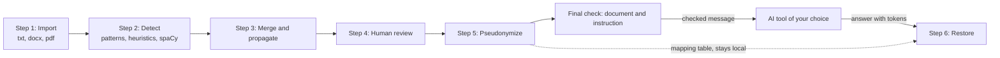

# HuisClos

Use generative AI on client files without breaching professional secrecy.

Lawyers want to ask ChatGPT, Claude or Mistral to summarize or draft from a client file.
Sending that file as it is discloses names, addresses and identifiers to a third party, which
professional secrecy forbids. HuisClos replaces these values with tokens on your computer,
lets you send only the tokenized text, and puts the real values back into the answer.

- [Live demo](https://huisclos.streamlit.app) (fictitious data only)
- Video: link added on submission day


## What HuisClos does

- Reads a pasted text or a .txt, .docx or text-based .pdf file.
- Detects persons, companies, addresses, emails, phone numbers, IBAN, social security numbers
  (NIR), SIREN, SIRET, birth dates, case numbers and labelled identifiers in French or English
  legal documents. Document language, interface language and token style are separate settings.
- Lets you review every detection: keep it, reject it, change its type, or add a missed value.
- Replaces each value with a consistent token, such as `[PERSONNE_1]` or `[SOCIETE_A]`.
- Reuses a case mapping table across documents and checks the exact outgoing message,
  including your instruction, for residual identifiers before copying, downloading or sending.
- Restores the real values in the answer of the AI tool, and reports unknown or altered tokens.
- Exports the checked message, the restored text (.txt and .docx) and the mapping table.

Gate G8 is **NO-GO for complete bilingual validation**: the historical challenge run failed,
and English Enhanced fails the precision margin fixed before testing. Standard remains the
default. English detection is experimental and needs careful manual review; English Enhanced
is not recommended. The local Enhanced option adds CamemBERT for French or GLiNER for English.
FIX2 located the challenge failure: pseudonymization stops when the same name, of the same
type, appears both in the text and inside a file name. A correction is proposed in
[results/fix2/report.md](results/fix2/report.md) and still needs an authorised session.
The [user guide](docs/USER_GUIDE.md#4-settings-in-the-left-column) describes the covered
FR/US/UK formats and their limits; a document language is not a nationality or jurisdiction.

## Quick start

You need Python 3.12 and an internet connection for the installation only. The step-by-step
version, written for non-specialists, is in the [user guide](docs/USER_GUIDE.md).

Windows (PowerShell):

```powershell
git clone https://github.com/Negan-san/huisclos.git
cd huisclos
python -m venv .venv
.venv\Scripts\python.exe -m pip install -r requirements.txt
.venv\Scripts\python.exe -m streamlit run streamlit_app.py --server.address localhost
```

macOS (Terminal):

```bash
git clone https://github.com/Negan-san/huisclos.git
cd huisclos
python3.12 -m venv .venv
.venv/bin/python -m pip install -r requirements.txt
.venv/bin/python -m streamlit run streamlit_app.py --server.address localhost
```

The application opens in your browser at http://localhost:8501. Press Ctrl+C in the terminal
to stop it. The address option limits access to this computer.

## How it works

1. **Import**: the text is read from the paste area or the uploaded file.
2. **Detect**: checksum-validated patterns (IBAN, NIR, SIREN, SIRET), regular expressions,
   name heuristics and the spaCy model of the document language (`fr_core_news_md` or
   `en_core_web_sm`, both 3.8.0) propose candidate values. Enhanced optionally adds a local
   neural model; see [local installation and model licences](docs/LOCAL_MODELS.md).
3. **Merge and propagate**: common words are excluded, overlaps are resolved, and every other
   mention of a detected value is found in the text.
4. **Human review**: you accept, reject, retype or add values in the Review step.
5. **Pseudonymize and check**: each masked value becomes a token; the mapping table links
   tokens to the real values and stays on your computer. The document and your instruction
   form one message. Resolve its alerts before export; edits revoke earlier checks and consent.
6. **Restore**: the answer of the AI tool is matched against the mapping table and the tokens
   are replaced by the real values.



## Historical G7 results

Measured on a fictitious corpus of French legal documents, with partial matching and micro
averages. The threshold was chosen on the development split; the test split was held out.
F2 weights recall more than precision, because a missed name is a breach of secrecy. The leak
rate is the share of reference characters left uncovered. Full table and definitions:
[results/summary.md](results/summary.md), and the Evaluation page of the application.

| Split | Configuration | Threshold | Precision | Recall | F2 | Leak rate | Exposed entities |
| --- | --- | ---: | ---: | ---: | ---: | ---: | ---: |
| dev | hybrid | 0.30 | 0.9904 | 1.0000 | 0.9981 | 0.0000 | 0 |
| test | patterns_only | 0.30 | 1.0000 | 1.0000 | 1.0000 | 0.0196 | 0 |
| test | ner_only | 0.30 | 0.9091 | 0.4301 | 0.4808 | 0.6945 | 51 |
| test | hybrid | 0.30 | 0.9789 | 1.0000 | 0.9957 | 0.0196 | 0 |
| test | hybrid_camembert | 0.30 | 0.9789 | 1.0000 | 0.9957 | 0.0196 | 0 |
| challenge | hybrid | 0.30 | 0.7921 | 0.8421 | 0.8316 | 0.1283 | 26 |
| challenge | hybrid_camembert | 0.30 | 0.7955 | 0.9211 | 0.8929 | 0.0969 | 12 |

`hybrid` is the Standard profile; French Enhanced uses `hybrid_camembert`.
Gate 7 measured 20 development, 6 test and 8 challenge documents. Challenge was written blind
after the detection rules were frozen. The saved reports include 95% document bootstrap
intervals; these do not account for corpus bias or threshold selection. The
[challenge comparison](results/challenge_comparison.md) records gate-5 and current results.

### Post-G7 development comparison

These A4 development observations were reproduced before G8, separately from the historical
G7 table and the new blind results below.

| Dev language | Profile | Fully covered entities | Leaked characters | Non-sensitive characters masked |
| --- | --- | ---: | ---: | ---: |
| French, 20 documents | Standard and Enhanced | 311/311 | 0/6701 | 7 |
| English, 8 documents | Standard | 124/136 | 105/2553 | 48 |
| English, 8 documents | Enhanced, GLiNER cutoff 0.70 | 126/136 | 63/2553 | 48 |

English Enhanced has a small point gain, with paired intervals including zero: no statistical
significance or universal accuracy is claimed. Its local CPU probes need about 2.8 GiB RSS;
the final check raises 29 alerts, 28 outside annotated references, while 10 entities remain
exposed. An alert alone masks nothing. French Enhanced adds no coverage on the saturated dev.
[LOCAL_MODELS.md](docs/LOCAL_MODELS.md) records versions, licences, costs and limitations.
### G8 blind results and open points

Eight new fictitious documents per language were measured once after the A4 freeze.
Main threshold: 0.30 in both languages; GLiNER cutoff: 0.70. No threshold was changed afterwards.

| Language | Profile | Partial precision | Fully covered entities | Leaked characters | Non-sensitive characters masked |
| --- | --- | ---: | ---: | ---: | ---: |
| French | Standard | 0.8922 | 95/105 | 139/2042 | 27 |
| French | Enhanced | 0.8824 | 96/105 | 130/2042 | 27 |
| English | Standard | 0.8349 | 78/100 | 235/2285 | 93 |
| English | Enhanced | 0.7000 | 88/100 | 115/2285 | 252 |

French corrections cover one more full entity and expose 32 fewer characters than each
corresponding G7 profile on these same new documents; paired intervals include zero.
French Enhanced meets the point criterion against Standard, with a small gain and no
established statistical difference. English Enhanced protects more characters but loses
13.49 precision points, exceeding the allowed two-point loss; it is not recommended.
Standard English leaves at least one annotated character exposed in all eight documents.
These counts exclude CUSTOM/LOCATION, reported separately with additional exposures.

The fourth historical French test measure covers 93/93 entities with no leaked character
in the eleven evaluated types; G7 leaked 37/1889. The historical challenge attempt failed
without a usable report and was not repeated. Its cause remains undetermined; a separate
synthetic test records a harness failure that discards predictions if the final check fails.
The French corrections and local workflow checks pass, but the complete gate remains NO-GO.
Keep English experimental, use Standard as the fallback and manually check every residual
identifier before sending. The UI Evaluation page still shows historical G7 reports.

[Full G8 report, intervals, costs and limitations](results/gate8/report.md),
[decision D-G8-1](docs/DECISIONS.md#d-g8-1-gate-bilingue-et-protection-complete).
No score guarantees anonymity or zero leakage; alerts alone mask nothing.

## Confidentiality

- **Local processing.** Detection, pseudonymization and restoration run on your computer. The
  application makes no network call; Streamlit usage statistics are switched off. The only
  exception is the optional Mistral connector, hidden unless you configure an API key, which
  sends exactly the checked document and instruction after an explicit confirmation.
- **Public demo: fictitious data only.** On the hosted demo, the text passes through the
  server of the host. Real client files must be processed with a local installation.
- **The mapping table is sensitive.** It links every token to a real identity. Keep it on
  your computer and never send it to an AI tool.
- **Pseudonymization is not anonymization** (GDPR, art. 4(5) and recital 26). Pseudonymized
  text is still personal data: the facts it contains can identify a client.

## Limits

- French and English have separate detection paths; G8 complete bilingual validation is
  NO-GO and English Enhanced is not recommended. English support remains experimental.
  Other languages and address formats have no dedicated coverage guarantee.
- No OCR: a PDF with no extractable text is refused. Mixed PDFs and unsupported Word
  structures can produce partial imports; compare the extracted text with the original.
- Detection misses values and masks some words by mistake. Human review is required.
- Places are not masked by default (the Place type is off), and indirect identifiers such as
  a job title or a rare event require human review.
- The evaluation corpus is small and fictitious; results on real files may be lower.
- The AI tool may change or invent tokens. HuisClos recognizes common alterations and lists
  unknown tokens, but you must check the restored text.

## Documentation

- [User guide](docs/USER_GUIDE.md): installation, workflow, settings, troubleshooting.
- [Local models](docs/LOCAL_MODELS.md): optional packages, pinned model files outside the
  repository, licences, development observations and fallback.
- Method report (METHOD_REPORT.md), architecture (ARCHITECTURE.md) and credits (CREDITS.md):
  added to `docs/` before submission.
- [Prompt log](docs/PROMPTS.md): the prompts given to the coding agents.
- [Deployment](docs/DEPLOYMENT.md), [decisions](docs/DECISIONS.md) (in French) and
  [contributions](docs/CONTRIBUTIONS.md).
- Developer commands (tests, lint, evaluation): [AGENTS.md](AGENTS.md), section 6.

## Course context

HuisClos is a group assignment for the Advanced AI Algorithms course (2026). All documents,
tests and examples in this repository are fictitious.

## Licence

MIT. See [LICENSE](LICENSE).
