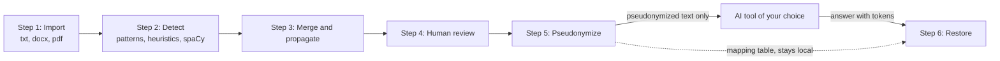

# HuisClos

Use generative AI on client files without breaching professional secrecy.

Lawyers want to ask ChatGPT, Claude or Mistral to summarize or draft from a client file.
Sending that file as it is discloses names, addresses and identifiers to a third party, which
professional secrecy forbids. HuisClos replaces these values with tokens on your computer,
lets you send only the tokenized text, and puts the real values back into the answer.

- Live demo (fictitious data only): URL added on submission day
- Video: link added on submission day


## What HuisClos does

- Reads a pasted text or a .txt, .docx or text-based .pdf file.
- Detects persons, companies, addresses, emails, phone numbers, IBAN, social security numbers
  (NIR), SIREN, SIRET, birth dates and case numbers in French legal documents.
- Lets you review every detection: keep it, reject it, change its type, or add a missed value.
- Replaces each value with a consistent token, such as `[PERSONNE_1]` or `[SOCIETE_A]`.
- Restores the real values in the answer of the AI tool, and reports unknown or altered tokens.
- Exports the pseudonymized text, the restored text (.txt and .docx) and the mapping table.

## Quick start

You need Python 3.12 and an internet connection for the installation only. The step-by-step
version, written for non-specialists, is in the [user guide](docs/USER_GUIDE.md).

Windows (PowerShell):

```powershell
git clone https://github.com/Negan-san/huisclos.git
cd huisclos
python -m venv .venv
.venv\Scripts\python.exe -m pip install -r requirements.txt
.venv\Scripts\python.exe -m streamlit run streamlit_app.py
```

macOS (Terminal):

```bash
git clone https://github.com/Negan-san/huisclos.git
cd huisclos
python3.12 -m venv .venv
.venv/bin/python -m pip install -r requirements.txt
.venv/bin/python -m streamlit run streamlit_app.py
```

The application opens in your browser at http://localhost:8501. Press Ctrl+C in the terminal
to stop it.

## How it works

1. **Import**: the text is read from the paste area or the uploaded file.
2. **Detect**: checksum-validated patterns (IBAN, NIR, SIREN, SIRET), regular expressions,
   name heuristics and the spaCy French model `fr_core_news_md` propose candidate values.
3. **Merge and propagate**: common words are excluded, overlaps are resolved, and every other
   mention of a detected value is found in the text.
4. **Human review**: you accept, reject, retype or add values in the Review step.
5. **Pseudonymize**: each masked value becomes a token; the mapping table links tokens to the
   real values and stays on your computer.
6. **Restore**: the answer of the AI tool is matched against the mapping table and the tokens
   are replaced by the real values.



## Key results

Measured on a fictitious corpus of French legal documents, with partial matching and micro
averages. The threshold was chosen on the development split; the test split was held out.
F2 weights recall more than precision, because a missed name is a breach of secrecy. The leak
rate is the share of reference characters left uncovered. Full table and definitions:
[results/summary.md](results/summary.md), and the Evaluation page of the application.

| Split | Configuration | Threshold | Precision | Recall | F2 | Leak rate | Exposed entities |
| --- | --- | ---: | ---: | ---: | ---: | ---: | ---: |
| dev | hybrid | 0.30 | 0.9648 | 1.0000 | 0.9928 | 0.0085 | 0 |
| test | patterns_only | 0.30 | 1.0000 | 1.0000 | 1.0000 | 0.0529 | 0 |
| test | ner_only | 0.30 | 0.9091 | 0.4301 | 0.4808 | 0.6993 | 51 |
| test | hybrid | 0.30 | 0.9789 | 1.0000 | 0.9957 | 0.0529 | 0 |
| test | hybrid_camembert | 0.30 | 0.9688 | 1.0000 | 0.9936 | 0.0529 | 0 |

`hybrid` is the configuration used by the application.

## Confidentiality

- **Local processing.** Detection, pseudonymization and restoration run on your computer. The
  application makes no network call; Streamlit usage statistics are switched off. The only
  exception is the optional Mistral connector, hidden unless you configure an API key, which
  sends the pseudonymized text after an explicit confirmation.
- **Public demo: fictitious data only.** On the hosted demo, the text passes through the
  server of the host. Real client files must be processed with a local installation.
- **The mapping table is sensitive.** It links every token to a real identity. Keep it on
  your computer and never send it to an AI tool.
- **Pseudonymization is not anonymization** (GDPR, art. 4(5) and recital 26). Pseudonymized
  text is still personal data: the facts it contains can identify a client.

## Limits

- French documents only; detection rules were written for French legal texts.
- No OCR: a scanned PDF is refused. Convert it to text first.
- Detection misses values and masks some words by mistake. Human review is required.
- Places are not masked by default (the Place type is off), and indirect identifiers such as
  a job title or a rare event are never detected.
- The evaluation corpus is small and fictitious; results on real files may be lower.
- The AI tool may change or invent tokens. HuisClos recognizes common alterations and lists
  unknown tokens, but you must check the restored text.

## Documentation

- [User guide](docs/USER_GUIDE.md): installation, workflow, settings, troubleshooting.
- Method report (METHOD_REPORT.md), architecture (ARCHITECTURE.md) and credits (CREDITS.md):
  added to `docs/` before submission.
- [Prompt log](docs/PROMPTS.md): the prompts given to the coding agents.
- [Deployment](docs/DEPLOYMENT.md), [decisions](docs/DECISIONS.md) (in French) and
  [contributions](docs/CONTRIBUTIONS.md).
- Developer commands (tests, lint, evaluation): [AGENTS.md](AGENTS.md), section 6.

## Course context

HuisClos is a group assignment for the Advanced AI Algorithms course (2026). All documents,
tests and examples in this repository are fictitious.

## Licence

MIT. See [LICENSE](LICENSE).
