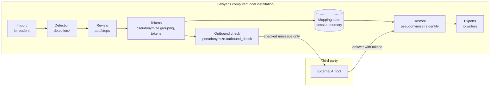

# HuisClos architecture

This page explains how HuisClos is built, for a reader who does not program. Technical terms
are defined in the glossary at the end. Decision identifiers (D-xx) refer to
[DECISIONS.md](DECISIONS.md), written in French.

## 1. The journey of one sentence

Take an invented French sentence:

> M. Octave Brunel, salarié de Ferlac SARL, a écrit depuis octave.brunel@example.com.

1. **Import.** The text is pasted, or read from a .txt, .docx or text-based .pdf file. The
   reader returns plain text and, for PDF and DOCX, a reading-quality note.
2. **Analysis view.** Invisible characters and typographic spaces are normalised in a copy;
   every position found in the copy is projected back onto the original text.
3. **Detection.** Several recognisers propose values with a score: the title rule sees
   "Octave Brunel" after "M." (0.80), the French spaCy model may also propose it as a person
   (0.85), the legal form "SARL" anchors the company "Ferlac SARL", and the email rule
   finds the address (0.95).
4. **Cleaning.** Excluded words (courts, institutions, common words) are removed; overlapping
   proposals are merged into one; company names are extended to their legal form; a later
   mention such as "M. Brunel" would be found by propagation.
5. **Review.** The lawyer sees each value highlighted with a colour and a written type,
   keeps, rejects or retypes it, and adds any missed value.
6. **Tokens.** Mentions of the same entity are grouped and replaced:

   > M. [PERSONNE_1], salarié de [SOCIETE_A], a écrit depuis [EMAIL_1].

   The title "M." stays visible by convention (D-09). The mapping table records that
   `[PERSONNE_1]` stands for "Octave Brunel".
7. **Outbound check.** The tokenised document and the lawyer's instruction are joined once
   into the exact message to send. Both parts are re-read for residual values. Any edit
   revokes the earlier check and confirmation.
8. **External AI tool.** The lawyer copies the checked message into the AI tool of their
   choice, or sends it through the optional Mistral connector after confirming.
9. **Restore.** The answer, still with tokens, is pasted back. HuisClos replaces each token
   with the real value, recognises common alterations such as `[personne_1]`, and lists
   unknown tokens.
10. **Export.** The checked message, the restored text (.txt, .docx) and the mapping table
    can be downloaded.

## 2. Overview diagram

## 3. Boundaries: local, cloud demo, AI tool

| Zone | What runs there | What it receives |
| --- | --- | --- |
| Local installation | Everything: reading, detection, review, tokens, check, restoration. Streamlit serves the page on `localhost` only; usage statistics are off. | The real document. |
| Public demo (cloud) | The same Standard code on the host's server. Enhanced profiles are refused there. | Fictitious data only: the text passes through the host's server (D-14). |
| External AI tool | The model chosen by the lawyer. | Only the checked message: tokenised document and instruction. |

The application makes no network call while it processes a document (D-11); a test blocks
sockets during the whole pipeline. The single exception is the Mistral connector: hidden
unless an API key is configured, it sends exactly the checked string after an explicit
confirmation (D-17, D-AF-A3-3). Installing packages or preparing optional models uses the
network, outside the application.

## 4. The mapping table, kept apart

The mapping table links every token to its real values and their positions. It is the
"additional information kept separately" of GDPR article 4(5), so:

- it lives in the session memory of the application (`st.session_state`), on the computer
  that runs it, is never written to disk by the application and is forgotten by Reset;
- it is never added to the outgoing message; a test inspects the HTTP body of the connector;
- it can be downloaded as `huisclos-<hash>.mapping.json`, a name that never contains the
  client's file name (D-S33-1), with a red warning;
- Git ignores `*.mapping.json`.

Uploading a table from an earlier document (case memory) keeps tokens stable across a case
(D-S24-2).

## 5. Module families

| Family | Paths | Input | Output |
| --- | --- | --- | --- |
| Entry point | `streamlit_app.py` | Browser request | Pages Pseudonymize, Method & limits, Evaluation (hidden) |
| Interface | `app/` (`state.py`, `sidebar.py`, `engine.py`, `fingerprints.py`, `steps/`, `components/`, `pages/`, `i18n/`, `assets/style.css`) | User actions | Screens, session state, messages in English or French |
| Shared contract | `src/huisclos/models.py`, `config.py`, `text_utils.py` | None | Entity types, sources, `Detection`, token style, `DetectionConfig`, profiles |
| Reading and writing | `src/huisclos/io/` (`readers.py`, `read_quality.py`, `writers.py`) | File bytes or text | Normalised text and quality note; .txt and .docx bytes |
| Rules | `detection/patterns.py`, `english_patterns.py`, `checksums.py`, `address_bounds.py`, `address_patterns.py`, `case_patterns.py`, `labeled_identifiers.py`, `person_heuristics.py` | Analysis view, document language | Scored candidates |
| Statistical models | `detection/ner.py` (spaCy), `camembert.py`, `gliner.py`, `windows.py`, `pii_labels.py`, `languages.py` | Text, language, local model files | Scored candidates, never downloaded |
| Cleaning | `detection/analysis_view.py`, `exclusions.py`, `merge.py`, `conflicts.py`, `organization_bounds.py`, `aliases.py`, `propagation.py` | All candidates | Sorted detections without overlap |
| Orchestration | `detection/pipeline.py`, function `detect(text, config, known)` | Text, configuration, known values | The list of `Detection` shown in Review |
| Pseudonymisation | `pseudonymize/grouping.py`, `tokens.py`, `mapping.py`, `case_memory.py` | Reviewed detections | Tokenised text, groups, mapping table |
| Checks | `pseudonymize/final_check.py`, `outbound_check.py` | Tokenised text, instruction, original text | Exact outgoing message, alerts, status |
| Restoration | `pseudonymize/reidentify.py`, function `restore` | Answer and table | Restored text, exact or tolerant mode, unknown tokens |
| Connector | `src/huisclos/llm/mistral_client.py`, `send_outbound` | Checked message, API key | Model answer or clear error |
| Evaluation | `src/huisclos/evaluation/`, `scripts/run_evaluation.py`, `scripts/evaluate_robustness.py` | Fictitious annotated corpus | Metrics, intervals, reports in `results/` |

The detection modules are under `src/huisclos/`.

## 6. Three independent settings

- **Document language** (French or English) chooses the rules, the spaCy model
  (`fr_core_news_md` or `en_core_web_sm`) and the exclusion lists. It says nothing about
  nationality or jurisdiction.
- **Interface language** (English or French) changes only the texts on screen.
- **Token style** (`[PERSONNE_1]` or `[PERSON_1]`) changes only the shape of the tokens. With
  a case table, the table's style prevails so that known entities keep their tokens.

## 7. Profiles and explicit fallback

| Profile | French document | English document |
| --- | --- | --- |
| Standard (default) | Rules, checksums, French spaCy model, propagation | Same with the English spaCy model |
| Enhanced (local only) | Standard plus CamemBERT | Standard plus GLiNER, experimental and not recommended |

Fallback is never silent. If the optional package or model files are missing or are not the
pinned revision, Import shows an error, nothing is downloaded and no other profile is used.
An old session value that asks for Enhanced on the public demo is set back to Standard with
a visible warning (D-AF-A3-1).

## 8. Stale states

Each result carries the fingerprint of what produced it (`app/fingerprints.py`):

- the detection fingerprint covers the text, every detection setting, the model identities
  and the case table;
- the review fingerprint covers the decisions per position, manual additions and token style.

If either changes, Import and Restore say that the result is out of date and send the user
back to the right step; no earlier decision is reused for new positions. A new
pseudonymisation first clears the earlier result, answer, restoration and check (D-FIX4-1).
The send confirmation covers the exact message and check settings; any edit revokes it.

## 9. Error handling

- **Reading**: unsupported, empty or too large files, and PDFs without text, return a stable
  code and a plain message; nothing is detected.
- **Models**: an unavailable profile or model raises a clear error at Import, without
  download (`ModelUnavailableError`).
- **Substitution**: if token assignment fails, Review shows a message without quoting the
  value; nothing is produced or sent (D-FIX3-3).
- **Check**: any failure gives the status "unavailable", never a success; only "clear" or
  "reviewed" allows a message presented as ready.
- **Tables**: a table file that is too large, not UTF-8 or invalid is refused; the table
  already loaded stays in use.
- **Connector**: network or service errors are shown; contents are never logged.

## 10. Where to change what after the freeze

| Need | Where | Condition |
| --- | --- | --- |
| Wording on screen | `app/i18n/` (one key per text, English required) | Interface tests |
| Colours, spacing | `app/assets/style.css` and `.streamlit/config.toml` | Contrast tests |
| Excluded words | `data/exclusions_fr.txt`, `data/exclusions_en.txt` | Changes detection: new dev measure |
| Detection rules or threshold | `src/huisclos/detection/`, `results/threshold.json` | Published figures no longer describe the code; dev measure, then a gate |
| Optional models | `scripts/prepare_local_models.py`, [LOCAL_MODELS.md](LOCAL_MODELS.md) | Pinned revisions and hashes |
| Token shape | `src/huisclos/models.py`, `pseudonymize/` | Restoration tests; old tables must stay readable |
| Documentation | `docs/`, `README.md` | `scripts/check_style.py` |

After the freeze of 28 October 2026, only corrections are expected. Any change to detection
voids the claim that the published results describe the current code.

## 11. Glossary

- **NER** (named entity recognition): a statistical model that labels names of people,
  organisations or places in a text.
- **Regex** (regular expression): a pattern describing the shape of a value, such as an email.
- **Key**: control digits computed from the other digits of an identifier, which detect typing
  errors.
- **Luhn**: the key used by SIREN and SIRET numbers.
- **Modulo 97**: the key used by IBAN and NIR numbers.
- **Token**: the placeholder, such as `[PERSONNE_1]`, that replaces a value.
- **Pseudonymisation**: replacing identifying values so that the text can only be linked back
  with separate information, here the mapping table. The data remain personal data.
- **Anonymisation**: irreversible removal of any link to a person. HuisClos does not do this.
- **Precision**: the share of detections that are correct.
- **Recall**: the share of sensitive values that are detected.
- **F1 / F2**: combined scores of precision and recall; F1 weighs them equally, F2 counts
  recall twice as much.
- **Leak**: sensitive characters left visible after pseudonymisation.
- **Full coverage**: a value whose every character is masked.
- **Over-masking**: masked characters that were not sensitive.
- **Threshold**: the minimum score a detection needs to be kept, 0.30 by default.
- **Transfer**: reusing a model trained elsewhere on a new task without retraining it.
- **Hybrid**: combining rules, keys and statistical models.
- **Review**: the step where the human validates every detection.
- **Streamlit**: the Python library that draws the web page.
- **Presidio**: Microsoft's open-source library that runs the recognisers and replaces values.
- **spaCy**: the open-source language library that provides the French and English models.
- **Bootstrap**: re-drawing documents at random, many times, to estimate how much a score
  could vary.
