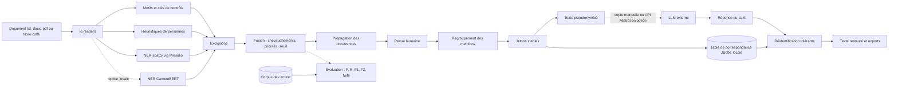

# HuisClos : master plan

Export Markdown du document « HuisClos : master plan » (claude.ai), cinq onglets mis bout à bout : Plan, Fiches 0-2, Fiches 3-5, Fiches 6-7, Annexes. Le document en ligne fait foi en cas d'écart.


<!-- Onglet : Plan -->

# HuisClos : master plan d'exécution (devoir AAA)

27 octobre 2026 · Graciano Nascimento

## 1. Synthèse

HuisClos peut être déposé le jeudi 29 octobre avant 21h59 : 28 sessions d'agents (dont 7 gates) sur deux pistes parallèles, gel des fonctionnalités le mercredi 28 à 23h59, vidéo finale le jeudi 29 à 16h00.

1. Produit : application Streamlit qui détecte localement les données identifiantes d'un dossier juridique français, les fait valider par l'utilisateur, les remplace par des jetons stables, puis restaure les vraies valeurs dans la réponse du LLM.
2. Détection hybride : motifs avec clés de contrôle (NIR, SIREN, SIRET, IBAN), heuristiques de personnes, NER spaCy via Presidio, propagation des occurrences, liste d'exclusions.
3. Preuve de qualité : précision, rappel, F1 et F2 par type, taux de fuite, comparaison motifs / NER / hybride, jeu de test réservé que les agents ne lisent jamais.
4. Traitement local démontré par un test qui bloque tout accès réseau pendant le pipeline complet.
5. Organisation : Graciano seul pilote Claude Code (piste A : Sonnet par défaut, Opus pour S13, S21, S22) et Codex (piste B : motifs, entrées-sorties, évaluation, toutes les gates).
6. Le quota Claude est la contrainte principale : chaque session Claude a une alternative Codex, et le corpus, la recherche et les brouillons passent par ChatGPT.
7. Coupes appliquées dès le plan : GLiNER et Faker. Coupes conditionnelles, dans l'ordre : option vidéo S6A (Remotion, avatar), Mistral, CamemBERT, export .docx, bascule FR/EN, entrée PDF.
8. Livrables : dépôt GitHub public, application en ligne (démo fictive), vidéo de 4 min 45, README, guide utilisateur, rapport de méthode, CREDITS.md, PROMPTS.md.
9. Les fiches de session, avec leurs prompts prêts à copier, sont dans les onglets suivants ; les fichiers de démarrage du dépôt sont dans l'onglet Annexes.

## 2. Hypothèses retenues

Quatorze hypothèses comblent les champs vides ou ambigus ; une seule change l'architecture du travail : Graciano exécute seul, avec deux agents en parallèle.

| N° | Paramètre | Hypothèse retenue | Conséquence |
| --- | --- | --- | --- |
| H-01 | Début effectif | Mardi 27 octobre, 14h00 (Paris) | Tout le calendrier glisse d'autant si le départ change ; les durées restent valables |
| H-02 | Équipe | « Tout le travail sera fait par moi » : Graciano exécute seul ; les autres membres ne sont pas sollicités (relecture facultative) | Un seul humain supervise deux agents ; les pistes humaines s'enchaînent entre deux lancements de session |
| H-03 | Disponibilité | Mardi 14h-23h30, mercredi 8h-24h, jeudi 8h-22h, repas déduits | Environ 34 h utiles |
| H-04 | Quota | Offre Claude inconnue ; Claude Code affiche l'usage du plan par `/usage` (fenêtre de 5 h et fenêtre de 7 jours) ; Codex et ChatGPT relèvent d'un abonnement OpenAI distinct | Opus limité à S13, S21, S22 ; corpus, recherche et brouillons via ChatGPT |
| H-05 | Postes | Windows 11 avec VS Code et Git for Windows (poste principal) ; le Mac sert de second poste de test d'installation | Commandes données en PowerShell et en bash |
| H-06 | Python | 3.12 : version par défaut de Streamlit Community Cloud et supportée par Presidio et spaCy ; repli 3.11 | Même version en local et en ligne |
| H-07 | Comptes | Dépôt GitHub public `huisclos` créé en H0 ; compte Streamlit Community Cloud gratuit (connexion GitHub) créé en S51 ; aucune clé payante | Coût nul |
| H-08 | Mistral | Option via l'offre gratuite « Experiment » (téléphone vérifié, sans carte) ; les requêtes de cette offre peuvent servir à entraîner les modèles de Mistral | Désactivée par défaut, données fictives uniquement, avertissement dans l'appli |
| H-09 | Langues | Interface, vidéo, README, guide, rapport et crédits en anglais ; AGENTS.md, CLAUDE.md, journaux, commentaires de code en français ; corpus et cas de démo en français ; jetons en français par défaut (`[PERSONNE_1]`) | Les correcteurs lisent tous les livrables en anglais |
| H-10 | Date limite | Jeudi 29 octobre, 23h59 (Paris) ; la consigne indique « 297th » par coquille | Dépôt visé à 21h00, au plus tard 21h59 |
| H-11 | Concepts du cours | Liste du prompt retenue (coût asymétrique, humain dans la boucle, IA hybride, transfert, mesure) ; à confirmer avec les notes du cours pendant H2 | Libellés ajustables dans l'onglet Method et le rapport |
| H-12 | Hébergement | L'application en ligne sert à la démonstration avec données fictives ; un usage réel passe par l'installation locale | Bandeau « Public demo » dans l'appli en ligne |
| H-13 | Codex | Codex tourne dans son bac à sable par défaut, sans accès réseau | Toute installation de paquet est faite par l'humain ou par Claude Code |
| H-14 | Correcteurs | Les pairs exécutent au mieux l'appli en ligne et lisent le README | Le README et l'appli en ligne portent la démonstration, l'installation locale reste documentée |

## 3. Bilan de charge

Le plan tient avec environ 8 h de marge humaine (23 %), à une condition : faire tourner Claude Code et Codex en parallèle sur des fichiers distincts. Le goulot n'est pas le temps des agents mais l'attention d'un seul superviseur et le quota Claude.

| Poste | Heures | Détail |
| --- | --- | --- |
| Piste A, Claude Code | 16,0 | Sonnet 10,25 h (S01, S12, S31, S32, S33, S51, S52, S61, S71) ; Opus 4,25 h (S13, S21, S22) ; réserve de corrections 1,5 h |
| Piste B, Codex | 14,25 | Développement 6,5 h (S11, S41, S23, S42, S43, S72) ; gates 4,5 h (G0 à G5, GF) ; options 3,25 h (S34, S44, S6A) |
| Humain, charge | 26,25 | Amorçage 0,7 ; corpus 3,0 ; recherche 2,0 ; supervision des sessions 4,5 ; recettes des gates 3,0 ; déploiement et second poste 1,0 ; vidéo 8,25 ; option vidéo S6A 0,75 ; relecture de la documentation 1,5 ; dépôt 1,0 ; journal des contributions 0,5 |
| Humain, disponible | 34,25 | Mardi 8,75 ; mercredi 14,0 ; jeudi 11,5 |
| Marge humaine | 8,0 | Absorbe une gate ratée par jour ou une session à refaire |

Les durées d'agents sont des cibles de dimensionnement, pas des mesures : une session qui dépasse sa cible de plus de 50 % s'arrête proprement (état consigné dans PROGRESS.md) et reprend dans une conversation neuve.

### Règles de quota Claude

1. Opus seulement pour S13, S21, S22 et pour une correction de logique transversale demandée par une gate ; lancer ces sessions en début de fenêtre de 5 h.
2. Vérifier `/usage` avant chaque session Claude (la commande ne s'exécute pas pendant qu'un agent travaille).
3. Seuil d'alerte : au-delà d'environ 70 % de la fenêtre hebdomadaire avant mercredi midi, basculer S32, S33 et S52 sur Codex avec le même prompt.
4. Sessions serrées : fichiers listés, aucune exploration du dépôt, aucun sous-agent, `/clear` entre deux sessions.
5. Corpus (H1), recherche (H2) et premiers jets non techniques : ChatGPT, pour épargner Claude.
6. N'exécuter aucune session dans cette conversation de planification : chaque session part d'un contexte neuf dans VS Code.

### Ligne de coupe

- **Appliquée dès le plan** : GLiNER (types sur mesure, bénéfice faible face à la saisie manuelle) et Faker (pseudonymes réalistes, qui compliquent la réidentification et brouillent la démo).
- **Conditionnelle**, déclenchée par une gate en retard de plus d'1 h ou un quota Claude au-delà de 80 %, dans cet ordre : option vidéo S6A (Remotion, avatar), connecteur Mistral, CamemBERT (option locale S44), export .docx, bascule FR/EN, entrée PDF. CamemBERT est inséré après Mistral car il nourrit le critère « au-delà du cours » mais exige l'installation de PyTorch.
- **Jamais coupé** : détection hybride, revue humaine, jetons cohérents, réidentification, évaluation chiffrée, application en ligne, vidéo, guide utilisateur.

## 4. Matrice critère, preuve, phase

Chaque point de la grille (100) a une preuve visible par un correcteur pressé ; les exigences hors grille de la consigne sont listées en bas du tableau.

| Critère (points) | Preuve dans les livrables | Sessions |
| --- | --- | --- |
| Qualité de l'application (20) | Parcours complet Import, Review, Restore sans erreur sur l'appli en ligne ; suite de tests verte ; captures d'écran du README | S11 à S33, G3 |
| Pertinence marché (10) | Problème du secret professionnel et du RGPD, recommandation du CNB, tableau concurrentiel, cible cabinets français et services RH | H2, S71 (sections 1 à 3), vidéo 0:00-1:05 et 3:45-4:20 |
| Reproductibilité (10) | Dépôt public, versions épinglées, installation testée sur un second poste, évaluation déterministe en une commande, appli en ligne | S01, S51, S52, G5 |
| Concepts du cours (10) | Seuil choisi par F2 (coût asymétrique), écran de revue (humain dans la boucle), pipeline règles plus NER (IA hybride), modèles pré-entraînés (transfert), onglet Evaluation (mesure) | S31, S43, S71, vidéo 3:00-3:45 |
| Clarté (10) | Script en sept blocs titrés, sous-titres, intertitres à l'écran | S61, H6 |
| Concision (5) | Budget de 650 mots environ, aucune redite entre démo et « sous le capot » | S61, G6 |
| Délivrance (5) | Voix humaine, répétition chronométrée, démo sans temps mort | H6 |
| Qualité de production (5) | Export 1080p, son sans saturation, suppression du bruit, cadrage constant | H6, G6 |
| Respect de la durée (5) | Cible 4:45 ; fenêtre acceptée 4:30 à 5:30 (5 min plus ou moins 10 %) ; contrôle bloquant en G6 | S61, G6 |
| Pertinence des informations d'appui (5) | README et rapport construits autour du parcours montré dans la vidéo | S52, S71 |
| Profondeur de la recherche (5) | RESEARCH.md sourcé : textes, guide du CNB, CJUE C-413/23 P, lignes directrices 01/2025 du CEPD, concurrents, méthode d'évaluation | H2, S71 |
| Qualité de la documentation (10) | README, USER\_GUIDE, METHOD\_REPORT, ARCHITECTURE avec glossaire, CREDITS, PROMPTS | S52, S71, S72, GF |
| Hors grille : au-delà du cours | NER par transformeurs (option évaluée), regroupement des mentions, réidentification tolérante, comparaison chiffrée de configurations | S13, S21, S22, S42, S44 |
| Hors grille : prompts et citations | PROMPTS.md (journal de toutes les sessions et outils), CREDITS.md (paquets, modèles, données, licences) | S72 |
| Hors grille : nom accrocheur et valeur | « HuisClos » expliqué à l'écran ; valeur si l'usage se généralise, chiffres sourcés uniquement | S61, S71 |

## 5. Architecture

Le pipeline sépare détection, décision humaine et substitution : chaque étape a son module, son propriétaire et ses tests, ce qui permet à deux agents de coder en parallèle sans se croiser.

### 5.1 Pipeline



Seules deux flèches sortent de la machine, toutes deux en pointillé et déclenchées par l'utilisateur : la copie vers le LLM et l'appel facultatif à Mistral. La table de correspondance ne quitte jamais le poste.

### 5.2 Pile technique justifiée

| Composant | Choix | Raison | Statut |
| --- | --- | --- | --- |
| Langage | Python 3.12 | Version par défaut de Streamlit Community Cloud ; Presidio 2.2.36x et spaCy 3.8 compatibles | Vérifié (doc Streamlit, notes de version Presidio) |
| Interface | Streamlit, version épinglée en S01 | Navigation multipage, `st.data_editor` pour la revue, `streamlit.testing.v1.AppTest` pour tester sans navigateur, hébergement gratuit | Hébergement vérifié ; signatures à lire dans le code installé |
| Orchestration de la détection | presidio-analyzer | Registre de reconnaisseurs, moteur NLP spaCy, API unique ; dépend de tldextract, à neutraliser (appel réseau possible) | Vérifié (dépendances publiées) |
| Substitution | presidio-anonymizer avec opérateur personnalisé | Réutilise l'outil existant ; repli sur un remplaçant interne si l'API gêne la restauration exacte | À vérifier en S21 |
| NER | spaCy `fr_core_news_md` | Modèle français pré-entraîné (apprentissage par transfert), taille compatible avec la mémoire du cloud ; `lg` non retenu pour la même raison | Taille et licence à lire dans `meta.json` en S01 |
| NER en option | `Jean-Baptiste/camembert-ner` | Transformeur français, scores probabilistes qui rendent le seuil plus fin ; exige PyTorch, donc local uniquement | À mesurer en S44 |
| Clés de contrôle | Code propre (Luhn, clé NIR, mod 97) ; python-stdnum comme oracle de test | Explicable en commentaires français ; vérification indépendante | python-stdnum à vérifier à l'installation |
| Lecture de documents | python-docx, pypdf | Texte natif ; en-têtes et pieds de page des .docx inclus (coordonnées des cabinets) | À vérifier en S23 |
| Données et graphiques | pandas, Altair (dépendance de Streamlit) | Tableaux et graphiques de l'onglet Evaluation | Aucun point ouvert |
| Qualité | pytest, ruff (règles E, F, W, I, B, UP, ERA, D1), `scripts/check_style.py` | Contrôles automatiques à chaque gate | Aucun point ouvert |
| Hébergement | Dépôt GitHub public et Streamlit Community Cloud | Gratuit ; mémoire 690 Mo à 2,7 Go (documentation officielle, chiffres de février 2024) ; mise en veille après 12 h sans trafic ; version de Python choisie au déploiement seulement | Vérifié |
| LLM en option | API Mistral appelée avec `requests` | Pas de SDK supplémentaire ; désactivée par défaut | Offre gratuite vérifiée ; nom du modèle à vérifier en S34 |

Points d'attention vérifiés : Streamlit Community Cloud ignore `runtime.txt` et fixe Python dans les réglages avancés du déploiement ; changer de version impose de supprimer puis redéployer l'appli. Des utilisateurs signalent en 2026 un forçage vers Python 3.14 : Presidio 2.2.363 accepte 3.14 en évitant spaCy 3.8.14, ce qui sert de repli.

### 5.3 Arborescence du dépôt

```text
huisclos/
  AGENTS.md                      source unique de vérité des agents
  CLAUDE.md                      @AGENTS.md puis consignes propres à Claude
  README.md                      (anglais) pitch, démo, installation, résultats
  LICENSE                        MIT (code) ; corpus sous CC BY 4.0
  streamlit_app.py               point d'entrée, navigation, bandeau de démo
  requirements.txt               dépendances épinglées du cloud, sans torch
  requirements-dev.txt           -r requirements.txt + pytest, ruff, python-stdnum, fpdf2, psutil, pip-licenses
  requirements-transformers.txt  option CamemBERT, installation locale
  pyproject.toml                 ruff et pytest (pythonpath = src et racine)
  .streamlit/config.toml         thème, maxUploadSize = 5, gatherUsageStats = false
  .gitignore  .gitattributes
  app/
    state.py  sidebar.py  ui_common.py
    components/highlight.py
    steps/import_step.py  review_step.py  restore_step.py
    pages/workflow.py  evaluation.py  method.py
    i18n/__init__.py  common.py  workflow.py  evaluation.py  method.py
    assets/style.css
  src/huisclos/
    models.py  config.py  text_utils.py
    detection/checksums.py  patterns.py  person_heuristics.py  ner.py  camembert.py
              exclusions.py  merge.py  propagation.py  pipeline.py
    pseudonymize/grouping.py  tokens.py  mapping.py  reidentify.py
    io/readers.py  writers.py
    evaluation/synthetic_ids.py  corpus.py  metrics.py  run.py
    llm/mistral_client.py
  data/exclusions_fr.txt  data/samples/demo_case_fr.txt
  corpus/README.md  corpus/source/*.md  corpus/dev.jsonl  corpus/test.jsonl
  results/results.json  metrics_by_type.csv  threshold_sweep.csv  threshold.json  summary.md
  scripts/check_style.py  banned_phrases.txt  build_corpus.py  run_evaluation.py
          detect_cli.py  roundtrip_cli.py  measure_memory.py
  tests/conftest.py (blocage réseau)  tests/fixtures/  tests/test_*.py
  docs/MASTER_PLAN.md  PROGRESS.md  DECISIONS.md  PROMPTS.md  CONTRIBUTIONS.md
       RESEARCH.md  USER_GUIDE.md  ARCHITECTURE.md  METHOD_REPORT.md  CREDITS.md
       prompts/  screenshots/  video/
```

Le code métier vit dans `src/huisclos/` sans packaging : pytest le trouve par `pythonpath`, et `streamlit_app.py` ajoute `src/` au chemin d'import, ce qui marche à l'identique en local et sur le cloud.

### 5.4 Modules et propriétaires

Un fichier n'a qu'un propriétaire à la fois ; une session ne modifie que les fichiers de sa fiche.

| Module | Responsabilité | Session | Piste |
| --- | --- | --- | --- |
| `models.py` | Types d'entités, sources, `Detection`, libellés de jetons | S01, évolutions en S13 et S21 | A |
| `detection/checksums.py` | Luhn, clé NIR (Corse 2A, 2B), mod 97 IBAN, exception La Poste | S11 | B |
| `detection/patterns.py` | Reconnaisseurs Presidio à motifs, barème, contexte | S11 | B |
| `evaluation/synthetic_ids.py` | Générateurs d'identifiants fictifs valides ou invalides | S11 | B |
| `detection/person_heuristics.py` | Civilité + nom, Prénom NOM, NOM Prénom | S12 | A |
| `detection/ner.py` | Moteur spaCy français pour Presidio, reconnaisseur NER | S12 | A |
| `detection/exclusions.py`, `data/exclusions_fr.txt` | Juridictions, institutions, textes, acronymes | S12 | A |
| `config.py`, `detection/merge.py`, `propagation.py`, `pipeline.py` | Configuration, arbitrage, propagation, point d'entrée `detect()` | S13 | A |
| `pseudonymize/grouping.py`, `tokens.py`, `mapping.py` | Regroupement des mentions, jetons, table JSON | S21 | A |
| `pseudonymize/reidentify.py` | Restauration exacte et tolérante | S22 | A |
| `io/readers.py`, `io/writers.py` | Lecture et export de documents | S23 | B |
| `evaluation/corpus.py`, `scripts/build_corpus.py` | Format, construction et validation du corpus | S41 | B |
| `evaluation/metrics.py`, `run.py`, `scripts/run_evaluation.py` | Métriques, comparaison, balayage du seuil | S42 | B |
| `detection/camembert.py` | Option NER transformeur | S44 | B |
| `app/` hors évaluation | Interface | S31, S32, S33 | A |
| `app/pages/evaluation.py`, `app/i18n/evaluation.py` | Onglet Evaluation | S43 | B |
| `llm/mistral_client.py`, chaînes FR | Options | S34 | B |

### 5.5 Contrats d'interface

Ces signatures sont figées par S01 et S13 ; elles permettent à S11 et S12 de travailler en parallèle, et à S23 et S42 d'avancer sans attendre l'interface.

```python
# src/huisclos/models.py (créé en S01 ; seule la piste A le modifie)
class EntityType(str, Enum):
    PERSON = "PERSON"; ORGANIZATION = "ORGANIZATION"; ADDRESS = "ADDRESS"
    EMAIL = "EMAIL"; PHONE = "PHONE"; IBAN = "IBAN"; NIR = "NIR"
    SIREN = "SIREN"; SIRET = "SIRET"; BIRTH_DATE = "BIRTH_DATE"
    CASE_NUMBER = "CASE_NUMBER"; LOCATION = "LOCATION"; CUSTOM = "CUSTOM"

class Source(str, Enum):
    CHECKSUM = "checksum"; PATTERN = "pattern"; HEURISTIC = "heuristic"
    NER_SPACY = "ner_spacy"; NER_CAMEMBERT = "ner_camembert"
    PROPAGATION = "propagation"; MANUAL = "manual"

@dataclass(frozen=True)
class Detection:
    start: int              # premier caractère
    end: int                # position après le dernier caractère
    entity_type: EntityType
    score: float            # confiance entre 0 et 1 (barème 5.7)
    source: Source
    text: str               # égal à document[start:end]

TOKEN_LABELS: dict[EntityType, tuple[str, str]]   # (libellé FR, libellé EN)
LETTER_INDEXED: frozenset[EntityType]             # {ORGANIZATION}
DEFAULT_ENABLED_TYPES: frozenset[EntityType]      # tous sauf LOCATION

# Signatures publiques (session propriétaire)
build_pattern_recognizers() -> list[EntityRecognizer]                     # S11
build_person_recognizers() -> list[EntityRecognizer]                      # S12
build_nlp_engine(model_name: str = "fr_core_news_md") -> NlpEngine        # S12
build_ner_recognizers() -> list[EntityRecognizer]                         # S12
load_exclusions(path: Path | None = None) -> ExclusionList                # S12
DetectionConfig ; PRESETS: dict[str, DetectionConfig] ; default_threshold() -> float  # S13
detect(text: str, config: DetectionConfig) -> list[Detection]             # S13
group_mentions(text: str, detections: list[Detection]) -> list[EntityGroup]          # S21
pseudonymize(text: str, detections: list[Detection], style: TokenStyle) -> PseudonymizationResult  # S21
Mapping.to_json() -> str ; Mapping.from_json(raw: str) -> Mapping         # S21
restore(text: str, mapping: Mapping, occurrences: list[Occurrence] | None = None) -> RestoreResult  # S22
read_document(filename: str, data: bytes) -> ReadResult                   # S23
to_txt_bytes(text: str) -> bytes ; to_docx_bytes(text: str, title: str) -> bytes     # S23
load_corpus(path: Path) -> list[CorpusDocument]                           # S41
evaluate_documents(docs: list[CorpusDocument], config: DetectionConfig) -> EvaluationReport  # S42
```

### 5.6 Jetons et conventions de span

| Type interne | Jeton FR (défaut) | Jeton EN (option) |
| --- | --- | --- |
| PERSON | `[PERSONNE_1]` | `[PERSON_1]` |
| ORGANIZATION | `[SOCIETE_A]` (puis B, ..., Z, AA) | `[COMPANY_A]` |
| ADDRESS | `[ADRESSE_1]` | `[ADDRESS_1]` |
| EMAIL | `[EMAIL_1]` | `[EMAIL_1]` |
| PHONE | `[TELEPHONE_1]` | `[PHONE_1]` |
| IBAN, NIR, SIREN, SIRET | `[IBAN_1]`, `[NIR_1]`, `[SIREN_1]`, `[SIRET_1]` | identiques |
| BIRTH\_DATE | `[DATE_NAISSANCE_1]` | `[BIRTH_DATE_1]` |
| CASE\_NUMBER | `[DOSSIER_1]` | `[CASE_1]` |
| LOCATION (désactivé par défaut) | `[LIEU_1]` | `[PLACE_1]` |
| CUSTOM (ajout manuel) | `[AUTRE_1]` | `[OTHER_1]` |

- La civilité reste hors du span : « M. \[PERSONNE\_1\] » garde le genre grammatical utile au LLM ; la fuite résiduelle est assumée et documentée.
- Les libellés restent hors du span : « né le », « RG n° », « N° Portalis », « SIRET », « IBAN ».
- Le span d'une société inclut sa forme juridique accolée (« Atelier Verlaine SAS ») ; « la société » reste en clair.
- Une adresse forme un seul span, du numéro de voie à la ville, saut de ligne et CEDEX compris.
- Après fusion, aucun span ne chevauche un autre.

### 5.7 Barème de confiance

Le seuil n'a de sens que si les scores varient : ce barème les rend explicables, et le seuil retenu sort de l'évaluation (F2 maximal sur dev).

| Détection | Score |
| --- | --- |
| Identifiant à clé valide avec contexte (NIR, IBAN, SIREN ou SIRET près de son libellé) ; ajout manuel | 1,00 |
| E-mail | 0,95 |
| Numéro de dossier après « RG » ou « Portalis » ; date après un contexte de naissance | 0,90 |
| SIRET à clé valide sans contexte | 0,85 |
| NER spaCy (score fixe attribué par Presidio, valeur à lire dans le code installé) | 0,85 |
| Civilité suivie d'un nom | 0,80 |
| Téléphone au format français (0,90 avec « tél. », « portable », « mobile » à proximité) | 0,75 |
| SIREN à clé valide sans contexte ; Prénom NOM ou NOM Prénom ; adresse complète | 0,70 |
| Voie sans code postal | 0,55 |
| Code postal et ville seuls | 0,45 |
| NIR ou IBAN au format valide mais à clé fausse (probable faute de frappe, donc sensible) | 0,40 |
| Propagation d'une entité retenue | Score de l'entité d'origine |

Seuil par défaut : 0,40 jusqu'à la gate 4, puis la valeur écrite dans `results/threshold.json`.

## 6. Organisation des agents

Deux pistes, un superviseur : Claude Code (piste A) porte la logique transversale et l'interface, Codex (piste B) porte les modules autonomes, l'évaluation et tous les contrôles ; les deux ne se rejoignent qu'aux fusions planifiées.

### 6.1 Choix du modèle

| Travail | Modèle | Justification | Sessions |
| --- | --- | --- | --- |
| Logique transversale : fusion, cohérence des jetons, réidentification | Opus 5.5 High | Les cas limites s'y propagent à tout le pipeline ; c'est là que le surcoût en quota rapporte | S13, S21, S22, corrections de gate sur ces modules |
| Spécification claire : interface, documentation, déploiement, NER | Sonnet 5.5 High | La fiche fixe le comportement attendu ; meilleur rapport qualité-quota côté Claude | S01, S12, S31, S32, S33, S51, S52, S61, S71 |
| Modules algorithmiques autonomes sur fichiers distincts | Codex, GPT 6.1 Sol High | Quota séparé, travail parallèle sans conflit, résultats faciles à vérifier par les tests | S11, S23, S41, S42, S43, S44, S34, S6A, S72 |
| Contrôle et revue croisée aux gates | Codex, GPT 6.1 Sol High | Un modèle d'une autre famille repère d'autres erreurs que l'auteur ; n'entame pas le quota Claude | G0 à G5, GF |
| Méthodologie d'évaluation | Décidée dans ce plan (fiche S42) | Une fois la méthode fixée ici, son implémentation devient une spécification claire | S42 |

### 6.2 Lancer une session

**Claude Code (piste A, dossier `huisclos`)**

1. Dans le panneau Claude Code de VS Code : `/clear`, puis `/model` pour choisir le modèle de la fiche et l'effort High.
2. `/usage` pour vérifier le quota avant de lancer.
3. Coller le prompt de la fiche tel quel, puis passer à une piste humaine.
4. Au retour : lire le compte rendu de cinq lignes, contrôler `git log -1 --stat`.

**Codex (piste B, dossier `huisclos-b`, seconde fenêtre VS Code)**

1. Dans `huisclos-b` : `git merge dev`.
2. Nouvelle conversation, modèle GPT 6.1 Sol, effort High, mode agent.
3. Coller le prompt de la fiche ; Codex lit AGENTS.md de lui-même.
4. En fin de session : fusion dans `dev` (6.3).

**Particularités Windows (vérifiées)** : Claude Code passe par Git Bash quand Git for Windows est installé, sinon par PowerShell ; si l'extension ne trouve pas Git Bash, définir `CLAUDE_CODE_GIT_BASH_PATH` (par exemple `C:\Program Files\Git\bin\bash.exe`). Codex tourne en natif sous Windows avec son propre bac à sable, sans réseau par défaut, ou via WSL. Si le bac à sable bloque, la piste B passe sur le Mac (clone séparé, branche `lane-b` poussée sur GitHub).

### 6.3 Git, branches et worktrees

| Branche | Dossier | Qui écrit | Règle |
| --- | --- | --- | --- |
| `main` | GitHub, déployée par Streamlit | Personne directement | Reçoit `dev` en avance rapide après une gate GO, puis le tag `gate-N` |
| `dev` | `huisclos` | Claude Code et les fusions | Intègre `lane-b` aux fusions planifiées |
| `lane-b` | `huisclos-b` (worktree) | Codex | Se resynchronise sur `dev` avant chaque session |

```powershell
# Une fois, en H0 (dossier huisclos, main déjà poussée)
git switch -c dev; git push -u origin dev
git worktree add ..\huisclos-b -b lane-b

# Avant chaque session Codex (dossier huisclos-b)
git merge dev

# Après chaque session Codex (dossier huisclos)
git merge lane-b; python -m pytest -q

# Après une gate GO (dossier huisclos), exemple pour la gate 1
git switch main; git merge --ff-only dev; git tag gate-1; git push origin main --tags; git switch dev
```

Les deux dossiers partagent l'environnement virtuel de `huisclos` : dans `huisclos-b`, l'interpréteur est `..\huisclos\.venv\Scripts\python.exe` (Windows) ou `../huisclos/.venv/bin/python` (macOS). Un commit par session, message en français : « S11 : validateurs et reconnaisseurs à motifs ».

### 6.4 Gates

1. Une gate = une session Codex de contrôle (prompt dans la fiche), puis une recette humaine de 10 à 20 minutes.
2. Le contrôleur corrige les écarts simples dans la même session, en trois cycles au plus (corriger, relancer tous les contrôles).
3. Un écart sur la fusion, les jetons ou la restauration part en session de correction Opus ciblée (prompt type dans la fiche G1).
4. GO : l'humain pose le tag `gate-N` sur `main` après la recette, jamais l'agent. NO-GO : plan de repli de la fiche, nouvelle tentative au créneau tampon suivant.

### 6.5 Mémoire partagée

- `AGENTS.md` : règles, architecture, commandes, protocole de session, définition de « terminé » (annexe A1).
- `CLAUDE.md` : import `@AGENTS.md` et consignes propres à Claude (annexe A2).
- `docs/PROGRESS.md` : une entrée par session, la plus récente en tête ; c'est le relais entre conversations.
- `docs/DECISIONS.md` : décisions D-01 à D-18 déjà prises par ce plan, puis celles des sessions.
- `docs/PROMPTS.md` : journal de chaque prompt (sessions, ChatGPT, outils vidéo), exigence de la consigne.
- `docs/CONTRIBUTIONS.md` : preuves de contribution pour l'évaluation interne au groupe.
- `docs/MASTER_PLAN.md` : export Markdown de ce document, versé au dépôt en H0 pour la traçabilité ; les agents ne le lisent pas.

## 7. Calendrier heure par heure

Révisé le 28 octobre à 00:30 : le mercredi suit le calendrier de l'onglet Approfondissement (fiches S36, S14, C2, S45, S24, G7, S53). Le développement tient en deux demi-journées et une journée, jusqu'au gel du mercredi 23h59 ; le jeudi est réservé à la vidéo, à la documentation et au dépôt. Trois dépendances commandent tout le reste : corpus construit mardi à 23h30, captures d'écran mercredi à 16h00, cas de démo répété mercredi à 21h45.

### Mardi 27 octobre

| Heure | Piste A, Claude Code | Piste B, Codex | Humain |
| --- | --- | --- | --- |
| 14:00-14:40 |  |  | H0 : dépôt GitHub, clone, Python 3.12, venv, fichiers de démarrage, worktree |
| 14:40-15:40 | S01 Socle (Sonnet) |  | H1 : corpus, lot 1 (doc\_01 à doc\_06) dans ChatGPT |
| 15:40-16:10 |  | G0 (contrôle) | Recette G0 avec installation à neuf ; tag `gate-0` |
| 16:10-17:10 | S12 NER, heuristiques, exclusions (Sonnet) | S11 Motifs et clés de contrôle | H1 : relecture du lot 1, lot 2 (doc\_07 à doc\_12) |
| 17:10-17:25 |  |  | Fusion de `lane-b` dans `dev`, tests |
| 17:25-19:00 | S13 Fusion et pipeline (Opus) | S41 Corpus, format et constructeur (jusqu'à 18:25) | H1 : lot 3 (doc\_13 à doc\_18) et cas de démo |
| 19:00-19:45 |  |  | Dîner |
| 19:45-20:30 |  | G1 (contrôle et revue croisée) | Recette G1 à 20:15 ; tag `gate-1` |
| 20:30-21:15 | Réserve : correction Opus si G1 l'exige |  | Installation de PyTorch CPU pour S44 ; construction du corpus |
| 21:15-22:15 |  | Réserve | H2 : recherche dans ChatGPT, début de RESEARCH.md |
| 22:15-23:30 |  |  | H1 : corpus validé et commité ; journal du jour ; H4 |

### Mercredi 28 octobre

| Heure | Piste A, Claude Code | Piste B, Codex | Humain |
| --- | --- | --- | --- |
| 08:00-09:30 | S21 Regroupement et jetons (Opus) | S23 Lecture et export (jusqu'à 09:15) | Comptes rendus ; fusion de `lane-b` à 09:15 |
| 09:30-10:45 | S22 Réidentification (Opus) | S42 Métriques et comparaison (jusqu'à 11:00) | H2 : tableau concurrentiel |
| 10:45-12:00 | S31 Charte et squelette (Sonnet) | G2 (11:00-11:45) | Recette G2 à 11:45 ; tag `gate-2` |
| 12:00-13:30 | S32 Écran de revue (Sonnet) | S43 Onglet Evaluation (jusqu'à 13:00) | Déjeuner 12:30-13:15 |
| 13:30-14:00 |  | G4 (contrôle de l'évaluation) | Recette G4 : évaluation unique du jeu test ; tag `gate-4` |
| 14:00-15:15 | S33 Restauration et exports (Sonnet) | S44 option CamemBERT (14:00-15:00) | H2 : fin de RESEARCH.md |
| 15:15-16:00 |  | G3 (contrôle de l'interface) | Recette G3 dans le navigateur, six captures ; tag `gate-3` |
| 16:00-17:00 | S51 Déploiement (Sonnet) | S34 option FR et Mistral | Compte Streamlit Community Cloud, déploiement de `main` |
| 17:00-18:00 | S52 README et guide utilisateur (Sonnet) |  | Installation à neuf sur le Mac |
| 18:00-18:45 |  | G5 (contrôle de reproductibilité) | Recette G5 ; tag `gate-5` |
| 18:45-19:30 |  |  | Dîner |
| 19:30-20:15 | S61 Script et storyboard (Sonnet) |  | Relecture du script à voix haute |
| 20:15-21:45 | Corrections issues de la répétition | Corrections issues de la répétition | 6.2 : cas de démo, répétition chronométrée, conversation ChatGPT de démo |
| 21:45-23:30 | Réserve | S6A option : segments Remotion et avatar (22:05-23:20) | Préparation de S6A à 21:45 (Node.js, Remotion, Rhubarb, voix test) ; go / no-go de l'avatar à 23:20 ; journal, H4 |
| 23:59 | Gel des fonctionnalités : tag `v1.0-freeze` |  | Corrections seulement ensuite |

### Jeudi 29 octobre

| Heure | Piste A, Claude Code | Piste B, Codex | Humain |
| --- | --- | --- | --- |
| 08:00-09:00 |  |  | Dernière répétition ; enregistrement de la narration |
| 09:00-10:30 | S71 Rapport de méthode et ARCHITECTURE (Sonnet) | S72 Crédits et journal des prompts (jusqu'à 09:45) | Rendu Remotion si S6A (09:00-09:20), puis 6.3 : captures OBS plan par plan |
| 10:30-14:00 | Corrections de documentation |  | 6.3 : montage Clipchamp, sous-titres, musique (pause 12:30) |
| 14:00-15:00 |  |  | 6.4 : contrôle qualité et G6 |
| 15:00-16:00 |  |  | Corrections ; export final 1080p avant 16:00 (T-8 h) |
| 16:00-17:30 | Corrections de documentation (Sonnet) |  | Relecture du rapport, du README, de CREDITS et PROMPTS |
| 17:30-18:30 |  | GF (gate finale) | Recette finale ; tag `v1.0` |
| 18:30-19:15 |  |  | Dîner ; test de téléversement de la vidéo |
| 19:15-20:30 |  |  | S73 : paquet de dépôt (lien GitHub, archive v1.0, vidéo, guide en PDF) |
| 20:30-21:00 |  |  | Dépôt sur la plateforme du cours |
| 21:00-21:59 |  |  | Tampon ; dépôt au plus tard 21:59 (T-2 h) |
| 22:00-23:59 |  |  | Aucune modification ; seulement un nouveau téléversement en cas d'échec technique |

## 8. Tableau de bord des sessions

35 lignes : 28 sessions d'agents (dont 7 gates), 6 activités humaines et la gate vidéo ; le responsable est partout Graciano, la colonne « Dépend de » dit quand lancer.

| ID | Titre | Agent, modèle | Durée | Dépend de | Onglet |
| --- | --- | --- | --- | --- | --- |
| H0 | Amorçage manuel du dépôt | Humain | 40 min | Ce plan | Fiches 0-2 |
| S01 | Socle du dépôt et garde-fous | Claude Code, Sonnet 5.5 High | 60 min | H0 | Fiches 0-2 |
| G0 | Gate 0 | Codex + recette | 30 + 15 min | S01 | Fiches 0-2 |
| S11 | Validateurs et reconnaisseurs à motifs | Codex | 60 min | G0 | Fiches 0-2 |
| S12 | NER française, heuristiques de personnes, exclusions | Claude Code, Sonnet 5.5 High | 60 min | G0 | Fiches 0-2 |
| S13 | Fusion, propagation, pipeline | Claude Code, Opus 5.5 High | 90 min | S11, S12 | Fiches 0-2 |
| G1 | Gate 1 et revue croisée | Codex + recette | 45 + 15 min | S13 | Fiches 0-2 |
| S21 | Regroupement des mentions, jetons, table | Claude Code, Opus 5.5 High | 90 min | G1 | Fiches 0-2 |
| S22 | Réidentification tolérante et aller-retour | Claude Code, Opus 5.5 High | 75 min | S21, S41, corpus | Fiches 0-2 |
| S23 | Lecture et export des documents | Codex | 75 min | G1 | Fiches 0-2 |
| G2 | Gate 2 | Codex + recette | 45 + 15 min | S22, S23 | Fiches 0-2 |
| S31 | Charte, squelette, navigation, étape Import | Claude Code, Sonnet 5.5 High | 75 min | G1 | Fiches 3-5 |
| S32 | Écran de revue | Claude Code, Sonnet 5.5 High | 90 min | S31, G2 | Fiches 3-5 |
| S33 | Restauration, exports, remise à zéro | Claude Code, Sonnet 5.5 High | 75 min | S32 | Fiches 3-5 |
| G3 | Gate 3 | Codex + recette navigateur | 45 + 20 min | S33 | Fiches 3-5 |
| S34 | Option : interface FR et connecteur Mistral | Codex | 60 min | G3 | Fiches 3-5 |
| S41 | Format, constructeur et validation du corpus | Codex | 60 min | S11 | Fiches 3-5 |
| S42 | Métriques, comparaison de configurations, seuil | Codex | 90 min | G1, S41, corpus | Fiches 3-5 |
| S43 | Onglet Evaluation | Codex | 60 min | S31, S42 | Fiches 3-5 |
| S44 | Option : CamemBERT en local | Codex | 60 min | S42, PyTorch installé | Fiches 3-5 |
| G4 | Gate 4 | Codex + recette | 30 + 15 min | S43 | Fiches 3-5 |
| S51 | Déploiement et mesure de mémoire | Claude Code, Sonnet 5.5 High | 60 min | G3 | Fiches 3-5 |
| S52 | README et guide utilisateur | Claude Code, Sonnet 5.5 High | 60 min | G3 (captures) | Fiches 3-5 |
| G5 | Gate 5 | Codex + installation sur Mac | 45 + 30 min | S51, S52 | Fiches 3-5 |
| S61 | Script et storyboard | Claude Code, Sonnet 5.5 High | 45 min | G4, G5, H2 | Fiches 6-7 |
| S6A | Option : segments Remotion et avatar synchronisé | Codex + humain (Rhubarb, rendu) | 75 + 40 min | S61, G4 | Fiches 6-7 |
| H6 | Démo : cas, répétition, tournage, montage, contrôle (6.2 à 6.4) | Humain, OBS, Clipchamp | 7 h | S61 | Fiches 6-7 |
| G6 | Gate 6 (vidéo) | Humain + checklist | 30 min | H6 | Fiches 6-7 |
| S71 | Rapport de méthode et ARCHITECTURE | Claude Code, Sonnet 5.5 High | 90 min | G5, H2 | Fiches 6-7 |
| S72 | CREDITS et PROMPTS | Codex | 45 min | G5 | Fiches 6-7 |
| GF | Gate finale | Codex + recette | 60 min | S71, S72, G6 | Fiches 6-7 |
| S73 | Paquet de dépôt et évaluations par les pairs | Humain | 75 min | GF | Fiches 6-7 |
| H1 | Corpus de test fictif | Humain + ChatGPT | 3 h | H0 | Annexes A5 |
| H2 | Recherche et cadre juridique | Humain + ChatGPT | 2 h | H0 | Annexes A6 |
| H4 | Journal des contributions | Humain | 10 min par jour | Aucune | Annexes A3 |

## 9. Pistes humaines et démo vidéo

La présentation pèse 30 points sur 100 : elle reçoit 8 h 15 de travail humain, la plus grosse part du budget, et un script verrouillé à 650 mots environ pour tenir 4 min 45.

### 9.1 Pistes humaines

| Piste | Livrable | Outil | Quand | Prompt |
| --- | --- | --- | --- | --- |
| H1 Corpus | 18 documents annotés et le cas de démo dans `corpus/source/` | ChatGPT, données fictives uniquement | Mardi 14:40-23:30 | Annexe A5 |
| H2 Recherche | `docs/RESEARCH.md` (anglais) : cadre juridique sourcé, tableau concurrentiel, chiffres de marché sourcés, concepts du cours confirmés | ChatGPT avec recherche web, puis ouverture de chaque source citée | Mardi soir, mercredi matin | Annexe A6 |
| H3 Script | Relecture à voix haute de `docs/video/SCRIPT.md` produit par S61 | Chronomètre | Mercredi 19:30 | Fiche S61 |
| H4 Contributions | `docs/CONTRIBUTIONS.md` mis à jour chaque soir | Aucun | 10 min par jour | Annexe A3 |

### 9.2 Déroulé de la vidéo

| Temps | Bloc | Contenu | Mots | À l'écran |
| --- | --- | --- | --- | --- |
| 0:00-0:20 | Accroche | Un avocat, une échéance, la tentation de coller le dossier dans ChatGPT ; le dossier contient nom, NIR et adresse du client | 45 | Note de dossier fictive, données sensibles entourées |
| 0:20-0:50 | Problème et cadre | Secret professionnel (loi du 31 décembre 1971, art. 66-5 ; Code pénal, art. 226-13), RGPD, guide du CNB de mars 2026 qui recommande de pseudonymiser avant l'IA générative | 70 | Références et source CNB à l'écran |
| 0:50-1:05 | Nom et promesse | « Huis clos » : l'audience à portes fermées ; les données du client restent dans la pièce | 35 | Carton titre et accroche |
| 1:05-3:00 | Démo en direct | Chargement du cas, détection, revue (juridiction exclue d'office, matricule ajouté à la main), pseudonymisation, passage dans ChatGPT, retour, restauration, export et avertissement sur la table | 270 | Appli en ligne, zooms sur la revue |
| 3:00-3:45 | Sous le capot | Pipeline hybride (règles, clés de contrôle, NER pré-entraînée), jetons cohérents, test sans réseau, rappel et taux de fuite mesurés, seuil choisi par F2 | 105 | Schéma du pipeline, onglet Evaluation |
| 3:45-4:20 | Valeur et concurrence | Valeur si l'usage se généralise (chiffres sourcés uniquement) ; positionnement face à Docuflair, Nymiz, Sentinel, PseudoShield | 80 | Tableau concurrentiel |
| 4:20-4:45 | Limites et fin | Réidentification par le contexte, pseudonymisation n'est pas anonymisation, l'humain reste responsable ; liens GitHub et appli | 60 | Carton de fin |

La fenêtre acceptée par la consigne va de 4:30 à 5:30 ; viser 4:45 laisse 15 secondes de marge de chaque côté.

### 9.3 Chaîne d'outils

| Usage | Outil retenu | Fonctions utilisées | Statut | Secours |
| --- | --- | --- | --- | --- |
| Script et storyboard | Claude Code Sonnet (S61), dépôt en contexte | Texte aligné sur la grille et sur les résultats réels | Sans objet | ChatGPT |
| Capture d'écran | OBS Studio, libre et gratuit | 1920 x 1080, 30 images par seconde, un fichier par plan | À installer mardi soir | Enregistreur intégré à Clipchamp |
| Narration | Voix de Graciano, micro-casque, pièce calme | Une prise par bloc | Sans objet | Voix de synthèse de Clipchamp |
| Montage | Clipchamp (intégré à Windows 11, ou navigateur) | Export 1080p sans filigrane, sous-titres automatiques et export SRT, suppression des silences, réduction du bruit, musique libre de droits | Vérifié sur sources secondaires 2026 ; reconfirmer dans l'appli mercredi soir | Descript : offre gratuite limitée à 60 min de média par mois et export 720p ; suppression des hésitations listée dans les offres payantes |
| Visuels | Segments Remotion (9.5), sinon Canva gratuit ou captures de l'appli | Carton titre, carton de fin, tableau concurrentiel | Fonctions gratuites à vérifier | PowerPoint exporté en image |
| Démo LLM | ChatGPT, conversation préenregistrée sur le texte pseudonymisé fictif | Aucune fonction particulière | Sans objet | Le Chat de Mistral |

CapCut est écarté : en 2026, les sources divergent sur la gratuité de ses sous-titres automatiques selon la plateforme et la région. Chaque texte donné à un outil (script, voix de synthèse éventuelle, prompts de visuels) est consigné dans `PROMPTS.md`.

### 9.4 Règles de tournage

- Navigateur en plein écran, zoom 125 %, thème clair, favoris masqués, notifications coupées (mode Concentration de Windows).
- Appli en ligne réveillée 15 minutes avant (mise en veille après 12 h sans trafic).
- Un fichier par plan du storyboard, nommé par numéro de plan (`03_review_reject.mp4`).
- Narration enregistrée à part, bloc par bloc, puis calée au montage.
- Aucune donnée réelle à l'écran, y compris dans les onglets, l'historique, la barre des tâches et les notifications.

### 9.5 Option : segments animés par le code et avatar synchronisé

Recommandation : Remotion pour quatre segments générés à partir des vrais résultats (carton titre, pipeline animé, graphique d'évaluation, carton de fin) et, seulement si l'essai de mercredi soir convainc, un petit avatar dessiné dont la bouche suit la voix enregistrée de Graciano grâce à Rhubarb Lip Sync. eSpeak NG reste un secours : une voix de synthèse coûterait sur le critère de délivrance.

| Outil | Rôle | Licence et conditions | Verdict |
| --- | --- | --- | --- |
| Remotion | Vidéo écrite en React : cartons, schéma animé, graphique lu dans `results/`, avatar | Gratuit pour un individu, une organisation à but lucratif de 3 salariés au plus ou un organisme sans but lucratif ; licence entreprise au-delà ; changement annoncé avec la version 5.0 (vérifié) | Retenu (option S6A), usage individuel dans le cadre du cours ; un usage commercial par un cabinet de plus de 3 salariés exigerait une licence entreprise |
| Rhubarb Lip Sync 1.14.0 | Calcule, à partir d'un enregistrement et du texte dit, la suite horodatée des formes de bouche, export JSON ; reconnaissance anglaise ou phonétique | Licence MIT et binaires Windows et macOS à confirmer sur la page des versions | Retenu pour l'avatar : la bouche suit la vraie voix |
| eSpeak NG | Synthèse vocale libre, plus de 100 langues, texte converti en phonèmes avec hauteur et durée | GPL v3 ou ultérieure ; Windows 8 et plus (vérifié) | Secours seulement, si la narration humaine est impossible : voix robotique ; chaîne texte, puis WAV, puis Rhubarb |
| Motion Canvas, Manim | Animations par le code | À vérifier | Non retenus : Remotion couvre le besoin, en React, que les agents maîtrisent |
| Avatars en ligne (HeyGen, Synthesia, D-ID) | Présentateur généré | Offres gratuites limitées, à vérifier ; voix et visage confiés à un tiers | Non retenus : coût, filigrane possible, et contradiction avec le message de confidentialité du produit |
| Visages parlants (SadTalker, Wav2Lip, LivePortrait) | Animation photoréaliste | Licences variables, certaines non commerciales (à vérifier) ; carte graphique quasi indispensable | Non retenus : installation et rendu trop lents sans GPU |

**Chaîne retenue**

1. Narration humaine enregistrée bloc par bloc en WAV (Audacity, gratuit, pour la conversion si l'enregistreur produit un autre format), comme prévu en 6.3.
2. Rhubarb sur chaque bloc qui montre l'avatar, avec le texte du bloc, export JSON (options exactes à lire avec `rhubarb --help`).
3. Projet Remotion dans `video/`, hors de l'application : TitleCard, PipelineAnimation, EvaluationChart (données lues dans `results/`), EndCard et Narrator (avatar 2D original, bouche pilotée par le JSON de Rhubarb).
4. Rendu MP4 1080p de chaque segment, importé dans Clipchamp comme un plan du storyboard.

**Garde-fous**

- Avatar limité à l'accroche et à la conclusion, en incrustation, 45 secondes au plus ; personnage original, sans ressemblance avec une personne ou un personnage existant.
- Essai mercredi 23:20 sur 5 secondes de voix test : si le rendu synchronisé n'est pas obtenu ou paraît amateur, l'avatar est abandonné et seuls les segments de données restent ; en dernier recours, cartons faits dans Clipchamp.
- Codex n'a pas le réseau : l'humain installe Node.js, crée le projet, lance `npm install` et `npx remotion browser ensure` (navigateur de rendu installé dans `node_modules`, vérifié) avant la session S6A.
- Les prompts donnés pour ces segments vont dans `PROMPTS.md`, au titre des outils d'IA utilisés pour la vidéo.

## 10. Mode d'emploi des onglets

Ce premier onglet sert à piloter ; les quatre suivants servent à exécuter, une fiche à la fois.

| Onglet | Contenu | Quand l'ouvrir |
| --- | --- | --- |
| Fiches 0-2 | H0, S01, G0, S11, S12, S13, G1 (avec le prompt de correction ciblée), S21, S22, S23, G2 | Mardi et mercredi matin |
| Fiches 3-5 | S31, S32, S33, G3, S34, S41, S42, S43, S44, G4, S51, S52, G5 | Mardi soir (S41) et mercredi |
| Fiches 6-7 | S61, S6A (option), H6 (6.2 à 6.4), G6, S71, S72, GF, S73 | Mercredi soir et jeudi |
| Annexes | A1 AGENTS.md, A2 CLAUDE.md, A3 modèles de suivi et décisions D-01 à D-18, A4 spécification de `check_style.py`, A5 corpus et prompt de génération, A6 prompt de recherche, A7 prompts vidéo, A8 registre des risques, A9 checklist de dépôt, sources | H0 puis à la demande |

Règles d'usage :

1. Copier le bloc de code d'une fiche tel quel : chaque prompt est autonome et suppose seulement le dépôt et AGENTS.md.
2. Ne jamais coller deux fiches dans la même conversation ; `/clear` (Claude Code) ou nouvelle conversation (Codex) à chaque fois.
3. Toute relance donnée à un agent en cours de session est copiée dans `docs/PROMPTS.md`.
4. Une fiche modifiée en cours de route est corrigée ici, puis réexportée dans `docs/MASTER_PLAN.md` au commit suivant.
5. Le kit de démarrage joint à ce document contient déjà `AGENTS.md`, `CLAUDE.md` et les quatre fichiers de suivi : en H0, il suffit de les décompresser à la racine du dépôt.


<!-- Onglet : Fiches 0-2 -->

# Fiches des phases 0 à 2

Ces fiches couvrent le socle, le moteur de détection, la pseudonymisation, la restauration et les fichiers, de mardi 14h00 à mercredi 11h45. Chaque fiche finit par un prompt autonome à copier tel quel dans une conversation neuve ; `PY` y désigne l'interpréteur du venv (AGENTS.md, section 6).

## H0. Amorçage manuel du dépôt (humain)

- **Objectif et livrable** : dépôt GitHub public `huisclos` avec les fichiers de démarrage, Python 3.12, branches `main` et `dev`, worktree `huisclos-b` sur `lane-b`.
- **Durée cible** : 40 min, mardi 14:00-14:40.
- **Critères d'acceptation** : `git branch -a` montre `main`, `dev` et `lane-b` ; `.venv\Scripts\python --version` affiche 3.12 ; AGENTS.md et CLAUDE.md visibles à la racine sur GitHub ; deux fenêtres VS Code ouvertes (`huisclos` pour Claude Code, `huisclos-b` pour Codex).
- **Risques et repli** : activation du venv bloquée par la stratégie d'exécution, alors `Set-ExecutionPolicy -Scope CurrentUser RemoteSigned` ; Python 3.12 absent, alors installeur python.org ; panneau Claude Code qui ne trouve pas Git Bash, alors variable d'environnement `CLAUDE_CODE_GIT_BASH_PATH`.

```powershell
# 1. Outils
git --version
py -0p                       # doit lister 3.12 ; sinon installer Python 3.12 depuis python.org

# 2. Sur github.com : créer le dépôt public "huisclos", vide (sans README ni licence)
git clone https://github.com/<compte>/huisclos.git
cd huisclos

# 3. Décompresser le kit de démarrage à la racine (AGENTS.md, CLAUDE.md, docs/)
#    puis exporter ce document en Markdown dans docs/MASTER_PLAN.md

# 4. Environnement Python
py -3.12 -m venv .venv
.\.venv\Scripts\Activate.ps1
python -m pip install --upgrade pip
setx PYTHONUTF8 1            # pris en compte dans les nouveaux terminaux

# 5. Premier commit, branches, worktree
git add -A
git commit -m "H0 : fichiers de démarrage"
git push -u origin main
git switch -c dev
git push -u origin dev
git worktree add ..\huisclos-b -b lane-b

# 6. Deux fenêtres VS Code
code .
code ..\huisclos-b
```

## S01. Socle du dépôt et garde-fous

- **Objectif et livrable** : socle installable et testé ; dépendances épinglées ; configurations ruff, pytest et Streamlit ; contrat `models.py` ; `check_style.py` ; tests de fumée.
- **Modèle** : Claude Code, Sonnet 5.5 High, car la spécification est complète et le travail se répartit sur une quinzaine de petits fichiers. Alternative : Codex, à condition que l'humain installe d'abord les paquets (Codex n'a pas le réseau).
- **Durée cible** : 60 min, mardi 14:40-15:40.
- **Fichiers** : à lire, AGENTS.md, DECISIONS.md, PROGRESS.md ; à créer, la liste du prompt ; à ne pas toucher, AGENTS.md, CLAUDE.md, `docs/MASTER_PLAN.md`, `docs/prompts/`.
- **Critères d'acceptation et tests** : dans le prompt (installation, quatre contrôles verts, tests des règles C1 à C6, AppTest).
- **Risques et repli** : conflit de versions entre spaCy, Presidio et Python 3.12, alors nouveau venv en 3.11 et nouvel épinglage ; URL du modèle introuvable, alors `python -m spacy download fr_core_news_md` et reprise de l'URL affichée ; AppTest indisponible, alors test de fumée par import et lancement headless limité à 20 s.

```text
[HuisClos] Session S01 : socle du dépôt et garde-fous
Piste A, Claude Code, Sonnet 5.5 High. Durée cible : 60 minutes.

Contexte
HuisClos est une application Streamlit (Python 3.12) qui pseudonymise localement des documents juridiques français avant leur envoi à un LLM, puis restaure les vraies valeurs dans la réponse. AGENTS.md fait foi pour toutes les règles. Le dépôt ne contient que AGENTS.md, CLAUDE.md et docs/ ; l'environnement .venv (Python 3.12) existe et ne contient que pip. Tu as accès au réseau pour installer les paquets.

Lis d'abord : AGENTS.md ; docs/DECISIONS.md ; docs/PROGRESS.md. Ne lis pas docs/MASTER_PLAN.md ni docs/prompts/.

Objectif
Poser un socle installable, testable et contrôlé automatiquement. Dès la session suivante, deux agents travailleront en parallèle à partir des contrats posés ici.

À créer
1. requirements.txt : streamlit, presidio-analyzer, presidio-anonymizer, spacy, python-docx, pypdf, pandas, requests, et le modèle fr_core_news_md par URL de wheel GitHub (ligne "fr_core_news_md @ https://github.com/explosion/spacy-models/releases/download/fr_core_news_md-X.Y.Z/fr_core_news_md-X.Y.Z-py3-none-any.whl", X.Y.Z aligné sur la version mineure de spaCy installée). Méthode : installer sans version, vérifier les imports, puis épingler chaque dépendance directe à la version réellement installée (==). Contrôler avec PY -m spacy validate. Ni torch ni transformers dans ce fichier.
2. requirements-dev.txt : "-r requirements.txt", pytest, ruff, python-stdnum, fpdf2, psutil, pip-licenses, épinglés de la même façon.
3. pyproject.toml : [tool.ruff] line-length 100, target-version "py312", exclude .venv ; [tool.ruff.lint] select E, F, W, I, B, UP, ERA, D1, avec D1 ignoré dans tests/ et scripts/ ; [tool.pytest.ini_options] pythonpath = ["src", "."], testpaths = ["tests"].
4. .gitignore (Python, .venv, .pytest_cache, .ruff_cache, *.mapping.json, .streamlit/secrets.toml, .env, *.mp4, results/tmp/).
5. .gitattributes : "* text=auto eol=lf" ; *.png, *.pdf, *.docx en binary ; merge=union pour docs/PROGRESS.md, docs/PROMPTS.md, docs/DECISIONS.md et docs/CONTRIBUTIONS.md (les deux pistes y écrivent en parallèle).
6. .streamlit/config.toml : browser.gatherUsageStats = false ; server.maxUploadSize = 5 ; client.toolbarMode = "minimal" ; theme : base "light", primaryColor "#1F3A5F", backgroundColor "#FFFFFF", secondaryBackgroundColor "#F4F5F7", textColor "#1B1F24", font "sans serif". Vérifie chaque clé avec PY -m streamlit config show.
7. LICENSE : MIT, "Copyright (c) 2026 HuisClos contributors".
8. src/huisclos/__init__.py (__version__ = "0.1.0") ; src/huisclos/models.py selon le contrat ci-dessous ; paquets vides src/huisclos/detection/, pseudonymize/, io/, evaluation/, llm/, chacun avec un __init__.py qui ne contient qu'une docstring de 3 lignes (rôle du paquet).
9. streamlit_app.py : st.set_page_config(page_title "HuisClos", layout "wide") ; ajout de src/ au sys.path ; chargement de app/assets/style.css ; page minimale : titre "HuisClos", accroche "Use generative AI on client files without breaching professional secrecy.", les trois étapes Import, Review, Restore affichées comme texte d'attente, et la mention "Pseudonymization is not anonymization (GDPR art. 4(5), recital 26)."
10. app/__init__.py ; app/assets/style.css : largeur maximale du contenu 1100 px, pile de polices système, aucune police web ni URL externe.
11. scripts/check_style.py et scripts/banned_phrases.txt, selon la spécification ci-dessous.
12. tests/conftest.py (fixture no_network), tests/test_smoke.py (import de huisclos ; AppTest.from_file("streamlit_app.py").run() sans exception), tests/test_models.py, tests/test_check_style.py.
13. README.md minimal en anglais : titre, accroche, "Work in progress", installation et lancement en quatre commandes.

Contrat de src/huisclos/models.py (d'autres sessions en dépendent : respecte-le exactement)
- EntityType(str, Enum) : PERSON, ORGANIZATION, ADDRESS, EMAIL, PHONE, IBAN, NIR, SIREN, SIRET, BIRTH_DATE, CASE_NUMBER, LOCATION, CUSTOM ; chaque valeur égale à son nom.
- Source(str, Enum) : CHECKSUM = "checksum", PATTERN = "pattern", HEURISTIC = "heuristic", NER_SPACY = "ner_spacy", NER_CAMEMBERT = "ner_camembert", PROPAGATION = "propagation", MANUAL = "manual".
- Detection : dataclass(frozen=True) avec start: int, end: int, entity_type: EntityType, score: float, source: Source, text: str ; propriété length ; __post_init__ lève ValueError si start < 0, end <= start, score hors de [0, 1] ou len(text) != end - start.
- TOKEN_LABELS : dict[EntityType, tuple[str, str]] (libellé FR, libellé EN) : PERSONNE/PERSON, SOCIETE/COMPANY, ADRESSE/ADDRESS, EMAIL/EMAIL, TELEPHONE/PHONE, IBAN/IBAN, NIR/NIR, SIREN/SIREN, SIRET/SIRET, DATE_NAISSANCE/BIRTH_DATE, DOSSIER/CASE, LIEU/PLACE, AUTRE/OTHER.
- LETTER_INDEXED = frozenset({EntityType.ORGANIZATION}) ; DEFAULT_ENABLED_TYPES = frozenset de tous les types sauf LOCATION.

Spécification de scripts/check_style.py
- Cibles par défaut : src/, app/, docs/, README.md ; option --paths pour en donner d'autres. Fichiers .py, .md, .toml, .css, .txt.
- Exclusions : docs/MASTER_PLAN.md, docs/PROMPTS.md, docs/prompts/, scripts/banned_phrases.txt, et tout fichier dont les 5 premières lignes contiennent "style-check: off".
- C1, tous fichiers : caractères U+2014 (tiret cadratin), U+2026 (points de suspension), emojis (U+1F000 à U+1FAFF, U+2600 à U+27BF, U+FE0F).
- C2, fichiers .py, .toml, .css : guillemets typographiques U+201C, U+201D, U+2018, U+2019, U+00AB, U+00BB.
- C3, fichiers .py, .toml, .css : bannière décorative, c'est-à-dire une ligne de commentaire contenant 5 fois de suite un même caractère parmi = - * # ~ _.
- C4, tous fichiers : expressions de scripts/banned_phrases.txt (une par ligne, lignes commençant par # ignorées), insensible à la casse, mots entiers.
- C5, .py de src/ et app/ : appel print(, marqueurs TODO, FIXME, XXX.
- C6, .py de src/ et app/ : docstring de module absente ou de moins de 3 lignes non vides (lecture avec ast).
- C7, .py : plus de 400 lignes, erreur ; plus de 300 lignes, avertissement sans échec.
- Le script écrit les caractères interdits sous forme d'échappements dans son propre code. Sortie : "chemin:ligne:colonne: CODE message", puis un total ; code de sortie 1 si au moins une erreur.
- banned_phrases.txt initial : puissant, puissante, puissants, puissantes, de manière transparente, de façon transparente, il convient de noter, il est important de noter, plongeons, révolutionnaire, révolutionner, incontournable, à la pointe, de pointe, seamless, seamlessly, powerful, cutting-edge, state-of-the-art, game-changer, game changer, revolutionary, revolutionize, unlock, unleash, leverage, delve, dive into, it is worth noting, worth noting that, world-class, best-in-class, effortless, effortlessly, supercharge, empower.

Fixture no_network (tests/conftest.py) : remplace socket.socket.connect, socket.create_connection et socket.getaddrinfo par une fonction qui lève RuntimeError("Network access is forbidden in tests") ; les tests l'activent en la demandant.

À ne pas toucher : AGENTS.md, CLAUDE.md, docs/MASTER_PLAN.md, docs/prompts/.

Critères d'acceptation
- PY -m pip install -r requirements-dev.txt réussit ; PY -m spacy validate déclare fr_core_news_md compatible.
- PY -m pytest -q, PY -m ruff check ., PY -m ruff format --check . et PY scripts/check_style.py sont verts.
- tests/test_check_style.py prouve, sur des fichiers écrits dans tmp_path, que chaque règle C1 à C6 détecte un cas fautif et accepte un cas propre.
- L'AppTest de streamlit_app.py s'exécute sans exception.
- Version, taille sur disque et licence de fr_core_news_md, lues dans son meta.json, sont ajoutées à D-05 dans docs/DECISIONS.md.

Déroulé imposé
a. Lis les fichiers listés, rien d'autre.
b. Présente un plan de 10 lignes au plus, puis enchaîne sans attendre.
c. Implémente, écris les tests, lance PY -m pytest -q.
d. Lance PY -m ruff check ., PY -m ruff format --check . et PY scripts/check_style.py ; corrige jusqu'au vert.
e. Mets à jour docs/PROGRESS.md, docs/PROMPTS.md et docs/DECISIONS.md, puis commit "S01 : socle du dépôt et garde-fous".
f. Termine par un compte rendu de 5 lignes au plus : fait, tests, reste à faire, risques, suite.
```

## G0. Gate 0 : contrôle du socle

- **Contrôleur** : Codex, GPT 6.1 Sol High, 30 min, dans `huisclos-b` après `git merge dev` ; puis recette humaine de 15 min.

```text
[HuisClos] Gate 0 : contrôle du socle
Piste B, Codex, GPT 6.1 Sol High. Durée cible : 30 minutes.

Rôle : contrôleur indépendant. Tu n'as pas écrit ce code. Tu vérifies, tu corriges les écarts simples, tu rends un verdict.
Contexte : HuisClos est une appli Streamlit (Python 3.12) de pseudonymisation locale de documents juridiques français. La session S01 vient de créer le socle. AGENTS.md fait foi. Tu travailles sans réseau : n'installe rien.

Lis : AGENTS.md ; docs/PROGRESS.md (dernière entrée) ; docs/DECISIONS.md ; puis requirements.txt, requirements-dev.txt, pyproject.toml, .gitignore, .gitattributes, .streamlit/config.toml, streamlit_app.py, src/huisclos/models.py, scripts/check_style.py, scripts/banned_phrases.txt et tests/.

Contrôles
1. git status propre ; dernier commit de S01 présent.
2. PY -m pytest -q ; PY -m ruff check . ; PY -m ruff format --check . ; PY scripts/check_style.py.
3. Conformité :
   - dépendances directes toutes épinglées avec == ; modèle fr_core_news_md par URL de wheel ; ni torch ni transformers dans requirements.txt ;
   - .streamlit/config.toml contient gatherUsageStats = false et maxUploadSize = 5 ;
   - .gitignore couvre *.mapping.json, .streamlit/secrets.toml, .env et .venv ; .gitattributes déclare merge=union pour les quatre fichiers de suivi ;
   - models.py respecte exactement le contrat (EntityType, Source, Detection gelée et validée, TOKEN_LABELS, LETTER_INDEXED, DEFAULT_ENABLED_TYPES) ;
   - check_style.py applique les règles C1 à C7 et ses tests couvrent C1 à C6 ;
   - AGENTS.md compte moins de 200 lignes ; CLAUDE.md commence par la ligne @AGENTS.md ;
   - aucun print, TODO ou code mort dans src/ et app/ ; aucune police web ni URL externe dans app/assets/style.css.
4. Robustesse de check_style : dans un dossier temporaire hors du dépôt, crée un fichier .py avec un tiret cadratin (écrit par échappement) et un print, lance le script avec --paths sur ce dossier, constate l'échec, supprime le dossier.
5. Revue : lis le diff complet de S01 ; signale bug, incohérence ou oubli.

Corrections : corrige directement les écarts simples, en trois cycles au plus (corriger, relancer tous les contrôles). Ne change ni l'architecture ni le contrat de models.py. Ce que tu ne peux pas corriger : consigne-le avec un plan de repli.

Critères go / no-go
- GO si les quatre contrôles automatiques sont verts, si le contrat de models.py est conforme et si check_style échoue bien sur le fichier fautif.
- NO-GO sinon.

Rapport final : tableau contrôle, statut (OK, corrigé, KO), commentaire ; corrections faites ; points ouverts et repli ; verdict GO ou NO-GO. Mets à jour docs/PROGRESS.md et docs/PROMPTS.md, puis commit "G0 : contrôle du socle". Ne tague pas, ne pousse pas.
```

**Recette humaine (15 min)**

1. Dans `huisclos` : `git merge lane-b`, puis `PY -m pytest -q`.
2. Installation à neuf : `py -3.12 -m venv $env:TEMP\hc-test` puis `& "$env:TEMP\hc-test\Scripts\python.exe" -m pip install -r requirements.txt` ; noter la durée ; supprimer le dossier.
3. `PY -m streamlit run streamlit_app.py` : nom, accroche, trois étapes et mention RGPD affichés, aucune erreur dans le terminal.

**Go / no-go** : GO si le rapport de Codex conclut GO et si la recette passe ; tag `gate-0` selon la procédure 6.3 de l'onglet Plan.

**En cas d'échec** : relancer S01 dans une conversation neuve avec, en tête du prompt, le rapport de G0 et la consigne « corrige uniquement ces points » ; si l'installation échoue sous 3.12, recréer le venv en 3.11 et le consigner dans D-01. Nouvelle tentative au plus tard à 16:40, quitte à décaler S11 et S12 d'autant.

## S11. Validateurs et reconnaisseurs à motifs

- **Objectif et livrable** : clés de contrôle (Luhn, NIR avec Corse, mod 97), reconnaisseurs Presidio à motifs pour NIR, SIREN, SIRET, IBAN, e-mail, téléphone, date de naissance, numéro de dossier et adresse, générateurs d'identifiants fictifs, tests exhaustifs.
- **Modèle** : Codex, GPT 6.1 Sol High, car ces modules algorithmiques sont autonomes, faciles à vérifier par les tests et sans fichier commun avec S12. Alternative : Claude Code Sonnet 5.5 High.
- **Durée cible** : 60 min, mardi 16:10-17:10, en parallèle de S12.
- **Fichiers** : à lire, AGENTS.md, PROGRESS.md, DECISIONS.md, `models.py` ; à créer, `detection/checksums.py`, `detection/patterns.py`, `evaluation/synthetic_ids.py`, `tests/test_checksums.py`, `tests/test_patterns.py` ; à ne pas toucher, `models.py`, `app/`, les autres fichiers de `detection/`.
- **Critères d'acceptation et tests** : verdicts identiques à python-stdnum sur 500 valeurs par type, pièges listés dans le prompt, barème D-07.
- **Risques et repli** : regex d'adresse trop gourmande ou lente, alors la limiter à voie plus code postal et ville et laisser le reste à la NER et à la revue humaine ; fonction absente de python-stdnum, alors cas écrits à la main.

```text
[HuisClos] Session S11 : validateurs et reconnaisseurs à motifs
Piste B, Codex, GPT 6.1 Sol High. Durée cible : 60 minutes.

Contexte
HuisClos pseudonymise localement des documents juridiques français. AGENTS.md fait foi. La gate 0 est passée : src/huisclos/models.py définit EntityType, Source et Detection ; les paquets detection/ et evaluation/ existent (__init__.py). En parallèle, la piste A écrit detection/ner.py, detection/person_heuristics.py et detection/exclusions.py : n'y touche pas. Tu travailles sans réseau ; presidio-analyzer, python-stdnum et pytest sont installés.

Lis d'abord : AGENTS.md ; docs/PROGRESS.md (3 dernières entrées) ; docs/DECISIONS.md (D-03, D-07, D-09, D-11) ; src/huisclos/models.py.
Avant d'écrire les reconnaisseurs, lis dans le code installé de presidio_analyzer les signatures de EntityRecognizer, PatternRecognizer, Pattern et RecognizerResult.

À créer : src/huisclos/detection/checksums.py, src/huisclos/detection/patterns.py, src/huisclos/evaluation/synthetic_ids.py, tests/test_checksums.py, tests/test_patterns.py.
À ne pas toucher : models.py, les __init__.py, app/, et tout autre fichier de detection/.

1. checksums.py (fonctions pures, commentées en français pour un lecteur juriste)
- digits_only(value) : retire espaces, espaces insécables (U+00A0, U+202F), points et tirets.
- luhn_is_valid(digits).
- siren_is_valid(value) : 9 chiffres et Luhn.
- siret_is_valid(value) : 14 chiffres et Luhn ; exception La Poste : SIREN 356000000 et somme des chiffres multiple de 5.
- nir_key(nir13) et nir_is_valid(value) : 15 caractères ; clé = 97 - (nombre formé par les 13 premiers caractères, modulo 97) ; pour la Corse, 2A devient 19 et 2B devient 18 avant le calcul ; structure : sexe 1, 2, 3, 4, 7 ou 8 ; mois 01 à 12, 20 à 42 ou 50 à 99 ; département à 2 chiffres, 2A ou 2B.
- nir_structure_is_plausible(value) : structure correcte, quelle que soit la clé.
- iban_is_valid(value) : 2 lettres, 2 chiffres de contrôle, longueur 15 à 34 (27 pour FR), mod 97 égal à 1 après déplacement des 4 premiers caractères en fin et conversion A=10 à Z=35.

2. synthetic_ids.py (générateurs déterministes : chaque fonction reçoit un random.Random)
make_nir(rng, valid=True, corsica=None), make_siren(rng, valid=True), make_siret(rng, siren=None, valid=True), make_iban_fr(rng, valid=True), make_phone_fr(rng, mobile=True), et format_nir, format_siren, format_siret, format_iban, format_phone, qui produisent les groupements usuels avec espaces. Une valeur valid=False garde un format plausible mais une clé fausse.

3. patterns.py : reconnaisseurs Presidio (supported_language "fr"), un par type
- Chaque RecognizerResult porte recognition_metadata avec "recognizer_name" et "huisclos_source" ("checksum" si une clé a été vérifiée avec succès, sinon "pattern").
- Contexte : recherche, sans accents et sans casse, des mots du type dans les 40 caractères qui précèdent le match. Ne pas utiliser l'attribut context de Presidio (D-03).
- Scores : barème D-07 strictement.
- NirRecognizer : 15 caractères, séparateurs espace ou point facultatifs entre les groupes 1-2-2-2-3-3-2, 2A et 2B acceptés ; clé valide 1,00 ; structure plausible et clé fausse 0,40 ; sinon rien. Contexte : sécurité sociale, n° ss, nir, insee, immatriculation.
- SirenRecognizer : 9 chiffres en un bloc ou en 3-3-3, ni précédés ni suivis d'un chiffre collé ; Luhn valide avec contexte 1,00, sans contexte 0,70 ; Luhn faux : rien. Contexte : siren, rcs, immatriculée, registre du commerce.
- SiretRecognizer : 14 chiffres en un bloc ou en 3-3-3-5 ; clé valide avec contexte 1,00, sans contexte 0,85 ; clé fausse avec contexte 0,40 ; sinon rien. Contexte : siret, établissement.
- IbanRecognizer : candidat de 2 lettres et 2 chiffres suivi de groupes alphanumériques en majuscules ; garder le plus long préfixe valide (un mot en majuscules qui suit, comme BNP, ne doit pas être avalé) ; valide 1,00 ; format FR plausible et clé fausse 0,40.
- EmailRecognizer maison, sans tldextract (D-11) : 0,95 ; gère les chevrons et la ponctuation finale.
- PhoneFrRecognizer : 0X XX XX XX XX avec séparateurs espace, point ou tiret, +33 ou 0033 avec ou sans (0) ; jamais à l'intérieur d'une suite de chiffres plus longue ; 0,75, ou 0,90 avec contexte (tél, téléphone, portable, mobile, fixe).
- BirthDateRecognizer : dates numériques (12/03/1985, 12.03.1985) ou en lettres (1er mai 1985, 12 mars 1985, mois avec ou sans accents) ; émise seulement si né, née, né(e) ou naissance apparaît dans la fenêtre de contexte ; 0,90 ; span = la date seule.
- CaseNumberRecognizer : numéro après "RG" (variantes "RG n°", "N° RG", "R.G.", lettre F facultative des conseils de prud'hommes, "RG n° F 23/00456") au format AA/NNNNN ou AAAA/NNNNN ; numéro Portalis après "Portalis" (quatre groupes alphanumériques séparés par des tirets) ; 0,90 ; span = le numéro seul, préfixe F compris.
- AddressRecognizer : numéro (avec bis, ter ou quater facultatif), type de voie (rue, avenue, av., boulevard, bd, place, allée, chemin, impasse, quai, cours, route, square, villa, passage, voie, sentier, cité, résidence, lieu-dit, hameau, faubourg, esplanade, promenade), nom de voie de 1 à 6 mots (articles et apostrophes droites ou typographiques compris), puis facultativement virgule ou saut de ligne, code postal à 5 chiffres, ville et CEDEX ; voie, code postal et ville 0,70 ; voie seule 0,55 ; code postal et ville seuls 0,45. Aucun quantificateur imbriqué non borné (retour arrière excessif).
- build_pattern_recognizers() renvoie la liste complète, dans un ordre stable.

Tests attendus (cas valides, invalides, pièges)
- Oracle : pour 500 valeurs générées de chaque type (graine fixe), nos validateurs donnent le même verdict que stdnum.fr.nir, stdnum.fr.siren, stdnum.fr.siret et stdnum.iban ; si une fonction de python-stdnum manque, le consigner et tester sur des cas écrits à la main.
- NIR corses 2A et 2B valides ; NIR avec espaces ; NIR à clé fausse détecté à 0,40 ; suite de 15 chiffres commençant par 5 : rien.
- "123 456 789 euros" avec Luhn faux : rien ; un SIRET détecté à 0,85 sans contexte et à 1,00 après "SIRET".
- IBAN suivi de "BNP" : span qui s'arrête avant "BNP".
- E-mail entre chevrons ; e-mail suivi d'un point final.
- "+33 (0)1 23 45 67 89" et "06.12.34.56.78" détectés ; "0612345678901" : rien.
- "audience du 12 mars 2025" : aucune date de naissance ; "née le 3 avril 1990 à Lyon" : span "3 avril 1990" ; "né le 1er mai 1985" : span "1er mai 1985".
- "RG n° 24/01873", "N° RG F 23/00456", "N° Portalis DBVM-V-B7H-ABCD" détectés ; "Cass. soc., 12 mars 2020, n° 18-12.345" : rien.
- "12 rue des Lilas, 75011 Paris" à 0,70 ; "3 bis avenue Jean Jaurès", saut de ligne, "92400 Courbevoie" en un seul span ; "rue de l'Église" avec apostrophe typographique (écrite par échappement dans le test) ; "Code du travail" et "article L. 1232-6" : rien.
- Pour chaque résultat, texte[start:end] est exactement la valeur attendue.

Critères d'acceptation : tous ces tests verts ; barème D-07 respecté ; aucun import de tldextract dans src/ ; PY -m pytest -q, ruff et check_style verts.

Déroulé imposé
a. Lis les fichiers listés, rien d'autre.
b. Présente un plan de 10 lignes au plus, puis enchaîne sans attendre.
c. Implémente, écris les tests, lance PY -m pytest -q.
d. Lance PY -m ruff check ., PY -m ruff format --check . et PY scripts/check_style.py.
e. Mets à jour docs/PROGRESS.md et docs/PROMPTS.md, puis commit "S11 : validateurs et reconnaisseurs à motifs".
f. Termine par un compte rendu de 5 lignes au plus : fait, tests, reste à faire, risques, suite.
```

## S12. NER française, heuristiques de personnes, exclusions

- **Objectif et livrable** : moteur spaCy français branché sur Presidio, trois heuristiques de personnes, liste d'exclusions (juridictions, institutions, textes, acronymes) et son chargeur.
- **Modèle** : Claude Code, Sonnet 5.5 High, car la configuration de Presidio pour le français se lit dans le code installé et la spécification fixe le comportement. Alternative : Codex, une fois S11 terminé.
- **Durée cible** : 60 min, mardi 16:10-17:10, en parallèle de S11.
- **Fichiers** : à lire, AGENTS.md, PROGRESS.md, DECISIONS.md, `models.py` ; à créer, `detection/ner.py`, `detection/person_heuristics.py`, `detection/exclusions.py`, `data/exclusions_fr.txt` et trois fichiers de tests ; à ne pas toucher, `models.py`, `checksums.py`, `patterns.py`, `app/`.
- **Critères d'acceptation et tests** : dans le prompt ; aucune dépendance à `patterns.py`.
- **Risques et repli** : API de Presidio différente de la description, alors adapter à la version installée et le consigner ; modèle spaCy faible sur les noms en majuscules, ce qui est prévu : les heuristiques et la propagation (S13) compensent, l'évaluation le mesurera.

```text
[HuisClos] Session S12 : NER française, heuristiques de personnes, exclusions
Piste A, Claude Code, Sonnet 5.5 High. Durée cible : 60 minutes.

Contexte
HuisClos pseudonymise localement des documents juridiques français. AGENTS.md fait foi. La gate 0 est passée : models.py définit EntityType, Source et Detection ; le paquet detection/ existe. En parallèle, Codex écrit detection/checksums.py et detection/patterns.py dans une autre branche : n'y touche pas et n'en dépends pas.

Lis d'abord : AGENTS.md ; docs/PROGRESS.md (3 dernières entrées) ; docs/DECISIONS.md (D-03, D-05, D-07, D-09) ; src/huisclos/models.py.
Avant d'écrire, lis dans le code installé de presidio_analyzer : NlpEngineProvider (format de configuration), SpacyRecognizer (constructeur, score par défaut), RecognizerRegistry et AnalyzerEngine (supported_languages, registry, nlp_engine).

À créer : src/huisclos/detection/ner.py, src/huisclos/detection/person_heuristics.py, src/huisclos/detection/exclusions.py, data/exclusions_fr.txt, tests/test_ner.py, tests/test_person_heuristics.py, tests/test_exclusions.py.
À ne pas toucher : models.py, les __init__.py, detection/checksums.py, detection/patterns.py, app/.

1. ner.py
- build_nlp_engine(model_name="fr_core_news_md") : moteur spaCy pour Presidio, langue "fr", correspondance PER vers PERSON, ORG vers ORGANIZATION, LOC vers LOCATION, MISC ignoré.
- build_ner_recognizers() : le reconnaisseur NER spaCy de Presidio pour le français, entités PERSON, ORGANIZATION et LOCATION ; ses résultats portent recognition_metadata["huisclos_source"] = "ner_spacy" (sous-classe si nécessaire).
- Consigne dans docs/DECISIONS.md, décision D-S12-1, le score fixe que Presidio attribue aux entités spaCy, lu dans le code installé ; corrige la ligne correspondante de D-07 s'il diffère de 0,85.
- Aucun reconnaisseur anglais prédéfini ne doit être chargé.

2. person_heuristics.py (reconnaisseurs Presidio, langue "fr", source "heuristic")
- CivilityPersonRecognizer, 0,80 : civilité (M., MM., Mme, Mmes, Mlle, Monsieur, Madame, Mademoiselle, Me, Maître, Dr, Docteur, Pr, Professeur) suivie d'un prénom facultatif et d'un nom (initiale majuscule ou tout en majuscules, traits d'union et apostrophes admis) ; le span exclut la civilité ; "Monsieur le Président", "Madame la Juge", "Maître de stage" : rien.
- FirstNameUpperSurnameRecognizer, 0,70 : "Jean DUPONT", "Marie-Claire LE GALL" (prénom à initiale majuscule puis un ou plusieurs mots en majuscules d'au moins deux lettres).
- UpperSurnameFirstNameRecognizer, 0,70 : "DUPONT Jean".
- Garde-fous : le premier mot n'appartient pas à une liste de mots courants en début de phrase (Le, La, Les, Selon, Par, Pour, Dans, Chez, Avec, Sans, Sur, Entre, Attendu, Vu, Considérant, Article, et autres du même genre) ; le mot en majuscules n'appartient pas à la section [acronymes] de data/exclusions_fr.txt.
- build_person_recognizers() renvoie la liste.

3. exclusions.py et data/exclusions_fr.txt
- Format : sections [juridictions], [institutions], [textes], [acronymes], [mots] ; une entrée par ligne ; "re:" en tête pour une expression régulière ; "#" pour un commentaire.
- [juridictions] : nom de la juridiction et sa ville (Conseil de prud'hommes de X, Tribunal judiciaire de X, Tribunal de commerce de X, Tribunal des activités économiques de X, Tribunal administratif de X, Cour d'appel de X, Cour administrative d'appel de X, Tribunal de proximité de X), plus Cour de cassation, Conseil d'État, Conseil constitutionnel, Cour de justice de l'Union européenne ; apostrophes droites et typographiques.
- [institutions] : France Travail, Pôle emploi, URSSAF, CPAM, CNIL, inspection du travail, Défenseur des droits, Conseil national des barreaux, barreau de X, ordre des avocats, ministère de X.
- [textes] : Code du travail, Code civil, Code pénal, Code de commerce, Code de procédure civile, Code de la sécurité sociale, RGPD, règlement (UE) 2016/679, "loi n°" suivi d'un numéro, "article" suivi d'une référence (L. 1232-6, R. 1452-2, 1240).
- [acronymes] : URSSAF, CPAM, SAS, SASU, SARL, EURL, SCI, RGPD, CNIL, CPH, RCS, SIREN, SIRET, IBAN, BIC, RIB, NIR, TVA, CDI, CDD, DRH, PDG, CSE, et autres du même genre.
- load_exclusions(path=None) -> ExclusionList (lecture en utf-8, mise en cache) ; ExclusionList.spans(text) -> liste triée de (start, end) ; ExclusionList.acronyms ; is_excluded(detection, spans) : vrai seulement pour PERSON, ORGANIZATION et LOCATION entièrement contenus dans un span exclu (identifiants à clé, e-mails et téléphones ne sont jamais exclus).

Tests attendus
- NER (fixture de portée session pour le moteur) : sur "Monsieur Jean Dupont a été embauché par la société Atelier Verlaine à Lyon.", au moins une PERSON couvre "Dupont" (assertion tolérante, le modèle n'est pas parfait).
- Le registre construit ne contient aucun reconnaisseur de langue "en".
- Heuristiques : chacun des cas positifs et négatifs ci-dessus, plus "Selon URSSAF" et "Le CDI" : rien.
- Exclusions : "Conseil de prud'hommes de Nanterre" et "Cour d'appel de Versailles" (apostrophe droite et typographique) couverts en entier ; "article L. 1232-6 du Code du travail" couvert ; is_excluded faux pour un NIR placé dans un span exclu.
- Au moins un test du NER tourne sous la fixture no_network.

Critères d'acceptation : tests verts ; aucune dépendance à patterns.py ; décision D-S12-1 consignée ; PY -m pytest -q, ruff et check_style verts.

Déroulé imposé
a. Lis les fichiers listés, rien d'autre.
b. Présente un plan de 10 lignes au plus, puis enchaîne sans attendre.
c. Implémente, écris les tests, lance PY -m pytest -q.
d. Lance PY -m ruff check ., PY -m ruff format --check . et PY scripts/check_style.py.
e. Mets à jour docs/PROGRESS.md, docs/PROMPTS.md et docs/DECISIONS.md, puis commit "S12 : NER française, heuristiques de personnes, exclusions".
f. Termine par un compte rendu de 5 lignes au plus : fait, tests, reste à faire, risques, suite.
```

**Fusion après S11 et S12 (humain, 17:10)** : dans `huisclos`, `git merge lane-b`, puis `PY -m pytest -q` ; un conflit ne peut porter que sur les fichiers de suivi, déjà en fusion `union`.

## S13. Fusion des détections, propagation, pipeline

- **Objectif et livrable** : `detect(text, config)`, qui assemble toutes les sources, arbitre les chevauchements, applique exclusions et seuil, puis propage chaque entité retenue à toutes ses occurrences ; préréglages d'évaluation ; outil en ligne de commande ; cas de test de référence.
- **Modèle** : Claude Code, Opus 5.5 High, car l'ordre des règles de fusion et la propagation conditionnent le rappel de tout le produit et cachent des cas limites qui se propagent en aval. Alternative : Sonnet 5.5 High avec la même fiche si le quota l'impose, et revue G1 renforcée.
- **Durée cible** : 90 min, mardi 17:25-19:00.
- **Fichiers** : à lire, AGENTS.md, PROGRESS.md, DECISIONS.md, `models.py`, signatures et docstrings des quatre modules de détection ; à créer, `config.py`, `text_utils.py`, `merge.py`, `propagation.py`, `pipeline.py`, `scripts/detect_cli.py`, deux fixtures, quatre fichiers de tests ; à ne pas toucher, les reconnaisseurs de S11 et S12, `app/`.
- **Critères d'acceptation et tests** : une fonction de test par règle de fusion, rappel de 100 % sur le cas de référence, aucun chevauchement, pipeline complet sans réseau, moins de 3 s pour 10 000 caractères après chargement.
- **Risques et repli** : propagation trop large (mots courants masqués), alors limiter aux formes à initiale majuscule, déjà exigé ; lenteur due à spaCy, alors `nlp.pipe` désactivé pour les composants inutiles (parser) si le code installé de Presidio le permet ; session trop longue, alors arrêt après `merge.py` testé et reprise de `propagation.py` dans une session S13b.

```text
[HuisClos] Session S13 : fusion des détections, propagation, pipeline
Piste A, Claude Code, Opus 5.5 High. Durée cible : 90 minutes.

Contexte
HuisClos pseudonymise localement des documents juridiques français. AGENTS.md fait foi. Les reconnaisseurs existent : detection/patterns.py (S11), detection/person_heuristics.py, detection/ner.py et detection/exclusions.py (S12) ; evaluation/synthetic_ids.py génère des identifiants fictifs valides. Cette session assemble le moteur de détection. C'est la logique la plus transversale du projet : chaque règle doit être testée isolément.

Lis d'abord : AGENTS.md ; docs/PROGRESS.md (3 dernières entrées) ; docs/DECISIONS.md ; src/huisclos/models.py ; puis seulement les signatures publiques et les docstrings de detection/patterns.py, person_heuristics.py, ner.py, exclusions.py et evaluation/synthetic_ids.py (pas leurs expressions régulières).

À créer : src/huisclos/config.py, src/huisclos/text_utils.py, src/huisclos/detection/merge.py, src/huisclos/detection/propagation.py, src/huisclos/detection/pipeline.py, scripts/detect_cli.py, tests/fixtures/mini_case_fr.txt, tests/fixtures/mini_case_expected.json, tests/test_merge.py, tests/test_propagation.py, tests/test_pipeline.py, tests/test_no_network.py.
À modifier si nécessaire : src/huisclos/models.py, par ajouts seulement, sans casser le contrat existant.
À ne pas toucher : patterns.py, checksums.py, person_heuristics.py, ner.py, exclusions.py (un défaut constaté va dans le compte rendu), app/.

1. config.py
- DetectionConfig, dataclass(frozen=True) : use_patterns, use_heuristics, use_spacy, use_camembert (False), use_propagation, use_exclusions (booléens) ; enabled_types (frozenset, DEFAULT_ENABLED_TYPES par défaut) ; threshold (float) ; spacy_model ("fr_core_news_md").
- PRESETS : "patterns_only" (motifs, heuristiques, exclusions) ; "ner_only" (spaCy, exclusions) ; "hybrid_no_propagation" (toutes les sources, exclusions) ; "hybrid" (idem avec propagation) ; "hybrid_camembert" (hybrid avec CamemBERT, utilisable seulement si l'option est installée).
- default_threshold() : lit results/threshold.json ({"threshold": x}) s'il existe, sinon 0,40.

2. text_utils.py : fold(text) (minuscules, sans accents, apostrophes et tirets unifiés, espaces réduits) ; CIVILITIES ; LEGAL_FORMS (SAS, SASU, SARL, EURL, SA, SCI, SNC, SCP, SELARL, SELAS, SCA, GIE) ; is_capitalized_form(word).

3. merge.py : merge(text, raw, config, exclusion_spans) -> list[Detection], règles appliquées dans cet ordre
  1. Rognage : espaces et ponctuation en bordure ; civilité en tête d'un PERSON retirée du span.
  2. Types non activés retirés.
  3. Exclusions, si config.use_exclusions : PERSON, ORGANIZATION et LOCATION entièrement inclus dans un span exclu sont supprimés.
  4. Requalification : un PERSON suivi d'une forme juridique, ou précédé de "société", "cabinet" ou "groupe", devient ORGANIZATION, span étendu à la forme juridique.
  5. Chevauchements, par grappes : même type, union des spans et score maximal ; types différents avec inclusion, le span englobant l'emporte si son type est au moins aussi prioritaire ; ordre de priorité : source MANUAL avant tout, puis IBAN, NIR, SIRET, SIREN, EMAIL, PHONE, CASE_NUMBER, BIRTH_DATE, puis ADDRESS, ORGANIZATION, PERSON, LOCATION, CUSTOM ; si l'inclus est plus prioritaire (un e-mail dans un span NER), garder l'inclus et rogner l'englobant à sa plus longue partie libre si elle compte au moins 2 lettres, sinon le supprimer ; chevauchement partiel entre types différents : priorité, puis score, puis longueur.
  6. Adjacence : deux PERSON séparés par un seul espace ou un trait d'union fusionnent ; deux ADDRESS séparés par une virgule, un espace ou un saut de ligne fusionnent.
  7. Seuil : score >= config.threshold.
  8. Résultat trié, sans aucun chevauchement (vérifié par une assertion), Detection.text exact.
  Le résultat ne doit pas dépendre de l'ordre d'arrivée des détections : trier avant de traiter.

4. propagation.py : propagate(text, detections, config, exclusion_spans) -> list[Detection]
- Pour chaque PERSON et ORGANIZATION retenu, variantes : forme exacte ; pour une personne d'au moins deux mots, nom de famille (mots en majuscules s'il y en a, sinon dernier mot) s'il compte au moins 3 lettres ; prénom et nom dans les deux ordres ; pour une société, nom sans forme juridique.
- Recherche dans tout le texte, sans accents, avec bornes de mots, et seulement sous une forme à initiale majuscule ou entièrement en majuscules : jamais en minuscules (le nom Petit ne doit pas masquer l'adjectif petit).
- Occurrences ajoutées avec la source PROPAGATION, le type et le score de l'entité d'origine ; une occurrence qui chevauche une détection existante est ignorée ; exclusions appliquées.

5. pipeline.py : detect(text, config) -> list[Detection]
- Analyseur Presidio construit une fois par combinaison de sources (functools.lru_cache) ; registre limité au français et aux reconnaisseurs des sources actives ; conversion des RecognizerResult en Detection (source lue dans recognition_metadata["huisclos_source"]) ; exclusions chargées une fois ; merge puis, si activée, propagation.
- Temps cible : moins de 3 secondes pour 10 000 caractères une fois le modèle chargé.

6. scripts/detect_cli.py : PY scripts/detect_cli.py <fichier> [--config hybrid] affiche un tableau start, end, type, score, source, texte, puis le nombre par type et le temps de calcul.

7. tests/fixtures/mini_case_fr.txt, 200 à 250 mots, entièrement fictif : une lettre d'avocat où figurent une personne citée sous quatre formes (Jean DUPONT, M. Dupont, DUPONT, Dupont), un homonyme distinct (Marie DUPONT), une société avec forme juridique citée deux fois, une adresse sur deux lignes, un téléphone, un e-mail en example.com, un NIR et un SIRET valides produits par synthetic_ids avec une graine fixe, un numéro RG, la juridiction "Conseil de prud'hommes de Nanterre", "l'article L. 1232-6 du Code du travail", le mot petit en minuscules et une personne nommée Petit. mini_case_expected.json : liste des spans attendus {start, end, type, text}, chaque text vérifié par le test contre texte[start:end].

Tests attendus
- test_merge : une fonction de test par règle 1 à 8, sur des listes de Detection construites à la main (sans modèle), plus un test qui mélange l'ordre d'entrée et vérifie un résultat identique.
- test_propagation : les quatre formes de Jean DUPONT couvertes ; petit en minuscules jamais masqué ; aucune propagation dans un span exclu.
- test_pipeline : sur mini_case avec PRESETS["hybrid"], chaque span attendu est recouvert par une détection de même type ; aucune détection dans la juridiction ni dans l'article ; patterns_only et ner_only s'exécutent ; Detection.text exact partout.
- test_no_network : construction de l'analyseur et detect() complet sous la fixture no_network.

Critères d'acceptation : tests verts ; detect_cli traite mini_case en moins de 3 secondes après chargement ; aucun chevauchement en sortie ; PY -m pytest -q, ruff et check_style verts.

Déroulé imposé
a. Lis les fichiers listés, rien d'autre.
b. Présente un plan de 10 lignes au plus, puis enchaîne sans attendre.
c. Implémente module par module avec ses tests ; lance PY -m pytest -q.
d. Lance PY -m ruff check ., PY -m ruff format --check . et PY scripts/check_style.py.
e. Mets à jour docs/PROGRESS.md, docs/PROMPTS.md et docs/DECISIONS.md, puis commit "S13 : fusion des détections, propagation, pipeline".
f. Termine par un compte rendu de 5 lignes au plus : fait, tests, reste à faire, risques, suite.
```

## G1. Gate 1 : moteur de détection et revue croisée

- **Contrôleur** : Codex, GPT 6.1 Sol High, 45 min, mardi 19:45-20:30, dans `huisclos-b` après `git merge dev` ; modèle d'une autre famille que l'auteur de S13, ce qui est le but de la revue croisée. Puis recette humaine de 15 min.

```text
[HuisClos] Gate 1 : contrôle du moteur de détection et revue croisée
Piste B, Codex, GPT 6.1 Sol High. Durée cible : 45 minutes.

Rôle : contrôleur indépendant, d'une autre famille de modèles que l'auteur principal. Tu vérifies, tu corriges les écarts simples, tu rends un verdict.
Contexte : HuisClos pseudonymise localement des documents juridiques français. AGENTS.md fait foi. La phase 1 (S11, S12, S13) a livré le moteur de détection. Tu travailles sans réseau : n'installe rien.

Lis : AGENTS.md ; docs/PROGRESS.md (entrées S11 à S13) ; docs/DECISIONS.md ; puis src/huisclos/models.py, config.py, text_utils.py, detection/*.py, data/exclusions_fr.txt, scripts/detect_cli.py, tests/fixtures/mini_case_fr.txt, tests/fixtures/mini_case_expected.json et les tests correspondants.

1. Contrôles automatiques : git status propre ; PY -m pytest -q ; PY -m ruff check . ; PY -m ruff format --check . ; PY scripts/check_style.py.
2. Scénario : PY scripts/detect_cli.py tests/fixtures/mini_case_fr.txt --config hybrid, puis --config patterns_only et --config ner_only ; compare au fichier attendu ; mesure le temps sur un texte de 50 000 caractères obtenu en répétant mini_case.
3. Revue croisée, en cherchant activement :
   - expressions régulières à retour arrière excessif (adresse, personnes) : teste une ligne de 5 000 caractères sans espace et une longue suite de mots capitalisés ;
   - décalages de positions, Detection.text faux, espaces insécables U+00A0 et U+202F, apostrophes typographiques ;
   - clés de contrôle : Corse 2A et 2B, exception La Poste, IBAN suivi d'un mot en majuscules ;
   - résultat de fusion qui dépend de l'ordre d'arrivée des détections ;
   - propagation qui masque un mot courant en minuscules ou déborde dans un span exclu ;
   - exclusions qui suppriment un identifiant à clé ;
   - écarts au barème D-07 ; reconnaisseur anglais chargé ; import de tldextract ou appel réseau ;
   - tests qui ne testent rien (assertion absente ou tautologique).
4. Corrige directement les écarts simples, en trois cycles au plus (corriger, relancer tous les contrôles). Ne modifie ni le contrat de models.py ni l'ordre de priorité de merge.py. Un défaut de logique dans merge.py ou propagation.py va dans le rapport, avec un test qui échoue aujourd'hui, marqué xfail.

Critères go / no-go
- GO si : contrôles automatiques verts ; mini_case recouvert à 100 % par hybrid ; juridiction et article jamais détectés ; aucun chevauchement ; moins de 3 secondes pour 10 000 caractères après chargement ; aucun appel réseau.
- NO-GO sinon.

Rapport final : tableau contrôle, statut (OK, corrigé, KO), commentaire ; corrections faites (fichiers) ; points ouverts avec leur test xfail et un plan de repli ; verdict GO ou NO-GO. Mets à jour docs/PROGRESS.md et docs/PROMPTS.md, puis commit "G1 : contrôle du moteur de détection". Ne tague pas, ne pousse pas.
```

**Recette humaine (15 min)**

1. Dans `huisclos` : `git merge lane-b`, puis `PY -m pytest -q`.
2. `PY scripts/detect_cli.py tests/fixtures/mini_case_fr.txt --config hybrid` : les quatre formes de Dupont sont masquées, la juridiction de Nanterre et l'article ne le sont pas, « petit » reste en clair.
3. Écrire en deux minutes un paragraphe fictif de son cru (prénoms inventés, société inventée) dans un fichier temporaire et le passer à `detect_cli` : aucun nom ne doit rester en clair.

**Go / no-go** : GO si le rapport conclut GO et si la recette passe ; tag `gate-1`. NO-GO avec points ouverts sur la logique : session de correction ciblée ci-dessous, à 20:30, puis nouvelle recette. Si la correction échoue à 21:15, la phase 2 démarre quand même mercredi 08:00 et le point reste dans le registre des risques avec la revue humaine comme filet.

### Prompt type : correction ciblée après une gate

Utilisable après n'importe quelle gate ; Opus 5.5 High pour la fusion, les jetons ou la restauration, Sonnet 5.5 High pour un point local.

```text
[HuisClos] Correction ciblée après la gate <N>
Piste A, Claude Code, Opus 5.5 High (Sonnet 5.5 High si le point est local). Durée cible : 30 à 45 minutes.

Contexte : HuisClos pseudonymise localement des documents juridiques français. AGENTS.md fait foi. Le contrôleur de la gate <N> a laissé les points ouverts ci-dessous, chacun avec un test marqué xfail.

Points ouverts (copie exacte du rapport du contrôleur) :
<coller ici>

Lis : AGENTS.md ; docs/PROGRESS.md (2 dernières entrées) ; docs/DECISIONS.md ; uniquement les fichiers et les tests cités par les points ouverts.
Pour chaque point : retire le marqueur xfail, constate l'échec, corrige la cause, constate le succès. Ne modifie rien d'autre. Si une correction exige de changer un contrat de models.py, arrête-toi et explique pourquoi dans le compte rendu.

Déroulé imposé
a. Lis les fichiers listés, rien d'autre.
b. Présente un plan de 10 lignes au plus, puis enchaîne sans attendre.
c. Corrige ; lance PY -m pytest -q.
d. Lance PY -m ruff check ., PY -m ruff format --check . et PY scripts/check_style.py.
e. Mets à jour docs/PROGRESS.md et docs/PROMPTS.md, puis commit "G<N>-fix : <résumé>".
f. Termine par un compte rendu de 5 lignes au plus : fait, tests, reste à faire, risques, suite.
```

## S21. Regroupement des mentions, jetons stables, table de correspondance

- **Objectif et livrable** : `pseudonymize(text, detections, style)` qui regroupe les mentions d'une même entité, attribue des jetons stables et déterministes, produit le texte pseudonymisé, la liste des occurrences et une table JSON importable.
- **Modèle** : Claude Code, Opus 5.5 High, car la cohérence des jetons entre variantes, homonymes et formes abrégées est la logique dont dépend toute la restauration. Alternative : Sonnet 5.5 High, avec une revue G2 qui insiste sur les homonymes.
- **Durée cible** : 90 min, mercredi 08:00-09:30, en parallèle de S23.
- **Fichiers** : à lire, AGENTS.md, PROGRESS.md, DECISIONS.md, `models.py`, `text_utils.py`, signature de `detect()` ; à créer, `pseudonymize/grouping.py`, `tokens.py`, `mapping.py` et trois fichiers de tests ; à modifier, `models.py` par ajouts ; à ne pas toucher, `detection/`, `app/`, `io/`, `evaluation/`.
- **Critères d'acceptation et tests** : dans le prompt ; déterminisme octet pour octet ; occurrences cohérentes avec le texte produit.
- **Risques et repli** : presidio-anonymizer ne restitue pas les positions de sortie utiles, alors remplaçant interne de droite à gauche et décision D-S21-1 ; règles de rattachement trop agressives, alors en cas de doute un groupe distinct (un jeton de plus vaut mieux qu'une confusion entre deux personnes).

```text
[HuisClos] Session S21 : regroupement des mentions, jetons stables, table de correspondance
Piste A, Claude Code, Opus 5.5 High. Durée cible : 90 minutes.

Contexte
HuisClos pseudonymise localement des documents juridiques français. AGENTS.md fait foi. Le moteur de détection est validé (gate 1) : detect(text, config) renvoie des Detection triées et sans chevauchement. Cette session transforme ces détections en jetons cohérents ; une erreur ici casse la restauration, chaque règle doit donc être testée. En cas de doute sur un rattachement, créer un groupe distinct : un jeton de plus vaut mieux qu'une confusion entre deux personnes.

Lis d'abord : AGENTS.md ; docs/PROGRESS.md (3 dernières entrées) ; docs/DECISIONS.md (D-04, D-08, D-09, D-10) ; src/huisclos/models.py ; src/huisclos/text_utils.py ; la signature de detect() dans src/huisclos/detection/pipeline.py.
Avant d'utiliser presidio-anonymizer, lis dans le code installé AnonymizerEngine.anonymize, OperatorConfig et le format de son résultat.

À créer : src/huisclos/pseudonymize/grouping.py, tokens.py, mapping.py ; tests/test_grouping.py, test_tokens.py, test_mapping.py.
À modifier : src/huisclos/models.py, par ajouts seulement (TokenStyle, EntityGroup, Occurrence, PseudonymizationResult).
À ne pas toucher : detection/, app/, io/, evaluation/.

1. Structures (models.py)
- TokenStyle, dataclass(frozen=True) : language ("fr" ou "en"), open_bracket "[", close_bracket "]".
- EntityGroup : group_id, entity_type, canonical, variants (tuple trié), token, mention_spans, ambiguous_with (tuple de group_id).
- Occurrence : token, original (texte exact remplacé), start et end dans le texte pseudonymisé.
- PseudonymizationResult : text, groups, occurrences, mapping, warnings.

2. grouping.py : group_mentions(text, detections) -> list[EntityGroup]
- Clé normalisée par type : PERSON, fold() sans civilité ; ORGANIZATION, fold() sans forme juridique, sans "société" ni ponctuation ; EMAIL, minuscules ; PHONE, chiffres seuls avec +33 ou 0033 ramené à 0 ; IBAN, NIR, SIREN, SIRET, alphanumérique en majuscules ; BIRTH_DATE, date ISO (12/03/1985 et 12 mars 1985 fusionnent) ; ADDRESS, fold() avec abréviations développées (av. en avenue, bd en boulevard) et virgules retirées ; CASE_NUMBER, alphanumérique ; CUSTOM et LOCATION, fold().
- Règles PERSON, dans cet ordre : clés identiques ; même ensemble de mots dans un autre ordre (DUPONT Jean et Jean Dupont) ; initiale et nom (J. Dupont rattaché à l'unique Jean Dupont) ; nom seul rattaché au nom complet s'il n'existe qu'un seul candidat, sinon groupe distinct avec ambiguous_with renseigné ; prénom seul rattaché seulement s'il n'existe qu'un seul candidat et qu'il n'est le nom de personne d'autre.
- Forme canonique : la variante qui compte le plus de mots, avec la casse de sa première occurrence.

3. tokens.py : pseudonymize(text, detections, style=TokenStyle()) -> PseudonymizationResult
- Jetons numérotés par ordre de première apparition, par type ; sociétés en lettres (A à Z, puis AA, AB) ; libellés tirés de TOKEN_LABELS selon style.language.
- Substitution par presidio-anonymizer avec un opérateur personnalisé qui renvoie le jeton du groupe ; si l'API empêche d'obtenir les occurrences exactes, remplaçant interne de droite à gauche et décision D-S21-1 qui le justifie.
- Occurrences dans l'ordre du texte pseudonymisé, avec le texte original exact de chaque mention.
- Avertissement si le texte d'entrée contient déjà une chaîne qui a la forme d'un jeton.
- Déterminisme : mêmes entrées, même sortie, octet pour octet.

4. mapping.py : Mapping
- Schéma JSON version 1 : schema "huisclos-mapping", version 1, created_at (UTC, ISO 8601), warning ("SENSITIVE: this file links tokens to real identities. Keep it on this computer. Never send it to an AI tool."), token_style, entities [{token, type, canonical, variants}], occurrences [{token, original}], pseudonymized_sha256.
- to_json() (UTF-8, indentation 2, ensure_ascii=False) ; from_json(raw) avec validation (schéma, version, jetons uniques, types connus) et erreurs explicites.

Tests attendus
- Jean DUPONT, M. Dupont, DUPONT, Dupont, DUPONT Jean, J. Dupont : un seul jeton.
- Jean DUPONT et Marie DUPONT : deux jetons ; Dupont seul : groupe ambigu distinct, ambiguous_with renseigné.
- "Atelier Verlaine SAS", "la société Atelier Verlaine", "ATELIER VERLAINE" : un seul jeton [SOCIETE_A].
- 01 23 45 67 89, 01.23.45.67.89 et +33 1 23 45 67 89 : un seul jeton ; 12/03/1985 et 12 mars 1985 : un seul jeton.
- 27 sociétés distinctes : la 27e reçoit [SOCIETE_AA] ; style "en" : [PERSON_1], [COMPANY_A].
- Déterminisme sur deux exécutions ; JSON aller-retour identique ; from_json refuse un jeton en double et une version inconnue.
- Le texte pseudonymisé ne contient plus aucune valeur détectée ; chaque occurrence se retrouve à sa position dans le texte produit.

Critères d'acceptation : tests verts ; PY -m pytest -q, ruff et check_style verts.

Déroulé imposé
a. Lis les fichiers listés, rien d'autre.
b. Présente un plan de 10 lignes au plus, puis enchaîne sans attendre.
c. Implémente module par module avec ses tests ; lance PY -m pytest -q.
d. Lance PY -m ruff check ., PY -m ruff format --check . et PY scripts/check_style.py.
e. Mets à jour docs/PROGRESS.md, docs/PROMPTS.md et docs/DECISIONS.md, puis commit "S21 : regroupement des mentions, jetons, table de correspondance".
f. Termine par un compte rendu de 5 lignes au plus : fait, tests, reste à faire, risques, suite.
```

## S22. Réidentification tolérante et test aller-retour

- **Objectif et livrable** : `restore(text, mapping, occurrences)` en deux modes (exact, tolérant), signalement des jetons inconnus, outil `roundtrip_cli.py`, test aller-retour sur tout le corpus.
- **Modèle** : Claude Code, Opus 5.5 High, car l'expression de repérage doit à la fois tolérer les altérations du LLM et ne jamais restaurer une phrase ordinaire, un équilibre où les erreurs passent inaperçues. Alternative : Sonnet 5.5 High si le quota dépasse le seuil d'alerte, la fiche étant très précise.
- **Durée cible** : 75 min, mercredi 09:30-10:45, en parallèle de S42.
- **Fichiers** : à lire, AGENTS.md, PROGRESS.md, DECISIONS.md, `models.py`, `tokens.py`, `mapping.py`, signature de `load_corpus` ; à créer, `pseudonymize/reidentify.py`, `scripts/roundtrip_cli.py`, deux fichiers de tests, une fixture ; à ne pas toucher, `detection/`, `tokens.py`, `mapping.py`, `app/`, `corpus/`.
- **Critères d'acceptation et tests** : aller-retour exact sur 100 % du corpus ; chaque altération de la fixture restaurée ; aucune phrase ordinaire touchée.
- **Risques et repli** : corpus pas encore construit, alors test ignoré avec message et relance à la gate 2 ; défaut découvert dans `tokens.py`, alors test xfail et correction ciblée Opus juste après.

```text
[HuisClos] Session S22 : réidentification tolérante et test aller-retour
Piste A, Claude Code, Opus 5.5 High. Durée cible : 75 minutes.

Contexte
HuisClos pseudonymise localement des documents juridiques français. AGENTS.md fait foi. S21 a livré les jetons et la table de correspondance (pseudonymize/tokens.py, mapping.py). Le corpus fictif est construit (corpus/dev.jsonl et corpus/test.jsonl, chargeur evaluation/corpus.py). Cette session restaure les vraies valeurs dans la réponse d'un LLM, y compris quand le LLM a abîmé les jetons.

Lis d'abord : AGENTS.md ; docs/PROGRESS.md (3 dernières entrées) ; docs/DECISIONS.md (D-08, D-10) ; src/huisclos/models.py ; src/huisclos/pseudonymize/tokens.py et mapping.py ; la signature de load_corpus dans src/huisclos/evaluation/corpus.py. Ne lis pas le contenu du corpus.

À créer : src/huisclos/pseudonymize/reidentify.py, scripts/roundtrip_cli.py, tests/test_reidentify.py, tests/test_roundtrip_corpus.py, tests/fixtures/llm_response_altered.txt.
À ne pas toucher : detection/, tokens.py et mapping.py (un défaut constaté va dans le compte rendu avec un test xfail), app/, corpus/.

1. reidentify.py : restore(text, mapping, occurrences=None) -> RestoreResult
- RestoreResult : text ; mode ("exact" ou "tolerant") ; replaced (dict jeton vers nombre) ; altered (liste de couples forme rencontrée, jeton) ; unknown (liste de couples forme, position) ; missing (jetons de la table absents du texte, pour information).
- Mode exact : si l'empreinte SHA-256 du texte reçu égale mapping.pseudonymized_sha256 et que les occurrences sont disponibles, chaque occurrence retrouve son texte original exact.
- Mode tolérant, sinon : une expression générique repère les formes de jetons, puis chaque forme est rapprochée de la table par le couple (type, indice).
  - Libellés acceptés : libellés FR et EN de TOKEN_LABELS, sans casse, avec ou sans accents (SOCIETE et SOCIÉTÉ ; DATE_NAISSANCE et DATE NAISSANCE).
  - Séparateur entre libellé et indice : tiret bas, espace, tiret, ou tiret bas précédé d'une barre oblique inverse (échappement Markdown).
  - Crochets facultatifs parmi [ ] ( ) { } < > et les guillemets français, éventuellement précédés d'une barre oblique inverse, avec espaces intérieurs.
  - Sans crochets, une forme n'est acceptée que si son libellé est en majuscules ou contient un tiret bas, pour ne pas restaurer la phrase "aucune personne 1".
  - Bornes : PERSONNE_1 ne capture jamais le début de PERSONNE_12 ; SOCIETE_A ne capture jamais le début de SOCIETE_AB.
  - Valeur restaurée : forme canonique du groupe.
- Une forme de jeton absente de la table (indice ou type inconnu) reste telle quelle et figure dans unknown.

2. scripts/roundtrip_cli.py : PY scripts/roundtrip_cli.py <fichier> pseudonymise avec PRESETS["hybrid"], affiche le texte pseudonymisé, restaure en mode exact, vérifie l'égalité et sort avec le code 1 sinon ; option --llm <fichier> pour restaurer une réponse en mode tolérant et afficher altered et unknown.

3. tests/fixtures/llm_response_altered.txt : réponse de LLM fictive qui contient au moins [PERSONNE_1], personne_1, PERSONNE 1, ( PERSONNE_1 ), \[SOCIETE\_A\], Societe_A, [PERSONNE_9] inexistant et la phrase "aucune personne 1 n'est concernée".

Tests attendus
- Chaque altération listée est restaurée ; [PERSONNE_9] figure dans unknown ; "aucune personne 1" reste intact ; PERSONNE_12 et SOCIETE_AB ne sont pas capturés par PERSONNE_1 et SOCIETE_A.
- Mode exact : pour 20 textes fabriqués à la main, result = pseudonymize(t, detect(t, config)) puis restore(result.text, result.mapping, result.occurrences).text == t.
- test_roundtrip_corpus : pour chaque document de corpus/dev.jsonl et corpus/test.jsonl (lus par load_corpus), detect avec PRESETS["hybrid"], pseudonymize, restore en mode exact : égalité stricte avec le texte d'origine ; puis altération aléatoire des jetons (graine fixe : minuscules, crochets retirés, espaces ajoutés, tirets bas échappés) et restauration en mode tolérant : unknown vide et plus aucune forme de jeton dans le texte. En cas d'échec, le message n'affiche que l'identifiant du document et la position du premier écart, jamais le texte. Test ignoré (skip) avec un message clair si le corpus est absent.

Critères d'acceptation : tests verts ; aller-retour exact sur 100 % du corpus ; PY -m pytest -q, ruff et check_style verts.

Déroulé imposé
a. Lis les fichiers listés, rien d'autre.
b. Présente un plan de 10 lignes au plus, puis enchaîne sans attendre.
c. Implémente, écris les tests, lance PY -m pytest -q.
d. Lance PY -m ruff check ., PY -m ruff format --check . et PY scripts/check_style.py.
e. Mets à jour docs/PROGRESS.md et docs/PROMPTS.md, puis commit "S22 : réidentification tolérante et test aller-retour".
f. Termine par un compte rendu de 5 lignes au plus : fait, tests, reste à faire, risques, suite.
```

## S23. Lecture et export des documents

- **Objectif et livrable** : `read_document()` pour .txt, .docx (corps, tableaux, en-têtes et pieds de page) et .pdf à texte natif, avec codes d'erreur explicites et limites de taille ; `to_txt_bytes()` et `to_docx_bytes()`.
- **Modèle** : Codex, GPT 6.1 Sol High, car le module est autonome, sans fichier commun avec S21, et ses comportements se vérifient entièrement par des fixtures fabriquées dans les tests. Alternative : Claude Code Sonnet 5.5 High.
- **Durée cible** : 75 min, mercredi 08:00-09:15, en parallèle de S21.
- **Fichiers** : à lire, AGENTS.md, PROGRESS.md, DECISIONS.md ; à créer, `io/readers.py`, `io/writers.py`, `tests/test_io.py` ; à ne pas toucher, tout le reste.
- **Critères d'acceptation et tests** : chaque code d'erreur couvert par un test ; aller-retour .docx et .txt sans perte.
- **Risques et repli** : chiffrement de PDF indisponible sans dépendance supplémentaire, alors test du code pdf\_encrypted par un PDF chiffré avec l'algorithme natif de pypdf, ou test ignoré avec raison écrite ; extraction pypdf médiocre sur un modèle Word, acceptée (l'utilisateur relit le texte à l'écran de revue).

```text
[HuisClos] Session S23 : lecture et export des documents
Piste B, Codex, GPT 6.1 Sol High. Durée cible : 75 minutes.

Contexte
HuisClos pseudonymise localement des documents juridiques français. AGENTS.md fait foi. Cette session écrit l'entrée et la sortie des fichiers, indépendamment du reste du pipeline. Tu travailles sans réseau ; python-docx, pypdf et fpdf2 sont installés.

Lis d'abord : AGENTS.md ; docs/PROGRESS.md (3 dernières entrées) ; docs/DECISIONS.md (D-15, D-16).
Avant d'écrire, lis dans le code installé les API de python-docx (Document, paragraphes, tableaux, sections, en-têtes et pieds de page) et de pypdf (PdfReader, extract_text, is_encrypted, PdfWriter.encrypt).

À créer : src/huisclos/io/readers.py, src/huisclos/io/writers.py, tests/test_io.py.
À ne pas toucher : tout le reste ; src/huisclos/io/__init__.py existe déjà.

1. readers.py
- ReadResult, dataclass(frozen=True) : text, source_type ("txt", "docx", "pdf", "paste"), warnings (tuple), char_count.
- DocumentReadError(Exception) avec un attribut code parmi : unsupported_type, too_large, too_long, empty, encoding, docx_invalid, pdf_encrypted, pdf_no_text, pdf_invalid. Le message affiché à l'utilisateur est fourni par l'interface à partir du code.
- read_document(filename, data, max_bytes=5_000_000, max_chars=200_000) -> ReadResult :
  - .txt : UTF-8 avec ou sans BOM, sinon cp1252 avec un avertissement ;
  - .docx : paragraphes du corps, cellules des tableaux ligne par ligne (cellules séparées par " | "), puis en-têtes et pieds de page de chaque section, sans doublon. Un en-tête de cabinet contient souvent une adresse et un téléphone : il doit être lu ;
  - .pdf : texte page par page, pages séparées par une ligne vide ; PDF chiffré : pdf_encrypted ; moins de 20 caractères utiles par page en moyenne : pdf_no_text (PDF scanné, pas d'OCR) ;
  - tous formats : normalisation Unicode NFC, fins de ligne ramenées à \n, espaces insécables conservés.
- read_pasted_text(text) -> ReadResult, avec les mêmes contrôles de longueur.

2. writers.py
- to_txt_bytes(text) : UTF-8 sans BOM.
- to_docx_bytes(text, title) : titre en premier paragraphe, puis un paragraphe par ligne ; aucune métadonnée personnelle (auteur vide).

Tests attendus (fixtures fabriquées dans tmp_path par les tests eux-mêmes, avec python-docx, fpdf2 et pypdf)
- .txt en UTF-8, en UTF-8 avec BOM, en cp1252 avec "é" et une apostrophe typographique (écrite par échappement).
- .docx avec un paragraphe, un tableau 2 x 2, un en-tête contenant une adresse et un pied de page : tout le texte lu une seule fois.
- .pdf de deux pages avec texte : lu ; PDF sans texte (seulement un rectangle dessiné) : pdf_no_text ; PDF chiffré : pdf_encrypted ; octets aléatoires nommés .pdf : pdf_invalid.
- Fichier de 6 Mo : too_large ; texte de 200 001 caractères : too_long ; extension .rtf : unsupported_type ; fichier vide : empty.
- Aller-retour : to_docx_bytes puis read_document redonne les mêmes lignes ; to_txt_bytes puis read_document redonne le même texte.
- Le module de test tourne sous la fixture no_network.

Critères d'acceptation : tests verts ; chaque code d'erreur couvert ; PY -m pytest -q, ruff et check_style verts.

Déroulé imposé
a. Lis les fichiers listés, rien d'autre.
b. Présente un plan de 10 lignes au plus, puis enchaîne sans attendre.
c. Implémente, écris les tests, lance PY -m pytest -q.
d. Lance PY -m ruff check ., PY -m ruff format --check . et PY scripts/check_style.py.
e. Mets à jour docs/PROGRESS.md et docs/PROMPTS.md, puis commit "S23 : lecture et export des documents".
f. Termine par un compte rendu de 5 lignes au plus : fait, tests, reste à faire, risques, suite.
```

## G2. Gate 2 : pseudonymisation, restauration et fichiers

- **Contrôleur** : Codex, GPT 6.1 Sol High, 45 min, mercredi 11:00-11:45, dans `huisclos-b` après `git merge dev` ; puis recette humaine de 15 min.

```text
[HuisClos] Gate 2 : contrôle de la pseudonymisation, de la restauration et des fichiers
Piste B, Codex, GPT 6.1 Sol High. Durée cible : 45 minutes.

Rôle : contrôleur indépendant. Tu vérifies, tu corriges les écarts simples, tu rends un verdict.
Contexte : HuisClos pseudonymise localement des documents juridiques français. AGENTS.md fait foi. La phase 2 a livré pseudonymize/grouping.py, tokens.py, mapping.py et reidentify.py (S21, S22) ainsi que io/readers.py et io/writers.py (S23). Tu travailles sans réseau : n'installe rien.

Lis : AGENTS.md ; docs/PROGRESS.md (entrées S21 à S23) ; docs/DECISIONS.md ; src/huisclos/models.py ; src/huisclos/pseudonymize/*.py ; src/huisclos/io/*.py ; scripts/roundtrip_cli.py ; les tests correspondants ; tests/fixtures/llm_response_altered.txt. Ne lis pas le contenu du corpus.

1. Contrôles automatiques : git status propre ; PY -m pytest -q ; PY -m ruff check . ; PY -m ruff format --check . ; PY scripts/check_style.py.
2. Scénario : PY scripts/roundtrip_cli.py tests/fixtures/mini_case_fr.txt (code de sortie 0) ; même commande avec --llm tests/fixtures/llm_response_altered.txt (aucune forme connue laissée, jeton inconnu signalé) ; lecture d'un .docx et d'un .pdf fabriqués à la volée.
3. Revue, en cherchant activement : jeton partagé par deux personnes distinctes ; nom seul rattaché malgré deux candidats ; numérotation non déterministe ; occurrences décalées ; expression de restauration qui capture PERSONNE_1 dans PERSONNE_12 ou restaure une phrase ordinaire ; table JSON insuffisante pour restaurer ; lecture .docx qui oublie en-têtes ou tableaux ; code d'erreur sans test ; fichier ouvert sans encoding="utf-8".
4. Corrige les écarts simples, en trois cycles au plus. Un défaut de logique dans grouping.py, tokens.py ou reidentify.py va dans le rapport avec un test xfail.

Critères go / no-go
- GO si : contrôles verts ; aller-retour exact sur 100 % du corpus (test_roundtrip_corpus vert, non ignoré) ; toutes les altérations de la fixture restaurées ; chaque code d'erreur de lecture testé ; JSON relu sans perte.
- NO-GO sinon.

Rapport final : tableau contrôle, statut (OK, corrigé, KO), commentaire ; corrections ; points ouverts et repli ; verdict GO ou NO-GO. Mets à jour docs/PROGRESS.md et docs/PROMPTS.md, puis commit "G2 : contrôle de la pseudonymisation et des fichiers". Ne tague pas, ne pousse pas.
```

**Recette humaine (15 min)**

1. Dans `huisclos` : `git merge lane-b`, puis `PY -m pytest -q`.
2. Écrire un texte fictif de cinq lignes avec des noms inventés, le passer à `roundtrip_cli.py` : aucune valeur identifiante ne reste visible dans la sortie pseudonymisée.
3. Modifier à la main cette sortie comme le ferait un LLM (crochets retirés, minuscules, un jeton inventé), la passer avec `--llm` : valeurs restaurées, jeton inventé signalé.
4. Créer dans Word une lettre fictive avec en-tête de cabinet, l'enregistrer en .docx et en PDF, puis lancer `roundtrip_cli.py` sur chacune.

**Go / no-go** : GO si le rapport conclut GO et si la recette passe ; tag `gate-2`.

**En cas d'échec** : logique de jetons ou de restauration, correction ciblée Opus (prompt type de la fiche G1) pendant que S31 avance, l'interface n'utilisant ces modules qu'à partir de S32 ; lecture de fichiers, correction par Codex dans la même session de gate, ou entrée PDF retirée (dernière ligne de coupe) si le défaut persiste à 13:30.


<!-- Onglet : Fiches 3-5 -->

# Fiches des phases 3 à 5

Ces fiches couvrent l'interface, l'évaluation, le déploiement et la documentation d'usage. Deux d'entre elles se lancent plus tôt que leur numéro ne l'indique : S41 dès mardi 17:25 (le corpus doit être construit avant S22 et S42) et S42 mercredi 09:30 en parallèle de S22. `PY` désigne l'interpréteur du venv (AGENTS.md, section 6).

## S31. Charte, squelette de l'interface, étape Import

- **Objectif et livrable** : navigation à trois pages, en-tête et indicateur d'étapes, charte et couleurs par type, barre latérale, étape Import complète avec « Load sample case », page Method & limits, chaînes centralisées, squelettes des étapes Review et Restore et de la page Evaluation.
- **Modèle** : Claude Code, Sonnet 5.5 High, car la spécification fixe les écrans, les couleurs et les textes ; le travail est surtout de l'assemblage Streamlit. Alternative : Codex.
- **Durée cible** : 75 min, mercredi 10:45-12:00.
- **Fichiers** : à lire, AGENTS.md, PROGRESS.md, DECISIONS.md, `streamlit_app.py`, `style.css`, signatures du moteur et des lecteurs ; à créer ou modifier, `streamlit_app.py` et l'arborescence `app/` listée dans le prompt, `data/samples/demo_case_fr.txt`, `tests/test_app_smoke.py` ; à ne pas toucher, `src/`, `corpus/`, `scripts/`.
- **Critères d'acceptation et tests** : AppTest des trois pages, chargement de l'exemple et détection, bandeau de démo conditionnel, remise à zéro.
- **Risques et repli** : `st.navigation` absent ou différent dans la version installée, alors pages par `st.tabs` dans `streamlit_app.py` et décision consignée ; `st.graphviz_chart` indisponible, alors schéma en image SVG statique dans `app/assets/`.

```text
[HuisClos] Session S31 : charte, squelette de l'interface, étape Import
Piste A, Claude Code, Sonnet 5.5 High. Durée cible : 75 minutes.

Contexte
HuisClos pseudonymise localement des documents juridiques français. AGENTS.md fait foi. Le moteur est prêt : detect(text, config) dans detection/pipeline.py, PRESETS et default_threshold() dans config.py, read_document() et read_pasted_text() dans io/readers.py. Le corpus contient un cas de démonstration fictif que PY scripts/build_corpus.py --export-demo écrit en texte clair dans data/samples/demo_case_fr.txt. Cette session pose l'interface : navigation, charte, barre latérale, étape Import et page Method & limits. Les étapes Review et Restore seront écrites par S32 et S33, la page Evaluation par une autre session (S43).

Lis d'abord : AGENTS.md (sections 2, 9, 10) ; docs/PROGRESS.md (3 dernières entrées) ; docs/DECISIONS.md (D-07, D-14, D-16) ; streamlit_app.py ; app/assets/style.css ; les signatures de detect, DetectionConfig, PRESETS, default_threshold, read_document, read_pasted_text et DocumentReadError.
Avant d'écrire, vérifie dans le code installé de Streamlit l'existence et la signature de st.navigation, st.Page, st.data_editor, st.graphviz_chart, st.html et streamlit.testing.v1.AppTest.

À créer ou modifier : streamlit_app.py ; app/state.py ; app/sidebar.py ; app/ui_common.py ; app/steps/__init__.py ; app/steps/import_step.py ; app/steps/review_step.py et app/steps/restore_step.py (squelettes avec un état vide clair, que S32 et S33 rempliront) ; app/pages/workflow.py ; app/pages/method.py ; app/pages/evaluation.py (squelette : titre et "Evaluation results will appear here.") ; app/i18n/__init__.py, common.py, workflow.py, method.py, evaluation.py (squelette) ; app/assets/style.css ; data/samples/demo_case_fr.txt, produit par PY scripts/build_corpus.py --export-demo ; tests/test_app_smoke.py.
À ne pas toucher : src/, corpus/, scripts/.

1. Navigation et état
- streamlit_app.py : st.set_page_config, CSS, st.navigation avec trois pages : "Pseudonymize" (app/pages/workflow.py, page par défaut), "Evaluation", "Method & limits".
- app/state.py : constantes de clés et fonctions init_state(), reset_state(), go_to(step) ; clés : step, source_text, source_name, detections, detection_signature, group_decisions, manual_entities, pseudo_result, llm_response, restore_result, language, token_style.
- Bandeau "Public demo: use fictitious data only. To process real client files, install HuisClos on your computer (see the user guide)." affiché si la variable d'environnement HUISCLOS_PUBLIC_DEMO vaut "true" ou si st.secrets la contient ; l'accès à st.secrets ne doit jamais lever d'exception en local sans fichier de secrets.

2. Charte (app/ui_common.py et style.css)
- En-tête : "HuisClos", accroche, mention courte "Pseudonymization is not anonymization."
- Indicateur d'étapes 1 Import, 2 Review, 3 Restore : étape courante en gras, soulignée et suivie de "(current step)" pour les lecteurs d'écran ; étapes non accessibles grisées avec un texte explicatif.
- Palette : encre #1B1F24, primaire #1F3A5F, fond secondaire #F4F5F7, succès #2E6B4F, alerte #8C5A00, erreur #9B2C2C ; police système ; aucun dégradé ; espacements multiples de 8 px.
- Couleurs de surlignage par type, toujours accompagnées d'un libellé texte, texte #1B1F24 sur fond clair (contraste d'au moins 4,5:1) : PERSON #DCE8F7, ORGANIZATION #E3F1E7, ADDRESS #F6EBD9, EMAIL #DDF0F0, PHONE #FBE4E0, IBAN #FFF2C2, NIR #F9D9D9, SIREN et SIRET #E6E6E6, BIRTH_DATE #E0EEF0, CASE_NUMBER #EAE6DF, LOCATION #E8F0D9, CUSTOM #EEEEEE ; un seul dictionnaire ENTITY_STYLES dans ui_common.py, avec le libellé anglais de chaque type.

3. Barre latérale (app/sidebar.py)
- Types à détecter (multiselect, libellés anglais, DEFAULT_ENABLED_TYPES par défaut) ; seuil (curseur de 0,30 à 0,95 par pas de 0,05, valeur initiale default_threshold(), aide : "Lower threshold = more text masked, fewer misses.") ; style des jetons ("French labels [PERSONNE_1]" ou "English labels [PERSON_1]") ; langue (English seule active, Français affiché "coming soon" tant que les chaînes FR n'existent pas) ; bouton "Reset session" avec confirmation.

4. Étape Import (app/steps/import_step.py)
- Deux onglets : "Paste text" (zone de texte) et "Upload a file" (.txt, .docx, .pdf ; mention "Text PDFs only, no scanned documents").
- Bouton "Load sample case" qui charge data/samples/demo_case_fr.txt et le présente comme fictif.
- Bouton "Detect sensitive data" : indicateur de chargement, appel de detect() avec la configuration de la barre latérale, stockage dans l'état, passage à l'étape Review ; recalcul seulement si le texte ou la configuration change (detection_signature).
- Un message clair par code de DocumentReadError (une clé i18n par code) ; état vide expliqué.
- Rappel discret : "Processing happens on this computer. Nothing is sent anywhere."

5. Page Method & limits (app/pages/method.py), textes anglais dans app/i18n/method.py
- Schéma du pipeline avec st.graphviz_chart (chaîne DOT rendue dans le navigateur, sans dépendance système).
- Sections : How it works (six étapes) ; Why hybrid AI (règles avec clés de contrôle, NER pré-entraînée, propagation) ; Human in the loop ; Legal framework (secret professionnel : loi n° 71-1130 du 31 décembre 1971, art. 66-5, et Code pénal, art. 226-13 ; RGPD : art. 4(5), considérant 26, art. 5(1)(c), art. 32 ; guide du Conseil national des barreaux sur la déontologie et l'IA, mars 2026) ; Limits (réidentification par le contexte, erreurs de détection, jetons altérés par le LLM, démo en ligne réservée aux données fictives) ; mention "Decision-support tool, not legal advice."

6. i18n : t(key, **kwargs) dans app/i18n/__init__.py, qui fusionne les dictionnaires EN (et FR quand ils existeront) des modules ; clé absente : KeyError en test, affichage de la clé en production.

Tests attendus (AppTest, sans navigateur)
- L'application démarre sans exception ; les trois pages s'affichent.
- "Load sample case" remplit le texte ; "Detect sensitive data" produit au moins une détection et passe à l'étape Review.
- Le bandeau de démo apparaît avec HUISCLOS_PUBLIC_DEMO=true et pas sans.
- Toutes les clés i18n utilisées existent en anglais.
- "Reset session" vide l'état.

Critères d'acceptation : tests verts ; parcours Import vers Review sur l'exemple en moins de 5 secondes après chargement du modèle ; aucune chaîne d'interface en dur hors de app/i18n/ ; aucune URL externe dans le CSS ; PY -m pytest -q, ruff et check_style verts.

Déroulé imposé
a. Lis les fichiers listés, rien d'autre.
b. Présente un plan de 10 lignes au plus, puis enchaîne sans attendre.
c. Implémente, écris les tests, lance PY -m pytest -q.
d. Lance PY -m ruff check ., PY -m ruff format --check . et PY scripts/check_style.py.
e. Mets à jour docs/PROGRESS.md et docs/PROMPTS.md, puis commit "S31 : charte, squelette de l'interface, étape Import".
f. Termine par un compte rendu de 5 lignes au plus : fait, tests, reste à faire, risques, suite.
```

## S32. Écran de revue

- **Objectif et livrable** : texte surligné (couleur et libellé) avec légende, tableau de décision par groupe d'entités (masquer, rejeter, changer le type), ajout manuel appliqué à toutes les occurrences, compteurs, passage à la pseudonymisation.
- **Modèle** : Claude Code, Sonnet 5.5 High, car le comportement est entièrement spécifié et la difficulté tient à l'état de Streamlit, bien couvert par AppTest. Alternative : Opus 5.5 High si l'état se perd entre deux exécutions et résiste à une première correction.
- **Durée cible** : 90 min, mercredi 12:00-13:30.
- **Fichiers** : à lire, AGENTS.md, PROGRESS.md, `state.py`, `ui_common.py`, les étapes existantes, `i18n/workflow.py`, signatures des jetons ; à créer ou modifier, `review_step.py`, `components/highlight.py`, `i18n/workflow.py`, deux fichiers de tests ; à ne pas toucher, `src/`, `pages/evaluation.py`.
- **Critères d'acceptation et tests** : aucune injection HTML, libellé texte sur chaque entité, décisions appliquées à toutes les occurrences.
- **Risques et repli** : `st.data_editor` instable avec des clés qui changent, alors une case à cocher et une liste de types par groupe, en colonnes, et décision consignée.

```text
[HuisClos] Session S32 : écran de revue
Piste A, Claude Code, Sonnet 5.5 High. Durée cible : 90 minutes.

Contexte
HuisClos pseudonymise localement des documents juridiques français. AGENTS.md fait foi. S31 a posé l'interface : l'étape Import stocke les détections dans l'état (app/state.py). Les modules de jetons sont validés (gate 2) : group_mentions() et pseudonymize() dans pseudonymize/grouping.py et tokens.py. Cette session écrit l'écran où l'humain garde la main : c'est le concept "humain dans la boucle" que la vidéo montrera.

Lis d'abord : AGENTS.md (sections 2, 9) ; docs/PROGRESS.md (3 dernières entrées) ; app/state.py ; app/ui_common.py ; app/steps/import_step.py ; app/steps/review_step.py (squelette) ; app/i18n/workflow.py ; les signatures de group_mentions, pseudonymize, TokenStyle, Detection et EntityGroup.

À créer ou modifier : app/steps/review_step.py ; app/components/__init__.py ; app/components/highlight.py ; app/i18n/workflow.py (section review) ; tests/test_highlight.py ; tests/test_app_review.py.
À ne pas toucher : src/, app/pages/evaluation.py ; app/steps/import_step.py sauf appel indispensable, à signaler dans le compte rendu.

1. Texte surligné (app/components/highlight.py)
- render_highlighted(text, detections, decisions) -> str : HTML où chaque segment de texte passe par html.escape ; chaque entité est un élément mark à la couleur de son type (ENTITY_STYLES), suivi d'un libellé texte en petites capitales (PERSON, COMPANY, ADDRESS...) ; attribut title échappé (type, score, source) ; entités rejetées barrées, en gris, avec le libellé "REJECTED".
- Légende : une pastille de couleur et le nom du type, pour les seuls types présents.
- Affichage par st.html ou st.markdown(unsafe_allow_html=True), uniquement sur le contenu produit par cette fonction.

2. Tableau de décision (st.data_editor)
- Une ligne par groupe d'entités (group_mentions), pas par occurrence : colonnes Mask (case cochée par défaut), Text (forme canonique), Type (liste déroulante), Occurrences, Variants (aperçu), Confidence (score le plus bas du groupe), Source.
- Décocher Mask rejette toutes les occurrences du groupe ; changer Type s'applique à toutes ; un groupe ambigu (ambiguous_with non vide) porte la mention "Check: may refer to another person".
- Lignes dans l'ordre d'apparition ; filtre par type facultatif.

3. Ajout manuel
- Champ texte et liste de types (CUSTOM par défaut, libellé "Other identifier") ; bouton "Add and mask everywhere" : recherche de toutes les occurrences (sans casse, sans accents, avec bornes de mots), ajout comme Detection de source MANUAL et de score 1,0, regroupement recalculé ; message clair si aucune occurrence n'est trouvée.

4. Compteurs et validation
- Compteurs par type (masqués et rejetés) en tête d'écran.
- Bouton "Pseudonymize" : applique les décisions, appelle pseudonymize() avec le style de jetons de la barre latérale, stocke le résultat, passe à l'étape Restore. Bouton "Back to Import".
- Les décisions survivent à chaque réexécution de Streamlit (clés stables) ; un nouveau document efface les décisions.

Tests attendus
- test_highlight : un texte qui contient <script>alert(1)</script> et un guillemet dans une entité ne produit que du HTML échappé ; chaque entité porte son libellé texte ; la légende ne liste que les types présents.
- test_app_review (AppTest, cas d'exemple) : décocher un groupe le retire de la pseudonymisation ; changer un type modifie le jeton produit ; l'ajout manuel d'un mot présent trois fois masque les trois occurrences ; "Pseudonymize" passe à l'étape Restore.

Critères d'acceptation : tests verts ; aucune injection HTML possible ; information jamais portée par la seule couleur ; PY -m pytest -q, ruff et check_style verts.

Déroulé imposé
a. Lis les fichiers listés, rien d'autre.
b. Présente un plan de 10 lignes au plus, puis enchaîne sans attendre.
c. Implémente, écris les tests, lance PY -m pytest -q.
d. Lance PY -m ruff check ., PY -m ruff format --check . et PY scripts/check_style.py.
e. Mets à jour docs/PROGRESS.md et docs/PROMPTS.md, puis commit "S32 : écran de revue".
f. Termine par un compte rendu de 5 lignes au plus : fait, tests, reste à faire, risques, suite.
```

## S33. Restauration, exports, remise à zéro

- **Objectif et livrable** : envoi du texte pseudonymisé (copie et consigne recommandée), restauration de la réponse du LLM avec signalement des jetons inconnus, import d'une table, cinq téléchargements avec avertissements, nouveau document.
- **Modèle** : Claude Code, Sonnet 5.5 High, car tous les modules appelés sont validés et l'écran est entièrement spécifié. Alternative : Codex.
- **Durée cible** : 75 min, mercredi 14:00-15:15.
- **Fichiers** : à lire, AGENTS.md, PROGRESS.md, DECISIONS.md, `state.py`, `ui_common.py`, squelette de `restore_step.py`, `i18n/workflow.py`, signatures de la restauration et des exports ; à créer ou modifier, `restore_step.py`, `i18n/workflow.py`, `tests/test_app_restore.py` ; à ne pas toucher, `src/` et les autres étapes.
- **Critères d'acceptation et tests** : parcours complet sur l'exemple sans erreur ; avertissement placé avant le téléchargement de la table.
- **Risques et repli** : `st.code` sans retour à la ligne dans la version installée, alors zone de texte en lecture seule et bouton de téléchargement .txt pour copier.

```text
[HuisClos] Session S33 : restauration, exports, remise à zéro
Piste A, Claude Code, Sonnet 5.5 High. Durée cible : 75 minutes.

Contexte
HuisClos pseudonymise localement des documents juridiques français. AGENTS.md fait foi. S32 a livré l'écran de revue, qui stocke un PseudonymizationResult dans l'état. restore(), Mapping.to_json() et Mapping.from_json(), to_txt_bytes() et to_docx_bytes() sont validés. Cette session écrit la dernière étape du parcours.

Lis d'abord : AGENTS.md (sections 2, 9) ; docs/PROGRESS.md (3 dernières entrées) ; docs/DECISIONS.md (D-10, D-14, D-17) ; app/state.py ; app/ui_common.py ; app/steps/restore_step.py (squelette) ; app/i18n/workflow.py ; les signatures de restore, RestoreResult, Mapping, to_txt_bytes et to_docx_bytes.

À créer ou modifier : app/steps/restore_step.py ; app/i18n/workflow.py (section restore) ; tests/test_app_restore.py.
À ne pas toucher : src/ ; les autres étapes, sauf bouton de navigation indispensable, à signaler.

1. Bloc "Send to your AI tool"
- Texte pseudonymisé dans st.code (bouton de copie intégré ; retour à la ligne si la version l'offre) ; nombre de jetons par type.
- Encadré "What leaves your computer: only the text above. The mapping table stays here."
- Consigne recommandée à coller avec le texte, en français et en anglais, chacune dans un st.code : "Conserve exactement chaque jeton entre crochets, par exemple [PERSONNE_1], sans le modifier ni le traduire, et n'en invente aucun." et "Keep every bracketed token exactly as written, for example [PERSON_1]; do not change, translate or invent tokens."

2. Bloc "Restore the AI answer"
- Zone de collage de la réponse ; bouton "Restore" ; texte restauré affiché ; avertissement listant les jetons inconnus (unknown) avec leur forme ; information sur les formes altérées reconnues (altered).
- Import facultatif d'une table de correspondance JSON, pour restaurer une réponse reçue plus tard : Mapping.from_json, erreurs claires.

3. Téléchargements
- Texte pseudonymisé (.txt, .docx) ; texte restauré (.txt, .docx) ; table de correspondance (.json, nom proposé finissant par .mapping.json), précédée d'un avertissement en rouge : "Sensitive file: it links tokens to real identities. Keep it on this computer. Never send it to an AI tool."

4. Bouton "Start a new document" : efface l'état après confirmation ; rappel que l'application ne conserve pas la table.

5. Emplacement du connecteur Mistral : fonction d'affichage vide qui ne montre rien sans clé configurée ; une session optionnelle (S34) la complétera.

Tests attendus (AppTest)
- Après pseudonymisation du cas d'exemple, le texte affiché ne contient aucune valeur détectée.
- Une réponse collée avec des jetons altérés est restaurée ; un jeton inventé produit un avertissement.
- Les cinq boutons de téléchargement existent ; l'avertissement précède celui de la table.
- Import d'une table JSON valide puis restauration ; import d'un JSON invalide : message d'erreur, aucune exception.
- "Start a new document" vide l'état.

Critères d'acceptation : parcours complet Import, Review, Restore sur le cas d'exemple sans erreur ; tests verts ; PY -m pytest -q, ruff et check_style verts.

Déroulé imposé
a. Lis les fichiers listés, rien d'autre.
b. Présente un plan de 10 lignes au plus, puis enchaîne sans attendre.
c. Implémente, écris les tests, lance PY -m pytest -q.
d. Lance PY -m ruff check ., PY -m ruff format --check . et PY scripts/check_style.py.
e. Mets à jour docs/PROGRESS.md et docs/PROMPTS.md, puis commit "S33 : restauration, exports, remise à zéro".
f. Termine par un compte rendu de 5 lignes au plus : fait, tests, reste à faire, risques, suite.
```

## G3. Gate 3 : interface

- **Contrôleur** : Codex, GPT 6.1 Sol High, 45 min, mercredi 15:15-16:00, dans `huisclos-b` après `git merge dev` ; puis recette humaine de 20 min dans le navigateur, qui produit les six captures d'écran de la documentation.

```text
[HuisClos] Gate 3 : contrôle de l'interface
Piste B, Codex, GPT 6.1 Sol High. Durée cible : 45 minutes.

Rôle : contrôleur indépendant. Tu vérifies, tu corriges les écarts simples, tu rends un verdict.
Contexte : HuisClos pseudonymise localement des documents juridiques français. AGENTS.md fait foi. La phase 3 a livré l'interface (S31, S32, S33) et l'onglet Evaluation (S43) est fusionné. Tu travailles sans réseau : n'installe rien.

Lis : AGENTS.md (sections 2, 9, 10) ; docs/PROGRESS.md (entrées S31 à S33 et S43) ; streamlit_app.py ; tout app/ ; tests/test_app_*.py ; tests/test_highlight.py.

1. Contrôles automatiques : git status propre ; PY -m pytest -q ; PY -m ruff check . ; PY -m ruff format --check . ; PY scripts/check_style.py.
2. Scénario AppTest de bout en bout sur le cas d'exemple : chargement, détection, rejet d'un groupe, ajout manuel, pseudonymisation, restauration d'une réponse aux jetons altérés, présence des téléchargements, remise à zéro. Ajoute-le à tests/test_app_flow.py s'il n'existe pas.
3. Revue, en cherchant activement :
   - tout usage de st.html ou de unsafe_allow_html sur une donnée qui n'est pas passée par html.escape ;
   - chaîne d'interface en dur hors de app/i18n/ ;
   - information portée par la seule couleur ; contraste insuffisant : calcule le ratio de chaque couleur de ENTITY_STYLES avec le texte #1B1F24 (seuil 4,5:1) ;
   - état perdu entre deux exécutions ; exception non gérée sur un fichier invalide ;
   - emoji, URL externe, police web ; table de correspondance écrite sur le disque par l'appli ; appel réseau.
4. Corrige les écarts simples, en trois cycles au plus ; un défaut de fond va dans le rapport avec un test xfail.

Critères go / no-go
- GO si : contrôles verts ; parcours AppTest complet sans exception ; aucune injection possible ; contraste d'au moins 4,5:1 pour tous les types ; aucune écriture de la table sur le disque ; aucun appel réseau.
- NO-GO sinon.

Rapport final : tableau contrôle, statut (OK, corrigé, KO), commentaire ; corrections ; points ouverts et repli ; verdict GO ou NO-GO. Mets à jour docs/PROGRESS.md et docs/PROMPTS.md, puis commit "G3 : contrôle de l'interface". Ne tague pas, ne pousse pas.
```

**Recette humaine (20 min) et captures d'écran**

1. Dans `huisclos` : `git merge lane-b`, `PY -m pytest -q`, puis `PY -m streamlit run streamlit_app.py` ; navigateur en 1920 x 1080, zoom 100 %, thème clair.
2. Parcours : Load sample case, Detect, lecture du texte surligné et de la légende, rejet d'un groupe, ajout manuel du matricule du cas de démo, Pseudonymize, copie du texte, passage dans ChatGPT avec la consigne recommandée (données fictives), collage de la réponse, Restore, téléchargement des cinq fichiers, ouverture du .docx, Start a new document.
3. Navigation au clavier : la touche Tab atteint chaque bouton principal dans un ordre logique.
4. Captures (Win + Maj + S) dans `docs/screenshots/` : `01_import.png`, `02_review_highlight.png`, `03_review_table.png`, `04_restore_send.png`, `05_restore_result.png`, `06_evaluation.png` ; commit « G3 : captures d'écran ».

**Go / no-go** : GO si le rapport conclut GO et si le parcours passe sans erreur ni lenteur gênante ; tag `gate-3` ; `main` est alors prêt pour le déploiement de 16:00.

**En cas d'échec** : défaut d'interface, correction Sonnet (prompt type de la fiche G1) avant S51 ; tableau de décision instable, repli sur une case à cocher et une liste de types par groupe ; si la correction dépasse 17:00, S34 est coupée et S51 démarre sur l'état corrigé.

## S34. Option : interface en français et connecteur Mistral

- **Objectif et livrable** : (a) bascule FR de l'interface ; (b) envoi direct facultatif du seul texte pseudonymisé à l'API Mistral, désactivé par défaut. Si le temps manque, (a) seulement ; la ligne de coupe place Mistral avant la bascule FR.
- **Modèle** : Codex, GPT 6.1 Sol High, car les deux options touchent des fichiers que la piste A n'édite plus après la gate 3 et se vérifient par des tests sans réseau. Alternative : Claude Code Sonnet 5.5 High.
- **Durée cible** : 60 min, mercredi 16:00-17:00.
- **Fichiers** : à lire, AGENTS.md, PROGRESS.md, DECISIONS.md, `i18n/*.py`, `sidebar.py`, `restore_step.py` ; à créer ou modifier, la liste du prompt ; à ne pas toucher, le reste.
- **Critères d'acceptation et tests** : ensembles de clés FR et EN identiques ; charge envoyée sans aucune valeur d'origine ; erreurs HTTP gérées ; aucun bloc Mistral sans clé.
- **Risques et repli** : URL ou nom de modèle de l'API changés, alors constantes à confirmer par l'humain dans la documentation de Mistral avant tout essai réel ; aucun essai réel n'est nécessaire pour la démo, qui passe par ChatGPT.

```text
[HuisClos] Session S34 (option) : interface en français et connecteur Mistral
Piste B, Codex, GPT 6.1 Sol High. Durée cible : 60 minutes.

Contexte
HuisClos pseudonymise localement des documents juridiques français. AGENTS.md fait foi. La gate 3 est passée. Deux options de la ligne de coupe restent possibles : (a) bascule FR de l'interface ; (b) envoi direct facultatif du texte pseudonymisé à l'API Mistral. Si le temps manque, fais (a) seulement. Tu travailles sans réseau : les appels HTTP sont testés avec un faux client.

Lis : AGENTS.md (sections 2, 9) ; docs/PROGRESS.md (3 dernières entrées) ; docs/DECISIONS.md (D-16, D-17) ; app/i18n/*.py ; app/sidebar.py ; app/steps/restore_step.py.

À créer ou modifier : app/i18n/*.py (dictionnaires FR) ; app/sidebar.py (activation du choix Français) ; src/huisclos/llm/mistral_client.py ; app/steps/restore_step.py (bloc Mistral seulement) ; tests/test_i18n.py ; tests/test_mistral_client.py.
À ne pas toucher : le reste.

(a) Interface en français
- Chaque clé EN a sa traduction FR, dans le même registre sobre ; la langue se choisit dans la barre latérale ; l'anglais reste la langue par défaut.

(b) Connecteur Mistral
- src/huisclos/llm/mistral_client.py : send_pseudonymized(text, instruction, api_key, model, timeout=30) -> str, requête HTTPS POST vers l'API de chat de Mistral avec requests. URL et nom de modèle en constantes commentées "à confirmer dans la documentation officielle" : tu ne peux pas les vérifier sans réseau, signale-le dans le compte rendu. Erreurs claires : clé refusée (401), quota (429), délai dépassé, réponse inattendue. Aucune journalisation du texte.
- Interface : bloc "Send to Mistral (optional)" visible seulement si MISTRAL_API_KEY figure dans st.secrets ou dans l'environnement ; case "I confirm that only the pseudonymized text above will be sent" décochée par défaut ; bouton inactif tant qu'elle n'est pas cochée ; avertissement : "On Mistral's free Experiment plan, requests may be used to train Mistral's models. Use fictitious data only." ; la réponse remplit la zone "Restore the AI answer".
- Le texte envoyé est exactement le texte pseudonymisé suivi de la consigne de l'utilisateur ; jamais la table, jamais le texte d'origine.

Tests attendus
- Faux client (monkeypatch de requests.post) : la charge envoyée ne contient aucune valeur d'origine du cas d'exemple ; erreurs 401, 429 et délai dépassé gérées par un message.
- Sans clé, le bloc n'apparaît pas (AppTest).
- Ensembles de clés FR et EN identiques, dans chaque module de app/i18n/.

Critères d'acceptation : tests verts ; aucun appel réseau pendant les tests ; PY -m pytest -q, ruff et check_style verts.

Déroulé imposé
a. Lis les fichiers listés, rien d'autre.
b. Présente un plan de 10 lignes au plus, puis enchaîne sans attendre.
c. Implémente, écris les tests, lance PY -m pytest -q.
d. Lance PY -m ruff check ., PY -m ruff format --check . et PY scripts/check_style.py.
e. Mets à jour docs/PROGRESS.md et docs/PROMPTS.md, puis commit "S34 : interface FR et connecteur Mistral".
f. Termine par un compte rendu de 5 lignes au plus : fait, tests, reste à faire, risques, suite.
```

Après S34, fusion dans `dev`, recette rapide (bascule FR, absence du bloc Mistral sans clé), puis passage dans `main` avec le tag de la gate 5. Une clé Mistral, si elle est créée, va seulement dans `.streamlit/secrets.toml` en local (ignoré par git), jamais dans le dépôt ni dans les secrets du cloud.

## S41. Format, construction et validation du corpus

- **Objectif et livrable** : format source annoté en ligne, script qui remplace les marqueurs par des identifiants fictifs valides, calcule les positions, valide et écrit les fichiers JSONL ; chargeur Python ; export du cas de démo ; README du corpus.
- **Modèle** : Codex, GPT 6.1 Sol High, car c'est un traitement de texte déterministe, autonome et entièrement vérifiable par une fixture. Alternative : Claude Code Sonnet 5.5 High.
- **Durée cible** : 60 min, mardi 17:25-18:25, en parallèle de S13 (lancée après la fusion de S11, dont elle utilise les générateurs).
- **Fichiers** : à lire, AGENTS.md, PROGRESS.md, DECISIONS.md, `models.py`, `synthetic_ids.py` ; à créer, `corpus/README.md`, `evaluation/corpus.py`, `scripts/build_corpus.py`, `tests/test_corpus.py`, une fixture ; à ne pas toucher, le reste.
- **Critères d'acceptation et tests** : positions exactes sur la fixture, erreurs localisées par numéro de ligne, construction déterministe octet pour octet.
- **Risques et repli** : sources produites par ChatGPT mal balisées, alors `--check` signale chaque erreur avec sa ligne et l'humain corrige à la main pendant H1 ; un document irrécupérable est retiré plutôt que de bloquer la construction.

```text
[HuisClos] Session S41 : format, construction et validation du corpus
Piste B, Codex, GPT 6.1 Sol High. Durée cible : 60 minutes.

Contexte
HuisClos pseudonymise localement des documents juridiques français. AGENTS.md fait foi. Le corpus d'évaluation est rédigé par l'humain avec un LLM, sous forme de sources Markdown annotées en ligne (corpus/source/*.md). Cette session écrit le script qui en tire des fichiers JSONL aux positions exactes, et le chargeur Python. evaluation/synthetic_ids.py fournit des identifiants fictifs valides ou invalides. Tu travailles sans réseau.

Lis : AGENTS.md (sections 2, 11) ; docs/PROGRESS.md (3 dernières entrées) ; docs/DECISIONS.md (D-12) ; src/huisclos/models.py ; src/huisclos/evaluation/synthetic_ids.py ; src/huisclos/detection/checksums.py (signatures). Ne lis pas les fichiers de corpus/source/ dont l'en-tête porte "split: test" : ton script peut les traiter, toi non.

À créer : corpus/README.md (anglais), src/huisclos/evaluation/corpus.py, scripts/build_corpus.py, tests/test_corpus.py, tests/fixtures/corpus_source_example.md.
À ne pas toucher : le reste.

1. Format source (corpus/source/<id>.md)
- En-tête : une ligne "---", puis "id: doc_01", "doc_type: lettre_licenciement", "split: dev" (dev, test ou demo), "title: ...", puis "---".
- Corps : texte du document avec des annotations [[valeur|TYPE]], TYPE parmi PERSON, ORGANIZATION, ADDRESS, EMAIL, PHONE, IBAN, NIR, SIREN, SIRET, BIRTH_DATE, CASE_NUMBER, CUSTOM ; une valeur peut contenir un saut de ligne (adresse sur deux lignes).
- Marqueurs remplacés avant le calcul des positions : {{NIR}}, {{NIR_2A}}, {{NIR_BADKEY}}, {{IBAN}}, {{IBAN_BADKEY}}, {{SIREN#k}} et {{SIRET#k}} (même k : le SIRET est construit sur le SIREN k du même document), {{SIREN_BADKEY}}, {{PHONE_MOBILE}}, {{PHONE_FIXE}}, {{DIGITS9}} (neuf chiffres à clé fausse, piège à laisser hors annotation).
- Valeurs générées avec random.Random(graine dérivée de l'identifiant du document par zlib.crc32), donc identiques à chaque construction, et formatées avec les fonctions format_* de synthetic_ids.

2. scripts/build_corpus.py
- Lit corpus/source/*.md, remplace les marqueurs, retire le balisage, calcule les positions, valide, puis écrit corpus/dev.jsonl et corpus/test.jsonl (un document par ligne, triés par id : {"id", "doc_type", "split", "title", "text", "entities": [{"start", "end", "type", "text"}]}) et corpus/stats.md (nombre de documents et d'entités par type et par split).
- Option --export-demo : écrit le document de split demo, sans balisage, dans data/samples/demo_case_fr.txt.
- Option --check : valide sans rien écrire.
- Validation, avec messages "fichier:ligne: problème" : en-tête complet ; split connu ; balisage équilibré et non imbriqué ; type connu ; marqueur connu ; texte[start:end] égal à la valeur ; aucun chevauchement ; identifiants valides pour les marqueurs valides et invalides pour les marqueurs _BADKEY (contrôlés avec detection/checksums.py) ; identifiants de documents uniques.
- Sortie déterministe : deux constructions successives donnent des fichiers identiques octet pour octet.

3. src/huisclos/evaluation/corpus.py
- GoldEntity(start, end, type, text) ; CorpusDocument(id, doc_type, split, title, text, entities) ; load_corpus(path) -> list[CorpusDocument], avec contrôle des positions ; load_split(name) pour "dev" ou "test".

4. corpus/README.md (anglais) : objectif ; format ; consignes d'annotation (civilités et libellés hors des spans, une adresse en un seul span, toutes les occurrences annotées, juridictions et institutions jamais annotées) ; marqueurs ; commandes ; licence CC BY 4.0 ; tout est fictif, et des identifiants générés au hasard peuvent coïncider par hasard avec des numéros réellement attribués, sans lien voulu.

Tests attendus
- La fixture d'exemple (trois personnes dont une sous deux formes, une adresse sur deux lignes, un SIRET lié à un SIREN, un NIR_BADKEY, un piège DIGITS9) se construit avec les bonnes positions.
- Balisage imbriqué, type inconnu, marqueur inconnu : erreurs avec numéro de ligne.
- Déterminisme vérifié sur deux constructions ; SIRET#1 commence par SIREN#1 ; NIR_BADKEY invalide et NIR valide.

Critères d'acceptation : tests verts ; PY scripts/build_corpus.py --check passe sur la fixture ; PY -m pytest -q, ruff et check_style verts.

Déroulé imposé
a. Lis les fichiers listés, rien d'autre.
b. Présente un plan de 10 lignes au plus, puis enchaîne sans attendre.
c. Implémente, écris les tests, lance PY -m pytest -q.
d. Lance PY -m ruff check ., PY -m ruff format --check . et PY scripts/check_style.py.
e. Mets à jour docs/PROGRESS.md et docs/PROMPTS.md, puis commit "S41 : format, construction et validation du corpus".
f. Termine par un compte rendu de 5 lignes au plus : fait, tests, reste à faire, risques, suite.
```

**Construction du corpus (humain, mardi 20:30 puis 22:15)** : déposer les 19 sources produites en H1 dans `corpus/source/`, lancer `PY scripts/build_corpus.py --check`, corriger les sources signalées, puis `PY scripts/build_corpus.py` et `PY scripts/build_corpus.py --export-demo` ; relire `corpus/stats.md` ; commit « H1 : corpus fictif ».

## S42. Métriques, comparaison de configurations, choix du seuil

- **Objectif et livrable** : métriques par type (exact et partiel), F2, taux de fuite, comparaison de quatre configurations, balayage du seuil, seuil retenu, sorties déterministes et liste des erreurs sur dev.
- **Modèle** : Codex, GPT 6.1 Sol High, car la méthode est décidée dans ce plan et son implémentation devient une spécification claire ; les tests de métriques se vérifient sur des valeurs calculées à la main. Alternative : Claude Code Opus 5.5 High si une question de méthode surgit.
- **Durée cible** : 90 min, mercredi 09:30-11:00, en parallèle de S22.
- **Fichiers** : à lire, AGENTS.md, PROGRESS.md, DECISIONS.md, `config.py`, signatures du pipeline et du chargeur, `corpus/stats.md` ; à créer, `evaluation/metrics.py`, `evaluation/run.py`, `scripts/run_evaluation.py`, `tests/test_metrics.py`, sorties dans `results/` ; à ne pas toucher, `detection/`, `pseudonymize/`, `app/`, `corpus/`.
- **Critères d'acceptation et tests** : valeurs exactes sur des cas calculés à la main ; CSV identiques d'une exécution à l'autre ; seuil retenu écrit.
- **Risques et repli** : évaluation trop lente à cause de spaCy, alors analyseur construit une fois par combinaison de sources et balayage du seuil sur les mêmes détections brutes, filtrées ensuite.

```text
[HuisClos] Session S42 : métriques, comparaison de configurations, choix du seuil
Piste B, Codex, GPT 6.1 Sol High. Durée cible : 90 minutes.

Contexte
HuisClos pseudonymise localement des documents juridiques français. AGENTS.md fait foi. Le corpus est construit (corpus/dev.jsonl, corpus/test.jsonl) ; detect(text, config) et PRESETS existent. La méthode est fixée par ce prompt : implémente-la telle quelle. Règle de méthode : le jeu test ne sert qu'aux gates ; aucune règle de détection ne s'ajuste d'après lui ; tu ne lis ni n'affiches son contenu. Tu travailles sans réseau.

Lis : AGENTS.md (sections 2, 11) ; docs/PROGRESS.md (3 dernières entrées) ; docs/DECISIONS.md (D-07, D-12, D-13) ; src/huisclos/config.py ; les signatures de detect et de load_corpus ; corpus/stats.md.

À créer : src/huisclos/evaluation/metrics.py, src/huisclos/evaluation/run.py, scripts/run_evaluation.py, tests/test_metrics.py ; sorties dans results/.
À ne pas toucher : detection/, pseudonymize/, app/, corpus/.

1. Appariement, document par document
- Prédictions = sortie de detect() avec la configuration évaluée, seuil compris.
- Correspondance exacte : même start, même end, même type.
- Correspondance partielle : même type et au moins un caractère commun ; chaque entité de référence est appariée au plus une fois, à la prédiction de plus grand recouvrement.
- Les prédictions LOCATION sont ignorées (type non annoté) ; CUSTOM n'est pas évalué.

2. Métriques (metrics.py)
- Par type, puis en moyenne micro et macro : VP, FP, FN, précision, rappel, F1, F2 (bêta = 2), en exact et en partiel.
- Taux de fuite : somme, sur les entités de référence, des caractères couverts par aucune prédiction (tous types confondus), divisée par le total des caractères de référence ; aussi par type de référence.
- Entités entièrement exposées : nombre d'entités de référence dont aucun caractère n'est couvert.

3. Comparaison (run.py et scripts/run_evaluation.py)
- Configurations : patterns_only, ner_only, hybrid_no_propagation, hybrid ; hybrid_camembert seulement si transformers et le modèle sont présents localement (sinon ligne absente et note dans le rapport).
- Balayage du seuil pour hybrid sur dev : de 0,30 à 0,95 par pas de 0,05.
- Seuil retenu : F2 partiel micro maximal sur dev ; à égalité, le plus bas (priorité au rappel) ; écrit dans results/threshold.json : {"threshold": x, "criterion": "max F2 (partial, micro) on dev"}.
- Commande : PY scripts/run_evaluation.py --split dev|test|all [--configs ...] [--out results]. Le split test n'est évalué qu'au seuil déjà retenu, sans balayage.
- Erreurs sur dev seulement : results/errors_dev.csv (id du document, type, texte, 30 caractères de contexte de part et d'autre, nature FN ou FP) pour hybrid, afin de corriger les règles sur dev. Jamais d'export d'erreurs pour test.

4. Sorties (results/)
- metrics_by_type.csv (split, config, threshold, mode, type, tp, fp, fn, precision, recall, f1, f2, leak_rate) ; threshold_sweep.csv ; results.json (métadonnées : versions de Python, spaCy, Presidio et du modèle, empreinte SHA-256 des fichiers de corpus, commit git, date ; puis les tableaux) ; summary.md (tableau lisible en anglais : configurations, précision, rappel, F2, taux de fuite, entités exposées).
- Les CSV ne contiennent aucune date : deux exécutions donnent des fichiers identiques octet pour octet.
- Temps total cible : moins de 2 minutes.

Tests attendus (spans construits à la main, sans modèle)
- Exemples aux valeurs calculées à la main pour l'exact, le partiel, le F2, le taux de fuite et les entités exposées.
- Une prédiction qui couvre deux références ; une référence couverte par une prédiction d'un autre type (compte dans la fuite, pas dans le rappel).
- Choix du seuil à égalité ; déterminisme des CSV.

Critères d'acceptation : PY scripts/run_evaluation.py --split dev s'exécute et produit tous les fichiers ; seuil retenu écrit ; tests verts ; ruff et check_style verts. Ne lance pas --split test : il est réservé à la gate 4.

Déroulé imposé
a. Lis les fichiers listés, rien d'autre.
b. Présente un plan de 10 lignes au plus, puis enchaîne sans attendre.
c. Implémente, écris les tests, lance PY -m pytest -q.
d. Lance PY -m ruff check ., PY -m ruff format --check . et PY scripts/check_style.py.
e. Mets à jour docs/PROGRESS.md et docs/PROMPTS.md, puis commit "S42 : métriques, comparaison de configurations, choix du seuil".
f. Termine par un compte rendu de 5 lignes au plus : fait, tests, reste à faire, risques, suite.
```

## S43. Onglet Evaluation

- **Objectif et livrable** : page qui lit les résultats précalculés et montre la comparaison des configurations, le rappel par type, le balayage du seuil et l'explication du choix (coût asymétrique), sans rien recalculer en ligne.
- **Modèle** : Codex, GPT 6.1 Sol High, car la page ne touche que deux fichiers réservés à la piste B et se vérifie par AppTest. Alternative : Claude Code Sonnet 5.5 High.
- **Durée cible** : 60 min, mercredi 12:00-13:00.
- **Fichiers** : à lire, AGENTS.md, PROGRESS.md, DECISIONS.md, squelettes de la page et de ses chaînes, `i18n/__init__.py`, `ui_common.py`, en-têtes des fichiers de `results/` ; à modifier, `pages/evaluation.py`, `i18n/evaluation.py` ; à créer, `tests/test_app_evaluation.py` ; à ne pas toucher, le reste.
- **Critères d'acceptation et tests** : page affichée avec et sans résultats ; aucun chiffre écrit en dur.
- **Risques et repli** : graphique Altair illisible au rendu, alors tableau seul et graphique simplifié (`st.bar_chart`) ; le correcteur doit lire les chiffres en moins de dix secondes.

```text
[HuisClos] Session S43 : onglet Evaluation
Piste B, Codex, GPT 6.1 Sol High. Durée cible : 60 minutes.

Contexte
HuisClos pseudonymise localement des documents juridiques français. AGENTS.md fait foi. S42 a produit results/ (metrics_by_type.csv, threshold_sweep.csv, results.json, threshold.json, summary.md) sur le split dev ; la gate 4 ajoutera le split test. S31 a créé les squelettes app/pages/evaluation.py et app/i18n/evaluation.py. La page lit les résultats précalculés : elle ne recalcule rien. Tu travailles sans réseau.

Lis : AGENTS.md (sections 9, 10) ; docs/PROGRESS.md (3 dernières entrées) ; docs/DECISIONS.md (D-13) ; app/pages/evaluation.py ; app/i18n/evaluation.py ; app/i18n/__init__.py ; app/ui_common.py ; les cinq premières lignes de chaque fichier de results/.

À modifier : app/pages/evaluation.py, app/i18n/evaluation.py. À créer : tests/test_app_evaluation.py.
À ne pas toucher : le reste.

Contenu de la page (anglais)
1. Phrase d'ouverture qui donne le résultat principal : rappel et taux de fuite de hybrid au seuil retenu, lus dans les fichiers.
2. Tableau : configurations en lignes ; colonnes précision, rappel, F1, F2, taux de fuite, entités exposées (partiel, micro), pour le split choisi (sélecteur dev ou test ; test seulement s'il existe).
3. Graphique Altair en barres groupées : rappel par type d'entité pour chaque configuration ; palette Okabe-Ito, légende et étiquettes textuelles.
4. Graphique Altair en lignes : précision, rappel, F1 et F2 selon le seuil (balayage dev), règle verticale au seuil retenu, avec son étiquette.
5. Encadré "How the threshold was chosen" : coût asymétrique des erreurs (un nom oublié est une violation du secret, un masquage en trop une gêne) ; F2 pondère le rappel ; choix fait sur dev ; mesure unique sur test.
6. Encadré "Limits of this evaluation" : corpus fictif et restreint (nombre de documents et d'entités lu dans les fichiers), généré avec un LLM puis relu ; mêmes auteurs pour le corpus et les règles ; chiffres indicatifs.
7. Métadonnées : date, commit, versions, nombre de documents et d'entités ; bouton de téléchargement des CSV.
8. État vide clair si results/ manque.

Tests attendus (AppTest) : page affichée sans exception avec les fichiers de results/ ; avec un dossier de résultats vide (chemin remplacé par monkeypatch), message d'état vide ; toutes les clés i18n utilisées existent.

Critères d'acceptation : tests verts ; aucune valeur chiffrée écrite en dur dans les textes (tout est lu dans les fichiers) ; PY -m pytest -q, ruff et check_style verts.

Déroulé imposé
a. Lis les fichiers listés, rien d'autre.
b. Présente un plan de 10 lignes au plus, puis enchaîne sans attendre.
c. Implémente, écris les tests, lance PY -m pytest -q.
d. Lance PY -m ruff check ., PY -m ruff format --check . et PY scripts/check_style.py.
e. Mets à jour docs/PROGRESS.md et docs/PROMPTS.md, puis commit "S43 : onglet Evaluation".
f. Termine par un compte rendu de 5 lignes au plus : fait, tests, reste à faire, risques, suite.
```

## G4. Gate 4 : évaluation et mesure unique sur le jeu test

- **Contrôleur** : Codex, GPT 6.1 Sol High, 30 min, mercredi 13:30-14:00 ; puis recette humaine de 15 min. Cette gate exécute la seule mesure sur le jeu test prévue avant le gel.

```text
[HuisClos] Gate 4 : contrôle de l'évaluation et mesure unique sur le jeu test
Piste B, Codex, GPT 6.1 Sol High. Durée cible : 30 minutes.

Rôle : contrôleur indépendant. Tu vérifies, tu corriges les écarts simples, tu rends un verdict.
Contexte : HuisClos pseudonymise localement des documents juridiques français. AGENTS.md fait foi. La phase 4 a livré le corpus (S41), les métriques et la comparaison (S42) et l'onglet Evaluation (S43). Tu travailles sans réseau.

Lis : AGENTS.md (sections 2, 11) ; docs/PROGRESS.md (entrées S41 à S43) ; docs/DECISIONS.md (D-12, D-13) ; src/huisclos/evaluation/*.py ; scripts/run_evaluation.py ; scripts/build_corpus.py ; app/pages/evaluation.py ; corpus/stats.md ; results/summary.md. Ne lis ni corpus/test.jsonl ni les sources du split test.

1. Contrôles automatiques : git status propre ; PY -m pytest -q ; PY -m ruff check . ; PY -m ruff format --check . ; PY scripts/check_style.py.
2. Reproductibilité : PY scripts/build_corpus.py --check ; reconstruction du corpus dans un dossier temporaire et comparaison octet pour octet ; nouvelle exécution de PY scripts/run_evaluation.py --split dev et comparaison des CSV (identiques).
3. Revue de méthode : appariements exact et partiel conformes ; fuite calculée tous types confondus ; seuil choisi par F2 sur dev, le plus bas à égalité ; aucune trace d'ajustement sur test (historique git des sessions, contenu des tests) ; valeurs de l'onglet lues dans les fichiers.
4. Mesure finale : PY scripts/run_evaluation.py --split test, une seule fois, au seuil retenu ; date, commit et résultats consignés dans docs/PROGRESS.md.
5. Corrige les écarts simples, en trois cycles au plus, sans toucher aux règles de détection.

Critères go / no-go
- GO si : contrôles verts ; corpus et CSV reproductibles ; méthode conforme ; mesure test faite une fois et consignée ; onglet Evaluation affiché avec dev et test.
- NO-GO sinon.
- Objectifs indicatifs sur dev, non bloquants, à commenter : rappel partiel des identifiants à clé d'au moins 0,98 ; rappel partiel PERSON d'au moins 0,90 ; taux de fuite d'au plus 5 %.

Rapport final : tableau contrôle, statut (OK, corrigé, KO), commentaire ; corrections ; résultats dev et test ; points ouverts ; verdict GO ou NO-GO. Mets à jour docs/PROGRESS.md et docs/PROMPTS.md, puis commit "G4 : contrôle de l'évaluation et mesure test". Ne tague pas, ne pousse pas.
```

**Recette humaine (15 min)** : fusion dans `dev` ; ouvrir l'onglet Evaluation dans le navigateur ; lire `results/summary.md` ; vérifier que les chiffres de la page et du fichier concordent ; noter le résultat principal pour le script vidéo (S61).

**Go / no-go** : GO si le rapport conclut GO ; tag `gate-4`. Les objectifs indicatifs non atteints ne bloquent pas : ils déclenchent une correction ciblée sur dev.

**En cas d'objectifs manqués** : correction ciblée Opus (prompt type de la fiche G1) nourrie par `results/errors_dev.csv`, mercredi 20:15-21:45 ; nouvelle mesure dev ; le jeu test est mesuré une seconde fois en GF et les deux mesures sont publiées, datées, dans le rapport. Hybrid moins bon qu'une configuration simple : résultat publié tel quel et expliqué, c'est une conclusion recevable.

## S44. Option : NER CamemBERT en local

- **Objectif et livrable** : reconnaisseur Presidio fondé sur `Jean-Baptiste/camembert-ner`, branché derrière `config.use_camembert`, évalué sur dev contre hybrid, avec mesure de mémoire et décision chiffrée (D-06). Jamais déployé sur le cloud.
- **Modèle** : Codex, GPT 6.1 Sol High, car le travail est un adaptateur autonome plus une mesure, sans interface. Alternative : Claude Code Sonnet 5.5 High.
- **Durée cible** : 60 min, mercredi 14:00-15:00, après G4 (le script d'évaluation doit exister).
- **Prérequis humain, mardi 20:30** : dans le venv, installer PyTorch CPU (commande d'index CPU donnée sur pytorch.org, à vérifier le jour même), puis `PY -m pip install transformers sentencepiece` ; télécharger le modèle une fois : `PY -c "from transformers import pipeline; pipeline('token-classification', model='Jean-Baptiste/camembert-ner', aggregation_strategy='simple')"`.
- **Fichiers** : à lire, AGENTS.md, PROGRESS.md, DECISIONS.md, `config.py`, `pipeline.py`, `ner.py` ; à créer, `detection/camembert.py`, `requirements-transformers.txt`, `scripts/measure_memory.py`, `tests/test_camembert.py` ; à modifier, `pipeline.py` pour le seul branchement ; à ne pas toucher, `requirements.txt` et l'interface.
- **Critères d'acceptation et tests** : positions exactes après découpage, aucun réseau, tests ignorés proprement sans transformers, décision D-S44-1 consignée.
- **Risques et repli** : installation de PyTorch échouée ou trop lente mardi soir, alors S44 est coupée et le rapport mentionne l'option comme prévue, non mesurée. Si la règle retient CamemBERT, la case de la barre latérale (visible seulement si transformers est installé) est ajoutée pendant le créneau de corrections du mercredi 20:15.

```text
[HuisClos] Session S44 (option) : NER CamemBERT en local
Piste B, Codex, GPT 6.1 Sol High. Durée cible : 60 minutes.

Contexte
HuisClos pseudonymise localement des documents juridiques français. AGENTS.md fait foi. Option prévue par D-06 : le modèle Hugging Face Jean-Baptiste/camembert-ner, conservé seulement si l'évaluation montre un gain et si la mémoire tient, et jamais déployé sur le cloud. L'humain a installé torch (CPU), transformers et sentencepiece, et téléchargé le modèle dans le cache local. Tu travailles sans réseau : le code de chargement force HF_HUB_OFFLINE=1 et TRANSFORMERS_OFFLINE=1.

Lis : AGENTS.md ; docs/PROGRESS.md (3 dernières entrées) ; docs/DECISIONS.md (D-03, D-06, D-07, D-11) ; src/huisclos/config.py ; src/huisclos/detection/pipeline.py ; src/huisclos/detection/ner.py (format des résultats).

À créer : src/huisclos/detection/camembert.py, requirements-transformers.txt, scripts/measure_memory.py, tests/test_camembert.py.
À modifier : src/huisclos/detection/pipeline.py, seulement pour brancher le reconnaisseur quand config.use_camembert est vrai, avec import paresseux (aucune dépendance à transformers quand l'option est coupée).
À ne pas toucher : le reste ; requirements.txt ne change pas ; aucune modification de l'interface.

1. camembert.py : CamembertRecognizer (EntityRecognizer Presidio, langue "fr", source "ner_camembert") qui utilise le pipeline token-classification de transformers avec aggregation_strategy "simple" ; correspondance PER, ORG, LOC vers PERSON, ORGANIZATION, LOCATION ; score = probabilité donnée par le modèle ; découpage des textes longs en morceaux compatibles avec la limite de 512 jetons du modèle, sur des frontières de paragraphe ou de phrase, avec recalcul exact des positions ; modèle chargé une seule fois.
2. requirements-transformers.txt : "-r requirements-dev.txt", puis torch, transformers et sentencepiece aux versions installées, avec en commentaire la commande d'installation de torch pour CPU.
3. scripts/measure_memory.py : mémoire résidente (psutil) après chargement de hybrid puis de hybrid_camembert, et après détection sur data/samples/demo_case_fr.txt ; temps de chargement et de détection ; sortie en tableau.
4. PY scripts/run_evaluation.py --split dev --configs hybrid hybrid_camembert, puis décision D-S44-1 dans docs/DECISIONS.md : gain de rappel PERSON et ORGANIZATION, évolution de la précision, mémoire, temps, et verdict selon la règle suivante : CamemBERT est proposé dans l'appli locale si le rappel PERSON et ORGANIZATION gagne au moins 2 points sur dev sans perdre plus de 5 points de précision ; sinon il reste dans le rapport d'évaluation seulement. Ne lance pas le split test.

Tests attendus : ignorés (skip) proprement si transformers est absent ; sur un texte de 3 000 caractères, positions exactes après découpage ; aucune requête réseau (fixture no_network).

Critères d'acceptation : tests verts ; D-S44-1 consignée avec les chiffres ; requirements.txt inchangé ; PY -m pytest -q, ruff et check_style verts.

Déroulé imposé
a. Lis les fichiers listés, rien d'autre.
b. Présente un plan de 10 lignes au plus, puis enchaîne sans attendre.
c. Implémente, écris les tests, lance PY -m pytest -q.
d. Lance PY -m ruff check ., PY -m ruff format --check . et PY scripts/check_style.py.
e. Mets à jour docs/PROGRESS.md, docs/PROMPTS.md et docs/DECISIONS.md, puis commit "S44 : option NER CamemBERT en local".
f. Termine par un compte rendu de 5 lignes au plus : fait, tests, reste à faire, risques, suite.
```

## S51. Déploiement et mesure de mémoire

- **Objectif et livrable** : installation à neuf vérifiée, mise en cache du moteur, mémoire mesurée, bandeau de démo publique, `docs/DEPLOYMENT.md`, tests de déploiement ; en parallèle, l'humain déploie `main` sur Streamlit Community Cloud.
- **Modèle** : Claude Code, Sonnet 5.5 High, car il faut le réseau pour l'installation à neuf, que Codex n'a pas, et la tâche est procédurale. Alternative : Codex pour tout sauf l'installation, faite alors par l'humain.
- **Durée cible** : 60 min, mercredi 16:00-17:00.
- **Fichiers** : à lire, la liste du prompt ; à créer ou modifier, `requirements.txt` si une version doit changer, `scripts/measure_memory.py`, la mise en cache dans `streamlit_app.py` ou `app/`, `docs/DEPLOYMENT.md`, `tests/test_deploy.py` ; à ne pas toucher, la logique métier.
- **Critères d'acceptation et tests** : installation à neuf réussie et chronométrée ; mémoire inférieure à 1 Go ; tests de déploiement verts.
- **Risques et repli** : appli en ligne au-delà de la mémoire allouée, alors redémarrage depuis « Manage app », puis vérification qu'aucun objet volumineux n'est recréé à chaque exécution ; en dernier recours `fr_core_news_sm` pour le cloud seulement, signalé dans le README ; Python forcé en 3.14 par la plateforme, alors redéploiement (suppression puis création) avec 3.12 et, à défaut, épinglage compatible 3.14 (Presidio 2.2.363 l'accepte en évitant spaCy 3.8.14).

**Gestes humains, en parallèle (16:00-16:30)**

1. share.streamlit.io : connexion avec GitHub, autorisation du dépôt `huisclos`.
2. Create app : dépôt `huisclos`, branche `main` (état `gate-3`), fichier `streamlit_app.py`, sous-domaine `huisclos` s'il est libre.
3. Advanced settings : Python 3.12 ; secret `HUISCLOS_PUBLIC_DEMO = "true"` ; Deploy.
4. Suivre les journaux jusqu'au démarrage, ouvrir l'URL, dérouler le cas d'exemple, noter l'URL pour S52. Chaque push ultérieur sur `main` met l'appli à jour presque aussitôt ; un changement de dépendances déclenche un redéploiement complet, plus long.

```text
[HuisClos] Session S51 : déploiement et mesure de mémoire
Piste A, Claude Code, Sonnet 5.5 High. Durée cible : 60 minutes.

Contexte
HuisClos pseudonymise localement des documents juridiques français. AGENTS.md fait foi. L'application est complète (gates 3 et 4 passées). Cette session la rend déployable sur Streamlit Community Cloud et vérifie la reproductibilité de l'installation ; l'humain fait le déploiement lui-même (compte, bouton Deploy). Tu as accès au réseau.

Lis : AGENTS.md ; docs/PROGRESS.md (3 dernières entrées) ; docs/DECISIONS.md (D-01, D-05, D-11, D-14) ; requirements.txt ; requirements-dev.txt ; .streamlit/config.toml ; streamlit_app.py ; app/state.py ; src/huisclos/detection/pipeline.py (construction et cache de l'analyseur) ; scripts/measure_memory.py s'il existe.

À créer ou modifier : requirements.txt (seulement si une version doit changer) ; scripts/measure_memory.py (créé s'il n'existe pas, complété sinon) ; streamlit_app.py ou app/ (mise en cache uniquement) ; docs/DEPLOYMENT.md (anglais, une page) ; tests/test_deploy.py.
À ne pas toucher : la logique métier de src/.

1. Installation à neuf : crée un venv temporaire hors du dépôt, installe requirements.txt, mesure la durée, lance l'AppTest de fumée avec cet interpréteur ; corrige les épinglages si besoin ; supprime le venv temporaire.
2. Mise en cache : le moteur de détection est construit une seule fois par processus (st.cache_resource autour de la construction de l'analyseur) ; aucune donnée de l'utilisateur n'est mise en cache entre sessions (pas de st.cache_data sur un texte).
3. Mémoire : scripts/measure_memory.py mesure la mémoire résidente après le démarrage, après la première détection et après dix détections sur le cas d'exemple ; cible : moins de 1 Go ; résultat consigné dans D-05.
4. Démo publique : le bandeau s'affiche si HUISCLOS_PUBLIC_DEMO vaut "true" (variable d'environnement ou secret) ; aucune fonction n'écrit sur le disque du serveur, table de correspondance comprise.
5. docs/DEPLOYMENT.md : étapes Community Cloud (connexion GitHub, dépôt, branche main, fichier streamlit_app.py, Advanced settings : Python 3.12 et secret HUISCLOS_PUBLIC_DEMO = "true") ; mise en veille après 12 heures sans trafic et réveil ; la version de Python ne change qu'en supprimant puis redéployant l'appli ; où lire les journaux.
6. tests/test_deploy.py : requirements.txt ne contient ni torch ni transformers ; toutes ses lignes sont épinglées (== ou URL de wheel) ; streamlit_app.py existe ; config.toml contient gatherUsageStats = false.

Critères d'acceptation : installation à neuf réussie et durée consignée ; mémoire mesurée et consignée ; tests verts ; PY -m pytest -q, ruff et check_style verts.

Déroulé imposé
a. Lis les fichiers listés, rien d'autre.
b. Présente un plan de 10 lignes au plus, puis enchaîne sans attendre.
c. Implémente, écris les tests, lance PY -m pytest -q.
d. Lance PY -m ruff check ., PY -m ruff format --check . et PY scripts/check_style.py.
e. Mets à jour docs/PROGRESS.md, docs/PROMPTS.md et docs/DECISIONS.md, puis commit "S51 : préparation du déploiement".
f. Termine par un compte rendu de 5 lignes au plus : fait, tests, reste à faire, risques, suite.
```

## S52. README et guide utilisateur

- **Objectif et livrable** : `README.md` et `docs/USER_GUIDE.md` en anglais, qui permettent à un correcteur d'installer et d'utiliser HuisClos sans aide.
- **Modèle** : Claude Code, Sonnet 5.5 High, car la qualité rédactionnelle en anglais compte (10 points de documentation) et le contenu se lit dans le dépôt. Alternative : Codex, puis relecture humaine.
- **Durée cible** : 60 min, mercredi 17:00-18:00.
- **Fichiers** : à lire, la liste du prompt ; à créer ou modifier, `README.md`, `docs/USER_GUIDE.md` ; à ne pas toucher, le code.
- **Critères d'acceptation et tests** : chaque commande testée telle qu'écrite ; libellés de boutons exacts ; chiffres tous issus de `results/` ; liens internes valides.
- **Risques et repli** : URL de l'appli pas encore disponible, alors un repère « Live demo: link added at gate 5 » complété à la main en G5.

```text
[HuisClos] Session S52 : README et guide utilisateur
Piste A, Claude Code, Sonnet 5.5 High. Durée cible : 60 minutes.

Contexte
HuisClos pseudonymise localement des documents juridiques français. AGENTS.md fait foi. L'application est en ligne ; six captures d'écran sont dans docs/screenshots/ ; results/summary.md contient les résultats. Ces deux documents sont lus par les correcteurs : ils doivent permettre d'installer et d'utiliser HuisClos sans aide.
URL de l'application en ligne : <coller ici>
Vidéo : écrire "Video: link added on submission day".

Lis : AGENTS.md (sections 1, 2, 10) ; docs/PROGRESS.md (3 dernières entrées) ; docs/DECISIONS.md (D-14, D-16) ; README.md ; results/summary.md ; app/i18n/common.py et app/i18n/workflow.py (libellés exacts des boutons) ; requirements.txt ; la liste des fichiers de docs/screenshots/.

À créer ou modifier : README.md, docs/USER_GUIDE.md. À ne pas toucher : le code.

README.md (anglais, une à deux pages) : nom et accroche ; problème en trois phrases ; liens vers l'appli et vers la vidéo ; capture principale ; ce que fait HuisClos (liste courte) ; démarrage rapide sous Windows et macOS ; fonctionnement (pipeline en six étapes, schéma Mermaid) ; résultats clés repris de results/summary.md sans les arrondir autrement ; confidentialité (traitement local, démo en ligne réservée aux données fictives, table de correspondance sensible, pseudonymisation n'est pas anonymisation) ; limites ; documentation (liens vers USER_GUIDE, METHOD_REPORT, ARCHITECTURE, CREDITS, PROMPTS) ; contexte du cours ; licence.

docs/USER_GUIDE.md (anglais, pour un juriste qui n'est pas informaticien) :
1. Installation pas à pas sous Windows (Python 3.12 depuis python.org avec la case "Add python.exe to PATH", téléchargement du dépôt en ZIP ou clone, environnement virtuel, installation, lancement) et sous macOS.
2. Lancement et arrêt.
3. Parcours en trois étapes illustré par les captures, avec les libellés exacts des boutons.
4. Réglages de la barre latérale : types, seuil et son effet, style des jetons.
5. Travailler avec ChatGPT, Claude ou Mistral : consigne recommandée, que faire des jetons inconnus.
6. Fichiers exportés et règles de sécurité (table de correspondance).
7. Dépannage : stratégie d'exécution PowerShell, port 8501 occupé, modèle spaCy introuvable, PDF scanné, appli en ligne en veille, mémoire.
8. Questions fréquentes. 9. Désinstallation.

Contraintes : phrases courtes ; aucune formule creuse ; interdits de check_style ; chaque commande testée telle qu'écrite sur ce poste ; aucun chiffre qui ne vienne de results/.

Tests : aucun nouveau test de code ; check_style vert sur les deux fichiers ; liens internes vérifiés (fichiers existants).

Déroulé imposé
a. Lis les fichiers listés, rien d'autre.
b. Présente un plan de 10 lignes au plus, puis enchaîne sans attendre.
c. Rédige ; teste chaque commande citée ; lance PY -m pytest -q.
d. Lance PY -m ruff check ., PY -m ruff format --check . et PY scripts/check_style.py.
e. Mets à jour docs/PROGRESS.md et docs/PROMPTS.md, puis commit "S52 : README et guide utilisateur".
f. Termine par un compte rendu de 5 lignes au plus : fait, tests, reste à faire, risques, suite.
```

## G5. Gate 5 : reproductibilité

- **Contrôleur** : Codex, GPT 6.1 Sol High, 45 min, mercredi 18:00-18:45, sur le dépôt ; l'humain vérifie en parallèle l'appli en ligne et l'installation sur le Mac.

```text
[HuisClos] Gate 5 : contrôle de la reproductibilité
Piste B, Codex, GPT 6.1 Sol High. Durée cible : 45 minutes.

Rôle : contrôleur indépendant. Tu vérifies, tu corriges les écarts simples, tu rends un verdict.
Contexte : HuisClos pseudonymise localement des documents juridiques français. AGENTS.md fait foi. La phase 5 a livré la préparation du déploiement (S51), le README et le guide (S52). L'appli est en ligne. Tu travailles sans réseau : tu vérifies le dépôt ; l'humain vérifie l'appli en ligne et l'installation sur un second poste.

Lis : AGENTS.md ; docs/PROGRESS.md (entrées S51, S52) ; README.md ; docs/USER_GUIDE.md ; docs/DEPLOYMENT.md ; requirements*.txt ; .gitignore ; scripts/measure_memory.py ; tests/test_deploy.py.

1. Contrôles automatiques : git status propre ; PY -m pytest -q ; PY -m ruff check . ; PY -m ruff format --check . ; PY scripts/check_style.py.
2. Cohérence documentaire : chaque commande du guide correspond à un fichier ou une option qui existe ; chaque libellé de bouton cité existe dans app/i18n/ ; chaque chiffre du README figure dans results/summary.md ; chaque lien interne pointe vers un fichier existant ; captures référencées présentes.
3. Hygiène du dépôt : aucun secret dans les fichiers suivis (recherche de key, token, secret, password) ; aucun *.mapping.json, .env ni secrets.toml suivi ; aucune adresse e-mail hors example.com et example.org dans corpus/, tests/ et data/ ; aucun fichier suivi de plus de 5 Mo.
4. Corrige les écarts simples (documentation, .gitignore), en trois cycles au plus.

Critères go / no-go
- GO si : contrôles verts ; documentation cohérente avec le code ; aucun secret ni donnée réelle.
- NO-GO sinon. Le résultat de l'installation sur le second poste, transmis par l'humain, complète le verdict.

Rapport final : tableau contrôle, statut (OK, corrigé, KO), commentaire ; corrections ; points ouverts et repli ; verdict GO ou NO-GO. Mets à jour docs/PROGRESS.md et docs/PROMPTS.md, puis commit "G5 : contrôle de la reproductibilité". Ne tague pas, ne pousse pas.
```

**Recette humaine (30 min)**

1. Sur le Mac : suivre `docs/USER_GUIDE.md` à la lettre depuis un téléchargement neuf du dépôt, chronomètre en main ; noter chaque écart entre le guide et la réalité.
2. Sur le Mac : parcours complet avec le cas d'exemple, puis `python -m pytest -q`.
3. Sur Windows, fenêtre de navigation privée : URL en ligne, bandeau de démo visible, parcours complet, temps jusqu'à la première détection après réveil.
4. Compléter l'URL dans le README si besoin.

**Go / no-go** : GO si le guide fonctionne tel quel sur le Mac en 20 minutes au plus, si l'appli en ligne déroule le parcours et si Codex conclut GO ; fusion, passage dans `main`, tag `gate-5`.

**En cas d'échec** : écart du guide, correction Sonnet ciblée avant 20:15 ; appli en ligne en échec, repli de la fiche S51 ; si l'appli en ligne reste instable à 21:45, la vidéo est tournée sur l'appli locale avec le bandeau de démo forcé et le README le signale, l'URL restant fournie aux correcteurs.


<!-- Onglet : Approfondissement -->

# Fiches de l'approfondissement (mercredi 28 octobre)

Révision du 28 octobre à 00:30. Le développement a environ 18 heures d'avance : S01 à S52 sont faites mardi soir et G5 tourne. Le gel du mercredi 23:59 et le jeudi restent inchangés. L'avance sert à rendre le travail plus abouti sur quatre axes, sans sortir de la consigne (mêmes trois étapes, traitement local, aucun nouveau service) :

1. **Détection plus fine (S14)** : sur le corpus actuel, hybrid atteint un rappel de 1,00 en dev et en test ; ce chiffre ne prouve plus rien de neuf. Restent des faux positifs visibles (le libellé "Courriel" pris pour une société dans le cas de démo), des identifiants internes non détectés (matricule) et une fuite de caractères de 5,29 % en test due aux bornes des spans. S14 ajoute un lot 4 de documents dev difficiles et des règles générales.
2. **Mesure honnête du gain (C2, G7)** : un jeu "challenge" de huit documents est rédigé par Claude à l'aveugle, après le gel des règles de Codex ; la gate G7 le mesure une fois avec le code de gate-5 et une fois avec le code final. Le tableau avant/après nourrit le rapport et la vidéo (concept "mesure").
3. **Pseudonymisation plus sûre (S24)** : mémoire de dossier (la table d'un document sert au suivant : mêmes jetons, valeurs connues retrouvées même si aucun reconnaisseur ne les voit) et contrôle final avant envoi (aucune valeur d'origine ni nouvelle détection dans le texte pseudonymisé).
4. **Interface refondue (S36) et évaluation étendue (S45)** : interface moderne et professionnelle ; intervalles de confiance par rééchantillonnage des documents, split challenge à l'écran.

Sessions de nuit : sans surveillance, découpées en phases committées une à une (AGENTS.md section 7, exception de la règle 5). Avant de dormir : Claude Code en mode auto (aucune demande de permission bloquante), Codex en mode Agent avec accès complet (le prompt interdit le réseau), mise en veille du PC désactivée, VS Code ouvert.

### Calendrier révisé

| Jour | Heure | Piste A (Claude, huisclos) | Piste B (Codex, huisclos-b) | Mode |
| --- | --- | --- | --- | --- |
| Mercredi | 00:15 | - | G5 (second passage, en cours) | seul |
| | 00:50 | S36 nuit : recette R5, puis refonte de l'interface (Opus 5.5 High, 4 h) | S14 nuit : détection plus fine (GPT High, 4 h), lancée une minute après S36 | PARALLÈLE |
| | 08:00 | C2 jeu challenge à l'aveugle (Sonnet 5.5 High, 45 min) | S45 évaluation étendue (GPT High, 90 min) | PARALLÈLE |
| | 08:45 | S24 mémoire de dossier et contrôle final (Opus 5.5 High, 2 h) | S45 (suite) | PARALLÈLE |
| | 10:45 | - | G7 contrôle et mesures (GPT High, 90 min) | seul |
| | 12:15 | R7 recette navigateur, captures, tag gate-7, push (Sonnet 5.5 Medium, 30 min) | - | seul |
| | 13:30 | S53 README et guide (Sonnet 5.5 Medium, 45 min) | - | seul |
| | 14:30 | S61 script et storyboard (Sonnet 5.5 High, 45 min) | - | seul |
| | 15:30-21:45 | Réserve : corrections après la répétition | S6A option (Remotion, avatar) | PARALLÈLE |
| | 23:59 | Gel : tag v1.0-freeze (Haiku 5.5) | - | seul |
| Jeudi | 09:00 | S71 rapport de méthode | S72 crédits et prompts | PARALLÈLE |
| | 17:30 | - | GF gate finale | seul |
| | 18:30 | RF recette finale, release v1.0 | - | seul |

Dépendances : S36 et S14 ne touchent pas les mêmes fichiers (app/ d'un côté, detection/ et corpus de l'autre) ; C2 attend la fin de S14 (le jeu doit être écrit après le gel des règles) ; S24 travaille sur la base refondue par S36 ; G7 attend S24 et S45 ; la recette R7 pousse main, donc l'application en ligne, seulement après G7.

## S36. Recette R5, puis refonte visuelle de l'interface (nuit)

- **Objectif et livrable** : la recette de la gate 5 (tag `gate-5` et push si GO), puis une interface moderne, plus belle et toujours professionnelle, sur toutes les pages, sans perte de parcours, de tests ni de garanties ; captures régénérées.
- **Modèle** : Claude Code, Opus 5.5 High : refonte transversale de app/ (3 100 lignes) avec jugement visuel sur captures ; la nuit offre une fenêtre de quota entière. Repli : Sonnet 5.5 High si `/usage` dépasse 30 % de la fenêtre de 5 h au lancement.
- **Durée cible** : 4 h, nuit du mardi au mercredi, sans surveillance.
- **Fichiers** : app/, .streamlit/config.toml, streamlit_app.py, tests d'interface, docs/screenshots/ ; README et guide pour les seuls libellés et captures.
- **Critères d'acceptation** : tests AppTest verts sans affaiblissement ; aucune ressource externe ; contrastes AA ; fichiers sous 400 lignes ; trois cycles de vérification visuelle au moins ; captures finales régénérées.
- **Risques et repli** : quota épuisé en cours de route, alors les phases déjà committées restent ; au réveil, relancer avec "Reprends S36 à la phase suivante".

```text
[HuisClos] Session S36 : recette R5, puis refonte visuelle de l'interface (nuit)
Piste A, Claude Code, Opus 5.5 High. Durée cible : 4 heures, sans surveillance.

Contexte
HuisClos pseudonymise localement des documents juridiques français. AGENTS.md fait foi (section 9 amendée le 28 octobre pour cette refonte). L'interface (Import, Review, Restore, Evaluation, Method & limits) fonctionne et est testée, mais reste austère : en-tête en texte brut, indicateur d'étapes en liste soulignée, longues colonnes sans hiérarchie, barre latérale chargée. Objectif : une interface moderne, plus belle et toujours professionnelle, digne d'un outil de cabinet d'avocats, sans rien perdre du parcours, des tests ni des garanties. Session de nuit : l'humain dort, tu ne poses aucune question. En cas d'ambiguïté, choisis l'option la plus prudente, consigne-la dans docs/DECISIONS.md (D-S36-n) et continue.

Phase 0 : recette R5 (30 minutes au plus)
Lis l'entrée G5 la plus récente de docs/PROGRESS.md (après l'étape 0).
- Tag gate-5 déjà présent : phase 0 terminée.
- Verdict GO :
  1. git clone --branch dev du dépôt local dans un dossier temporaire hors dépôt ; suis docs/USER_GUIDE.md à la lettre (venv neuf en Python 3.12, installation, lancement headless, cas d'exemple par AppTest), chronomètre en main ; consigne chaque écart entre le guide et la réalité.
  2. Dans ce clone : python -m pytest -q.
  3. Entrée "R5 | Recette de la gate G5" en tête de docs/PROGRESS.md, une ligne dans docs/PROMPTS.md, commit "R5 : recette de la gate G5".
  4. Si tout passe : git fetch . dev:main (avance rapide seulement ; si dev contient déjà un commit S14, avance main sur le dernier commit G5 de lane-b à la place) ; git tag gate-5 main ; git push origin main dev --tags. Sinon : aucun tag, aucun push, écarts consignés.
  5. Après le push : application en ligne (URL du README) ; attends le redéploiement, 10 minutes au plus ; réponse HTTP 200 ; avec Playwright (venv temporaire ; Chromium est déjà dans le cache de l'utilisateur, sinon python -m playwright install chromium) : bandeau de démo visible, détection du cas d'exemple aboutie, temps jusqu'à la première détection. Complète l'entrée R5 (commit séparé, sans nouveau push).
  Seule modification permise dans le dépôt pendant cette phase, hors PROGRESS et PROMPTS : l'URL du README si elle est fausse. Supprime les dossiers temporaires.
- Verdict NO-GO : aucun tag, aucun push. Traite les points ouverts du rapport comme la correction ciblée (retire le xfail, constate l'échec, corrige la cause, constate le succès), commit "G5-fix : <résumé>". La gate G7 recontrôlera ces points. Passe ensuite à la phase 1.

Lis ensuite : AGENTS.md (sections 2, 9, 10) ; docs/DECISIONS.md (D-S32-*, D-S33-1, D-S51-1) ; .streamlit/config.toml ; streamlit_app.py ; tous les fichiers de app/ (c'est ton périmètre) ; tests/test_app_*.py, tests/test_highlight.py, tests/test_i18n.py ; les six images de docs/screenshots/ (état de départ, regarde-les).

À modifier : app/ ; .streamlit/config.toml ; streamlit_app.py ; tests/test_app_*.py, tests/test_highlight.py, tests/test_i18n.py et de nouveaux tests d'interface ; docs/screenshots/*.png ; README.md et docs/USER_GUIDE.md seulement pour garder libellés et captures exacts ; docs/DECISIONS.md. À ne pas toucher : src/, corpus/, results/, scripts/, data/.

Direction artistique
- Ton : confiance et confidentialité, legaltech sobre. Palette fondée sur le bleu marine actuel (#1F3A5F), un neutre assumé, une seule couleur d'accent, des états succès, alerte et erreur ; contrastes AA (4,5:1 pour le texte, 3:1 pour les composants).
- Système de design en jetons CSS (couleurs, espacements multiples de 4, rayons, ombres légères, échelle typographique) dans app/assets/style.css ; thème Streamlit aligné dans .streamlit/config.toml. Avant d'utiliser une option de thème ou une API (st.navigation, st.container, st.badge, st.pills, st.segmented_control, column_config), vérifie qu'elle existe dans la version installée (PY -m streamlit config show, signatures dans le code installé) : jamais de mémoire.
- Polices système uniquement, chiffres tabulaires pour les nombres. Icônes : uniquement les icônes Material intégrées à Streamlit (paramètre icon=":material/<nom>:"), jamais d'emoji, jamais d'image distante. Aucun dégradé décoratif, aucune animation gratuite.

Chantiers
1. Cadre : en-tête de marque compact (mot-symbole HuisClos, accroche, pastille "Local processing" avec icône de cadenas, mention RGPD discrète) ; navigation claire avec icônes (évalue la navigation en haut de page si la version installée la propose) ; barre latérale réorganisée (réglages groupés, aide courte, Reset session en action secondaire) ; largeur et grille cohérentes sur toutes les pages.
2. Indicateur d'étapes : stepper horizontal (pastilles numérotées ; états fait avec coche, courant, verrouillé), lisible sans la couleur (mention écrite, aria-current="step"), raison du verrouillage conservée.
3. Import : deux colonnes sur grand écran (saisie dans une carte ; panneau "What HuisClos detects" et garantie de confidentialité), action principale évidente, Load sample case en action secondaire, état vide soigné, chargement détaillé (st.status ou st.spinner).
4. Review : rangée d'indicateurs en cartes (entités, occurrences, types, détections à faible confiance) ; texte surligné présenté comme une page de document (carte, marges, interligne confortable) ; pastilles d'entité modernisées (fond doux, contour ou bordure gauche, libellé de type en petites capitales) ; légende compacte ; tableau soigné par column_config (cases, listes, confiance en barre ou nombre formaté, largeurs) ; actions regroupées dans une barre claire.
5. Restore : deux colonnes "Send to your AI tool" et "Paste the answer" ; copie en un clic ; résultat restauré dans une carte, valeurs restaurées mises en évidence (couleur et libellé) ; téléchargements regroupés dans une carte avec icônes ; avertissement sur la table de correspondance visible et sobre.
6. Evaluation et Method & limits : en-têtes de section, cartes d'indicateurs clés, graphiques Altair aux couleurs de la charte, tableaux formatés ; page Method lisible (largeur de ligne limitée, encadrés).
7. Responsive et accessibilité : rendu correct à 1366 x 768, 1920 x 1080 et 390 px de large ; focus visible ; ordre de tabulation logique ; html.escape sur tout texte de l'utilisateur ; couleur toujours doublée d'un libellé.

Invariants
- Parcours en trois étapes ; libellés des boutons principaux inchangés (Load sample case, Detect sensitive data, Pseudonymize, Restore, Start a new document et les autres cités par README.md et docs/USER_GUIDE.md) : documents, vidéo et recettes s'y réfèrent. Si un libellé doit changer, mets à jour README, guide et tests dans la même phase et consigne-le.
- Toute nouvelle chaîne passe par app/i18n/, en anglais et en français.
- Aucune ressource externe : aucun http:// ni https:// dans le CSS ni dans le HTML injecté (nouveau test) ; tests/test_no_network.py vert.
- Fichiers de 300 lignes environ, 400 au plus : app/steps/review_step.py en compte 393, découpe-le en composants (app/components/).
- Le test de contraste couvre les nouvelles couleurs.

Vérification visuelle (obligatoire)
- Dossier temporaire hors dépôt : venv, pip install playwright. Script de captures : Streamlit en headless sur le port 8599 ; Load sample case, Detect, Review, Pseudonymize, réponse de LLM simulée, Restore, puis Evaluation et Method & limits ; chaque écran à 1440 x 900 et 1920 x 1080, Import et Review aussi à 390 px de large.
- Une série "avant" avant toute modification ; une série "après" à chaque phase. Ouvre réellement chaque image, note les défauts (alignements, débordements, hiérarchie, contrastes, éléments coupés, cohérence entre pages) et corrige ; trois cycles regarder-corriger au moins sur la session.
- Arrête Streamlit après chaque série ; aucun processus actif en fin de session ; dossier temporaire supprimé à la fin.

Phases et commits (tests verts avant chaque commit)
1. Système de design, thème, en-tête, navigation, barre latérale, stepper : commit "S36 (1/4) : système de design et cadre".
2. Import et Review : commit "S36 (2/4) : Import et Review".
3. Restore, Evaluation, Method & limits : commit "S36 (3/4) : Restore, Evaluation et Method".
4. Finitions : responsive, accessibilité, version française relue à l'écran ; docs/screenshots/ régénérées avec les mêmes six noms et le même déroulé que la recette R3 (exemple, rejet du groupe faux positif s'il existe, ajout manuel du matricule "4471-B" s'il n'est pas détecté) ; README et guide vérifiés ; D-S36-n (palette, navigation, découpage) ; commit "S36 : refonte visuelle de l'interface".

Tests : tous les tests AppTest existants restent verts ; adapte un sélecteur si la structure change, jamais en affaiblissant ce qu'il vérifie. Nouveaux tests : absence de ressource externe, contraste des nouvelles couleurs, états et texte du stepper, cartes d'indicateurs de Review.

Déroulé imposé
a. Phase 0, puis lis les fichiers listés.
b. Présente un plan de 10 lignes au plus, puis enchaîne sans attendre, phase après phase.
c. À chaque phase : implémente, vérifie à l'image, lance PY -m pytest -q, PY -m ruff check ., PY -m ruff format --check . et PY scripts/check_style.py, puis commit.
d. Quota ou contexte proche de la limite : finis la phase en cours, entrée "S36 (partiel)" dans docs/PROGRESS.md, commit, arrêt.
e. Mets à jour docs/PROGRESS.md (entrée S36 ; l'entrée R5 est déjà faite) et docs/PROMPTS.md avec le commit final.
f. Aucun push hors de la phase 0.
g. Termine par un compte rendu de 5 lignes au plus : fait, tests, reste à faire, risques, suite.
```

## S14. Détection plus fine : cas difficiles et identifiants libellés (nuit)

- **Objectif et livrable** : un lot 4 de huit documents dev difficiles, des règles générales qui les traitent, l'outillage du split challenge, un bilan dev avant/après.
- **Modèle** : Codex, GPT 6.1 Sol High : règles à motifs, corpus et évaluation, domaine déjà tenu par la piste B (S11, S41, S42) ; sans réseau.
- **Durée cible** : 4 h, nuit du mardi au mercredi, sans surveillance.
- **Fichiers** : src/huisclos/detection/, text_utils.py, data/exclusions_fr.txt, corpus/source/doc_19 à doc_26, outillage du split challenge, tests.
- **Critères d'acceptation** : rappel dev non dégradé sur les lots 1 et 2 ; lot 4 nettement amélioré ; aucune règle tirée d'un nom du corpus ; lignes test de results/ intactes.
- **Risques et repli** : une règle qui coûte du rappel dev est retirée ; la phase 3 (split challenge) passe avant la phase 4 si le temps manque, car C2 en dépend.

```text
[HuisClos] Session S14 : détection plus fine, cas difficiles et identifiants libellés (nuit)
Piste B, Codex, GPT 6.1 Sol High. Durée cible : 4 heures, sans surveillance.

Contexte
HuisClos pseudonymise localement des documents juridiques français. AGENTS.md fait foi. Sur le corpus actuel, la configuration hybrid atteint un rappel de 1,00 en dev et en test ; ce corpus est petit et ses pièges sont connus. Restent des faux positifs visibles (dans le cas de démo, le libellé "Courriel" est pris pour une société), des identifiants internes non détectés (matricule) et une fuite de caractères de 5,29 % en test, qui vient des bornes des spans. Cette session rend la détection plus fine et plus robuste, par des règles générales, à partir d'un lot 4 de documents dev difficiles. Le gain sera mesuré par la gate G7 sur un jeu "challenge" qu'une autre session rédigera à l'aveugle après toi : tu ne le verras jamais. Session de nuit : l'humain dort, tu ne poses aucune question ; en cas d'ambiguïté, choisis l'option la plus prudente, consigne-la (D-S14-n) et continue. Tu travailles sans réseau : aucune installation, aucun accès en ligne.

Lis : AGENTS.md ; docs/PROGRESS.md (3 dernières entrées) ; docs/DECISIONS.md (D-07, D-09, D-12, D-13, D-S35-*, D-G4bisfix-1) ; corpus/README.md ; corpus/source/doc_01.md (format) ; l'annexe A5 de docs/MASTER_PLAN.md (règles d'annotation) ; tous les fichiers de src/huisclos/detection/ ; src/huisclos/text_utils.py ; src/huisclos/config.py ; data/exclusions_fr.txt (par plages de lignes) ; results/errors_dev.csv ; scripts/build_corpus.py ; scripts/run_evaluation.py ; src/huisclos/evaluation/run.py ; les tests des modules que tu modifies.

À modifier : src/huisclos/detection/*.py ; src/huisclos/text_utils.py ; data/exclusions_fr.txt ; corpus/source/doc_19.md à doc_26.md (nouveaux, split dev) ; docs/prompts/corpus_lot_4.md ; corpus/dev.jsonl et corpus/stats.md (par build_corpus.py) ; scripts/build_corpus.py, scripts/run_evaluation.py et src/huisclos/evaluation/run.py (split challenge seulement) ; corpus/README.md ; tests/ ; docs/DECISIONS.md. À ne pas toucher : app/ ; src/huisclos/models.py (aucun nouveau type ni nouvelle source : un identifiant interne reste CUSTOM) ; src/huisclos/pseudonymize/ ; les sources et le fichier du split test ; data/samples/ ; results/.

Interdits méthodologiques (contrôlés par G7)
- N'ouvre jamais corpus/test.jsonl ni les sources doc_13 à doc_18 ; ne lance aucune évaluation test ou all.
- Aucune règle tirée d'un nom, d'un numéro ou d'une formulation du corpus : règles générales (morphologie, libellés, contexte) ; valeurs de test inventées pour l'occasion ; courriels en example.com ou example.org.
- results/ reste inchangé : PY scripts/run_evaluation.py --split dev réécrit results/ sans les lignes test ; toutes tes mesures vont donc dans un dossier temporaire hors dépôt (--out). G7 remesurera dev, test et challenge.

Phase 1 : diagnostic et lot 4 (dev)
- Diagnostic : mesure dev "avant" dans un dossier temporaire ; lis les erreurs ; PY scripts/detect_cli.py data/samples/demo_case_fr.txt --config hybrid ; liste les familles d'erreurs.
- Rédige huit sources dev, doc_19 à doc_26, en appliquant l'annexe A5 à la lettre (écrites directement dans leur fichier, UTF-8, fins de ligne LF, 250 à 500 mots, 12 à 30 annotations). Types : procès-verbal de constat d'un commissaire de justice ; échange de courriels à plusieurs participants avec signatures ; extrait de jugement de tribunal judiciaire ; déclaration de sinistre à un assureur ; compte rendu de réunion du CSE ; procuration ; contrat de prestation entre sociétés ; texte extrait d'un PDF (sauts de ligne au milieu des noms et des adresses, mots coupés par un trait d'union en fin de ligne).
- Le lot couvre chaque famille ci-dessous au moins deux fois :
  a. personnes : NOM avant le prénom, prénoms composés, particules (de, du, de La, Le, van der), apostrophes (N'Diaye, O'Neil), initiales ("J.-P. MARTIN"), titres (Me, Maître, Dr, Pr, Mme, Mlle, MM.), noms qui sont des mots courants, nom en minuscules dans un courriel informel, signature de courriel ;
  b. libellés de champ en tête de ligne qui ne sont pas des entités ("Courriel :", "Objet :", "Réf. :", "Tél. :", "Pièce jointe :") ;
  c. identifiants internes libellés, annotés CUSTOM : matricule, numéro de salarié, de contrat, de police d'assurance, de client, d'adhérent, immatriculation de véhicule (AA-123-AA et 1234 AB 56), numéro de passeport, de carte d'identité, numéro fiscal ; et des pièges à laisser en clair (numéro de facture ou de commande avec {{DIGITS9}}, montants, articles) ;
  d. numéros de procédure : RG, numéro Portalis, numéro de pourvoi d'une affaire non publiée, numéro de parquet ;
  e. adresses : bis, ter, BP, CS, Cedex, lieu-dit, résidence, bâtiment et appartement, code postal et ville sur une autre ligne, outre-mer (971 à 976) ;
  f. téléphones : +33 (0)6, 0033, points, tirets, sans séparateur, poste ; courriels en majuscules ou masqués ("prenom.nom [at] example.com") ;
  g. dates de naissance : "né(e) le 3/4/1985", "née le 1er mars 1980", "date de naissance : 03.04.1985".
- Consignes et liste du lot dans docs/prompts/corpus_lot_4.md ; PY scripts/build_corpus.py --check (trois cycles au plus), puis PY scripts/build_corpus.py ; corpus/stats.md compte 20 documents dev. Mesure dev "avant" sur les 20 documents (dossier temporaire), conservée pour le bilan.
- Commit "S14 (1/4) : lot 4 de développement, cas difficiles".

Phase 2 : règles
- Pour chaque famille en échec : une règle générale ; des tests (cas valides, invalides, pièges) avec des valeurs inventées ; un score conforme au barème D-07 ; des bornes conformes à D-09 (civilités et libellés hors du span, adresse entière, forme juridique dedans).
- Identifiants libellés : reconnaisseur à motifs (CUSTOM, source pattern) déclenché par le libellé dans une fenêtre courte ; jamais sur un numéro sans libellé.
- Libellés de champ : exclusion ciblée (mot à majuscule suivi de deux-points en tête de ligne ou après un saut de ligne), sans masquer la vraie entité qui suit.
- Propagation : une forme connue retrouvée en majuscules, en minuscules ou sans accents, et à travers un saut de ligne.
- Après chaque famille : PY -m pytest -q et mesure dev (dossier temporaire) ; une règle qui fait baisser le rappel dev est retirée.
- Commit "S14 (2/4) : règles de détection plus fines".

Phase 3 : outillage du split challenge (C2 en dépend : passe-la avant la phase 4 si le temps manque)
- scripts/build_corpus.py accepte split: challenge et écrit corpus/challenge.jsonl (aucun fichier tant qu'aucune source n'existe) ; PY scripts/run_evaluation.py --split challenge utilise le seuil de threshold.json, comme --split test, et conserve les lignes dev et test existantes ; tests avec une source challenge fictive créée dans un dossier temporaire.
- corpus/README.md : le split challenge est réservé, comme test, aux gates.
- Commit "S14 (3/4) : outillage du split challenge".

Phase 4 : bilan
- docs/DECISIONS.md : D-S14-1 et suivantes, une par famille de règles (choix, raison, limite connue) ; tableau dev avant/après (lots 1 et 2, lot 4, ensemble) : précision, rappel, F2, fuite ; rappel CUSTOM à part (CUSTOM reste hors des moyennes, pour la comparabilité avec G4 et G4bis).
- Cas de démo : détections avant/après ; liste les éléments encore non détectés (la vidéo montre un ajout manuel) ; s'il n'en reste aucun, propose dans le compte rendu, sans l'appliquer, un élément fictif à ajouter au cas de démo.
- docs/PROGRESS.md et docs/PROMPTS.md ; commit "S14 : détection plus fine et cas difficiles".

Déroulé imposé
a. Lis les fichiers listés, rien d'autre.
b. Présente un plan de 10 lignes au plus, puis enchaîne sans attendre, phase après phase.
c. À chaque phase : PY -m pytest -q, PY -m ruff check ., PY -m ruff format --check ., PY scripts/check_style.py, puis commit.
d. Contexte ou quota proche de la limite : finis la phase en cours, entrée "S14 (partiel)" dans docs/PROGRESS.md, commit, arrêt.
e. Aucun tag, aucun push.
f. Termine par un compte rendu de 5 lignes au plus : fait, tests, reste à faire, risques, suite.
```

## C2. Jeu challenge rédigé à l'aveugle (lot 5)

- **Objectif et livrable** : huit sources `chl_01` à `chl_08` (split challenge), construites dans `corpus/challenge.jsonl`.
- **Modèle** : Claude Code, Sonnet 5.5 High : rédaction juridique française soignée, par un autre modèle que l'auteur des règles (Codex), après leur gel.
- **Durée cible** : 45 min, mercredi 08:00, après S14.
- **Critères d'acceptation** : règles A5 respectées ; chaque difficulté présente deux fois au moins ; aucun fichier de code lu ; build sans erreur.
- **Risques et repli** : S14 n'a pas fait sa phase 3, alors C2 ajoute le seul split challenge à `scripts/build_corpus.py`, avec un test.

```text
[HuisClos] Session C2 : jeu challenge rédigé à l'aveugle (lot 5)
Piste A, Claude Code, Sonnet 5.5 High. Durée cible : 45 minutes.

Contexte
HuisClos pseudonymise localement des documents juridiques français. AGENTS.md fait foi. La session S14 (Codex) a rendu la détection plus fine à partir de documents dev difficiles. Pour mesurer honnêtement ce gain, tu rédiges un jeu "challenge" de huit documents nouveaux, après le gel de ces règles et sans les connaître : c'est l'exception prévue par AGENTS.md section 11. Tu ne lis aucun fichier de src/, tests/, results/, ni les sources doc_07 à doc_26, ni les décisions D-S14 ; tu ne modifies aucun code, sauf le repli ci-dessous. La gate G7 mesurera ce jeu avec le code d'avant (gate-5) et le code actuel.

Lis : AGENTS.md ; docs/PROGRESS.md (2 dernières entrées) ; corpus/README.md ; corpus/source/doc_01.md (format) ; l'annexe A5 de docs/MASTER_PLAN.md (règles d'annotation, prompt de génération, relecture).

À créer : corpus/source/chl_01.md à chl_08.md (split: challenge), docs/prompts/corpus_lot_5.md, puis corpus/challenge.jsonl et corpus/stats.md par build_corpus.py. À ne pas toucher : tout le reste.

Documents (types absents du corpus actuel) : chl_01 assignation devant le tribunal judiciaire ; chl_02 échange de SMS retranscrit dans une attestation ; chl_03 extrait de rapport d'expertise après un accident (sans détail médical) ; chl_04 compte rendu d'enquête interne pour harcèlement ; chl_05 mise en demeure adressée par un assureur ; chl_06 fiche de renseignements client d'un cabinet (formulaire à champs) ; chl_07 courriel transféré avec historique et signatures ; chl_08 texte extrait d'un PDF scanné de qualité moyenne (coupures, espaces manquants).

Difficultés, chacune au moins deux fois sur le lot, jamais signalées dans le texte : personnes nommées dans un ordre inhabituel ; prénoms composés ; particules ; initiales ; noms qui sont des mots courants ; noms en minuscules ou en majuscules ; libellés de champ en tête de ligne ; identifiants internes libellés (CUSTOM) ; numéros de procédure variés ; adresses complexes (bis, BP, Cedex, lieu-dit, outre-mer) ; téléphones et courriels de formats variés ; dates de naissance de formats variés ; coupures de ligne au milieu d'une entité ; pièges A5 à laisser en clair (juridictions, articles, dates d'audience, montants, {{DIGITS9}}). Ajoute au moins deux difficultés de ton invention, réalistes pour un cabinet, et décris-les dans docs/prompts/corpus_lot_5.md.

Relecture de chaque source avec la liste de l'annexe A5 : chaque valeur annotée à chacune de ses occurrences ; aucune civilité ni libellé dans une annotation ; aucun nom connu ; aucun numéro inventé à la place d'un marqueur ; en-tête complet.

Repli : si PY scripts/build_corpus.py refuse split: challenge, ajoute ce seul split (valeur admise, sortie corpus/challenge.jsonl, test) dans scripts/build_corpus.py et tests/test_corpus.py ; c'est la seule modification de code permise, signalée dans le compte rendu.

Déroulé imposé
a. Lis les fichiers listés, rien d'autre.
b. Présente un plan de 10 lignes au plus, puis enchaîne sans attendre.
c. Rédige les huit sources, relis-les ; PY scripts/build_corpus.py --check (trois cycles au plus), puis PY scripts/build_corpus.py ; corpus/stats.md compte 8 documents challenge.
d. PY -m pytest -q ; PY -m ruff check . ; PY -m ruff format --check . ; PY scripts/check_style.py.
e. Mets à jour docs/PROGRESS.md et docs/PROMPTS.md, puis commit "C2 : jeu challenge rédigé à l'aveugle".
f. Termine par un compte rendu de 5 lignes au plus, sans aucun extrait des documents : fait, tests, reste à faire, risques, suite.
```

## S45. Évaluation étendue : intervalles de confiance et split challenge

- **Objectif et livrable** : intervalles de confiance à 95 % par rééchantillonnage des documents, split challenge dans les rapports et l'onglet Evaluation, script de comparaison avant/après utilisé par G7.
- **Modèle** : Codex, GPT 6.1 Sol High, propriétaire de l'évaluation (S42, S43).
- **Durée cible** : 90 min, mercredi 08:00.
- **Critères d'acceptation** : intervalles déterministes (graine fixe) ; tableau principal de summary.md inchangé dans sa forme ; page Evaluation correcte avec et sans données challenge ; aucune mesure test ni challenge.
- **Risques et repli** : temps court, alors l'analyse des erreurs par catégorie est abandonnée en premier.

```text
[HuisClos] Session S45 : évaluation étendue, intervalles de confiance et split challenge
Piste B, Codex, GPT 6.1 Sol High. Durée cible : 90 minutes.

Contexte
HuisClos pseudonymise localement des documents juridiques français. AGENTS.md fait foi. Le jeu test compte 6 documents : un chiffre ponctuel y cache une forte incertitude. Cette session ajoute des intervalles de confiance, affiche le nouveau split challenge (rédigé à l'aveugle, mesuré par la gate G7) et fournit le script de comparaison avant/après que G7 utilisera. Tu ne lances aucune évaluation test, challenge ou all, et tu n'ouvres ni corpus/test.jsonl, ni corpus/challenge.jsonl, ni leurs sources. Tu travailles sans réseau.

Lis : AGENTS.md ; docs/PROGRESS.md (3 dernières entrées) ; docs/DECISIONS.md (D-12, D-13, D-S36-*) ; src/huisclos/evaluation/ ; scripts/run_evaluation.py ; app/pages/evaluation.py ; app/i18n/evaluation.py ; app/ui_common.py et app/components/ (charte refondue par S36, à réutiliser) ; results/summary.md ; les 40 premières lignes de results/results.json ; tests/test_metrics.py, tests/test_evaluation_reports.py, tests/test_app_evaluation.py.

À modifier : src/huisclos/evaluation/ ; scripts/run_evaluation.py ; scripts/compare_results.py (nouveau) ; app/pages/evaluation.py ; app/i18n/evaluation.py (anglais et français) ; les tests listés et de nouveaux tests ; docs/DECISIONS.md. À ne pas toucher : results/ (G7 le régénère), corpus/, src/huisclos/detection/, le reste de app/ (S24 y travaille en parallèle).

1. Intervalles : rééchantillonnage avec remise des documents (2 000 tirages, graine fixe, random.Random), percentiles 2,5 et 97,5 pour la précision, le rappel, le F2 et le taux de fuite, en appariement partiel micro, par split et par configuration ; stockés dans results.json ; dans summary.md, un second tableau "95% bootstrap intervals" sous le tableau principal, dont la forme ne change pas (README et vidéo le citent).
2. Split challenge : rapports et page Evaluation l'affichent quand il existe, sinon rien ne change ; sélecteur de split, intervalles visibles (texte et barres d'erreur), note expliquant que le jeu a été écrit à l'aveugle après le gel des règles.
3. scripts/compare_results.py : deux dossiers de résultats (référence, actuel) et un split ; écrit results/<split>_comparison.md et .json (précision, rappel, F2, fuite, entités exposées, intervalles, écarts) ; la page Evaluation affiche le tableau avant/après s'il existe.
4. Si le temps le permet : catégorie de chaque erreur dev (manquée, en trop, bornes, confusion de type) dans errors_dev.csv et un décompte par catégorie dans summary.md.
5. Contrôle sur données réelles : une évaluation dev dans un dossier temporaire hors dépôt seulement.

Tests : intervalles reproductibles et encadrant la valeur ponctuelle ; cas dégénérés (un document, aucune entité) ; comparaison sur deux petits dossiers fictifs ; AppTest de la page avec et sans challenge, en anglais et en français.

Déroulé imposé
a. Lis les fichiers listés, rien d'autre.
b. Présente un plan de 10 lignes au plus, puis enchaîne sans attendre.
c. Implémente ; lance PY -m pytest -q, PY -m ruff check ., PY -m ruff format --check . et PY scripts/check_style.py.
d. D-S45-1 (méthode des intervalles) dans docs/DECISIONS.md ; mets à jour docs/PROGRESS.md et docs/PROMPTS.md, puis commit "S45 : évaluation étendue et split challenge".
e. Termine par un compte rendu de 5 lignes au plus : fait, tests, reste à faire, risques, suite.
```

## S24. Mémoire de dossier et contrôle final avant envoi

- **Objectif et livrable** : la table d'un document sert au suivant (mêmes jetons, valeurs connues retrouvées) ; un contrôle final signale toute valeur d'origine ou nouvelle détection dans le texte pseudonymisé avant l'envoi.
- **Modèle** : Claude Code, Opus 5.5 High : logique transversale des jetons et de la table (même famille que S21 et S22).
- **Durée cible** : 2 h, mercredi 08:45.
- **Critères d'acceptation** : aller-retour sur deux documents d'un même dossier ; table jamais écrite côté serveur ni envoyée ; reste planté signalé ; aucune fausse alerte sur le cas de démo.
- **Risques et repli** : temps court, alors le contrôle final passe avant la mémoire de dossier.

```text
[HuisClos] Session S24 : mémoire de dossier et contrôle final avant envoi
Piste A, Claude Code, Opus 5.5 High. Durée cible : 2 heures.

Contexte
HuisClos pseudonymise localement des documents juridiques français. AGENTS.md fait foi. Aujourd'hui, chaque document repart de zéro : le deuxième document d'un même dossier renumérote ses jetons, refait ses détections et peut oublier un nom que le premier connaissait ; rien ne revérifie le texte pseudonymisé avant son envoi. Deux ajouts, au service des principes 3 (priorité au rappel) et 5 (table sensible) :
1. Mémoire de dossier. À l'étape Import, l'utilisateur peut charger la table de correspondance d'un document précédent du même dossier (fichier mapping.json exporté par Restore). (a) Chaque valeur de la table et ses variantes enregistrées sont recherchées dans le nouveau texte (casse, accents et espaces tolérés, frontières de mots respectées) et proposées comme détections, même si aucun reconnaisseur ne les voit ; (b) une entité connue garde son jeton, une entité nouvelle prend le premier numéro libre ; (c) Restore exporte la table fusionnée, qui sert au document suivant et restaure une réponse qui mêle plusieurs documents.
2. Contrôle final. Après Pseudonymize, un panneau "Final check" vérifie le texte pseudonymisé : (a) aucune valeur d'origine de la table, ni une partie significative (nom de famille seul, trois lettres au moins, hors mots de data/exclusions_fr.txt), ne subsiste, à la casse et aux accents près ; (b) une nouvelle détection sur ce texte, jetons neutralisés, à un seuil plus bas que le seuil courant, ne trouve rien. Les valeurs rejetées volontairement en Review ne déclenchent pas d'alerte. Chaque alerte montre l'extrait et propose "Mask everywhere", qui l'ajoute comme entité manuelle et relance la pseudonymisation. Sans alerte : "No residual identifier found", sans jamais promettre l'anonymat.

Lis : AGENTS.md ; docs/PROGRESS.md (3 dernières entrées) ; docs/DECISIONS.md (D-04, D-08, D-10, D-S33-1, D-S36-*) ; src/huisclos/models.py ; src/huisclos/pseudonymize/ ; src/huisclos/detection/pipeline.py et propagation.py ; src/huisclos/text_utils.py ; app/state.py ; app/steps/ ; app/components/ ; app/ui_common.py ; app/i18n/workflow_import.py, workflow_review.py, workflow_restore.py ; les tests de ces modules.

À modifier : src/huisclos/pseudonymize/ ; src/huisclos/detection/pipeline.py (entrée des valeurs connues, si nécessaire) ; src/huisclos/models.py (ajout compatible seulement, consigné) ; app/state.py, app/steps/, app/components/, app/i18n/ (anglais et français) ; tests ; docs/DECISIONS.md. À ne pas toucher : le reste de detection/, evaluation/, corpus/, results/, app/pages/evaluation.py et app/i18n/evaluation.py (S45 y travaille en parallèle).

Contraintes
- La table chargée reste en mémoire de session : jamais écrite sur disque côté serveur, jamais incluse dans le texte à envoyer. Validation stricte du JSON (format exporté par Restore, taille limitée, erreurs en langage clair) ; une table invalide n'altère pas la session.
- Jetons stables (D-08) ; restauration tolérante inchangée (D-10) ; noms de fichiers selon D-S33-1.
- Interface cohérente avec la charte de S36 (réutilise ses composants) ; textes en anglais et en français.

Tests : deux documents fictifs d'un même dossier (personne commune : même jeton ; nouvelle personne : numéro libre ; réponse mêlant les deux restaurée avec la table fusionnée) ; valeur connue retrouvée en minuscules et sans accents ; table invalide refusée ; reste planté signalé et masqué par "Mask everywhere" ; aucune alerte sur le cas de démo traité normalement ; valeur rejetée sans alerte ; AppTest des deux parcours ; tests/test_no_network.py vert.

Déroulé imposé
a. Lis les fichiers listés, rien d'autre.
b. Présente un plan de 10 lignes au plus, puis enchaîne sans attendre.
c. Implémente le contrôle final, puis la mémoire de dossier ; lance PY -m pytest -q.
d. Lance PY -m ruff check ., PY -m ruff format --check . et PY scripts/check_style.py.
e. D-S24-n dans docs/DECISIONS.md ; mets à jour docs/PROGRESS.md et docs/PROMPTS.md, puis commit "S24 : mémoire de dossier et contrôle final avant envoi".
f. Termine par un compte rendu de 5 lignes au plus : fait, tests, reste à faire, risques, suite.
```

## G7. Gate 7 : contrôle de l'approfondissement et mesures

- **Contrôleur** : Codex, GPT 6.1 Sol High, 90 min, mercredi 10:45, après S24 et S45 ; recette R7 par Claude Code ensuite (navigateur, captures, tag `gate-7`, push).

```text
[HuisClos] Gate 7 : contrôle de l'approfondissement et mesures
Piste B, Codex, GPT 6.1 Sol High. Durée cible : 90 minutes.

Rôle : contrôleur indépendant. Tu vérifies, tu corriges les écarts simples, tu mesures, tu rends un verdict.
Contexte : HuisClos pseudonymise localement des documents juridiques français. AGENTS.md fait foi. Depuis la gate 5 : refonte de l'interface (S36), détection plus fine (S14), jeu challenge rédigé à l'aveugle (C2), évaluation étendue (S45), mémoire de dossier et contrôle final (S24). Tu travailles sans réseau.

Lis : AGENTS.md ; docs/PROGRESS.md (entrées depuis G5) ; docs/DECISIONS.md (D-S36-*, D-S14-*, D-S45-*, D-S24-*, D-G4bisfix-1) ; git diff --stat gate-5..HEAD (à défaut, depuis le dernier commit G5) ; puis les seuls fichiers que tes contrôles exigent. N'ouvre ni corpus/test.jsonl, ni corpus/challenge.jsonl, ni leurs sources : seuls les scripts les lisent, et tes audits n'affichent que des comptes.

1. Contrôles automatiques : git status propre ; PY -m pytest -q ; PY -m ruff check . ; PY -m ruff format --check . ; PY scripts/check_style.py ; git diff --check.
2. Points de G5 : si G5 a rendu NO-GO, vérifie que ses points ouverts sont corrigés.
3. Surajustement (méthode D-G4bisfix-1, comptes seulement) : valeurs littérales ajoutées par S14 dans src/ et data/ ; aucune correspondance spécifique dans les spans annotés de test et de challenge. Ordre : le commit C2 est postérieur au dernier commit S14 et ne touche ni src/ ni tests/, hors le repli prévu dans scripts/build_corpus.py.
4. Interface (S36, S24, S45) : AppTest de chaque page en anglais et en français ; aucun http:// ni https:// dans app/ (CSS et HTML injecté) ; html.escape sur tout texte de l'utilisateur ; couleur doublée d'un libellé ; contrastes testés ; fichiers sous 400 lignes ; libellés de boutons cités par README.md et docs/USER_GUIDE.md présents dans app/i18n/.
5. Mémoire de dossier et contrôle final : aller-retour sur deux documents fictifs que tu écris hors dépôt (jetons stables, numéros libres, réponse mêlant les deux restaurée) ; table jamais écrite côté serveur ni présente dans le texte envoyé ; un reste planté est signalé.
6. Mesures, une seule fois chacune, hors ligne, dans cet ordre :
   a. PY scripts/run_evaluation.py --split all : dev choisit le seuil, puis test (troisième mesure test du projet, consignée en D-G7-1 à côté des deux précédentes, sans les remplacer) ;
   b. PY scripts/run_evaluation.py --split challenge : code actuel ;
   c. référence : code du tag gate-5 (à défaut, le dernier commit G5) dans un worktree temporaire hors dépôt, sur une copie de corpus/challenge.jsonl dont seul le champ split est adapté, avec le seuil de ce code ; sorties hors dépôt ;
   d. PY scripts/compare_results.py pour écrire la comparaison avant/après du split challenge dans results/.
   Recopie dans le rapport les tableaux dev, test et challenge (avant et après), avec les intervalles.
7. Corrige les écarts simples (documentation, tests, libellés), trois cycles au plus ; un défaut de logique reste ouvert avec un test xfail strict.

Critères go / no-go
- GO si : contrôles verts ; aucun surajustement établi ; parcours et nouvelles fonctions sans erreur ; rappel test et challenge du code actuel au moins égal à celui de la référence ; aucune donnée réelle ni ressource externe.
- NO-GO sinon, avec les points ouverts et leurs tests xfail stricts.

Rapport final : tableau contrôle, statut (OK, corrigé, KO), commentaire ; mesures ; corrections ; points ouverts et repli ; verdict GO ou NO-GO. Mets à jour docs/PROGRESS.md, docs/PROMPTS.md et docs/DECISIONS.md (D-G7-1), puis commit "G7 : contrôle de l'approfondissement". Ne tague pas, ne pousse pas.
```

## S53. README et guide après l'approfondissement

- **Objectif et livrable** : `README.md` et `docs/USER_GUIDE.md` à jour : nouvelle interface, contrôle final, mémoire de dossier, résultats dev, test et challenge avec intervalles.
- **Modèle** : Claude Code, Sonnet 5.5 Medium : mise à jour de textes existants à partir de fichiers du dépôt.
- **Durée cible** : 45 min, mercredi 13:30, après R7 (captures finales).

```text
[HuisClos] Session S53 : README et guide après l'approfondissement
Piste A, Claude Code, Sonnet 5.5 Medium. Durée cible : 45 minutes.

Contexte
HuisClos pseudonymise localement des documents juridiques français. AGENTS.md fait foi. Depuis S52, l'interface a été refondue (S36), la détection affinée (S14), un jeu challenge rédigé à l'aveugle et mesuré avant/après (C2, G7), des intervalles de confiance ajoutés (S45), la mémoire de dossier et le contrôle final créés (S24). La recette R7 a régénéré les captures. README.md et docs/USER_GUIDE.md doivent le refléter exactement.

Lis : AGENTS.md (sections 1, 2, 10) ; docs/PROGRESS.md (6 dernières entrées) ; docs/DECISIONS.md (D-S14-*, D-S24-*, D-S36-*, D-S45-1, D-G7-1) ; README.md ; docs/USER_GUIDE.md ; results/summary.md ; results/challenge_comparison.md ; app/i18n/ (libellés exacts) ; la liste des fichiers de docs/screenshots/.

À modifier : README.md, docs/USER_GUIDE.md. À ne pas toucher : le reste.

README.md : capture principale à jour ; liste des fonctions avec le contrôle final et la mémoire de dossier ; résultats : tableau principal recopié de results/summary.md, puis le tableau avant/après du challenge et ses intervalles, avec une phrase sur la méthode (jeu écrit à l'aveugle après le gel des règles, par un autre modèle) ; limites mises à jour. docs/USER_GUIDE.md : parcours illustré par les nouvelles captures ; section "Working on a case with several documents" (exporter la table, la charger pour le document suivant, règles de sécurité) ; section "Final check" ; libellés exacts.

Contraintes : phrases courtes ; aucune formule creuse ; interdits de check_style ; aucun chiffre qui ne vienne de results/ ; liens internes valides.

Déroulé imposé
a. Lis les fichiers listés, rien d'autre.
b. Présente un plan de 10 lignes au plus, puis enchaîne sans attendre.
c. Rédige ; vérifie chaque chiffre et chaque lien ; lance PY -m pytest -q.
d. Lance PY scripts/check_style.py.
e. Mets à jour docs/PROGRESS.md et docs/PROMPTS.md, puis commit "S53 : README et guide après l'approfondissement".
f. Termine par un compte rendu de 5 lignes au plus : fait, tests, reste à faire, risques, suite.
```


<!-- Onglet : Fiches 6-7 -->

# Fiches des phases 6 et 7

Ces fiches couvrent la vidéo (30 points de la grille), la documentation d'appui (20 points) et le dépôt, de mercredi 19:30 à jeudi 21:59. Après le gel du mercredi 23:59, seules les corrections sont permises.

## S61. Script et storyboard de la vidéo

- **Objectif et livrable** : `docs/video/SCRIPT.md` (anglais, 600 à 680 mots, sept blocs minutés) et `docs/video/STORYBOARD.md` (un plan par action visible, liste de tournage, correspondance avec la grille).
- **Modèle** : Claude Code, Sonnet 5.5 High, car le texte doit reprendre les libellés exacts de l'appli et les résultats réels, que l'agent lit dans le dépôt. Alternative : ChatGPT avec le prompt A7-1 de l'onglet Annexes et le README collé.
- **Durée cible** : 45 min, mercredi 19:30-20:15 ; relecture à voix haute par Graciano, chronomètre en main.
- **Fichiers** : à lire, la liste du prompt ; à créer, les deux fichiers ; à ne pas toucher, le reste.
- **Critères d'acceptation** : 600 à 680 mots ; durées qui somment 4:45 ; chaque chiffre issu de `results/summary.md` ou de `docs/RESEARCH.md` ; chaque critère de présentation servi par au moins un plan.
- **Risques et repli** : lecture à voix haute au-delà de 4:55, alors couper d'abord dans « Under the hood » et « Value », jamais dans la démo.

```text
[HuisClos] Session S61 : script et storyboard de la vidéo
Piste A, Claude Code, Sonnet 5.5 High. Durée cible : 45 minutes.

Contexte
HuisClos est terminé et en ligne. Il reste la vidéo de démonstration : 5 minutes au plus, plus ou moins 10 % (fenêtre de 4:30 à 5:30), cible 4:45, narration en anglais par une voix humaine. Elle est notée sur 30 points : clarté 10, concision 5, délivrance 5, qualité de production 5, respect de la durée 5. Elle doit expliquer le but de l'application, justifier son nom et montrer la valeur créée si son usage se généralisait.

Lis : AGENTS.md (sections 1, 2, 10) ; README.md ; results/summary.md ; results/challenge_comparison.md ; l'entrée S14 de docs/PROGRESS.md ; docs/RESEARCH.md ; app/i18n/ (libellés exacts des boutons) ; les 40 premières lignes de data/samples/demo_case_fr.txt.

À créer : docs/video/SCRIPT.md et docs/video/STORYBOARD.md, en anglais. À ne pas toucher : le reste.

SCRIPT.md
- Sept blocs minutés :
  0:00-0:20 Hook : un avocat, une échéance, un dossier de licenciement qui contient le nom, le NIR et l'adresse du client.
  0:20-0:50 Problem and rules : secret professionnel (loi du 31 décembre 1971, art. 66-5 ; Code pénal, art. 226-13), RGPD, guide du CNB de mars 2026 qui recommande de pseudonymiser avant l'IA générative.
  0:50-1:05 Name and promise : "huis clos", l'audience à portes fermées ; les données du client restent dans la pièce.
  1:05-3:00 Live demo : Load sample case, détection, revue (juridiction laissée en clair d'office, ajout manuel d'un élément non détecté : le matricule, ou l'élément indiqué par le compte rendu de S14), pseudonymisation, contrôle final (Final check), passage dans ChatGPT, retour, restauration, export et avertissement sur la table ; une phrase sur la mémoire de dossier.
  3:00-3:45 Under the hood : pipeline hybride (clés de contrôle, heuristiques, NER pré-entraînée), jetons cohérents, test sans réseau, résultats repris de results/summary.md, seuil choisi par F2 parce qu'un nom oublié coûte plus qu'un masquage en trop ; jeu challenge écrit à l'aveugle après le gel des règles, avant/après repris de results/challenge_comparison.md.
  3:45-4:20 Value and competition : valeur si l'usage se généralise (chiffres seulement s'ils figurent avec une source dans docs/RESEARCH.md) ; positionnement face à Docuflair, Nymiz, Sentinel et PseudoShield.
  4:20-4:45 Limits and close : réidentification par le contexte, pseudonymisation n'est pas anonymisation, l'humain reste responsable ; liens vers l'appli et le dépôt.
- Budget : 600 à 680 mots ; pour chaque bloc, nombre de mots et durée calculée à 140 mots par minute ; total en tête du fichier.
- Phrases courtes, faites pour l'oral ; aucun terme technique sans explication ; prononciation indiquée : HuisClos se dit "wee-kloh" ; aucune formule creuse ni superlatif.
- Aucun chiffre ni fait qui ne vienne de results/summary.md ou de docs/RESEARCH.md ; la source figure entre crochets en fin de phrase et ne se lit pas.

STORYBOARD.md
- Tableau : numéro de plan, début et fin, image (appli, ChatGPT, carton, schéma), action exacte à l'écran (bouton cliqué, avec son libellé), texte à l'écran, phrase de narration correspondante, son.
- Un plan par action visible ; zooms sur la revue et sur la restauration ; carton titre et carton de fin décrits (nom, accroche, adresse de l'appli, adresse du dépôt).
- Liste de tournage : fichiers à capturer dans l'ordre, nommés par numéro de plan (exemple : 03_review_reject.mp4).
- Tableau final : critère de la grille et plans qui le servent.

Contrôle : un script Python ponctuel, non commité, compte les mots par bloc.

Déroulé imposé
a. Lis les fichiers listés, rien d'autre.
b. Présente un plan de 10 lignes au plus, puis enchaîne sans attendre.
c. Rédige les deux fichiers ; compte les mots ; lance PY -m pytest -q.
d. Lance PY scripts/check_style.py.
e. Mets à jour docs/PROGRESS.md et docs/PROMPTS.md, puis commit "S61 : script et storyboard de la vidéo".
f. Termine par un compte rendu de 5 lignes au plus : fait, tests, reste à faire, risques, suite.
```

## S6A. Option : segments vidéo générés par le code et avatar synchronisé

- **Objectif et livrable** : projet Remotion dans `video/` qui rend en MP4 1080p un carton titre, un pipeline animé, un graphique d'évaluation lu dans `results/`, un carton de fin et, si l'essai convainc, un avatar narrateur dont la bouche suit la voix enregistrée (Rhubarb Lip Sync). Contexte et choix des outils : section 9.5 de l'onglet Plan.
- **Modèle** : Codex, GPT 6.1 Sol High, car le projet est autonome (dossier séparé de l'application), en React et TypeScript, et la piste B est en réserve mercredi soir. Alternative : Claude Code Sonnet 5.5 High si le quota le permet.
- **Durée cible** : 75 min d'agent, mercredi 22:05-23:20 ; 20 min de préparation humaine à 21:45 ; 20 min de rendu jeudi 09:00 après la narration.
- **Fichiers** : à lire, la liste du prompt ; à créer ou modifier, `video/` et `.gitignore` ; à ne pas toucher, l'application.
- **Critères d'acceptation** : cinq compositions qui se rendent ; chiffres du graphique lus dans les CSV ; décalage entre son et bouche inférieur à une image ; README de `video/` avec les commandes exactes.
- **Risques et repli** : rendu bloqué par le bac à sable de Codex (lancement du navigateur de rendu), alors Codex écrit le code et l'humain lance les rendus ; avatar peu convaincant à 23:20, alors abandon de l'avatar seul ; projet qui ne démarre pas à 22:30, alors abandon de S6A et cartons faits dans Clipchamp (première ligne de la coupe conditionnelle).

**Préparation humaine (mercredi 21:45-22:05, avec réseau)**

```powershell
node --version                     # Node.js LTS ; installer depuis nodejs.org si absent (version minimale à vérifier sur remotion.dev)
npx create-video@latest video      # dans le dépôt, modèle vide ; commande à vérifier sur remotion.dev
cd video
npm install
npx remotion browser ensure        # installe le navigateur de rendu dans node_modules
# Rhubarb Lip Sync 1.14.0 : archive Windows de la page des versions GitHub, décompressée hors du dépôt, par exemple C:\tools\rhubarb
# Prise de voix test de 5 à 10 secondes, en WAV, enregistrée dans video\public\test.wav
C:\tools\rhubarb\rhubarb.exe -f json -o public\test.json public\test.wav
```

**Rendu final (jeudi 09:00-09:20)** : Rhubarb sur `hook.wav` et `close.wav` avec leur texte (option de fichier de dialogue), copie dans `video/public/`, puis une commande `npx remotion render` par composition, selon `video/README.md`.

```text
[HuisClos] Session S6A (option) : segments vidéo générés par le code et avatar synchronisé
Piste B, Codex, GPT 6.1 Sol High. Durée cible : 75 minutes.

Contexte
HuisClos est une application de pseudonymisation locale de documents juridiques ; sa vidéo de démonstration (4 min 45, en anglais) est montée dans Clipchamp. Cette session produit, dans un projet Remotion séparé (dossier video/, hors de l'application), des segments vidéo générés par le code à partir des vrais résultats du projet, et un avatar narrateur dont la bouche suit la voix humaine enregistrée. L'humain a créé le projet (modèle vide), lancé npm install et npx remotion browser ensure, installé Rhubarb Lip Sync, et déposé dans video/public/ un enregistrement test (test.wav) et ses formes de bouche (test.json, format JSON de Rhubarb). Tu travailles sans réseau : n'installe aucun paquet ; si un paquet manque, dis-le et contourne sans lui.

Lis : AGENTS.md (sections 1, 2, 10) ; docs/video/STORYBOARD.md ; results/summary.md ; les en-têtes de results/metrics_by_type.csv et de results/threshold_sweep.csv ; video/package.json ; les fichiers de video/src/ créés par le modèle ; les 30 premières lignes de video/public/test.json.
Avant d'écrire, lis dans video/node_modules les signatures des API Remotion que tu utilises (Composition, AbsoluteFill, Sequence, composant audio, useCurrentFrame, useVideoConfig, interpolate, spring, staticFile) : la version installée fait foi.

À créer ou modifier : video/src/ (racine, compositions, composants) ; video/src/config.ts (adresses de l'appli et du dépôt, à compléter par l'humain) ; video/scripts/csv_to_json.mjs (copie des CSV de results/ en JSON dans video/public/) ; video/README.md (anglais : rôle, commandes de rendu, licence Remotion) ; .gitignore (video/node_modules, video/out).
À ne pas toucher : l'application (src/, app/), results/, corpus/.

Compositions, toutes en 1920 x 1080 à 30 images par seconde, palette de l'application (encre #1B1F24, primaire #1F3A5F, fonds #FFFFFF et #F4F5F7), police système, aucun dégradé, aucun emoji :
1. TitleCard, 5 s : "HuisClos", l'accroche "Use generative AI on client files without breaching professional secrecy." et "Huis clos: a hearing behind closed doors." ; apparition sobre.
2. PipelineAnimation, 15 à 20 s : les étapes apparaissent l'une après l'autre (document, détection hybride, revue humaine, jetons, LLM externe, restauration) ; la table de correspondance reste visiblement sur le poste ; libellés en anglais.
3. EvaluationChart, 15 à 20 s : barres de rappel par configuration (patterns_only, ner_only, hybrid), puis courbe du F2 selon le seuil avec le seuil retenu marqué ; toutes les valeurs lues dans les JSON issus de results/, aucun chiffre tapé à la main.
4. EndCard, 6 s : nom, accroche, adresses de l'appli en ligne et du dépôt lues dans config.ts.
5. Narrator, durée de l'audio : avatar 2D original et sobre (visage stylisé de juriste, sans ressemblance avec une personne ou un personnage existant), dessiné en SVG ; bouche aux formes A à F, G, H et X de Rhubarb, choisie à chaque image d'après mouthCues (start, end, value) ; clignement des yeux discret ; audio joué en synchronisation ; fond uni ou transparent pour l'incrustation ; paramètres : fichier audio et fichier JSON, pour servir aux blocs hook, close et au test.

Contrôles : vérification des types (npx tsc --noEmit) sans erreur ; image fixe de chaque composition (npx remotion still) ; rendu MP4 de TitleCard et d'un Narrator de 5 secondes sur test.wav et test.json dans video/out/ (npx remotion render) ; décalage entre son et bouche inférieur à une image. Si le lancement du navigateur de rendu est bloqué par ton bac à sable, écris les commandes exactes dans video/README.md et dis-le dans le compte rendu : l'humain lancera les rendus.

Critères d'acceptation : cinq compositions qui s'affichent et se rendent ; chiffres du graphique issus des CSV ; README de video/ avec les commandes exactes ; aucune modification hors de video/ et de .gitignore.

Déroulé imposé
a. Lis les fichiers listés, rien d'autre.
b. Présente un plan de 10 lignes au plus, puis enchaîne sans attendre.
c. Implémente ; lance la vérification des types, les images fixes et les rendus de test.
d. Lance PY scripts/check_style.py.
e. Mets à jour docs/PROGRESS.md et docs/PROMPTS.md, puis commit "S6A : segments vidéo Remotion et avatar".
f. Termine par un compte rendu de 5 lignes au plus : fait, rendus, reste à faire, risques, suite.
```

**Go / no-go de l'avatar (mercredi 23:20, 5 min)** : regarder le rendu test au casque ; GO si la bouche suit la voix sans décalage visible et si l'avatar paraît sobre et professionnel ; sinon, seuls les segments de données sont gardés et le storyboard revient à la voix seule sur l'appli.

## H6. Démo : cas, répétition, tournage, montage, contrôle (6.2 à 6.4)

- **Objectif et livrable** : vidéo MP4 1080p de 4:45 environ, sous-titres anglais (fichier SRT), copie de secours.
- **Responsable et outils** : Graciano ; OBS Studio pour la capture, Clipchamp pour la narration, le montage, les sous-titres et la musique ; ChatGPT pour la séquence de démo.
- **Durée cible** : environ 7 h, de mercredi 20:15 à jeudi 15:00.
- **Risques et repli** : appli en ligne lente au tournage, alors réveil 15 min avant et prise refaite ; voix fatiguée, alors narration jeudi 08:00 et voix de synthèse de Clipchamp en dernier recours ; export trop lourd pour la plateforme, alors export 1080p à débit réduit et 720p en secours.

### 6.2 Cas de démonstration et répétition (mercredi 20:15-21:45)

1. Ouvrir `data/samples/demo_case_fr.txt` et vérifier la présence de : nom du client sous trois formes, NIR, date de naissance, adresse, téléphone, e-mail, matricule interne (« matricule n° 4471-B », qu'aucun reconnaisseur ne détecte : il servira à l'ajout manuel), employeur avec SIREN et SIRET, nom du gérant, collègue témoin, numéro RG devant le Conseil de prud'hommes de Nanterre, article L. 1232-6 du Code du travail, date d'entretien préalable, IBAN.
2. Dérouler le parcours sur l'appli en ligne en suivant le storyboard, deux fois, chronomètre en main ; cible : 1 min 55 pour le bloc de démo.
3. Préparer la séquence ChatGPT dans une conversation dédiée nommée « HuisClos demo », avec le prompt ci-dessous ; garder la réponse obtenue pour le tournage (pas d'attente à l'écran) ; copier le prompt dans `docs/PROMPTS.md`.
4. Noter dans `docs/PROGRESS.md` les écarts constatés (libellé peu clair, lenteur, détection manquante) ; ils alimentent le créneau de corrections de 20:15 à 21:45.

```text
Here is a pseudonymized French employment case file. Keep every bracketed token exactly as written, for example [PERSONNE_1]; do not change, translate or invent tokens.
Draft a structured outline of submissions before the French employment tribunal (conseil de prud'hommes) contesting this dismissal for gross misconduct. Use the facts of the file, cite the relevant articles of the French Labour Code, and answer in French.

<coller ici le texte pseudonymisé>
```

### 6.3 Tournage et montage (jeudi 08:00-14:00)

1. **Narration (08:00-09:00)** : micro-casque, pièce calme ; lire `SCRIPT.md` sur un second écran ; une prise par bloc, deux si nécessaire ; enregistrement dans Clipchamp (enregistrement audio) ou l'Enregistreur vocal de Windows.
2. **Captures (09:00-10:30)** : OBS en 1920 x 1080, 30 images par seconde, sortie MP4 ; capture de la fenêtre du navigateur ; un fichier par plan du storyboard ; règles de tournage de la section 9.4 de l'onglet Plan.
3. **Montage (10:30-14:00, pause 12:30)** : projet Clipchamp 16:9 ; narration puis plans dans l'ordre du storyboard ; suppression des silences ; réduction du bruit sur la voix ; zooms sur la revue et la restauration ; carton titre et carton de fin ; musique de la bibliothèque libre de droits de Clipchamp, nettement sous la voix ; sous-titres automatiques en anglais, puis correction des noms propres (HuisClos, Presidio, spaCy, CNB, GDPR) ; export 1080p et export des sous-titres en SRT.
4. Consigner dans `docs/PROMPTS.md` tout texte donné à un outil d'IA (voix de synthèse éventuelle, génération de visuels).

### 6.4 Contrôle qualité (jeudi 14:00-15:00)

Visionnage complet sur l'écran d'un ordinateur portable, au casque puis sur les haut-parleurs, avec la checklist de la gate 6 ; facultatif : prompt de contrôle A7-3 (onglet Annexes) appliqué au fichier SRT. Corrections jusqu'à 15:45 ; export final avant 16:00.

## G6. Gate 6 : vidéo

- **Contrôleur** : Graciano, 30 min, jeudi 14:30-15:00, avec la checklist ci-dessous ; facultatif : prompt A7-3 appliqué au fichier SRT dans ChatGPT ou Claude (Sonnet).

* [ ] Durée entre 4:30 et 5:30, idéalement 4:45 à 10 secondes près, lue dans les propriétés du fichier exporté.
* [ ] Nom HuisClos et son explication dans la première minute ; accroche lisible à l'écran.
* [ ] Démo sur l'appli en ligne, bandeau de démo visible ; aucune donnée réelle à l'écran, ni dans les onglets, ni dans les notifications.
* [ ] Chaque chiffre dit ou affiché figure dans `results/summary.md` ; chaque référence juridique affichée est exacte.
* [ ] Valeur si l'usage se généralise, positionnement face aux concurrents et limites présents.
* [ ] Voix intelligible et sans saturation ; musique nettement sous la voix ; aucun bruit de clavier dominant.
* [ ] Sous-titres anglais synchronisés, noms propres corrects.
* [ ] Image en 1920 x 1080, texte lisible sur un écran de portable, aucun curseur parasite ni fenêtre étrangère.
* [ ] Fichier MP4 (H.264), taille compatible avec la plateforme de dépôt (limite à vérifier sur la plateforme), copie de secours sur un second support.

**Go / no-go** : GO si toutes les cases sont cochées ; la durée hors fenêtre est bloquante, sans exception.

**En cas d'échec** : refaire seulement le bloc fautif (narration ou plan) ; au-delà de 5:15, couper dans « Under the hood » puis « Value » avant de toucher à la démo ; export final au plus tard à 16:00 (T-8 h), quitte à livrer une version moins finie mais conforme.

## S71. Rapport de méthode et architecture vulgarisée

- **Objectif et livrable** : `docs/METHOD_REPORT.md` (2 500 à 3 500 mots) et `docs/ARCHITECTURE.md` (1 500 à 2 000 mots, glossaire), en anglais.
- **Modèle** : Claude Code, Sonnet 5.5 High, car la qualité de rédaction compte et toute la matière est déjà dans le dépôt (décisions, résultats, recherche). Alternative : Opus 5.5 High si le quota le permet encore jeudi matin, pour la section juridique.
- **Durée cible** : 90 min, jeudi 09:00-10:30, pendant le tournage.
- **Fichiers** : à lire, la liste du prompt ; à créer, les deux fichiers ; à ne pas toucher, le reste.
- **Critères d'acceptation** : douze sections du rapport présentes ; chaque chiffre identique à `results/summary.md` ; chaque affirmation juridique sourcée ; glossaire complet.
- **Risques et repli** : `docs/RESEARCH.md` incomplet, alors le rapport s'en tient aux sources de l'annexe A et du plan, et l'humain complète la section marché à 16:00.

```text
[HuisClos] Session S71 : rapport de méthode et architecture vulgarisée
Piste A, Claude Code, Sonnet 5.5 High. Durée cible : 90 minutes.

Contexte
HuisClos est terminé, en ligne et évalué. Il reste la documentation d'appui, notée sur 20 points : pertinence 5, profondeur de la recherche 5, qualité de la documentation 10. Deux documents en anglais : un rapport de méthode pour les correcteurs et une architecture vulgarisée qui permet à chaque membre du groupe d'expliquer le code.

Lis : AGENTS.md ; docs/PROGRESS.md (5 dernières entrées) ; docs/DECISIONS.md ; docs/RESEARCH.md ; results/summary.md ; les 30 premières lignes de results/results.json ; README.md ; la docstring de module de chaque fichier de src/huisclos/ (première docstring seulement).

À créer : docs/METHOD_REPORT.md, docs/ARCHITECTURE.md. À ne pas toucher : le reste.

METHOD_REPORT.md (2 500 à 3 500 mots, sections numérotées)
1. Problem and users : avocats, juristes, services RH ; usage de l'IA générative sur des dossiers.
2. Legal and ethical framework : secret professionnel (loi n° 71-1130 du 31 décembre 1971, art. 66-5 ; Code pénal, art. 226-13) ; RGPD (art. 4(5), considérant 26, art. 5(1)(c), art. 32) ; guide du CNB de mars 2026 ; CJEU, 4 September 2025, EDPS v SRB, C-413/23 P (pseudonymised data are not personal data in every case and for every person ; the controller's information duty is assessed at collection, before transfer ; General Court judgment set aside and case referred back) ; EDPB Guidelines 01/2025 on pseudonymisation. Uniquement ce que docs/RESEARCH.md source.
3. Market and competitors : tableau tiré de docs/RESEARCH.md ; angle de HuisClos (identifiants juridiques français, rappel mesuré et publié, code ouvert, traitement local, revue humaine).
4. Solution and pipeline : schéma Mermaid, six étapes, choix techniques avec renvoi aux décisions D-xx.
5. Evaluation : corpus (taille, types, split dev et test, génération puis relecture), appariements exact et partiel, F2, taux de fuite, comparaison des configurations, choix du seuil, résultats dev et test copiés de results/summary.md avec leur date ; toutes les mesures test (G4, G4bis, G7), sans en cacher aucune ; intervalles de confiance (D-S45-1) ; jeu challenge écrit à l'aveugle et comparaison avant/après (results/challenge_comparison.md, D-G7-1).
6. Course concepts applied : coût asymétrique et seuil, humain dans la boucle, IA hybride, apprentissage par transfert, mesure de la performance ; pour chacun, l'endroit précis de l'appli où il se voit.
7. Beyond the course : NER par transformeurs (résultat de D-S44-1, ou option non mesurée), regroupement des mentions, réidentification tolérante, comparaison chiffrée de configurations, mémoire de dossier et contrôle final (D-S24-*), intervalles par rééchantillonnage, évaluation à l'aveugle.
8. Limits and ethics : réidentification par le contexte, erreurs de détection, jetons altérés, démo en ligne et données fictives, biais du corpus, responsabilité humaine, outil d'aide et non conseil juridique.
9. Value if widely used : chiffres sourcés de docs/RESEARCH.md seulement, sinon raisonnement qualitatif annoncé comme tel.
10. Reproducibility : commandes exactes d'installation, de test, de construction du corpus et d'évaluation.
11. Use of AI tools : résumé (Claude Code, Codex, ChatGPT, outils vidéo) et renvoi à docs/PROMPTS.md.
12. References : chaque source citée avec son adresse.

ARCHITECTURE.md (1 500 à 2 000 mots) : vue d'ensemble pour un lecteur non informaticien ; trajet d'un document à travers les modules, avec une phrase fictive suivie étape par étape ; un paragraphe par module (rôle, entrées, sorties, fichier) ; où modifier quoi (ajouter un type d'entité, une exclusion, une langue d'interface) ; glossaire : NER, motif et expression régulière, clé de contrôle, Luhn, modulo 97, jeton, pseudonymisation, anonymisation, précision, rappel, F1, F2, taux de fuite, seuil, apprentissage par transfert, IA hybride, revue humaine, Streamlit, Presidio, spaCy.

Contraintes : phrases courtes ; aucune formule creuse ; interdits de check_style ; aucun chiffre ni fait qui ne vienne des fichiers lus ; chaque affirmation juridique reprise de docs/RESEARCH.md avec sa source.

Déroulé imposé
a. Lis les fichiers listés, rien d'autre.
b. Présente un plan de 10 lignes au plus, puis enchaîne sans attendre.
c. Rédige ; vérifie chaque chiffre contre results/summary.md ; lance PY -m pytest -q.
d. Lance PY scripts/check_style.py.
e. Mets à jour docs/PROGRESS.md et docs/PROMPTS.md, puis commit "S71 : rapport de méthode et architecture".
f. Termine par un compte rendu de 5 lignes au plus : fait, tests, reste à faire, risques, suite.
```

## S72. Crédits et journal des prompts

- **Objectif et livrable** : `docs/CREDITS.md` (dépendances, modèles, données, outils, licences) et `docs/PROMPTS.md` consolidé (une ligne par session, relances verbatim, autres outils).
- **Modèle** : Codex, GPT 6.1 Sol High, car le travail est un inventaire mécanique à partir de fichiers locaux, sans réseau. Alternative : Claude Code Sonnet 5.5 High.
- **Durée cible** : 45 min, jeudi 09:00-09:45.
- **Fichiers** : à lire, la liste du prompt ; à créer ou modifier, `docs/CREDITS.md`, `docs/PROMPTS.md` ; à ne pas toucher, le reste.
- **Critères d'acceptation** : chaque dépendance de `requirements.txt` citée avec sa licence ; chaque session de `PROGRESS.md` présente dans `PROMPTS.md`.
- **Risques et repli** : licence d'un modèle introuvable hors ligne, alors mention « to verify on the model card » et vérification humaine à 16:00.

```text
[HuisClos] Session S72 : crédits et journal des prompts
Piste B, Codex, GPT 6.1 Sol High. Durée cible : 45 minutes.

Contexte
HuisClos pseudonymise localement des documents juridiques français. AGENTS.md fait foi. La consigne exige de citer les paquets et les données utilisés, et de montrer où et comment les outils d'IA ont servi, prompts à l'appui. Tu travailles sans réseau ; pip-licenses est installé.

Lis : AGENTS.md ; docs/PROGRESS.md (en survol, titres des entrées) ; docs/PROMPTS.md ; requirements.txt ; requirements-dev.txt ; requirements-transformers.txt s'il existe ; corpus/README.md ; le fichier meta.json du modèle fr_core_news_md installé (licence) ; la fiche README du modèle Jean-Baptiste/camembert-ner dans le cache local, si elle existe.

À créer ou modifier : docs/CREDITS.md, docs/PROMPTS.md. À ne pas toucher : le reste.

1. docs/CREDITS.md (anglais)
- Tableau des dépendances directes : nom, version, licence, adresse du projet, usage dans HuisClos ; produit avec pip-licenses (format markdown, adresses incluses) puis filtré aux dépendances directes des fichiers requirements.
- Modèles : fr_core_news_md (version et licence lues dans meta.json) ; camembert-ner (licence lue dans sa fiche locale, sinon "to verify on the model card").
- Données : corpus fictif créé pour le projet, CC BY 4.0, généré avec ChatGPT puis relu ; aucun jeu de données externe.
- Outils d'IA utilisés pour construire le projet : Claude Code (Opus 5.5, Sonnet 5.5), Codex (GPT 6.1 Sol), ChatGPT, outils vidéo ; renvoi à docs/PROMPTS.md.
- Sources juridiques et de marché : renvoi à docs/RESEARCH.md.
2. docs/PROMPTS.md
- Une ligne par session de docs/PROGRESS.md (S01 à S73, gates, corrections) avec date, outil et modèle, référence au prompt dans docs/MASTER_PLAN.md et relances verbatim ; lignes manquantes ajoutées avec la mention "reconstructed from PROGRESS.md".
- Section "Other AI tools" : corpus (prompts dans docs/prompts/), recherche, vidéo.
- Paragraphe d'en-tête "How AI tools were used", six lignes au plus.

Critères d'acceptation : chaque dépendance de requirements.txt figure dans CREDITS.md avec sa licence ; chaque session du journal figure dans PROMPTS.md ; check_style vert sur CREDITS.md (PROMPTS.md est exclu des contrôles car il contient des prompts verbatim).

Déroulé imposé
a. Lis les fichiers listés, rien d'autre.
b. Présente un plan de 10 lignes au plus, puis enchaîne sans attendre.
c. Rédige ; lance PY -m pytest -q.
d. Lance PY scripts/check_style.py.
e. Mets à jour docs/PROGRESS.md, puis commit "S72 : crédits et journal des prompts".
f. Termine par un compte rendu de 5 lignes au plus : fait, tests, reste à faire, risques, suite.
```

## GF. Gate finale : audit avant dépôt

- **Contrôleur** : Codex, GPT 6.1 Sol High, 60 min, jeudi 17:30-18:30, dans `huisclos-b` après `git merge dev` ; puis recette finale humaine et tag `v1.0`.

```text
[HuisClos] Gate finale : audit avant dépôt
Piste B, Codex, GPT 6.1 Sol High. Durée cible : 60 minutes.

Rôle : contrôleur indépendant, dernier contrôle avant le dépôt. Corrige seulement ce qui est sûr : aucune nouvelle fonctionnalité, le gel court depuis mercredi 23:59.
Contexte : HuisClos pseudonymise localement des documents juridiques français. AGENTS.md fait foi. Tous les livrables sont dans le dépôt : application, tests, corpus, résultats, README, guide, rapport, architecture, crédits, journal des prompts, script vidéo. Tu travailles sans réseau.

Lis : AGENTS.md ; docs/PROGRESS.md (10 dernières entrées) ; README.md ; les fichiers .md de docs/ sauf MASTER_PLAN.md et docs/prompts/ ; results/summary.md ; corpus/stats.md ; requirements.txt.

1. Contrôles automatiques : git status propre ; PY -m pytest -q ; PY -m ruff check . ; PY -m ruff format --check . ; PY scripts/check_style.py.
2. Si les règles de détection ont changé après la gate 4 (voir docs/PROGRESS.md), lance une fois PY scripts/run_evaluation.py --split all, puis vérifie que le rapport publie les deux mesures test, datées.
3. Cohérence : chiffres identiques entre results/summary.md, README.md, docs/METHOD_REPORT.md et l'onglet Evaluation ; chaque document cité par le README existe ; présence de tout ce qu'exige la consigne (but de l'appli, nom, valeur si l'usage se généralise, concepts du cours, apports au-delà du cours, prompts, crédits des paquets et des données, guide utilisateur) ; liens internes valides.
4. Hygiène : aucun secret ; aucun *.mapping.json suivi ; aucune donnée réelle évidente ; aucun fichier suivi de plus de 5 Mo ; aucun TODO ; versions épinglées.
5. Reproductibilité : PY scripts/build_corpus.py --check ; corpus reconstruit identique ; CSV d'évaluation dev identiques après une nouvelle exécution.
6. Corrige les écarts simples, surtout de documentation, en trois cycles au plus.

Critères go / no-go
- GO si tout est vert et cohérent.
- NO-GO sinon, avec la liste exacte de ce qui bloque le dépôt et de ce qui peut partir en l'état.

Rapport final : tableau contrôle, statut (OK, corrigé, KO), commentaire ; corrections ; points ouverts ; verdict GO ou NO-GO. Mets à jour docs/PROGRESS.md et docs/PROMPTS.md, puis commit "GF : audit avant dépôt". Ne tague pas, ne pousse pas.
```

**Recette finale (humain, 18:30-19:15 avec le dîner)**

1. Dans `huisclos` : `git merge lane-b`, `PY -m pytest -q`, puis `git switch main`, `git merge --ff-only dev`, `git tag v1.0`, `git push origin main --tags`.
2. Sur GitHub : créer la release `v1.0` (archive ZIP du code générée par GitHub) ; vérifier le rendu du README et des schémas Mermaid.
3. Appli en ligne : vérifier qu'elle affiche la version poussée (mise à jour presque immédiate après un push, redéploiement complet si les dépendances ont changé) et dérouler le cas d'exemple une dernière fois.
4. Téléverser la vidéo une première fois sur la plateforme pour mesurer le temps d'envoi.

**Go / no-go** : GO si le rapport conclut GO, si la release existe et si l'appli en ligne fonctionne. NO-GO sur un point de documentation : corriger à la main avant 20:30 ; NO-GO sur l'application : déposer l'état `gate-5`, qui fonctionnait, et le signaler dans le README.

## S73. Paquet de dépôt et évaluations par les pairs

- **Objectif et livrable** : dépôt complet sur la plateforme du cours avant 21:59 (cible 21:00), preuve de dépôt, préparation des deux évaluations par les pairs du 5 novembre.
- **Responsable** : Graciano, 75 min, jeudi 19:15-20:30, puis dépôt de 20:30 à 21:00.
- **Risques et repli** : téléversement lent ou refusé par la taille, alors version 720p préparée d'avance et lien de téléchargement (OneDrive ou Google Drive, accès par lien) cité dans le dépôt ; plateforme indisponible, alors courriel horodaté à l'enseignant avec les liens avant 23:59.

**Paquet (détail dans la checklist A9)**

1. Vidéo MP4 finale et ses sous-titres SRT.
2. Lien du dépôt GitHub public et du tag `v1.0` ; archive ZIP de la release si la plateforme exige des fichiers.
3. Lien de l'appli en ligne.
4. Guide utilisateur et rapport de méthode en PDF : ouvrir chaque fichier rendu sur GitHub, imprimer en PDF depuis le navigateur.
5. Données : corpus et résultats inclus dans le dépôt, à mentionner explicitement dans le texte du dépôt.
6. Capture d'écran de la confirmation de dépôt, conservée dans un dossier personnel et jamais dans le dépôt public.

**Évaluations par les pairs (à rendre le 5 novembre, 23:59)**

- Inter-groupes : deux projets à évaluer sur FeedbackFruits avec la même grille de 100 points ; préparer une fiche par projet (critère, note, justification en deux phrases, suggestion concrète) ; l'évaluation est elle-même évaluée par les groupes concernés : rester factuel, équilibré et précis.
- Intra-groupe : `docs/CONTRIBUTIONS.md` et l'historique Git servent de preuves ; les partager avec les membres du groupe avant le 5 novembre.
- Rappel dans l'agenda : mercredi 4 novembre, 18:00.


<!-- Onglet : Annexes -->

# Annexes

Les annexes A1 à A3 sont aussi fournies en fichiers dans le kit de démarrage, à décompresser à la racine du dépôt en H0 ; en cas d'écart, les fichiers du kit font foi. Les autres annexes servent aux pistes humaines, à la vidéo et au dépôt.

## A1. AGENTS.md (125 lignes)

```markdown
# AGENTS.md : HuisClos

Source unique de vérité pour tous les agents (Claude Code, Codex). À lire en entier avant toute tâche.
En cas de conflit, ce fichier prime sur tout autre document du dépôt, sauf consigne explicite du prompt de session.

## 1. Objectif

HuisClos est une application Streamlit qui pseudonymise localement des documents juridiques français avant leur envoi à un LLM, puis restaure les vraies valeurs dans la réponse.
Accroche : "Use generative AI on client files without breaching professional secrecy."
Devoir de groupe noté (cours Advanced AI Algorithms). Gel des fonctionnalités : mercredi 28 octobre 2026, 23h59. Dépôt : jeudi 29 octobre 2026 (Paris).

## 2. Principes non négociables

1. Traitement local : aucun appel réseau à l'exécution, sauf action explicite de l'utilisateur (connecteur Mistral, désactivé par défaut). Pas de police web, pas de CDN, télémétrie Streamlit coupée. Le test tests/test_no_network.py le vérifie.
2. Aucune donnée réelle : tests, corpus et démo sont fictifs. Ne jamais coller une donnée réelle dans un outil d'IA.
3. Priorité au rappel : un nom oublié est une violation du secret, un mot masqué en trop n'est qu'une gêne. L'humain valide chaque détection.
4. Pseudonymisation n'est pas anonymisation (RGPD, art. 4(5) et considérant 26) : l'interface et la documentation le disent.
5. La table de correspondance est sensible : jamais envoyée au LLM, jamais commitée (sauf fixtures fictives de tests).

## 3. Pipeline

1. Texte -> io.readers -> détection : detection.patterns, detection.person_heuristics, detection.ner (option detection.camembert).
2. -> detection.exclusions -> detection.merge -> detection.propagation -> revue humaine (app/).
3. -> pseudonymize.grouping -> pseudonymize.tokens -> texte pseudonymisé et table de correspondance.
4. Réponse du LLM + table -> pseudonymize.reidentify -> texte restauré -> io.writers.
5. evaluation.* mesure le pipeline sur corpus/dev.jsonl puis, une seule fois par gate, sur corpus/test.jsonl.

## 4. Arborescence

- streamlit_app.py : point d'entrée ; ajoute src/ au chemin d'import.
- app/ : interface (state.py, sidebar.py, ui_common.py, components/, steps/, pages/, i18n/, assets/style.css).
- src/huisclos/ : code métier (models.py, config.py, text_utils.py, detection/, pseudonymize/, io/, evaluation/, llm/).
- data/ : exclusions_fr.txt, samples/demo_case_fr.txt.
- corpus/ : source/*.md (sources annotées), dev.jsonl, test.jsonl. results/ : sorties de l'évaluation.
- scripts/ : check_style.py, banned_phrases.txt, build_corpus.py, run_evaluation.py, detect_cli.py, roundtrip_cli.py, measure_memory.py.
- tests/ : un fichier test_<module>.py par module, fixtures/, conftest.py (fixture no_network).
- docs/ : PROGRESS.md, DECISIONS.md, PROMPTS.md, CONTRIBUTIONS.md, puis livrables en anglais.

## 5. Types d'entités, jetons et spans

- Types (src/huisclos/models.py) : PERSON, ORGANIZATION, ADDRESS, EMAIL, PHONE, IBAN, NIR, SIREN, SIRET, BIRTH_DATE, CASE_NUMBER, LOCATION (désactivé par défaut), CUSTOM.
- Sources : checksum, pattern, heuristic, ner_spacy, ner_camembert, propagation, manual. Chaque RecognizerResult porte recognition_metadata["huisclos_source"] = valeur de Source.
- Jetons FR par défaut : [PERSONNE_1], [SOCIETE_A], [ADRESSE_1], [EMAIL_1], [TELEPHONE_1], [IBAN_1], [NIR_1], [SIREN_1], [SIRET_1], [DATE_NAISSANCE_1], [DOSSIER_1], [LIEU_1], [AUTRE_1].
- Jetons EN en option : PERSON, COMPANY, ADDRESS, EMAIL, PHONE, IBAN, NIR, SIREN, SIRET, BIRTH_DATE, CASE, PLACE, OTHER.
- Spans : civilités et libellés ("né le", "RG n°", "SIRET") hors du span ; forme juridique accolée dans le span d'une société ; une adresse = un span du numéro à la ville ; aucun chevauchement après fusion ; Detection.text == texte[start:end].
- Barème de confiance et seuil : docs/DECISIONS.md, D-07 et D-13.

## 6. Commandes

Appeler l'interpréteur par son chemin, noté PY ci-dessous :
- dossier huisclos : PY = .venv/Scripts/python.exe (Windows) ou .venv/bin/python (macOS) ;
- worktree huisclos-b : PY = ../huisclos/.venv/Scripts/python.exe (Windows) ou ../huisclos/.venv/bin/python (macOS).

- Installer : PY -m pip install -r requirements-dev.txt
- Tests : PY -m pytest -q
- Lint : PY -m ruff check . puis PY -m ruff format --check .
- Style : PY scripts/check_style.py
- Appli : PY -m streamlit run streamlit_app.py
- Détection en ligne de commande : PY scripts/detect_cli.py <fichier> --config hybrid
- Corpus : PY scripts/build_corpus.py
- Évaluation : PY scripts/run_evaluation.py --split dev
- Sous Windows, définir PYTHONUTF8=1 dans l'environnement.

Codex travaille sans réseau : aucune installation de paquet. Si un paquet manque, l'écrire dans le compte rendu et contourner sans lui ou s'arrêter sur ce point.

## 7. Protocole de session (obligatoire)

1. Lire AGENTS.md, les 3 dernières entrées de docs/PROGRESS.md, docs/DECISIONS.md, puis uniquement les fichiers listés dans le prompt.
2. Présenter un plan de 10 lignes au plus, puis implémenter sans attendre de validation, sauf ambiguïté bloquante.
3. Écrire ou mettre à jour les tests ; lancer pytest, ruff check, ruff format --check et scripts/check_style.py ; corriger jusqu'au vert.
4. Mettre à jour docs/PROGRESS.md (nouvelle entrée en tête de la section Entrées), docs/PROMPTS.md (une ligne), docs/DECISIONS.md si une décision est prise (identifiant D-<session>-<n>, en fin de fichier).
5. Un commit par session, message en français : "S11 : <résumé>". Ne jamais pousser, fusionner une branche ni poser de tag.
6. Finir par un compte rendu de 5 lignes au plus : fait, tests, reste à faire, risques, suite.

Contexte presque plein : s'arrêter proprement, consigner l'état dans docs/PROGRESS.md, committer "S11 (partiel) : <état>".

## 8. Règles de code

- Python 3.12, annotations de type partout, identifiants en anglais explicites.
- Commentaires et docstrings en français, phrases simples et complètes, compréhensibles par un étudiant en droit ou en gestion.
- Chaque module commence par une docstring de 3 à 6 lignes : rôle, entrées, sorties, place dans le pipeline.
- Chaque fonction a une docstring : rôle, paramètres, valeur retournée, exemple quand c'est utile.
- Commenter le pourquoi (choix technique, règle juridique, limite connue), jamais la paraphrase du code.
- Fonctions courtes ; fichiers de 300 lignes environ, 400 au maximum.
- Caractères typographiques dans le code : écrire les échappements ("’", "«", " "), jamais le caractère littéral.
- Toujours encoding="utf-8" pour lire ou écrire un fichier.
- Pas de print dans src/ ni app/, pas de TODO ni FIXME, pas de code commenté ni de code mort.
- Avant d'utiliser une API de bibliothèque (Presidio, Streamlit, pypdf, python-docx), lire sa signature dans le code installé, pas de mémoire.
- Tests : pytest, cas valides, invalides et pièges ; aucun accès réseau ; modèle spaCy chargé une fois par session de test (fixture de portée session).

## 9. Règles d'interface

- Textes en anglais, centralisés dans app/i18n/ (une clé par texte ; EN obligatoire, FR en option).
- Parcours en trois étapes visibles : Import, Review, Restore.
- Esthétique sobre de legaltech : palette retenue, police système lisible, hiérarchie claire, espacements constants, aucun dégradé ni décor gratuit, CSS minimal dans app/assets/style.css.
- Chaque entité surlignée porte une couleur ET un libellé texte ; jamais d'information portée par la seule couleur ; contrastes suffisants.
- Tout texte de l'utilisateur injecté en HTML passe par html.escape.
- États vides et messages d'erreur en langage clair ; indicateur de chargement pour toute opération de plus d'une seconde.
- Tests d'interface avec streamlit.testing.v1.AppTest, sans navigateur.

## 10. Interdits (code, interface, documentation)

- Emojis, tiret cadratin, points de suspension typographiques ; guillemets typographiques dans le code ; bannières décoratives.
- Formules creuses et superlatifs marketing (liste dans scripts/banned_phrases.txt).
- TODO orphelins, code mort, print de débogage.
- scripts/check_style.py vérifie ces interdits dans src/, app/, docs/ et README.md ; il fait partie de chaque gate.

## 11. Données et confidentialité

- Ne jamais lire en entier corpus/*.jsonl ni data/ : lire une plage de lignes ou passer par un script.
- corpus/test.jsonl et les sources du split test sont réservés à l'évaluation : ne pas les ouvrir, ne pas ajuster une règle d'après leur contenu ; seuls les scripts les lisent.
- *.mapping.json, .streamlit/secrets.toml et .env sont ignorés par git.

## 12. Git

- Branches : main (déployée ; reçoit dev après une gate GO), dev (piste A, dossier huisclos), lane-b (piste B, worktree huisclos-b).
- Un commit par session. L'agent ne pousse pas, ne fusionne pas, ne tague pas : l'humain s'en charge.
- Ne modifier que les fichiers listés par le prompt ; tout autre besoin va dans le compte rendu.

## 13. Définition de "terminé"

- Critères d'acceptation du prompt remplis et vérifiés.
- pytest, ruff check, ruff format --check et scripts/check_style.py verts.
- docs/PROGRESS.md et docs/PROMPTS.md à jour ; commit fait.
- Aucune donnée réelle, aucun appel réseau ajouté, aucun fichier hors périmètre modifié.
```

## A2. CLAUDE.md (11 lignes)

La première ligne importe AGENTS.md ; avec AGENTS.md, l'ensemble chargé par Claude Code reste sous 140 lignes.

```markdown
@AGENTS.md

# Consignes propres à Claude Code

- Applique le protocole de session d'AGENTS.md (section 7) sans exception.
- Quota limité : pas de sous-agents, pas d'exploration large du dépôt, pas de recherche web sauf demande du prompt. Lis seulement les fichiers listés.
- Gros fichiers : lis une plage de lignes ; jamais corpus/*.jsonl ni data/ en entier.
- Sous Windows, ton shell est Git Bash : utilise les chemins de la section 6 d'AGENTS.md (.venv/Scripts/python.exe).
- Pour vérifier l'interface, préfère les tests AppTest. Si tu lances streamlit, fais-le en mode headless et arrête le processus avant la fin de la session.
- Annonce dans ton plan toute commande longue (installation, évaluation complète) avant de la lancer.
- En fin de session : compte rendu de 5 lignes, puis arrêt. N'enchaîne jamais sur la session suivante.
```

## A3. Fichiers de suivi

Quatre fichiers, déclarés en fusion `union` dans `.gitattributes` (S01) pour que les deux pistes y écrivent sans conflit.

### docs/PROGRESS.md (modèle et première entrée)

```markdown
# Journal de passage de relais

Une entrée par session, la plus récente en tête de la section Entrées. Cinq à huit lignes, sans paraphrase du code.

## Modèle d'entrée

### AAAA-MM-JJ HH:MM | S00 | Titre de la session | Agent, modèle
- Fait :
- Tests : commande et résultat (exemple : "pytest : 42 passed ; ruff : OK ; check_style : OK")
- Reste à faire :
- Décisions : renvoi D-xx, ou "aucune"
- Risques ou blocages :
- Prochaine session :

## Entrées

### 2026-10-27 14:40 | H0 | Amorçage du dépôt | Humain
- Fait : dépôt public créé, fichiers de démarrage versés (AGENTS.md, CLAUDE.md, docs/), branches main et dev, worktree huisclos-b sur lane-b.
- Tests : aucun, pas encore de code.
- Reste à faire : S01.
- Décisions : D-01 à D-18 (master plan).
- Risques ou blocages : aucun.
- Prochaine session : S01, socle du dépôt (Claude Code, Sonnet 5.5 High).
```

### docs/DECISIONS.md (décisions D-01 à D-18 prises par ce plan)

```markdown
# Décisions d'architecture

Format : contexte, choix, raison. D-01 à D-18 viennent du master plan (27 octobre 2026). Les sessions ajoutent leurs décisions en fin de fichier, avec l'identifiant D-<session>-<n> (exemple : D-S12-1), pour éviter les doublons entre les deux pistes.

## D-01 Version de Python
- Contexte : Streamlit Community Cloud fixe Python au déploiement (réglages avancés), 3.12 par défaut ; runtime.txt est ignoré.
- Choix : Python 3.12 en local et en ligne ; repli 3.11.
- Raison : même interpréteur partout ; Presidio 2.2.36x et spaCy 3.8 compatibles.

## D-02 Organisation du code
- Choix : code métier dans src/huisclos/ sans packaging ; pytest via pythonpath = ["src", "."] ; streamlit_app.py ajoute src/ au sys.path.
- Raison : fonctionne à l'identique en local, en test et sur le cloud.

## D-03 Orchestration de la détection
- Contexte : Presidio fournit registre, moteur NLP spaCy et API unique ; ses reconnaisseurs prédéfinis visent surtout l'anglais.
- Choix : presidio-analyzer avec un RecognizerRegistry limité au français et à nos reconnaisseurs. Le contexte (mots proches) est évalué dans nos reconnaisseurs, sur une fenêtre de 40 caractères avant le match, et non par l'améliorateur de contexte de Presidio. Chaque résultat porte recognition_metadata["huisclos_source"].
- Raison : scores explicables et conformes au barème D-07.

## D-04 Substitution
- Choix : presidio-anonymizer avec un opérateur personnalisé qui renvoie le jeton du groupe ; repli sur un remplaçant interne si l'API gêne la restauration exacte (le consigner dans une nouvelle décision).
- Raison : réutiliser l'outil existant tout en gardant la main sur la cohérence des jetons.

## D-05 Modèle spaCy
- Choix : fr_core_news_md, installé par URL de wheel dans requirements.txt ; lg écarté.
- Raison : modèle français pré-entraîné compatible avec la mémoire du cloud (690 Mo à 2,7 Go selon la documentation de Streamlit, chiffres de février 2024).
- À compléter en S01 : version, taille et licence lues dans le meta.json du modèle installé.

## D-06 CamemBERT
- Choix : option locale (requirements-transformers.txt), évaluée en S44, jamais déployée, exécutée hors ligne (HF_HUB_OFFLINE=1).
- Raison : exige PyTorch, trop lourd pour le cloud gratuit ; sert à mesurer l'apport d'un transformeur.

## D-07 Barème de confiance

| Détection | Score |
| --- | --- |
| NIR ou IBAN à clé valide ; SIREN ou SIRET à clé valide près de son libellé ; ajout manuel | 1,00 |
| E-mail | 0,95 |
| Numéro de dossier après "RG" ou "Portalis" ; date après un contexte de naissance | 0,90 |
| SIRET à clé valide sans contexte | 0,85 |
| NER spaCy (score fixe attribué par Presidio, à confirmer dans le code installé) | 0,85 |
| Civilité suivie d'un nom | 0,80 |
| Téléphone français (0,90 avec "tél.", "téléphone", "portable" ou "mobile" à proximité) | 0,75 |
| SIREN à clé valide sans contexte ; Prénom NOM ; NOM Prénom ; adresse complète | 0,70 |
| Voie sans code postal | 0,55 |
| Code postal et ville seuls | 0,45 |
| NIR ou IBAN au bon format mais à clé fausse (faute de frappe probable, donc sensible) | 0,40 |
| Propagation | score de l'entité d'origine |

Seuil par défaut : 0,40 jusqu'à la gate 4, puis la valeur de results/threshold.json (D-13).

## D-08 Jetons
- Choix : libellés français par défaut, crochets, numérotation par ordre de première apparition ; sociétés indexées par lettres (A à Z, puis AA) ; libellés anglais en option.
- Raison : documents en français ; un jeton lisible aide le LLM ; les lettres distinguent les sociétés des personnes.

## D-09 Conventions de span
- Choix : civilités et libellés hors du span ; forme juridique accolée dans le span d'une société ; adresse en un seul span ; aucun chevauchement après fusion.
- Raison : "M. [PERSONNE_1]" garde le genre grammatical utile au LLM ; fuite résiduelle assumée et documentée.

## D-10 Restauration
- Choix : mode exact par la liste ordonnée des occurrences quand le texte reçu est le texte pseudonymisé (empreinte SHA-256) ; sinon mode tolérant qui restaure la forme canonique du groupe.
- Raison : aller-retour exact garanti ; réponse du LLM restaurée même si les jetons sont altérés.

## D-11 Aucun appel réseau à l'exécution
- Choix : pas d'EmailRecognizer de Presidio (il passe par tldextract, qui peut télécharger la liste des suffixes) ; gatherUsageStats = false ; aucune police web ; HF_HUB_OFFLINE=1 pour CamemBERT ; tests/test_no_network.py bloque les sockets pendant le pipeline complet.
- Raison : principe 1 d'AGENTS.md, démontrable par un test.

## D-12 Corpus d'évaluation
- Choix : sources Markdown avec balisage [[valeur|TYPE]] et marqueurs {{NIR}}, {{SIRET#1}} remplis par scripts/build_corpus.py avec des identifiants fictifs valides ; 12 documents dev, 6 test, 1 démo ; le split test n'est jamais lu par un agent.
- Raison : positions calculées par script, clés de contrôle exactes, séparation entre mise au point et mesure.

## D-13 Choix du seuil
- Choix : seuil qui maximise le F2 du pipeline hybride sur dev ; à égalité, le plus bas ; écrit dans results/threshold.json.
- Raison : F2 pondère le rappel davantage que la précision, à l'image du coût asymétrique des erreurs.

## D-14 Hébergement
- Choix : l'appli en ligne est une démonstration sur données fictives (bandeau si HUISCLOS_PUBLIC_DEMO est défini) ; un usage réel passe par l'installation locale.
- Raison : sur le cloud, le texte transite par le serveur de l'hébergeur.

## D-15 PDF
- Choix : pypdf, texte natif uniquement ; un PDF sans texte exploitable renvoie une erreur claire (pas d'OCR).

## D-16 Langues
- Choix : interface, README, guide, rapport, crédits et journal des prompts en anglais ; AGENTS.md, CLAUDE.md, PROGRESS, DECISIONS, CONTRIBUTIONS et commentaires de code en français.

## D-17 Connecteur Mistral
- Choix : appel HTTP avec requests, désactivé par défaut, visible seulement si une clé est configurée ; n'envoie que le texte pseudonymisé ; avertit que l'offre gratuite Experiment peut servir à entraîner les modèles de Mistral.

## D-18 Coupes
- Choix : GLiNER et Faker retirés du périmètre dès le plan.
- Raison : bénéfice faible pour la note ; Faker complique la réidentification et brouille la démo.
```

### docs/PROMPTS.md (en-tête, en anglais)

```markdown
# AI prompts log

This file records every prompt given to an AI tool while building HuisClos, as the assignment requires ("show us where and how you used such tools by reporting the prompts used").

- Planning prompt, verbatim: docs/prompts/00_master_prompt.md, sent to Claude (claude.ai, Opus 5.5) on 27 October 2026.
- Session prompts, verbatim: docs/MASTER_PLAN.md, one card per session (S01 to S73, gates G0 to GF).
- Follow-up prompts given during a session, and prompts given to other tools (ChatGPT for the corpus and the research, video tools), are copied verbatim in the table below or saved in docs/prompts/.

| Date and time (Paris) | Session | Tool and model | Prompt reference | Follow-up prompts (verbatim) or notes |
| --- | --- | --- | --- | --- |
| 2026-10-27 11:28 | Plan | Claude (claude.ai), Opus 5.5 | docs/prompts/00_master_prompt.md | Produced docs/MASTER_PLAN.md |
```

### docs/CONTRIBUTIONS.md

```markdown
# Contributions

Preuves pour l'évaluation interne au groupe (30 % de la note, individuelle). Une ligne par travail, avec un renvoi vers un commit, un fichier ou un lien.

| Date | Membre | Travail | Preuve |
| --- | --- | --- | --- |
| 2026-10-27 | Graciano Nascimento | Cadrage du projet et master plan d'exécution | docs/MASTER_PLAN.md, docs/prompts/00_master_prompt.md |
```

## A4. Spécification de scripts/check\_style.py

Le script rend les interdits de style vérifiables à chaque gate ; il échoue (code de sortie 1) dès qu'une erreur est trouvée. S01 l'implémente avec ses tests.

| Code | Fichiers visés | Ce qui est détecté | Pourquoi |
| --- | --- | --- | --- |
| C1 | Tous | Tiret cadratin U+2014, points de suspension U+2026, emojis (U+1F000 à U+1FAFF, U+2600 à U+27BF, sélecteur U+FE0F) | Interdits du projet, dans le code comme dans la documentation |
| C2 | .py, .toml, .css | Guillemets typographiques U+201C, U+201D, U+2018, U+2019, U+00AB, U+00BB | Le code écrit ces caractères par échappement ; un caractère littéral trahit souvent un copier-coller |
| C3 | .py, .toml, .css | Ligne de commentaire contenant 5 fois de suite un même caractère parmi = - \* # \~ \_ | Bannières décoratives |
| C4 | Tous | Expressions de `scripts/banned_phrases.txt`, sans casse, mots entiers | Formules creuses et superlatifs ; liste modifiable sans toucher au code |
| C5 | .py de `src/` et `app/` | `print(`, TODO, FIXME, XXX | Print de débogage et marqueurs orphelins ; le reste à faire va dans PROGRESS.md |
| C6 | .py de `src/` et `app/` | Docstring de module absente ou de moins de 3 lignes non vides | En-tête obligatoire de 3 à 6 lignes |
| C7 | .py | Plus de 400 lignes (erreur), plus de 300 lignes (avertissement) | Fichiers courts |

- **Cibles par défaut** : `src/`, `app/`, `docs/`, `README.md` ; option `--paths` pour désigner d'autres chemins (utilisée en G0 sur un dossier temporaire).
- **Exclusions** : `docs/MASTER_PLAN.md`, `docs/PROMPTS.md` et `docs/prompts/` (prompts verbatim, qui citent les interdits), `scripts/banned_phrases.txt`, et tout fichier dont les 5 premières lignes contiennent `style-check: off`. `tests/` et `data/` ne sont pas analysés : leurs fixtures contiennent volontairement de la typographie française.
- **Sortie** : une ligne par violation, `chemin:ligne:colonne: CODE message`, puis un total ; les avertissements C7 s'affichent sans faire échouer.
- **Le code mort et les imports inutiles** ne relèvent pas du script : ruff les couvre (règles F401, F841 et ERA001).
- **Tests** : `tests/test_check_style.py` écrit, dans `tmp_path`, un fichier fautif et un fichier propre par règle C1 à C6.
- **Limite connue** : C4 ne voit pas les tournures creuses absentes de la liste ; on complète `banned_phrases.txt` au fil des relectures.

## A5. Corpus de test : spécification et prompt de génération

19 sources fictives en français : 12 en dev pour mettre au point les règles, 6 en test pour la mesure, 1 cas de démonstration. Elles sont produites par Graciano avec ChatGPT (piste H1, mardi 14:40-23:30), puis construites par `scripts/build_corpus.py` (S41).

### Lots et types de documents

| Lot | Identifiants | Split | Types |
| --- | --- | --- | --- |
| 1 | doc\_01 à doc\_06 | dev | Lettre de licenciement pour faute grave ; convocation à entretien préalable ; conclusions prud'homales du salarié ; mise en demeure pour loyers impayés ; courriel client à avocat ; extrait de bail d'habitation |
| 2 | doc\_07 à doc\_12 | dev | Procès-verbal d'assemblée de SAS ; attestation de témoin ; extrait de contrat de travail ; requête au conseil de prud'hommes ; courriel RH sur une rupture conventionnelle ; mise en demeure pour facture impayée entre sociétés |
| 3 | doc\_13 à doc\_18 | test | Licenciement pour motif économique ; conclusions prud'homales de l'employeur ; courriel client ; extrait de bail commercial ; compte rendu d'entretien RH ; procès-verbal d'assemblée de SARL |
| Démo | demo\_01 | demo | Note de dossier d'un avocat pour contester un licenciement pour faute grave (brief ci-dessous) |

### Prompt de génération (ChatGPT, une conversation par lot)

```text
Tu es juriste en droit social et en droit des affaires français. Tu rédiges des documents entièrement fictifs qui serviront à tester un outil de pseudonymisation. Aucune personne, société, adresse ou affaire réelle : invente tout, et évite les noms de personnalités ou d'entreprises connues.

Pour chaque document demandé, produis un bloc de code séparé, exactement dans ce format :
---
id: doc_XX
doc_type: <type>
split: <dev, test ou demo>
title: <titre court>
---
<texte du document>

Règles d'annotation, à appliquer dans le texte :
1. Entoure chaque donnée identifiante par [[valeur|TYPE]], avec TYPE parmi PERSON, ORGANIZATION, ADDRESS, EMAIL, PHONE, IBAN, NIR, SIREN, SIRET, BIRTH_DATE, CASE_NUMBER, CUSTOM.
2. Laisse hors de l'annotation la civilité et les libellés : M. [[Karim BENALI|PERSON]] ; née le [[14 mars 1987|BIRTH_DATE]] ; RG n° [[24/01873|CASE_NUMBER]] ; SIRET [[{{SIRET#1}}|SIRET]].
3. N'invente jamais de numéro à clé de contrôle : écris un marqueur que notre script remplacera par une valeur valide et fictive : {{NIR}}, {{NIR_2A}} (personne née en Corse), {{NIR_BADKEY}} (NIR mal recopié), {{IBAN}}, {{IBAN_BADKEY}}, {{SIREN#1}} et {{SIRET#1}} (même chiffre pour une même société, #2 pour une deuxième), {{SIREN_BADKEY}}, {{PHONE_MOBILE}}, {{PHONE_FIXE}}. Annote ces marqueurs comme toute valeur. Le marqueur {{DIGITS9}} sert de piège (numéro de commande, montant) : ne l'annote jamais.
4. Annote chaque occurrence, y compris les formes courtes : [[Jean DUPONT|PERSON]], puis M. [[Dupont|PERSON]], puis [[DUPONT|PERSON]].
5. N'annote jamais : juridictions (Conseil de prud'hommes de Nanterre, Cour d'appel de Versailles), institutions publiques (URSSAF, France Travail, inspection du travail), textes et articles de loi, dates autres que de naissance, montants, références de jurisprudence publiée (Cass. soc., 12 mars 2020, n° 18-12.345).
6. Une adresse s'annote en une seule fois, du numéro de voie à la ville, saut de ligne compris.
7. Adresses e-mail en example.com ou example.org uniquement.
8. Un identifiant interne qu'aucun format standard ne reconnaît (matricule de salarié, numéro de badge) s'annote CUSTOM.

Contenu attendu pour chaque document : 250 à 500 mots ; 12 à 30 annotations ; au moins une personne citée sous deux formes ou plus ; au moins deux pièges parmi : homonymes (deux DUPONT différents), prénom qui est aussi un mot courant (Rose, Pierre, Claire, Constant), nom de famille qui est aussi un mot courant (Petit, Blanc, Lebrun), société dont le nom contient un nom de personne (Boulangerie Martin SARL), personne désignée par son seul nom, nom tout en majuscules, adresse sur deux lignes, numéro à clé fausse, juridiction et article de loi à laisser en clair, date d'audience à laisser en clair.

Ton et forme : style juridique français réaliste, formules d'usage, références de textes exactes ; aucun espace réservé du type [Nom].

Génère maintenant les documents suivants : <coller ici la liste du lot>
```

### Brief du cas de démonstration (demo\_01, à ajouter au lot 3)

```text
Génère aussi le document demo_01 (doc_type: note_dossier, split: demo), avec les mêmes règles d'annotation. Note de dossier de 300 mots environ, rédigée par un avocat pour préparer la contestation d'un licenciement pour faute grave. Elle doit contenir : le client salarié cité sous trois formes (prénom et NOM, civilité et nom, nom seul), sa date de naissance, son {{NIR}}, son adresse sur deux lignes, son {{PHONE_MOBILE}}, son e-mail, son matricule interne "matricule n° 4471-B" annoté CUSTOM ; l'employeur, une société avec forme juridique, {{SIREN#1}} et {{SIRET#1}}, et son gérant nommé ; un collègue témoin nommé ; le numéro RG de l'affaire devant le Conseil de prud'hommes de Nanterre ; l'article L. 1232-6 du Code du travail ; la date de l'entretien préalable (à laisser en clair) ; un {{IBAN}} pour le versement d'une indemnité. Ton professionnel et sobre.
```

### Relecture humaine de chaque source (5 minutes par document)

- [ ] Chaque nom, numéro, adresse ou e-mail visible est annoté, à chacune de ses occurrences.
- [ ] Aucune civilité ni aucun libellé à l'intérieur d'une annotation.
- [ ] Juridictions, institutions, articles et dates d'audience laissés en clair.
- [ ] Aucun nom de personne ou de société connue ; aucun numéro inventé à la main à la place d'un marqueur.
- [ ] Au moins deux pièges présents ; en-tête complet (id, doc\_type, split, title).
- [ ] Enregistrement sous `corpus/source/<id>.md` en UTF-8 ; le prompt utilisé et le lot copiés dans `docs/prompts/corpus_lot_N.md`.

Les documents du lot 3 (test) ne sont jamais montrés à un agent de code : seul le script de construction et le script d'évaluation les lisent.

## A6. Prompt de recherche (piste H2)

À lancer dans ChatGPT avec la recherche web activée, mardi soir ; le résultat devient `docs/RESEARCH.md` après ouverture et vérification par Graciano de chaque source citée. Le prompt est en anglais car le livrable l'est.

```text
You are a legal research assistant for a French business-law master's project. Produce a sourced research brief, in English, for "HuisClos", an open-source tool that pseudonymizes French legal documents locally before they are sent to a generative AI model, then restores the real values in the answer.

Rules: open every source you cite and give its URL; quote at most one short sentence per source; label anything you could not verify as "to verify"; never invent a figure or a source; prefer official sources (CNB, CNIL, EDPB, CJEU, Legifrance, EUR-Lex).

Sections:
1. Legal framework (France and EU): professional secrecy of lawyers (loi n° 71-1130 du 31 décembre 1971, art. 66-5; Code pénal, art. 226-13); GDPR art. 4(5), recital 26, art. 5(1)(c), art. 25 and art. 32; EDPB Guidelines 01/2025 on pseudonymisation (adoption date, status of the final version, key points); CJEU judgment of 4 September 2025, EDPS v SRB, C-413/23 P (holdings on pseudonymised data and on the controller's information duty, outcome of the appeal); CNIL guidance on pseudonymisation and anonymisation, if any; the CNB guide on ethics and artificial intelligence adopted in March 2026 (what it says about pseudonymising data before using generative AI).
2. Market need: number of lawyers practising in France (CNB or Ministry of Justice statistics, latest year available); surveys on generative AI use by lawyers or in-house legal teams in France or Europe (source, year, sample, figure).
3. Competitive landscape: a table of existing tools (Docuflair Mask, Nymiz, Copilex Sentinel, PseudoShield, Microsoft Presidio as a library, and any other relevant tool you find): what they do, local or cloud deployment, reversibility, support of French legal identifiers, price model, source URL.
4. Evaluation practice: how de-identification or PII-detection tools are usually evaluated (precision, recall, F1, F-beta, leakage), with one or two academic or official references.
5. Value if widely used: sourced facts only, followed by a clearly labelled qualitative reasoning.

Output: Markdown, with a final "Sources" list (title, publisher, date, URL).
```

Points déjà vérifiés pour ce plan (à reprendre tels quels) : arrêt CJUE du 4 septembre 2025, C-413/23 P (arrêt du Tribunal annulé et affaire renvoyée ; des données pseudonymisées ne sont pas, dans tous les cas et pour toute personne, des données personnelles ; l'obligation d'information du responsable s'apprécie au moment de la collecte, avant la transmission) ; lignes directrices 01/2025 du CEPD adoptées le 16 janvier 2025 pour consultation, version finale publiée depuis (date à vérifier) ; liens de la section Sources de cet onglet.

## A7. Prompts de la phase 6

### A7-1. Script (secours de S61, dans ChatGPT ou Claude)

```text
Tu rédiges le script d'une vidéo de démonstration de 4 minutes 45, en anglais, lue par une voix humaine. Produit : HuisClos, application qui pseudonymise localement les dossiers juridiques français avant leur envoi à un outil d'IA générative, puis restaure les vraies valeurs dans la réponse. Accroche : "Use generative AI on client files without breaching professional secrecy."

Je colle ci-dessous le README, le résumé des résultats (results/summary.md) et la fiche de recherche (docs/RESEARCH.md). N'utilise aucun chiffre ni fait qui n'y figure pas.

Structure imposée et durées : 0:00-0:20 hook (un avocat, une échéance, un dossier de licenciement avec nom, numéro de sécurité sociale et adresse) ; 0:20-0:50 problème et règles (secret professionnel, RGPD, guide du CNB de mars 2026) ; 0:50-1:05 nom et promesse ("huis clos", audience à portes fermées) ; 1:05-3:00 démo en direct (import, détection, revue avec un ajout manuel, pseudonymisation, passage dans ChatGPT, restauration, export) ; 3:00-3:45 sous le capot (pipeline hybride, jetons cohérents, traitement local, résultats, seuil choisi par F2 car un nom oublié coûte plus qu'un masquage en trop) ; 3:45-4:20 valeur si l'usage se généralise et concurrents ; 4:20-4:45 limites et conclusion.

Contraintes : 600 à 680 mots au total ; nombre de mots et durée (140 mots par minute) indiqués pour chaque bloc ; phrases courtes faites pour l'oral ; aucun superlatif ni formule creuse ; pas de tiret cadratin ; prononciation de HuisClos indiquée : "wee-kloh".

<coller ici README.md, results/summary.md et docs/RESEARCH.md>
```

### A7-2. Storyboard (secours de S61)

```text
À partir du script ci-dessous et des libellés exacts des boutons de l'application (liste collée après le script), produis le storyboard de la vidéo, en anglais, sous forme de tableau : numéro de plan, début et fin, image (appli, ChatGPT, carton, schéma), action exacte à l'écran (bouton cliqué, avec son libellé), texte affiché, phrase de narration correspondante, son. Un plan par action visible ; zooms sur l'écran de revue et sur la restauration ; carton titre et carton de fin décrits. Ajoute la liste de tournage (fichiers à capturer dans l'ordre, nommés par numéro de plan) et un tableau qui relie chaque critère de la grille (clarté, concision, délivrance, qualité de production, durée) aux plans qui le servent.

<coller ici le script, puis les libellés des boutons>
```

### A7-3. Contrôle qualité du montage (gate 6)

```text
Tu contrôles la vidéo de démonstration d'une application avant son dépôt pour un devoir noté. Je te donne : la durée exacte du fichier exporté, ses sous-titres au format SRT, le script prévu et le résumé des résultats d'évaluation.

Vérifie et rends un tableau "point, constat, correction proposée" :
1. Durée dans la fenêtre de 4:30 à 5:30 (cible 4:45) ; durée réelle de chaque bloc, calculée sur les horodatages.
2. Écarts entre le texte dit (SRT) et le script : phrases ajoutées, coupées ou modifiées.
3. Chaque chiffre dit est identique à celui du résumé des résultats.
4. Clarté : phrases de plus de 25 mots, jargon non expliqué, répétitions entre blocs.
5. Présence : nom et explication du nom, but de l'application, valeur si l'usage se généralise, limites.
6. Sous-titres : fautes, noms propres mal écrits (HuisClos, Presidio, spaCy, CNB, GDPR), lignes de plus de 42 caractères, affichage de moins d'une seconde.
Termine par un verdict : prêt à déposer, ou liste ordonnée des corrections indispensables.

Durée : <mm:ss>
<coller ici le SRT, le script et results/summary.md>
```

## A8. Registre des risques

| Risque | Probabilité | Impact | Parade | Déclencheur |
| --- | --- | --- | --- | --- |
| Quota Claude épuisé avant jeudi | Moyenne | Élevé | Opus limité à S13, S21, S22 ; alternative Codex dans chaque fiche ; `/usage` avant chaque session | 70 % de la fenêtre hebdomadaire avant mercredi midi |
| Versions incompatibles (Python 3.12, spaCy, Presidio) | Faible | Élevé | Installation à neuf en G0 ; repli 3.11 ; épinglage vérifié à l'installation | Échec d'installation en S01 |
| Python forcé ou mémoire dépassée sur Streamlit Cloud | Moyenne | Moyen | Python 3.12 choisi au déploiement ; mesure en S51 ; Presidio 2.2.363 accepte 3.14 ; `fr_core_news_sm` en dernier recours | Journaux du cloud |
| Rappel faible sur les noms en majuscules ou rares | Élevée | Élevé | Heuristiques, propagation, revue humaine, correction guidée par `errors_dev.csv` | Objectifs indicatifs de G4 manqués |
| Faux positifs nombreux qui lassent l'utilisateur | Moyenne | Faible | Exclusions, seuil, rejet par groupe d'entités | Recette G3 |
| Corpus biaisé ou surajustement des règles | Élevée | Moyen | Séparation dev et test, test jamais lu par un agent, limites publiées | Revue de méthode en G4 |
| Annotations du corpus erronées | Moyenne | Moyen | Balisage en ligne, validation par script, relecture humaine | `build_corpus.py --check` |
| Conflits Git entre les deux pistes | Moyenne | Moyen | Worktrees, propriété des fichiers, fusion `union` des journaux, fusions planifiées | Conflit à une fusion |
| Appel réseau caché (tldextract, télémétrie, Hugging Face) | Moyenne | Élevé | Reconnaisseur d'e-mail maison, `gatherUsageStats = false`, `HF_HUB_OFFLINE`, test sans réseau | `test_no_network.py` |
| Jetons altérés par le LLM | Élevée | Moyen | Restauration tolérante, consigne recommandée, jetons inconnus signalés | Recettes G2 et G3 |
| Réidentification par le contexte | Moyenne | Élevé | Limite documentée, revue humaine, type LIEU activable | Rapport, page Method |
| Données réelles collées dans l'appli en ligne | Faible | Très élevé | Bandeau de démo publique, README, guide (D-14) | Toute utilisation publique |
| Donnée réelle dans le dépôt ou dans un outil d'IA | Faible | Très élevé | Corpus fictif, contrôles G5 et GF, `.gitignore` | Revue G5 |
| Vidéo hors de la fenêtre de durée | Moyenne | Moyen | Budget de mots, répétition chronométrée, G6 bloquante | G6 |
| Son de mauvaise qualité | Moyenne | Moyen | Micro-casque, réduction du bruit de Clipchamp, voix de synthèse en secours | Écoute en G6 |
| Appli en veille au tournage ou pendant la correction | Élevée | Faible | Réveil avant le tournage ; mention dans le README | Page de réveil affichée |
| Codex bloqué par son bac à sable sous Windows | Moyenne | Moyen | WSL, ou piste B sur le Mac | Échec de commande en G0 |
| Fatigue d'un opérateur unique | Moyenne | Élevé | Gel à T-24 h, nuits protégées, marge de 8 h 45 | Retard de plus d'1 h sur une gate |
| Téléversement lent ou refusé | Moyenne | Élevé | Essai à 18:30, version 720p, lien de téléchargement de secours | Échec d'envoi |
| Fonction d'un outil vidéo devenue payante | Faible | Faible | Clipchamp vérifié ; Descript en secours ; sous-titres corrigés à la main | Vérification mercredi soir |
| Option vidéo S6A (Remotion, avatar) qui dévore le temps du montage | Moyenne | Moyen | Essai de 5 secondes mercredi soir, abandon de l'avatar au premier blocage, segments de données conservés, cartons Clipchamp en secours ; licence gratuite de Remotion limitée à l'usage individuel ou aux structures de 3 salariés au plus | Go / no-go de mercredi 23:20 |

## A9. Checklist finale de dépôt

**Application et code**

- [ ] Tag `v1.0` sur `main`, release GitHub créée, dépôt public.
- [ ] Appli en ligne opérationnelle, bandeau de démo visible, adresse dans le README.
- [ ] pytest, ruff et check\_style verts sur `v1.0` (rapport GF).
- [ ] `requirements.txt` épinglé ; installation testée sur le second poste (G5).

**Données**

- [ ] `corpus/` (sources, `dev.jsonl`, `test.jsonl`, README, statistiques) et `results/` présents ; corpus entièrement fictif.

**Documentation**

- [ ] README : but, nom, démo, installation, résultats, limites, liens.
- [ ] `USER_GUIDE.md` et sa version PDF.
- [ ] `METHOD_REPORT.md` (douze sections) et sa version PDF ; `ARCHITECTURE.md` avec glossaire.
- [ ] `CREDITS.md` : paquets, modèles, données, licences.
- [ ] `PROMPTS.md` complet ; `MASTER_PLAN.md` réexporté depuis ce document ; `docs/prompts/` complet.
- [ ] `CONTRIBUTIONS.md` à jour.

**Vidéo**

- [ ] MP4 1080p, durée entre 4:30 et 5:30, sous-titres, checklist G6 entièrement cochée.

**Dépôt**

- [ ] Fichiers téléversés ; liens du dépôt et de l'appli dans le texte de soumission ; mention que le corpus et les résultats sont dans le dépôt.
- [ ] Confirmation conservée ; dépôt avant 21:59.

**Après le dépôt**

- [ ] Plus aucun push sur `main` jusqu'à la notation, ou version `v1.0` citée explicitement dans la soumission.
- [ ] Rappel du mercredi 4 novembre pour les évaluations par les pairs.

## Sources

Consultées le 27 octobre 2026. Les pages ouvertes ont été lues en entier ; les autres ne sont connues que par leurs extraits de recherche et restent à rouvrir avant toute citation dans un livrable.

**Pages ouvertes**

- [Streamlit, Deploy your app on Community Cloud](https://docs.streamlit.io/deploy/streamlit-community-cloud/deploy-your-app/deploy) : Python 3.12 par défaut, choix dans Advanced settings.
- [Streamlit, Manage your app](https://docs.streamlit.io/streamlit-community-cloud/manage-your-app) : mémoire de 690 Mo à 2,7 Go (chiffres de février 2024), veille après 12 h sans trafic, mise à jour à chaque push.
- [Mistral, offre Experiment](https://help.mistral.ai/en/articles/450104-how-can-i-try-the-api-for-free-with-the-experiment-plan) : téléphone vérifié, sans carte, requêtes susceptibles de servir à l'entraînement.
- [CJUE, communiqué sur l'arrêt C-413/23 P du 4 septembre 2025](https://curia.europa.eu/jcms/jcms/p1_5127926/sv) : arrêt du Tribunal annulé, affaire renvoyée.

* [Remotion, licence](https://github.com/remotion-dev/remotion/blob/main/LICENSE.md) : gratuite pour un individu, une organisation à but lucratif de 3 salariés au plus ou un organisme sans but lucratif ; changement annoncé avec la version 5.0.
* [Remotion, Chrome Headless Shell](https://www.remotion.dev/docs/chrome-headless-shell) : navigateur de rendu installé dans node\_modules, préinstallation par `npx remotion browser ensure`.
* [Rhubarb Lip Sync, versions](https://github.com/DanielSWolf/rhubarb-lip-sync/releases) : version 1.14.0, exports XML et JSON, reconnaissance phonétique pour les enregistrements non anglais.
* [eSpeak NG](https://github.com/espeak-ng/espeak-ng/) : GPL v3 ou ultérieure, plus de 100 langues et accents, Windows 8 et plus.

**Extraits de recherche**

- [Streamlit, Upgrade your app's Python version](https://docs.streamlit.io/deploy/streamlit-community-cloud/manage-your-app/upgrade-python) ; [forum Streamlit, Python 3.14 forcé et runtime.txt ignoré](https://discuss.streamlit.io/t/streamlit-cloud-forcing-python-3-14-before-tensorflow-supports-it/121567).
- [Notes de version de presidio-analyzer 2.2.363, reprises par Dependabot](https://github.com/AnonShield/anonshield/pull/34) ; [dépendance tldextract de presidio-analyzer](https://github.com/microsoft/presidio/pull/1992).
- [Bird & Bird, analyse de l'arrêt EDPS c/ SRB](https://cm.twobirds.com/en/insights/2025/eu-the-srb-decision-a-new-era-for-personal-data-and-data-processing-agreements) ; [CEPD, page des lignes directrices](https://www.edpb.europa.eu/our-work-tools/our-documents/publication-type/guidelines_en) ; [Hunton, lignes directrices 01/2025](https://www.hunton.com/insights/publications/edpb-advises-on-pseudonymisation-for-gdpr-compliance).
- [OpenAI, Codex sous Windows](https://developers.openai.com/codex/windows.md) ; [OpenAI, bac à sable de Codex](https://developers.openai.com/codex/sandbox).
- [Claude Code, installation](https://code.claude.com/docs/en/install.md) ; [liste des commandes de Claude Code, dont /usage (source secondaire)](https://gradually.ai/en/claude-code-commands).
- [Clipchamp, offre gratuite (source secondaire)](https://kingy.ai/ai-tools/clipchamp/) ; [Clipchamp, fonctions d'IA (source secondaire)](https://platform.softwareone.com/product/clipchamp/PCP-9183-5915) ; [Descript, transcription et offres](https://www.descript.com/tools/transcription) ; [Sonix, revue de Descript 2026](https://sonix.ai/resources/descript-review-pricing/amp/) ; [AEJuice, CapCut et ses sous-titres payants](https://forum.aejuice.com/t/aejuice-auto-captions-vs-capcut-auto-captions-2026/2173) ; [Ruzuku, CapCut et ses sous-titres gratuits](https://www.ruzuku.com/learn/tools/capcut/add-captions).

**Fournies par le prompt (annexe A), non vérifiées à nouveau**

- [CNB, adoption du guide déontologie et IA](https://cnb.avocat.fr/actualite/le-cnb-adopte-un-guide-sur-la-deontologie-et-l-intelligence-artificielle) ; [Lefebvre Dalloz Formation, guide pratique du CNB](https://formation.lefebvre-dalloz.fr/actualite/ia-et-avocats-un-guide-pratique-du-cnb-pour-la-conformite).
- [Forum OpenAI, pseudonymisation locale](https://community.openai.com/t/local-anonymization-mode-for-confidential-documents-before-upload/1383200) ; [Docuflair Mask](https://www.docuflair.com/en/pages/products/pseudonymization.html) ; [Nymiz](https://www.legaltechnologyhub.com/vendors/nymiz/) ; [Sentinel de Copilex](https://didmar.substack.com/p/pseudonymization-context-engineering) ; [PseudoShield](https://extensionauditor.com/scan/pseudoshield-emjdkidcnkbjkpmlffjcjhpofckomfel).
- [Hugging Face, gestion des Spaces](https://huggingface.co/docs/huggingface_hub/en/guides/manage-spaces) ; [Codex et AGENTS.md](https://developers.openai.com/codex/guides/agents-md) ; [Claude Code, mémoire et CLAUDE.md](https://code.claude.com/docs/en/memory.md).
