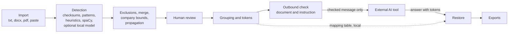

# HuisClos method report

Course: Advanced AI Algorithms, group assignment, 2026. Status at the feature freeze of
28 October 2026. Every document, test and example mentioned here is fictitious. Figures come
from the project files cited under each table; this report runs no new measurement.

## 1. Problem and users

Lawyers and in-house legal staff want to ask a general-purpose language model to summarise a
file, draft a letter or compare two contracts. Pasting the file as it is sends client names,
addresses, bank details and case numbers to a third party. For a French lawyer this conflicts
with professional secrecy, and for any organisation it is a transfer of personal data that
needs a legal basis and safeguards.

HuisClos answers a narrow need: before the text leaves the computer, replace each identifying
value with a stable token such as `[PERSONNE_1]` or `[SOCIETE_A]`, let a human check every
replacement, send only the checked text, then put the real values back into the answer. The
mapping between tokens and real values stays on the computer.

The primary users are lawyers, legal assistants and lawyers working in companies, who handle
French or English documents and have no programming background. The user guide is written
for them ([USER_GUIDE.md](USER_GUIDE.md)).

A second audience is a hypothesis, not a validated use: human resources teams handle similar
documents (employment contracts, disciplinary letters, labelled employee numbers). The
detector already recognises labelled internal identifiers such as employee numbers
(decision D-S14-1), but no HR user was interviewed and no HR corpus was measured. This report
gives no market size, no user count and no adoption figure, because the project holds no
sourced data on them.

## 2. Legal and ethical framework

The references below are those already stated in the application's Method page and in the
project documents. They describe the frame the tool was designed for; they are not a legal
opinion.

- **Professional secrecy.** Law no. 71-1130 of 31 December 1971, article 66-5: consultations,
  correspondence, interview notes and, more generally, every document of the case file are
  covered by professional secrecy. Penal Code, article 226-13: revealing secret information
  held through one's profession is a criminal offence. Sending a client file to an external
  AI service can amount to such a disclosure.
- **GDPR, article 4(5).** Pseudonymisation means processing personal data so that they can no
  longer be attributed to a person without additional information, kept separately and
  protected. In HuisClos, that additional information is the mapping table.
- **GDPR, recital 26.** Pseudonymised data remain personal data. HuisClos therefore never
  claims anonymisation: the interface, the README and every export say "Pseudonymization is
  not anonymization".
- **GDPR, article 5(1)(c) and article 32.** Data minimisation, and security of processing,
  which names pseudonymisation among the possible measures. HuisClos sends the minimum
  (the checked document and the user's instruction) and processes everything else locally.

Primary sources: the GDPR, Regulation (EU) 2016/679, at
<https://eur-lex.europa.eu/eli/reg/2016/679/oj>; the French texts on Legifrance,
<https://www.legifrance.gouv.fr>. These links point to official publication sites. They were
not consulted during this session and do not replace a check of the current wording.

Three design rules follow from this frame:

1. The mapping table is sensitive. It is never sent to the model, never committed to Git
   (`*.mapping.json` is ignored), held in session memory and offered for download only with a
   red warning ([AGENTS.md](../AGENTS.md), principle 5).
2. A missed name is a breach; an extra masked word is a nuisance. Recall comes first.
3. The human decides. No detection is accepted by default and no alert masks anything.

Missing research. The project holds no research file (`docs/RESEARCH.md` is absent). The
report therefore says nothing about recent guidance of the French bar on artificial
intelligence, the final status of European guidelines on pseudonymisation, or how the Court
of Justice of the European Union interprets pseudonymised data held by a recipient without
the key. These points need a sourced legal review before any professional use.

## 3. Market and alternatives

This section is a qualitative comparison only. The project collected no market study, price
list or competitor documentation, so no commercial product is named and no figure is given.

| Approach | What the user does | Main weakness for a lawyer |
| --- | --- | --- |
| Send the raw file to a chatbot | Paste and ask | Discloses every identifier to a third party |
| Manual redaction | Replace names by hand | Slow, inconsistent tokens, no restoration of the answer |
| Contractual enterprise AI service | Rely on a provider's terms | Data still leave the firm; depends on the contract |
| Generic open-source PII detection library | Build a pipeline | Mostly English, no French legal identifiers, no review or restoration |
| HuisClos | Detect, review, tokenise, check, restore locally | Small fictitious validation; human review still required |

HuisClos is built on one such library, Microsoft Presidio, and on spaCy models. Its added
value lies in the French and English legal rules, the review step, the outbound check and the
restoration, not in a new detection model.

## 4. Solution and pipeline

Each stage and the decision that justifies it:

- **Local reading** (D-15, D-AF-B2-1, D-AF-B2-2). Text-based PDF and DOCX are read locally; a
  PDF without text is refused, because there is no OCR. Doubtful pages raise a warning.
- **Rules before statistics** (D-03, D-07). Identifiers with a control key (IBAN and NIR by
  modulo 97, SIREN and SIRET by the Luhn key) score 1.00; emails 0.95; labelled case numbers
  and birth dates 0.90; spaCy entities a fixed 0.85 (D-S12-1); name heuristics 0.70 to 0.80.
- **Threshold 0.30** (D-13). It maximises F2 on the development set, the lowest value at a tie.
- **Merge without overlap** (D-S13-1, D-AF-A1-1). Overlapping proposals are arbitrated by
  priority, score and length; a weak candidate below the threshold can no longer remove a
  stronger protection.
- **Span conventions** (D-09). Titles and labels stay outside the token (`M. [PERSONNE_1]`),
  which keeps grammatical gender for the model; a legal form stays inside a company token.
- **Propagation** (D-S13-4, D-S14-4). Once "Jean DUPONT" is found, "M. Dupont" and "DUPONT"
  elsewhere are found too, but "petit" never matches the surname Petit.
- **Grouping in doubt** (D-S21-1, D-FIX3-1). Two uncertain mentions get two tokens rather
  than one shared token, because confusing two people is worse than an extra token.
- **Exact or tolerant restoration** (D-10, D-S22-1). If the received text is the tokenised
  text, positions restore it exactly; otherwise common token alterations by the model
  (case, accents, brackets, Markdown escapes) are recognised and unknown tokens are listed.
- **Outbound check** (D-S24-3, D-AF-A3-3 to D-AF-A3-5). The message is composed once, then
  both segments, the document and the user's instruction, are re-read for residual values.

## 5. Evaluation

### 5.1 Corpora and protocol

All corpora are fictitious, built from annotated Markdown sources by `scripts/build_corpus.py`,
which fills identifiers with valid synthetic keys (D-12).

| Set | Documents | Role | Status |
| --- | ---: | --- | --- |
| French dev | 20 | Tuning and threshold choice | Saturated: rules written next to it |
| English dev | 8 | English tuning | 136 evaluated entities; not a blind check |
| Historical test | 6 | Held out, measured once per gate | 93 evaluated entities, measured four times |
| Challenge | 8 | Written blind after the S14 rule freeze | 190 evaluated entities, now known |
| C3 French and English | 8 + 8 | Written blind after the A4 freeze | Measured once by G8 on e3d13bd |

Sources: D-S14-10, D-G7-1, D-AF-B2-3, D-G8-1.

Eleven types are evaluated: person, company, address, email, phone, IBAN, NIR, SIREN, SIRET,
birth date and case number. CUSTOM (labelled identifiers and manual values) and LOCATION are
excluded from the main figures and reported separately.

Metrics ([POST_G7_PROTOCOL.md](POST_G7_PROTOCOL.md), sections 1 and 4):

- **Exact and partial matching.** A prediction matches a reference of the same type, one to
  one; exact matching needs the same bounds, partial matching any overlap. A wrong label is
  never a true positive.
- **F2** weighs recall twice as much as precision, mirroring the asymmetric cost.
- **Leak rate**: reference characters left visible, divided by all reference characters.
- **Full coverage**: references whose every character is masked, whatever the predicted type;
  one visible character breaks it.
- **Over-masking**: masked characters outside any annotation.
- **Uncertainty**: document bootstrap, 2,000 draws, seed 45, 2.5 and 97.5 percentiles. A
  difference between two profiles is called significant only if its paired interval, computed
  on the same draws, excludes zero.
- **Engineering criterion** for recommending a heavier profile against its reference: lower
  leakage, higher full coverage, precision loss within 0.02 and extra masking within 0.01.

No measurement simulates a human: every proposal is substituted automatically. The figures
describe the tool before review.

### 5.2 Development results

French dev, threshold 0.30, partial matching, micro averages: Standard (`hybrid`) reaches
precision 0.9904, recall 1.0000, F2 0.9981 and leak rate 0.0000; Enhanced (`hybrid_camembert`)
gives the same figures (source: [results/summary.md](../results/summary.md)). Both profiles fully
cover 311/311 entities with 7 over-masked characters (D-AF-A4-4). These figures show that the
rules fit the documents they were written with; they do not measure generalisation.

English dev: Standard fully covers 124/136 entities and leaks 105/2553 characters; Enhanced
(GLiNER, cutoff 0.70) covers 126/136 and leaks 63/2553, with 48 over-masked characters in
both. The paired intervals include zero (source: D-AF-A4-4, README).

### 5.3 Historical test register

| Measure | Code | Precision | Recall | F2 | Leak rate |
| --- | --- | ---: | ---: | ---: | ---: |
| 1, G4 | ad978562 | 0.946809 | 0.956989 | 0.954936 | 0.120169 |
| 2, G4bis | 9a18fdd | 0.978947 | 1.000000 | 0.995717 | 0.052938 |
| 3, G7 | b86a977 | 0.978947 | 1.000000 | 0.995717 | 0.019587 |
| 4, G8 | e3d13bd | 0.978947 | 1.000000 | 0.995717 | 0.000000 |

Source: D-G8-1, historical register (Standard profile, partial matching, threshold 0.30).
G4bis was a second measure after rule changes made on dev only (D-S35-3). Each measure is
kept in its history; none replaces another. The G8 figures describe code e3d13bd, not the
current code.

### 5.4 Challenge: G7, the G8 failure and the single resume G8R2

At G7, on the challenge written blind after the rule freeze, Standard reached recall 0.8421
and leak rate 0.1283 with 26 entities fully exposed; Enhanced reached recall 0.9211 and leak
rate 0.0969 with 12 (source: [results/summary.md](../results/summary.md)). These results
were much lower than on dev and showed the limits of rules written next to their examples.

At G8, the single authorised challenge run stopped with exit code 2 and no usable report
(D-G8-1). FIX2 then ran one diagnostic attempt that exported only the failure location: a
RuntimeError in the token assignment when the same name appeared both in the text and inside
a file name, such as `conclusions_NAME.pdf` (D-FIX2-1). FIX3 corrected the token assignment
(D-FIX3-1) and FIX4 cleared earlier results before a new attempt (D-FIX4-1). After an
independent recheck, G8R2 measured the challenge once more, the fourth historical execution
including the diagnostic, on code 930c414, with the plan frozen at G7.

| French challenge, G8R2 | Fully covered | Leaked characters | Partial precision | Over-masked characters |
| --- | ---: | ---: | ---: | ---: |
| Standard | 157/190 | 325/3600 | 0.803922 | 366 |
| Enhanced | 170/190 | 218/3600 | 0.801802 | 379 |

Source: [results/gate8-resume/report.md](../results/gate8-resume/report.md), D-G8R2-1.

Enhanced meets the four pre-registered criteria against Standard. The paired leakage
difference, -0.029722 [-0.061759; -0.006485], excludes zero on this set. The paired coverage
gain, 0.068421 [0.000000; 0.166667], touches zero: no significant coverage gain is claimed.
Before review, 33 entities with Standard and 20 with Enhanced remain at least partly exposed.
This challenge was already known when G8R2 ran, so it is not a new blind validation.

### 5.5 C3 French and English blind sets (historical, code e3d13bd)

| Language and profile | Partial precision | Fully covered | Leaked characters |
| --- | ---: | ---: | ---: |
| French Standard | 0.8922 | 95/105 | 139/2042 |
| French Enhanced | 0.8824 | 96/105 | 130/2042 |
| English Standard | 0.8349 | 78/100 | 235/2285 |
| English Enhanced | 0.7000 | 88/100 | 115/2285 |

Source: D-G8-1 and [results/gate8/report.md](../results/gate8/report.md).

English Enhanced protects more characters, but its precision loss of 0.1349 exceeds the
0.02 margin: it is experimental and not recommended. English Standard leaves content exposed
in all eight documents and remains experimental with strong reservations. No complete
bilingual validation exists and no figure guarantees zero leakage.

### 5.6 Limits of the evaluation

The corpora are small, fictitious and written by few authors, often from the same model
family, so styles may be correlated. The intervals are conditional on the corpus and the
threshold; they do not measure author bias. Character coverage does not judge
re-identification by context. The final-check alerts are reported separately and reduce no
leakage unless a human masks the value.

## 6. Course concepts applied

| Concept | How HuisClos applies it | Where it is visible |
| --- | --- | --- |
| Asymmetric cost | F2 chooses the threshold; lowest threshold at a tie | Threshold setting, default 0.30; "Low confidence" card in Review |
| Human in the loop | No proposal accepted by default; keep, reject, retype or add | Review step and its decision table |
| Hybrid system | Keys and patterns plus statistical models plus heuristics | Source column in Review (checksum, pattern, heuristic, ner_spacy) |
| Transfer | Published pretrained models reused without project training | Document language and profile settings |
| Measurement | Held-out sets, ablations, bootstrap intervals | Evaluation page, linked from Method & limits |

The ablation shows why the system is hybrid. On the G7 challenge, patterns alone reach recall
0.6947, the spaCy model alone 0.4579, and their combination with propagation 0.8421
(source: [results/summary.md](../results/summary.md)).

## 7. Beyond the course

- **Optional local models.** CamemBERT for French and GLiNER for English, pinned to immutable
  revisions and file hashes, loaded offline from a prepared folder (D-AF-A4-6).
- **Overlapping windows.** CamemBERT reads 510-token windows with a 64-token overlap, so a
  mention near a cut is seen whole by one window (D-AF-A1-2); GLiNER uses 256-token windows
  and checks its full prompt against the native 512 limit after a silent truncation was
  found (D-AF-A4-7).
- **Unicode projection.** Invisible characters, ligatures and typographic spaces are
  normalised in an analysis view; every span is projected back onto the original text, which
  is never modified (D-AF-A2-5).
- **Grouping.** Mentions of one entity share a token; in doubt a new group is created.
- **Tolerant restoration.** Altered tokens are restored without touching ordinary words.
- **Case memory.** A mapping table from an earlier document keeps tokens stable across a case
  (D-S24-2), with a known limit when a name also appears in a file name (D-FIX3-2).
- **Two-segment check.** The exact outgoing string is checked, instruction included.
- **Revoked authorisation.** Any edit after the check revokes the user's confirmation; the
  send function recomputes it in Python before sending (D-AF-A3-4).
- **Paired bootstrap.** Profiles are compared on the same document draws (D-AF-B1-3).

## 8. Limits and ethics

- **Omissions.** Values are missed, especially in English and in unusual formats.
- **Context.** A rare job title, a small town and a date can identify a person.
- **File quality.** No OCR; mixed PDFs and unsupported DOCX structures can import partially.
- **Synthetic bias.** Fictitious corpora may be easier than real files.
- **False positives.** Ordinary words are sometimes masked; the human rejects them.
- **The table.** Whoever holds the mapping table can re-identify the text.
- **Responsibility.** The lawyer remains responsible for what is sent.
- **English.** Standard English carries strong reservations; English Enhanced is not
  recommended.
- **Demo.** The public demo runs on the host's server and accepts fictitious data only.
- **Token continuity.** A person can receive a new token in a later document (D-FIX3-2).

## 9. Value if widely used

If the tool were widely used, the hypotheses are qualitative: fewer raw files pasted into
external services, consistent tokens instead of ad hoc redaction, and a recorded review.
Review has a cost: every detection must be read, and the final check can raise false alerts.
Whether the net effect saves time is unknown. A timed study with real users on realistic,
non-sensitive files is still needed. HuisClos guarantees neither a productivity gain nor
legal compliance.

## 10. Reproducibility

Ordinary local use (from the [user guide](USER_GUIDE.md)), Python 3.12 required:

- Windows: `python -m venv .venv`, then
  `.venv\Scripts\python.exe -m pip install -r requirements.txt`, then
  `.venv\Scripts\python.exe -m streamlit run streamlit_app.py --server.address localhost`.
- macOS: `python3.12 -m venv .venv`, then `.venv/bin/python -m pip install -r requirements.txt`,
  then `.venv/bin/python -m streamlit run streamlit_app.py --server.address localhost`.
- Toolkit: [START_HERE.md](../START_HERE.md) launchers for Windows and macOS.

Optional models are prepared outside the application with
`scripts/prepare_local_models.py`, then `HUISCLOS_MODELS_DIR` points to that folder; the
application never downloads a model ([LOCAL_MODELS.md](LOCAL_MODELS.md)).

Ordinary checks: `PY -m pytest -q`, `PY -m ruff check .`, `PY -m ruff format --check .` and
`PY scripts/check_style.py`, where `PY` is the environment's Python. Development evaluation:
`PY scripts/run_evaluation.py --split dev`. Reserved evaluation on test, challenge or C3 is a
different matter: it requires a gate session and its explicit authorisation, a registration
written before the run and a single attempt. These commands are documented here, not run
by this session.

## 11. Use of AI tools

The prompt log [PROMPTS.md](PROMPTS.md) records every prompt given to an AI tool. Observed
uses:

- Claude (claude.ai, Opus 5.5) produced the master plan from the planning prompt.
- Claude Code (Opus 5.5, Sonnet 5.5, Haiku 5.5) and Codex (GPT-6, or model not exposed) ran
  the development, gate and documentation sessions, each with a verbatim or referenced prompt.
- The same agents wrote the fictitious corpora (prompts in `docs/prompts/`).
- Humans pasted prompts, reviewed code and took decisions; independent gates used a
  different model family where possible.

The demonstration video is entrusted to a classmate. It is planned to be produced entirely
with AI tools and a synthetic voice ([video plan](video/MASTER_PLAN.md)). It is not produced
yet; its tools and final result will be credited when it is delivered.

## 12. References

Project files:

- [README.md](../README.md), [USER_GUIDE.md](USER_GUIDE.md), [LOCAL_MODELS.md](LOCAL_MODELS.md),
  [ARCHITECTURE.md](ARCHITECTURE.md)
- [DECISIONS.md](DECISIONS.md), in French: D-07, D-09, D-10, D-12, D-13, D-S24-2, D-S24-3,
  D-AF-A2-5, D-AF-A3-3 to D-AF-A3-5, D-G7-1, D-G8-1, D-FIX2-1, D-FIX3-1, D-FIX3-2, D-FIX4-1,
  D-G8R2-1, D-R8-1
- [POST_G7_PROTOCOL.md](POST_G7_PROTOCOL.md), in French
- [results/summary.md](../results/summary.md),
  [results/challenge_comparison.md](../results/challenge_comparison.md)
- [results/gate8/report.md](../results/gate8/report.md),
  [results/gate8-recheck/report.md](../results/gate8-recheck/report.md),
  [results/gate8-resume/report.md](../results/gate8-resume/report.md),
  [results/recette8/report.md](../results/recette8/report.md)
- [PROMPTS.md](PROMPTS.md)

Primary legal sources:

- Regulation (EU) 2016/679 (GDPR), articles 4(5), 5(1)(c), 32 and recital 26:
  <https://eur-lex.europa.eu/eli/reg/2016/679/oj>
- Law no. 71-1130 of 31 December 1971, article 66-5, and French Penal Code, article 226-13:
  <https://www.legifrance.gouv.fr>
