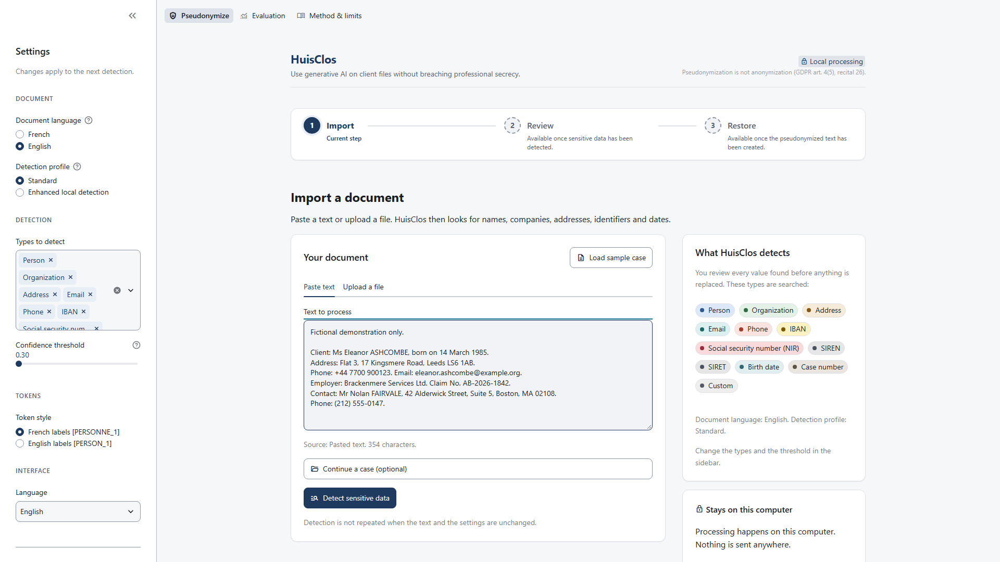
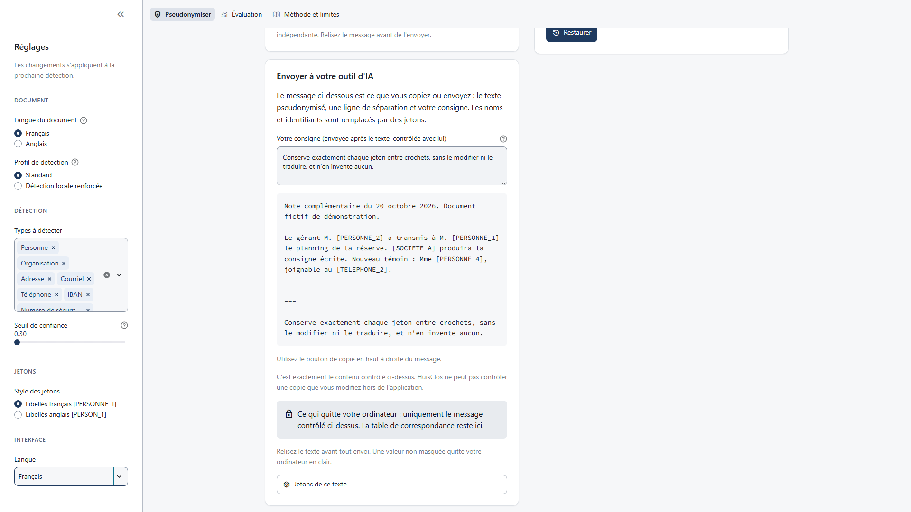
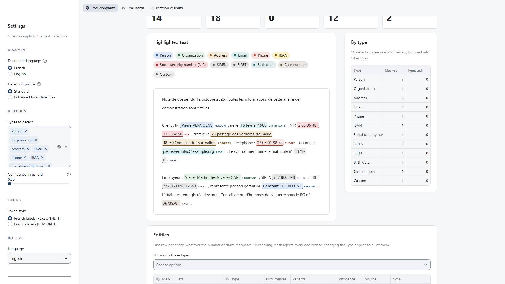
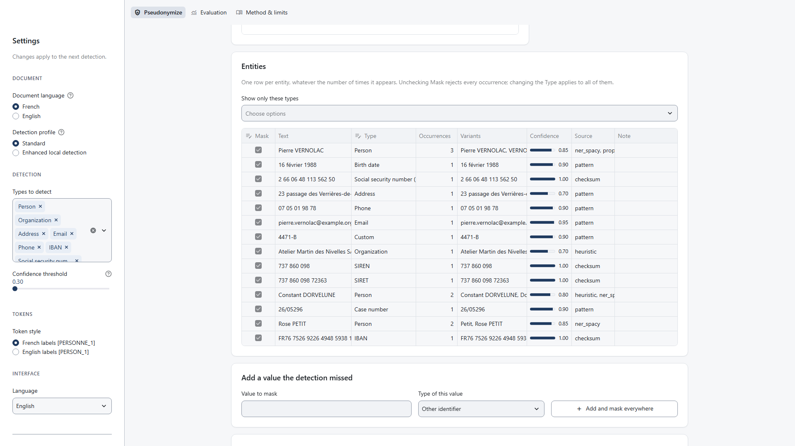
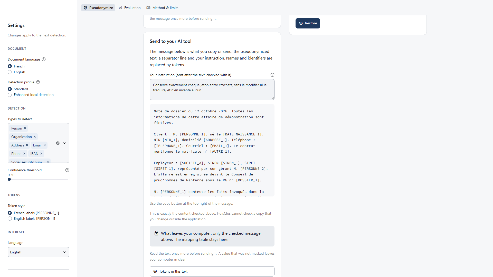
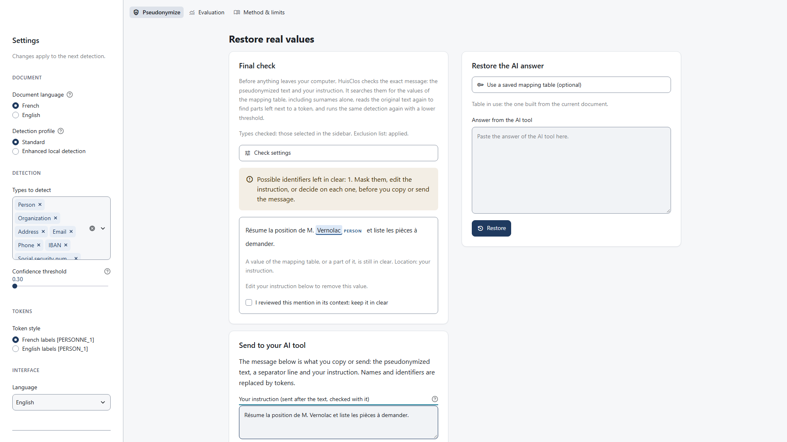
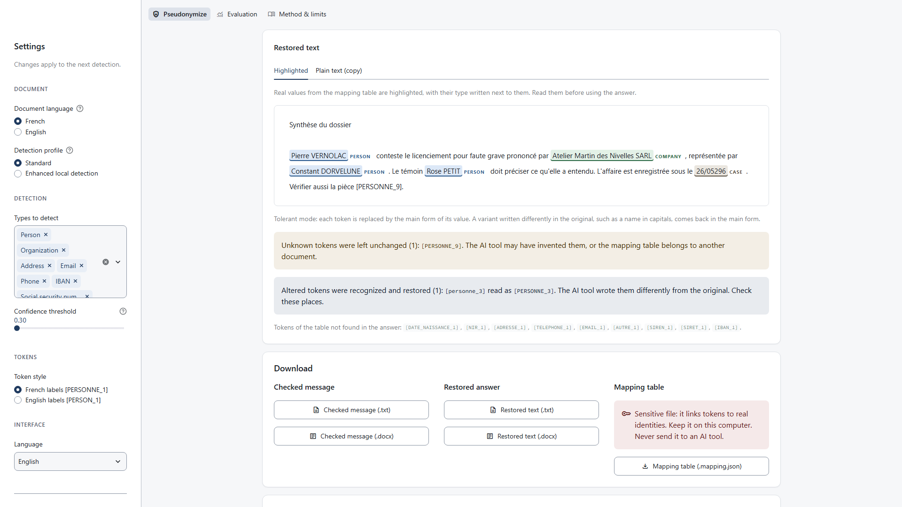
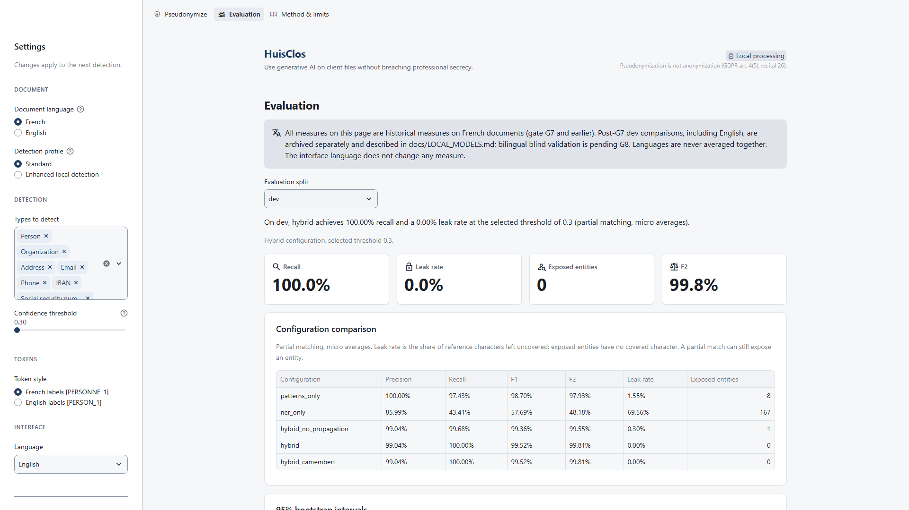

# HuisClos user guide

This guide is written for lawyers and legal staff. It assumes no programming knowledge.
HuisClos replaces names and identifiers in a legal document, written in French or in
English, with tokens such as `[PERSONNE_1]` or `[PERSON_1]`, so that you can send the text to
an AI tool. It then puts the real values back into the answer. With a local installation,
everything runs on your computer. The online demo runs on the host's server and must only
receive fictitious data.

Three choices are independent of each other: the language of the document you analyse, the
language of the interface, and the style of the tokens. Section 4 explains them. The English
support and the updated detection profiles were delivered after the last measured gate (G7)
and are still experimental: see section 4.3.

Important: pseudonymization is not anonymization (GDPR, art. 4(5) and recital 26). The
pseudonymized text remains personal data. Read it before you send it.

## 1. Installation

You install HuisClos once. You need an internet connection during the installation, and
about ten minutes. After that, HuisClos works without internet.

### Windows

1. **Install Python 3.12.** Go to https://www.python.org/downloads/windows/ and download the
   latest "Windows installer (64-bit)" of Python 3.12. Run it. On the first screen, tick the
   box **Add python.exe to PATH**, then click **Install Now**.
2. **Download HuisClos.** Two options:
   - Without Git: open https://github.com/Negan-san/huisclos, click the green **Code** button,
     then **Download ZIP**. Right-click the downloaded file, choose **Extract All**, and
     extract it into your Documents folder.
   - With Git: open PowerShell and run
     `git clone https://github.com/Negan-san/huisclos.git`.
3. **Open PowerShell in the HuisClos folder.** In File Explorer, open the folder that contains
   the file `streamlit_app.py`. Click in the address bar, type `powershell` and press Enter.
   A blue or black window opens in that folder.
4. **Check Python.** Type the following command and press Enter. It must print
   `Python 3.12` followed by a number.

   ```powershell
   python --version
   ```

5. **Create the environment and install HuisClos.** Run these two commands, one after the
   other. The second one downloads the libraries and the two language models, French and
   English (`fr_core_news_md` and `en_core_web_sm`); it takes a few minutes.

   ```powershell
   python -m venv .venv
   .venv\Scripts\python.exe -m pip install -r requirements.txt
   ```

6. **Start HuisClos.**

   ```powershell
   .venv\Scripts\python.exe -m streamlit run streamlit_app.py --server.address localhost
   ```

   The first time, Streamlit may ask for an email address in the window. Leave it empty and
   press Enter. Your browser then opens HuisClos.

### macOS

1. **Install Python 3.12.** Go to https://www.python.org/downloads/macos/ and download the
   latest "macOS 64-bit universal2 installer" of Python 3.12. Open it and follow the steps.
2. **Download HuisClos** as a ZIP file (green **Code** button, then **Download ZIP**) and
   double-click it to extract it, or run `git clone https://github.com/Negan-san/huisclos.git`
   in Terminal.
3. **Open Terminal** (Applications, Utilities). Type `cd` followed by a space, drag the
   HuisClos folder (the one that contains `streamlit_app.py`) into the window, and press
   Enter.
4. **Create the environment, install and start:**

   ```bash
   python3.12 -m venv .venv
   .venv/bin/python -m pip install -r requirements.txt
   .venv/bin/python -m streamlit run streamlit_app.py --server.address localhost
   ```

## 2. Starting and stopping

- **Start**: open PowerShell (or Terminal) in the HuisClos folder, as in step 3 above, and run
  the start command only:
  - Windows: `.venv\Scripts\python.exe -m streamlit run streamlit_app.py --server.address localhost`
  - macOS: `.venv/bin/python -m streamlit run streamlit_app.py --server.address localhost`
- The browser opens http://localhost:8501. "localhost" means your own computer: the page is
  not on the internet. If the browser does not open, copy this address into it.
- Keep `--server.address localhost`: it limits access to your own computer. Without it,
  the default server also accepts connections through your network interfaces.
- **Stop**: go back to the PowerShell or Terminal window and press **Ctrl+C**, then close the
  window. Closing the browser tab does not stop HuisClos.
- The first detection after a start takes longer, because the language model of the
  document is loaded into memory.

## 3. The three steps

The bar at the top of the page shows the pages (**Pseudonymize**, **Evaluation**,
**Method & limits**); on a narrow screen, they are in the menu of the left column. The left
column holds the settings. The **Pseudonymize** page guides you through three steps:
**Import**, **Review** and **Restore**, shown at the top of the page with their state
(completed, current step, or the reason why a step is not available yet). A step becomes
available once the previous one is done.

### Step 1: Import



1. Choose the tab **Paste text** and paste your document, or the tab **Upload a file** and
   choose a .txt, .docx or .pdf file. To try HuisClos first, click **Load sample case**: it
   loads a fictitious French case and sets the document language to French.
2. In the group **Document** of the left column, choose the **Document language** and the
   **Detection profile**, then check the other settings (section 4 below). The line
   "Document language: ... Detection profile: ..." under **What HuisClos detects** repeats
   your choice.
3. Click **Detect sensitive data**.

Accepted files: up to 5 MB and 200,000 characters. A PDF with no extractable text is refused.
An image page inside a mixed PDF is not read: there is no OCR.

**Partial imports.** HuisClos reads only the text it can extract, and says so when something
may be missing. A warning starting with "Document completeness is unknown" or "Partial Word
extraction" appears for:

- PDF pages with no text, or with very little text (a short page can be legitimate);
- a Word file with footnotes or endnotes, comments, text boxes, tracked changes, or embedded
  content and content controls;
- a text file that is not in UTF-8 (it is read as Windows-1252: check the accents).

What is missing is not silently added to the text sent to the AI tool. Open the original,
copy the passages you need into **Text to process**, and review them like the rest. For
tracked changes, accept or reject them in a copy of the original and import it again.

**Continue a case.** For another document in the same case, open **Continue a case
(optional)** and upload the mapping table saved from the previous document (the case
memory). Known entities keep their tokens, and new entities take unused numbers or letters.
The values of the table are also searched in the new text where the detection misses them:
the message "Known values of the case table found in this text" gives their number. The
table's token style takes precedence over the sidebar setting. **Remove the case table**
forgets it. The table stays in session memory; it is not added to the text sent to the AI
tool. Save the merged table after each document.



In the picture, the interface is French and the second document of the sample case is
already pseudonymized with the table of the first one. Mr Vernolac is still `[PERSONNE_1]`, Mr Dorvelune `[PERSONNE_2]` and
the company `[SOCIETE_A]`; the new witness takes the next free number, `[PERSONNE_4]`. A
match by spelling is not proof that two people are the same: read the places marked "Check:
may refer to another person".

**When a result becomes out of date.** If you change the text, the document language, the
detection profile, the types, the threshold or the case table after a detection, Import
shows "Run the detection again". Your earlier review decisions and the final check no longer
apply: you start a new review of the new detections, and the text you typed is kept. If you
only change a review decision or the token style, the message under **Final check** sends
you back to Review (**Back to Review**) to pseudonymize again.

### Step 2: Review



Cards at the top count the entities, the masked and rejected occurrences, the types found
and the **Low confidence** occurrences (score below 0.75), which deserve a check first.

The **Highlighted text** shows every detection with a colour and a label such as PERSON,
COMPANY or ADDRESS. The legend above the text explains the colours, and **By type** counts
the masked and rejected occurrences of each type. Hover over a highlight to see its score
and source.



The **Entities** table has one row per entity, however many times it appears.

- **Mask**: uncheck the box to keep this value in clear everywhere. Click in the centre of
  the box.
- **Type**: change it if the detection chose the wrong type.
- **Occurrences** and **Variants**: how many times and in which forms the value appears.
- **Note**: "Check: may refer to another person" means that a short form, such as a surname
  alone, may belong to two people. Read those places.
- **Show only these types** filters the table.

If a value was missed, use **Add a value the detection missed**: type it in **Value to
mask**, choose its **Type of this value**, then click **Add and mask everywhere**. Case and
accents are ignored when HuisClos looks for it.

A forgotten name is a breach of professional secrecy; a word masked by mistake is only a
nuisance. When in doubt, mask. Then click **Pseudonymize**. **Back to Import** returns to the
first step.

### Step 3: Restore



1. Under **Send to your AI tool**, write your question in **Your instruction (sent after the
   text, checked with it)**. The field starts with a recommended line, in the language of
   the document (section 5); keep it and add your question after it.
2. Read the message below the field: the pseudonymized text, a separator line and your
   instruction. A value that was not masked leaves your computer in clear. Once the
   **Final check** (below) allows it, copy the message with its copy button and send it to
   your AI tool.
3. Under **Restore the AI answer**, paste the answer in **Answer from the AI tool** and click
   **Restore**.

Before copying, read **Final check**.



The check applies to the exact message, which has two parts: the pseudonymized document and
your instruction (**Your instruction (sent after the text, checked with it)**). Each alert
says where it comes from: "Location: pseudonymized text" or "Location: your instruction".
HuisClos searches the message for the values of the mapping table, including a surname
alone, reads the original text again to find a part of a name left next to a token, and
runs the detection again at a lower threshold. In the picture, the instruction names the
client: the check lists it. Copy and download stay disabled until the alert is resolved
("Not ready to send").

The available action depends on the alert:

- **Mask everywhere**, for a value in the document, adds it to the masked values and
  pseudonymizes the text again;
- edit your instruction when the value is in it;
- tick **I reviewed this mention in its context: keep it in clear** for this mention only.
  The box is never ticked for you. Untick it to withdraw the decision.

A token-like string absent from the table cannot be approved with that checkbox. In the
instruction, replace it with an existing token written exactly, or remove it. If the document
needs a new token, go back to Review and add the value before pseudonymizing again.

A decision to keep a mention in clear is forgotten as soon as the message or the check
settings change. Copy and download of the message stay disabled until every alert is
handled; the message then reports that you decided to keep the alerts in clear. The
confirmation of the
optional Mistral sending (section 5) is withdrawn in the same way, and also when you change
a decision.

Under **Check settings**, two options widen the check: **Also check the types turned off in
the sidebar** (places, for example) and **Ignore the exclusion list during the check**. Both
find more values and give more false alerts; neither masks anything. The second detection
uses the same engine as the first one: it is not an independent review, and a lower
threshold cannot reveal a value that no model proposed. If the check cannot run, nothing is
presented as checked; use **Run the check again**.

The main check threshold is 0.10 at the default detection threshold of 0.30. English Enhanced
keeps GLiNER's own cutoff at 0.70 during this check; it does not lower that neural cutoff.

A clear check does not make the text anonymous. With a case table, a reply can mix tokens
from several documents; restoration uses the merged table. Never send that table to the AI
tool.



The **Restored text** shows the answer with the real values from the mapping table
highlighted, each with its type written next to it; the tab **Plain text (copy)** gives the
same text with a copy button. Read the messages below it:

- **Exact mode** (you pasted the pseudonymized text itself): every value comes back as it was
  written.
- **Tolerant mode** (an answer from an AI tool): each token comes back in the main form of
  its value. A name written in capitals in the original may come back in normal case.
- **Unknown tokens** and **altered tokens** are listed (section 5).

Under **Download**, save the files you need (section 6). **Start a new document** erases the
current session after a confirmation (**Yes, start a new document**). **Back to Review**
returns to the review.

The **Evaluation** page shows the measured results of the detection. They are historical
measures on French documents (gate G7 and earlier); the page says so. **Method & limits**
explains how HuisClos works and which document languages it supports.



## 4. Settings in the left column

The left column has four groups: **Document**, **Detection**, **Tokens** and **Interface**.
Choose the detection settings before you click **Detect sensitive data**. Changing them
requires a new detection and review. Changing a review decision or the token style requires
pseudonymizing again from Review. Changing only the interface language keeps those choices
(section 3, "When a result becomes out of date").

### 4.1 Language of the document, language of the interface, style of the tokens

These are three separate settings. Loading the sample explicitly resets the document
language to French; a case table imposes its saved token style.

| Setting | Choices | What it changes |
| --- | --- | --- |
| **Document language** (group Document) | French, English | The rules, the spaCy model (`fr_core_news_md` or `en_core_web_sm`), the exclusion lists and the recommended instruction. Choose the language in which the text is written. |
| **Token style** (group Tokens) | French labels `[PERSONNE_1]`, English labels `[PERSON_1]` | Only the shape of the tokens. A French document can use English tokens, for example if you write to the AI tool in English. With a case table, the style of the table prevails. |
| **Language** (group Interface) | English, Français | Only the texts of the application. Your other settings are kept when you switch. |

A language is not a nationality or a legal system. An English document may contain French
identifiers (a NIR, a SIREN or SIRET number, a French phone number, an RG number) and a
French contract may name an English company: these formats are recognized in both document
languages. The language setting is one choice for the whole text. For a text with long
passages in both languages, choose the main language, review with extra care, and add the
missed values by hand.

### 4.2 What is recognized, and where it stops

| Type | French documents | English documents (and what both share) |
| --- | --- | --- |
| Person | French titles such as M. and Mme, name patterns and the French spaCy model. | Titles Mr, Mrs, Ms, Miss, Mx, Dr, Prof, Sir, Dame, Lady, Lord and the English spaCy model. A bare "Me" is never read as a title. |
| Company | Legal form attached to the name (SARL, SAS, SA, SCI and others). | Ltd, Limited, LLP, LLC, Inc, PLC, Corp, Corporation attached to the name. Both lists work in both languages. |
| Address | Number, street, French postal code and city on one span; also BP, CS and TSA boxes and named places followed by a postal line. | Street number and name with a UK postcode (`17 Kingsmere Road, Leeds LS6 1AB`) or a US state and ZIP code (`42 Alderwick Street, Suite 5, Boston, MA 02108`); a leading unit ("Flat 3") is included. The country stays outside the span. These are fictional examples. |
| Phone | French national formats, `+33 (0)`, `0033`, spaces, dots or hyphens; short labelled numeric extensions. | Explicit international numbers with `+` and 8 to 15 digits, including country code (`+44 7700 900123`), in both languages. A national UK or US number (`(212) 555-0147`, `0113 496 0123`) has a dedicated rule only in an English document and next to a phone label. |
| Email | Structured addresses such as `name@example.org`, also the explicit `[at]` spelling. | Same; other obfuscations need review. |
| IBAN, NIR, SIREN, SIRET | Control-digit checks, with lower-confidence handling of some invalid or labelled values. | Same: recognized in both languages. NINO and SSN use separate labelled CUSTOM rules. |
| Birth date | "né le 16 février 1988" and variants, within a bounded range after the birth wording. | "born", "date of birth", "DOB" followed by a valid date; English month names are supported. Ordinary hearing or signature dates are not targeted as birth dates. |
| Case number | RG, Portalis, parquet and pourvoi numbers. | Claim, Case, File, Matter, Docket, "Our ref", "Your ref" followed by a number. Public references (case C-131/12, neutral citations) stay visible. |
| Custom | The values you add by hand, and labelled identifiers such as "matricule n° 4471-B", read from their label. | Same idea, with labels such as Employee No., NINO, SSN and Policy number. |
| Place | Off by default. | Off by default. |

Limits to keep in mind:

- The table describes dedicated rules, not guaranteed detection. An address or a phone number
  written in another format (a Canadian postcode, a German address) has no dedicated rule: it
  is found only if the language model proposes it, so read it in the review.
- The US and UK address rules work only in an English document. A foreign address inside a
  French document is left to the language model and to your review.
- HuisClos does not check that a street, a postcode or a city exists. A US state and ZIP code
  or a UK postcode is recognized by its shape.
- NINO and SSN labelled numbers are found by their label, not validated.
- Indirect identifiers (a job title, a rare event) are not systematically protected.
- Address assembly is bounded to six segments, four line breaks and 220 characters. Blank
  lines, labels or sentence boundaries can stop it; unfamiliar units or long addresses may
  remain partial. Review the whole address, including text next to each token.

### 4.3 Detection profiles

The group **Document** also holds the **Detection profile**.

| Profile | Document languages | What it uses | Where it is offered |
| --- | --- | --- | --- |
| **Standard** (default) | French, English | Rules, control digits, the spaCy model of the document language, propagation of each value to its other mentions. | Everywhere, including the public demo. |
| **Enhanced local detection** | French, English | Standard plus a neural model that runs on your computer: CamemBERT for a French document, GLiNER for an English one. | Local installation only. Experimental until the bilingual gate G8. |

How Enhanced behaves:

- It is not offered on the public demo. A value left over from an earlier session is replaced
  by Standard with the visible warning "Enhanced detection is not available on the public
  demo. Standard is used."
- It needs optional packages and model files that are not part of the normal installation,
  and nothing is downloaded when you click **Detect sensitive data**. If something is missing
  or is not the validated version, Import shows an error such as "The validated local GLiNER
  package is missing or incomplete. Nothing was downloaded. Choose Standard or follow
  docs/LOCAL_MODELS.md". HuisClos never switches to another profile by itself. Installation:
  [LOCAL_MODELS.md](LOCAL_MODELS.md).
- It is slower and uses more memory. English Enhanced used about 2.8 GiB resident memory in
  local CPU probes; a short two-document probe with imports and loading took about 16 seconds.
  Older French probes recorded about 732 MiB for Standard (S51) and 1204 MiB for Enhanced
  (S44, earlier package versions). These different probes are observations, not a direct
  bilingual comparison or a latency guarantee. Versions, licences and measured costs are
  recorded in [LOCAL_MODELS.md](LOCAL_MODELS.md).
- A neural model adds candidates; it does not mask anything by itself. Every detection still
  goes through your review, and the final check may list more alerts with Enhanced.

What has been measured, and what has not:

| Result | Documents | Status |
| --- | --- | --- |
| Evaluation page and README tables | French, gate G7 and earlier | Historical, unchanged. Standard is the `hybrid` configuration and Enhanced French is `hybrid_camembert`. |
| Development comparison after G7 | 20 French and 8 English fictitious documents | Dev only. French: both profiles fully cover 311 of 311 entities, as at G7. English: Standard fully covers 124 of 136 entities and Enhanced 126 of 136. Leaked characters fall from 105/2553 to 63/2553; non-sensitive masking stays at 48 characters. Paired intervals include zero: this point gain is not statistically established. |
| Blind bilingual validation | New French and English documents | Pending (gate G8). |

The development sets are small and fictitious. The English rules were developed together
with a few small example documents, which cannot show how they behave on new ones. Treat
both English profiles as experimental: read every detection, and expect missed values.
HuisClos makes no claim of precision on your documents.

On the English dev, Enhanced's final check raised 29 alerts, 28 outside annotated references,
while 10 entities were still exposed. Standard raised no alert despite 12 exposed entities.
An alert does not mask anything and an empty alert list is not a guarantee of confidentiality.

### 4.4 Other settings

- **Types to detect**: the kinds of values HuisClos looks for. Remove a type only if you are
  sure the document does not need it. **Place** is off by default, because place names are
  rarely identifying on their own and masking them makes the text harder to use.
- **Confidence threshold**: each detection has a score. HuisClos keeps the detections whose
  score reaches the threshold. A lower threshold masks more text and misses fewer values; a
  higher threshold masks less text but may miss names. The default, 0.30, is the threshold
  selected on the development corpus (see `results/summary.md`); it is also the lowest
  value. Keep it unless you have a reason to change it.
- **Reset session**: erases the text, the detections and the mapping table, after
  confirmation (**Yes, reset** or **Cancel**).

### 4.5 The interface in French

Choose **Français** under **Language** (group **Interface**). Application labels then appear
in French; file-upload controls supplied by Streamlit may remain English. The steps are
**Importer**, **Vérifier** and **Restaurer**; the pages are **Pseudonymiser**, **Évaluation**
and **Méthode et limites**. The
main labels, as shown in the application:

| English | Français |
| --- | --- |
| Document language / French, English | Langue du document / Français, Anglais |
| Detection profile / Standard, Enhanced local detection | Profil de détection / Standard, Détection locale renforcée |
| Token style / French labels, English labels | Style des jetons / Libellés français, Libellés anglais |
| Load sample case | Charger le cas d'exemple |
| Detect sensitive data | Détecter les données sensibles |
| Continue a case (optional) / Remove the case table | Poursuivre un dossier (facultatif) / Retirer la table de dossier |
| Mask / Type | Masquer / Type |
| Add a value the detection missed / Add and mask everywhere | Ajouter une valeur oubliée par la détection / Ajouter et masquer partout |
| Pseudonymize | Pseudonymiser |
| Your instruction (sent after the text, checked with it) | Votre consigne (envoyée après le texte, contrôlée avec lui) |
| Final check / Check settings | Contrôle final / Réglages du contrôle |
| I reviewed this mention in its context: keep it in clear | J'ai examiné cette mention dans son contexte : la garder en clair |
| Mask everywhere / Run the check again | Masquer partout / Relancer le contrôle |
| Answer from the AI tool / Restore | Réponse de l'outil d'IA / Restaurer |
| Mapping table (.mapping.json) | Table de correspondance (.mapping.json) |
| I confirm sending exactly the checked message above | Je confirme l'envoi exact du message contrôlé ci-dessus |
| Start a new document / Reset session | Commencer un nouveau document / Réinitialiser la session |
| Back to Import / Back to Review | Retour à Importer / Retour à Vérifier |

This guide gives the English names. The French interface has the same buttons, in the same
places; it adds none. The French sample case, the recommended instruction and the tokens
depend on the document language and on the token style, not on the interface language.

## 5. Working with ChatGPT, Claude or Mistral

Send the message built by HuisClos: the pseudonymized text, a separator line and your
instruction. The field **Your instruction** starts with a recommended line, chosen from the
document language, so that the AI tool keeps the tokens unchanged:

- Document language French: "Conserve exactement chaque jeton entre crochets, sans le
  modifier ni le traduire, et n'en invente aucun."
- Document language English: "Keep every bracketed token exactly as written; do not change,
  translate or invent tokens."

Edit the field to add your question. The instruction is part of the message and goes through
the final check with the text: do not write a client name in it.

After **Restore**, HuisClos may show three messages:

- **Altered tokens were recognized and restored**: the AI tool wrote a token differently, for
  example in lower case. HuisClos restored it. Check these places.
- **Unknown tokens were left unchanged**: the token is not in the mapping table. Either the AI
  tool invented it, or you loaded the mapping table of another document. Check that the table
  matches the document. Otherwise, ask the AI tool to use only the tokens of the text, or
  complete the passage by hand. Never send the mapping table to the AI tool to solve this.
- **Tokens of the table not found in the answer**: normal when the answer is a summary.

Your AI tool's account settings still apply: check whether your conversations may be used to
train its models.

**Mistral connector (optional).** HuisClos can send the pseudonymized text to Mistral
directly. The block **Send to Mistral (optional)** appears only if an API key is configured.
In PowerShell, set it in the same window before the start command:

```powershell
$env:MISTRAL_API_KEY = "your-key"
```

The block is usable once the final check allows the message. Tick **I confirm sending
exactly the checked message above** and click **Send to Mistral**. The confirmation applies
to that exact message and to its check settings. If anything changes (the text, the
instruction, a setting, a decision on an alert), the confirmation is withdrawn, the box is
unticked and nothing is sent until you check the message and confirm again. A confirmation
is valid for one sending. The answer is placed in the Restore step. The application warns
that Mistral's free Experiment plan may use requests to train its models: use fictitious
data only and check the provider's terms before configuring a real account.

## 6. Exported files and security rules

| File | Contains | Rule |
| --- | --- | --- |
| Checked message (.txt, .docx) | Pseudonymized document, separator and your instruction | Available after the final check allows it; read the complete message before sending |
| Restored text (.txt, .docx) | Real values | Client document: store it with the client file |
| Mapping table (.mapping.json) | Every token and its real value | Sensitive: keep it on your computer |

Rules for the mapping table:

- Never send it to an AI tool, and never send it by email or chat.
- Store it with the client file, where only authorized people can read it.
- HuisClos does not keep it. Download it if you will receive the answer later; to restore
  that answer, upload it under **Use a saved mapping table (optional)**. In a new session,
  Restore is locked until Import and Review are complete. Click **Load sample case**, then
  **Detect sensitive data**, then **Pseudonymize** to open Restore. Upload your saved table
  there, paste the answer for your original document, and click **Restore**. Download only
  the restored answer: the sample's pseudonymized text and mapping table do not belong to
  your original document.
- Delete it when you no longer need it.

The browser saves the files in your usual downloads folder.

## 7. Troubleshooting

**"running scripts is disabled on this system" (PowerShell).** This appears only if you run
`.venv\Scripts\Activate.ps1`. The commands of this guide do not need it. If you want to
activate the environment anyway, allow scripts for the current window only, then activate:

```powershell
Set-ExecutionPolicy -Scope Process -ExecutionPolicy Bypass
.venv\Scripts\Activate.ps1
```

**"python is not recognized".** The box **Add python.exe to PATH** was not ticked. Run the
Python installer again, choose **Modify**, then tick **Add Python to environment variables**.
You can also use the Python launcher instead of `python`:

```powershell
py -3.12 -m venv .venv
```

**Port 8501 is already used.** HuisClos (or another Streamlit application) is already
running. Stop your earlier local server with Ctrl+C, or choose another port explicitly.
To find which program uses port 8501, or to choose port 8502 yourself:

```powershell
netstat -ano | findstr :8501
.venv\Scripts\python.exe -m streamlit run streamlit_app.py --server.address localhost --server.port 8502
```

**"The detection engine could not start".** The language model of the document language is
missing. Check the French and the English models:

```powershell
.venv\Scripts\python.exe -c "import fr_core_news_md; print('ok')"
.venv\Scripts\python.exe -c "import en_core_web_sm; print('ok')"
```

If a command shows an error instead of `ok`, run the installation command again, with an
internet connection: `.venv\Scripts\python.exe -m pip install -r requirements.txt`. An
installation made before the English support has no English model: the same command adds it.

**An error about Enhanced detection ("Nothing was downloaded").** The optional packages or
the local model files of the Enhanced profile are missing, or they are not the validated
version. Choose **Standard** in the left column, or follow [LOCAL_MODELS.md](LOCAL_MODELS.md).
HuisClos does not download models while you work and does not change profile by itself.

**"Document completeness is unknown" or "Partial Word extraction".** The import could not
read everything (section 3, "Partial imports"). Check the original and copy the missing
passages into **Text to process**.

**"DLL load failed" with "file name too long" (Windows).** The HuisClos folder is too deep
in your folders: Windows limits the length of file paths. Move the folder to a short
location, for example directly in Documents, delete its `.venv` folder, and repeat step 5 of
the installation.

**"No usable text was extracted from any page of this PDF".** The file may be blank or
contain images only. HuisClos does not read images. Convert it with a local OCR tool, then
upload the result or paste its verified text. OCR errors can hide names from detection.

**The online demo shows a sleeping page.** The hosted demo goes to sleep when nobody uses it.
Click the button on the page to wake it up and wait a few minutes. The first detection then
takes longer, because the language model is loaded. Remember: fictitious data only online.

**The computer slows down or HuisClos stops.** The language model needs several hundred
megabytes of memory, and the Enhanced profile much more (section 4.3). Close other
programs, choose Standard, process long documents in parts, and restart HuisClos.

## 8. Frequently asked questions

**Does my document leave my computer?** With a local installation, processing stays on your
computer. You decide whether to copy the pseudonymized text to an AI tool. The optional
Mistral connector sends that text and your instruction after an explicit confirmation.
On the online demo, the original text passes through the host's server.

**Is the pseudonymized text anonymous?** No. The facts of the case can still identify a
person. Pseudonymized data remain personal data under the GDPR.

**Can I use the online demo with a real file?** No. Online, the text passes through the
server of the host. Install HuisClos on your computer for real files.

**Does HuisClos keep my documents?** HuisClos does not save them to disk. The text, the
detections and the mapping table are held in session memory. Closing a tab does not
guarantee immediate removal from server memory. To clear the current session explicitly, use
**Reset session** or
**Start a new document** and confirm; stop the local server with Ctrl+C when finished.

**Why is a word masked when it should not be?** The detection prefers masking too much to
missing a name. Uncheck **Mask** for that row in the Review step.

**Is the English support as reliable as the French one?** It is newer and has not been
validated on documents it has not seen. Its development results are in section 4.3. Review
English documents with extra care.

**Can I restore an answer received days later?** Yes, if you downloaded the mapping table.
Follow the new-session workaround in section 6, then upload it under
**Use a saved mapping table (optional)** in the Restore step.

**Which files are accepted?** .txt, .docx and .pdf with selectable text, in French or in
English. Choose the document language before the detection.

## 9. Uninstalling

1. Stop HuisClos (Ctrl+C in its window).
2. Delete the HuisClos folder. It contains the program and its environment (`.venv`). Python,
   browser downloads, and caches or settings created by pip and Streamlit outside that folder
   are separate and may remain.
3. Before deleting, move any mapping table or restored text you want to keep out of your
   downloads folder into the client file, or delete them.
4. To remove Python as well: on Windows, open Settings, Apps, Installed apps, and uninstall
   "Python 3.12"; on macOS, delete the "Python 3.12" folder in Applications.

## 10. Reproducing the screenshots

The eight PNGs were captured on the frozen A4 application (commit `dc5b041`), with Standard,
threshold 0.30, the default twelve enabled types and French token labels. Chromium
156.0.8078.4 ran headless at 1920 x 1080, device scale 1, with a light theme. Playwright
1.64.1 was already installed
in a temporary environment outside the repository; neither project packages nor application
files were changed. The local server listened only on `127.0.0.1:8599`, usage statistics were
off, Enhanced models were offline and the Mistral connector was not configured. Browser
requests to external hosts were blocked. The browser was closed and Streamlit was stopped
after capture; no server is needed to read these images.

The session tools (`serve.py`, `base_capture.py`, `capture.py`) and the PNG SHA-256 inventory
are archived outside the repository in `pilotage/post_g7_assets/benchmarks/A5/`. They use the
already installed Playwright environment; they do not install anything or change the app.

To reproduce manually, start a local installation on port 8599 and follow these steps.
All texts below are invented for this guide, not client files or evaluation documents.

1. For `01_import.png`, keep the interface in English, choose document language **English**
   and paste this text. Capture Import; detection can then be tried without changing a rule.

   ```text
   Fictional demonstration only.

   Client: Ms Eleanor ASHCOMBE, born on 14 March 1985.
   Address: Flat 3, 17 Kingsmere Road, Leeds LS6 1AB.
   Phone: +44 7700 900123. Email: eleanor.ashcombe@example.org.
   Employer: Brackenmere Services Ltd. Claim No. AB-2026-1842.
   Contact: Mr Nolan FAIRVALE, 42 Alderwick Street, Suite 5, Boston, MA 02108.
   Phone: (212) 555-0147.
   ```

2. Return to Import and click **Load sample case**, which sets document language to French.
   Detect, scroll to **Highlighted text** for `02_review_highlight.png`, then **Entities**
   for `03_review_table.png`. The sample gives 18 detections in 14 groups; no value was
   rejected or manually added for these images.
3. Click **Pseudonymize**, leave the recommended instruction unchanged and wait for
   **No residual identifier found.** Capture **Send to your AI tool** for
   `04_restore_send.png`. Download the fictional mapping table locally for step 6.
4. Replace the instruction with `Résume la position de M. Vernolac et liste les pièces à
   demander.` Commit the edit with Ctrl+Enter. Capture **Final check** for
   `07_final_check.png`: the surname in the instruction triggers an alert. The checkbox
   remains unticked. Restore the recommended instruction from section 5 and wait for the
   clear check before proceeding.
5. Paste this simulated AI answer and click **Restore**. Capture **Restored text** and its
   unknown and altered-token notices for `05_restore_result.png`.

   ```text
   Synthèse du dossier

   [PERSONNE_1] conteste le licenciement pour faute grave prononcé par [SOCIETE_A], représentée par [PERSONNE_2]. Le témoin [personne_3] doit préciser ce qu'elle a entendu. L'affaire est enregistrée sous le [DOSSIER_1]. Vérifier aussi la pièce [PERSONNE_9].
   ```

6. Click **Start a new document**, confirm, and load the saved table in **Continue a case
   (optional)**. Paste the second fictional document below, detect, review and pseudonymize.
   Change only the interface **Language** to **Français**. Capture **Envoyer à votre outil
   d'IA** for `08_case_memory.png`: the earlier tokens persist, the new witness uses
   `[PERSONNE_4]` and the new phone uses `[TELEPHONE_2]`.

   ```text
   Note complémentaire du 20 octobre 2026. Document fictif de démonstration.

   Le gérant M. Constant DORVELUNE a transmis à M. Pierre VERNOLAC le planning de la réserve. Atelier Martin des Nivelles SARL produira la consigne écrite. Nouveau témoin : Mme Alice FERRANDOU, joignable au 06 41 27 83 90.
   ```

7. Switch the interface back to English and open **Evaluation**, split **dev**, for
   `06_evaluation.png`. It displays saved French historical G7 results, not the English
   example or a newly run evaluation. Stop the local server when finished.

These screenshots show the current behaviour, including truncated cells in the entity table;
scroll or open a cell to read long values. They do not establish detection accuracy. A5
did not open any reserved corpus or run a new evaluation.
